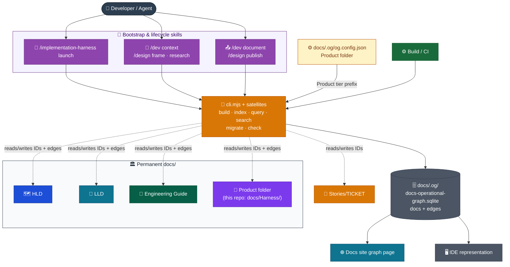
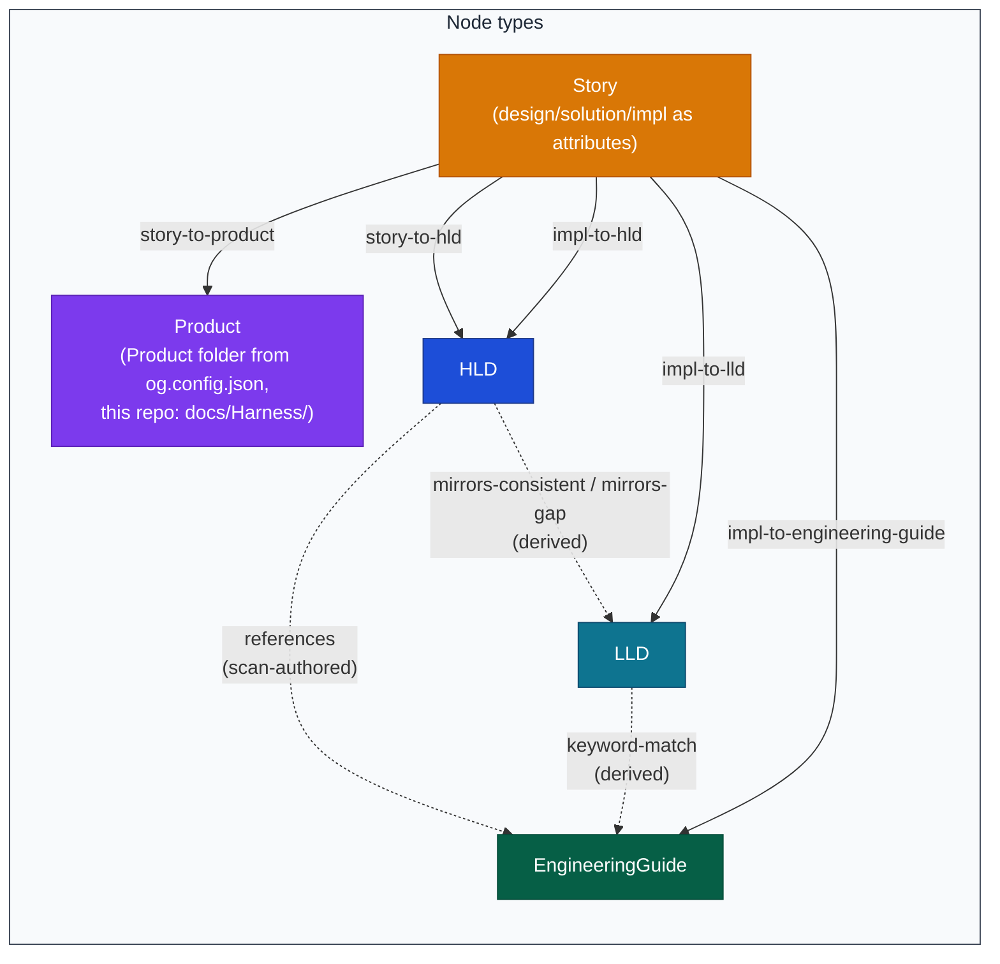
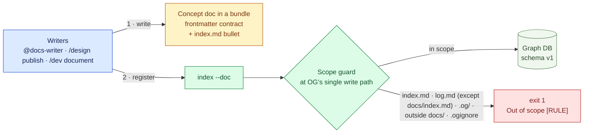
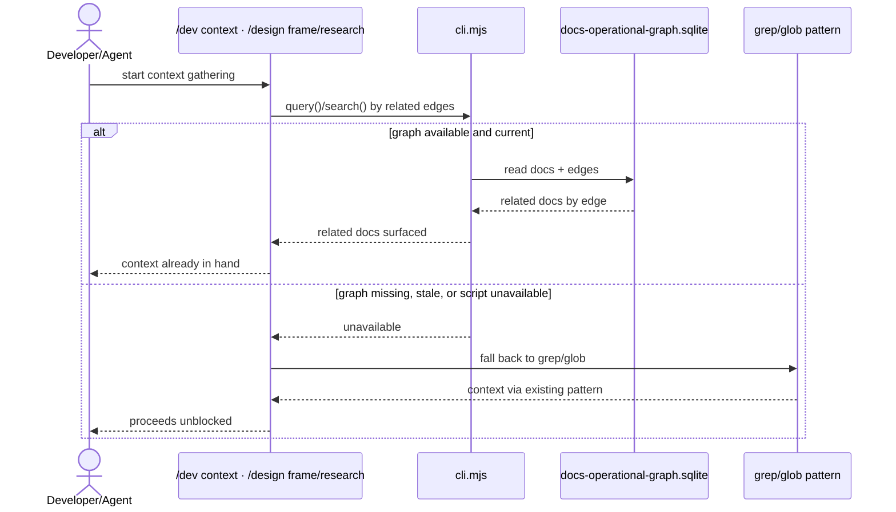
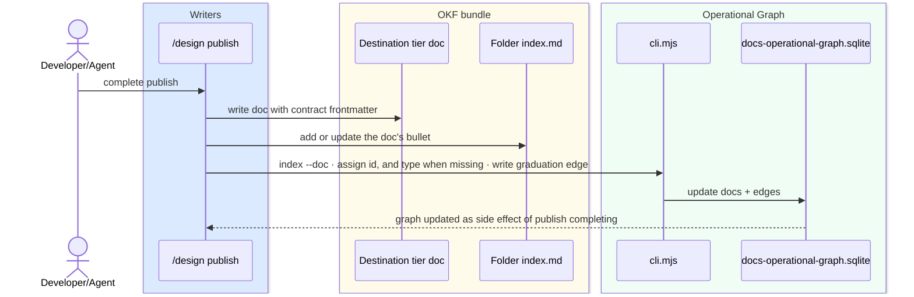
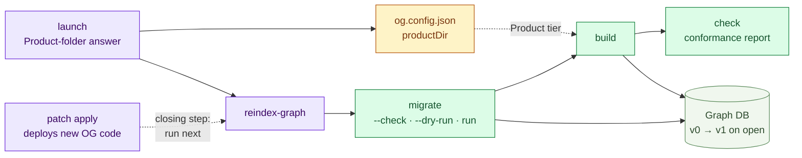
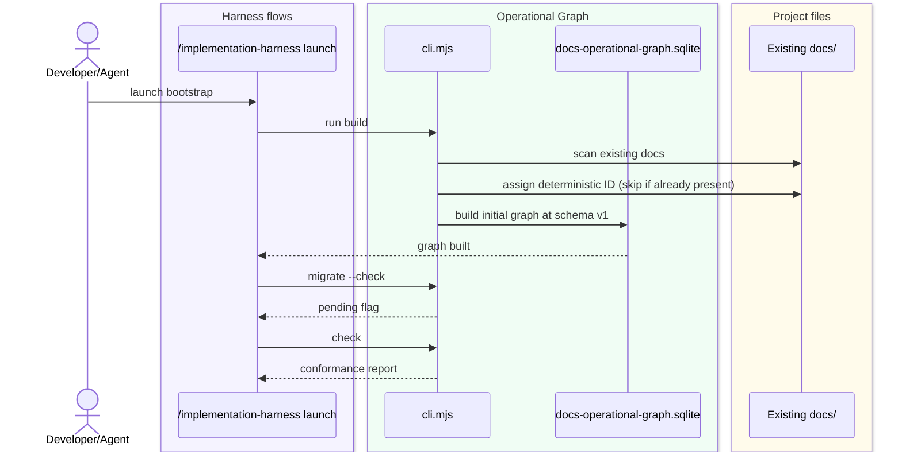

# Ops Model

The knowledge graph is additive tooling: a CLI entry (`cli.mjs`) plus its satellite modules (`constants.mjs`, `utils.mjs`, `docs.mjs`, `edges.mjs`, `schema.mjs`) and one SQLite file (`docs/.og/docs-operational-graph.sqlite`), consumed by the existing docs site build. No new container joins the architecture, and the existing browser-to-hosting data flow is unchanged — the graph page ships as part of the same static build output.

## System context

> Applies from the major harness release that introduces OG schema v1.

OG reads and writes only under `docs/`. The Product folder comes from `docs/.og/og.config.json`.

## Node and edge model

> Applies from the major harness release that introduces OG schema v1.

A Story's `design/`, `solution/`, `impl/` subfolders are attributes of its single `Story` node, not separate sub-nodes. Each project bootstrapping the harness instantiates its own `Product` tier under its own name; this repo's instance is `docs/Harness/`.

Nine edge types exist in total, in three families, per `docs/.og/constants.mjs`:

- **`EDGE_TYPES`** (5 types, `derived=0`): `story-to-product`, `story-to-hld`, `impl-to-hld`, `impl-to-lld`, `impl-to-engineering-guide` — the named graduation actions from `03 Lifecycles/05 Documents Flow.md`, each authored as a Story-to-destination-tier edge by `index()`'s `--edge` flag.
- **`SCAN_EDGE_TYPES`** (1 type, `derived=0`): `references` — a generic content cross-reference, authored by `reindex-graph.md`'s intelligent scan when a doc's content names another doc it references, not a graduation event.
- **`DERIVED_EDGE_TYPES`** (3 types, `derived=1`): `mirrors-consistent`/`mirrors-gap`, computed by diffing HLD container file names (`Target Architecture (HLD)/<Version>/Containers/<Name>.md`) against LLD folder names (`System Architecture (LLD)/<Name>/`), per the naming convention in `docs/Engineering Guide/Documentation/02 Structure.md`; and `keyword-match`, computed from shared `tags:` frontmatter tokens between any two docs. Neither pair is ever authored.

HLD version supersession is not modeled as a graph edge — the existing folder-per-version/README-router convention already covers it.

The docs-site Graph Explorer groups these nine types into four visual/filter buckets: `keyword-match` (automatic, the largest group, with the most recessive styling), `references` (scan-authored content links), `graduation` (the five `EDGE_TYPES`), and `mirrors` (the `mirrors-*` pair). See `03 Visualization Model.md`.

## Graph type

> Applies from the major harness release that introduces OG schema v1.

Nodes are typed — each is one of the five types above. Edges are typed and directed — each of the nine types above has a defined source-tier → destination-tier meaning, except `references` and `keyword-match`, which may connect any two tiers. A `derived` flag on each edge distinguishes the six authored edges (the five graduation types plus `references`, written by a lifecycle action or the intelligent scan) from the three computed edges (`mirrors-consistent`, `mirrors-gap`, `keyword-match`, never authored). Cycles are permitted — edges are typed relationship statements, not a dependency or control-flow order, so nothing in this design enforces acyclicity.

## Settled interfaces

> Applies from the major harness release that introduces OG schema v1.

| Component                                | Settled interface                                                                                                                                                                                                                                                                                                                                                                                                             |
| ---------------------------------------- | ----------------------------------------------------------------------------------------------------------------------------------------------------------------------------------------------------------------------------------------------------------------------------------------------------------------------------------------------------------------------------------------------------------------------------- |
| `cli.mjs` (+ satellites)                 | The script. Ships from the canonical shipping root `skills/implementation-harness/canonical/docs/.og/`, deployed into a project's `docs/.og/` by `/implementation-harness launch`'s Materialize stage, by `/implementation-harness patch apply` on update, or by the standalone `/implementation-harness reindex-graph` route.                                                                                                |
| `docs/.og/docs-operational-graph.sqlite` | The data file. Sole producer and consumer is `cli.mjs`.                                                                                                                                                                                                                                                                                                                                                                       |
| `docs/.og/og.config.json`                | Names the Product folder: `{"productDir": "docs/Harness"}`. Project-owned; patches never overwrite it. An absent file or key means no Product tier. An invalid value (outside `docs/`, `docs/.og`, or equal to or overlapping another tier root) is ignored and reported as `invalidConfig`; `index --doc` on a path under it exits 1 naming `invalidConfig`. Tier names are static; only the path prefixes come from config. |
| `migrate`                                | Brings a project's docs to the frontmatter contract and the OKF layout in one idempotent pass. See [Storage and Build Model → `migrate`](<./02 Storage and Build Model.md#migrate>).                                                                                                                                                                                                                                          |
| `check`                                  | Prints the conformance report as JSON and exits 0. See [Knowledge Base Format → Conformance check](<./05 Knowledge Base Format.md#conformance-check>).                                                                                                                                                                                                                                                                        |

## Scope guard

> Applies from the major harness release that introduces OG schema v1.

The scope guard decides which paths OG may index or write. It runs at OG's single write path and in the reindex walker.

A path is in scope only when it passes every rule. Rules run in order; the first failing rule wins.

| Rule id             | A path passes when                                                                                                                                                 |
| ------------------- | ------------------------------------------------------------------------------------------------------------------------------------------------------------------ |
| `outside-docs`      | It is under `docs/`                                                                                                                                                |
| `og-internal`       | It is not under `docs/.og/`                                                                                                                                        |
| `reserved-basename` | It is not an `index.md` or `log.md` at any depth, compared case-insensitively. `docs/index.md` is the one exception. The rule does not depend on `og.config.json`. |
| `ogignore`          | It matches no prefix in `docs/.ogignore`                                                                                                                           |

The error message is `Out of scope [RULE]: PATH`.

| Command                     | On an out-of-scope path             |
| --------------------------- | ----------------------------------- |
| `index --doc`, `index --to` | Exits 1 and writes nothing          |
| `reindex`, `build`          | Skips the file silently and exits 0 |

- `scopeViolations` in the `reindex`/`build` JSON lists only out-of-scope files that still carry `id:`, plus rows pruned because their path is now out of scope.
- Prune safety: the row of an out-of-scope `index.md` stays while that file still carries the row's `id:`. Once the `id:` is gone, every authored edge on the row is listed in `orphanedAuthored` before it is deleted with the row.
- Only `migrate` may write an `index.md` other than `docs/index.md`.
- Stray-id cleanup outside `docs/` is the one bounded exception to writing only under `docs/`. Only `migrate` does it, and only on git-tracked `.md` files whose sole frontmatter key is an OG-shaped `id` that no row owns.

Retired: the `AppReadme` tier and the `impl-to-readme` edge type. `migrate` re-types existing `impl-to-readme` edges to `references`. When a `references` edge already joins the same pair, the two merge into one.

## Lifecycle wiring

> Applies from the major harness release that introduces OG schema v1.

Read is required at Context Gathering/Research (`/dev context`, `/design frame`/`research`), with required fallback to existing grep/glob when the graph is missing, stale, or unavailable.

Write is required but tool-automated, not manually authored, at Document/Publish (`/dev document`, `/design publish`): the writer writes the doc with contract frontmatter and adds its bullet to the folder `index.md`; the same script assigns `id`, and `type` when missing, and writes the corresponding graduation edge as a side effect of completing.

Context Gathering and Research query the graph first, with a required fallback to the existing grep/glob pattern when it isn't available:

`/dev document` updates app READMEs through `@docs-writer` and records them in the story's `2-report.md` only. An app README is not a graph node and gets no edge.

## Bootstrap and upgrade wiring

> Applies from the major harness release that introduces OG schema v1.

Patch apply and launch both lead to `reindex-graph`, which runs `migrate`, `build` and `check` in that order.

The script ships from the canonical shipping root `skills/implementation-harness/canonical/docs/.og/`. `/implementation-harness launch`'s Materialize stage deploys it into the project's `docs/.og/` and runs it proactively: it assigns deterministic, collision-safe frontmatter IDs to any doc missing one and builds the initial graph in the same pass, silently on success. The standalone `/implementation-harness reindex-graph` route deploys and runs the same script on demand, without a full launch. `/implementation-harness patch apply` deploys updated OG code into an installed project; it never runs the script.

`/implementation-harness launch` invokes the same script to seed the graph for an existing doc tree:

| Flow                                 | Behaviour                                                                                                                                                                                                                                             |
| ------------------------------------ | ----------------------------------------------------------------------------------------------------------------------------------------------------------------------------------------------------------------------------------------------------- |
| `launch`                             | Writes `docs/.og/og.config.json` from the launch Product-folder answer ("none" → `{}`). Creates the bundle root `index.md` files and the DB at v1. Graph verify runs `migrate --check` and `check`.                                                   |
| `launch` into a pre-existing `docs/` | Shows `migrate --dry-run`, asks the developer to confirm, then runs `migrate --allow-dirty`.                                                                                                                                                          |
| `reindex-graph`                      | Runs `migrate --check`. On `missingConfig` it asks for the Product folder and writes `og.config.json` before the dry-run. When pending, it shows `migrate --dry-run`, asks the developer to confirm, then runs `migrate`. Then `build`, then `check`. |
| `reindex-graph`, `migrate` exits 1   | Stops, prints the reason and skips `build`.                                                                                                                                                                                                           |
| `reindex-graph`, developer declines  | Skips `migrate`, still runs `build` and `check`, and reports "migration pending".                                                                                                                                                                     |
| `patch apply`                        | Never runs a migration. When OG files changed, its closing step tells the developer to run `/implementation-harness reindex-graph`.                                                                                                                   |

`reindex-graph` always prints the `check` report.

## Visualization surface

Both an IDE-side representation and a docs-site graph page exist, sharing one SQLite data source. The docs-site page queries it client-side in the browser. See `03 Visualization Model.md` for the data-access pattern.
