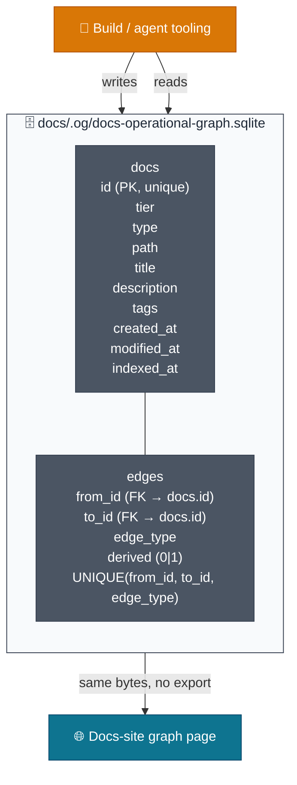
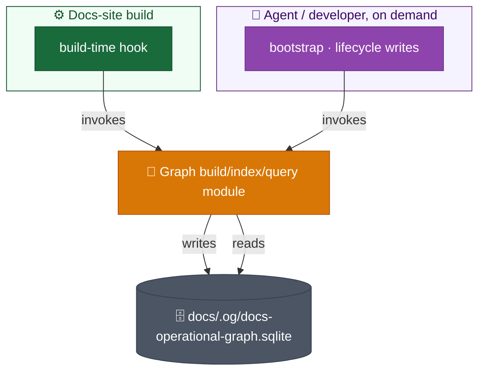

# Storage and Build Model

The graph is one SQLite file, `docs/.og/docs-operational-graph.sqlite`, with two tables — `docs` and `edges`. The same file is read and written from the build/agent tooling and queried directly by the browser, with no export or conversion step between them.

## Schema

> Applies from the major harness release that introduces OG schema v1.

| Column        | Description                                     |
| ------------- | ----------------------------------------------- |
| `id`          | Primary key, unique, stable identity.           |
| `tier`        | One of HLD/LLD/EngineeringGuide/Story/Product.  |
| `type`        | The doc's OKF `type`.                           |
| `path`        | Relative repo path.                             |
| `title`       | Human-readable title.                           |
| `description` | Nullable — the doc's one-line description.      |
| `tags`        | Nullable — search tags from frontmatter.        |
| `created_at`  | From frontmatter `generated.at`.                |
| `modified_at` | From frontmatter `updated.at`.                  |
| `indexed_at`  | Time of the last OG index run touching the row. |

One row per indexed doc.

| Column      | Description                                                                                                                                                                |
| ----------- | -------------------------------------------------------------------------------------------------------------------------------------------------------------------------- |
| `from_id`   | Foreign key into `docs.id`.                                                                                                                                                |
| `to_id`     | Foreign key into `docs.id`.                                                                                                                                                |
| `edge_type` | One of the nine types in `01 Ops Model.md`'s node and edge model.                                                                                                          |
| `derived`   | Flag distinguishing the six authored edges (five graduation types plus `references`) from the three computed edges (`mirrors-consistent`, `mirrors-gap`, `keyword-match`). |

One row per typed edge between two doc IDs, in the `edges` table. Composite uniqueness on `(from_id, to_id, edge_type)` — the same edge between the same two docs is never recorded twice; a repeat write upserts rather than duplicating.

### Why an edge list, not a single parent reference

The `edges` table is an edge list, not a single parent reference per doc. A doc can have multiple outgoing edges of different types in the same build — for example, one Story doc producing edges to an HLD doc, an LLD doc, and an Engineering Guide doc, all at once, each a different edge type. A single parent reference allows only one parent per doc and cannot represent this, nor the derived mirror edge, which relates two already-existing docs to each other rather than expressing a parent-child relation.

### Example

Sample `docs` rows:

| id                | tier             | path                                             | title         |
| ----------------- | ---------------- | ------------------------------------------------ | ------------- |
| `s-20261102-a1b2` | Story            | `Stories/[ND-42] Example/design/`                | Example Story |
| `hld-web`         | HLD              | `Target Architecture (HLD)/v1/Containers/Web.md` | Web           |
| `lld-web`         | LLD              | `System Architecture (LLD)/Web/00. Overview.md`  | Web Overview  |
| `eg-deploy`       | EngineeringGuide | `Engineering Guide/12 Deploy.md`                 | Deploy        |

Sample `edges` rows:

| from_id           | to_id       | edge_type                   | derived |
| ----------------- | ----------- | --------------------------- | ------- |
| `s-20261102-a1b2` | `hld-web`   | `story-to-hld`              | 0       |
| `s-20261102-a1b2` | `lld-web`   | `impl-to-lld`               | 0       |
| `s-20261102-a1b2` | `eg-deploy` | `impl-to-engineering-guide` | 0       |
| `hld-web`         | `lld-web`   | `mirrors-consistent`        | 1       |

One Story produces three authored edges to three different destination tiers in the same build; the fourth row is the derived mirror edge between the HLD and LLD docs, computed from their matching names, unrelated to the Story.

## Frontmatter format

> Applies from the major harness release that introduces OG schema v1.

Every indexed doc carries the frontmatter contract. Its keys, owners and accepted YAML are in [Knowledge Base Format → Frontmatter contract](<./05 Knowledge Base Format.md#frontmatter-contract>). OG maps the keys to columns:

| Frontmatter key | Column                            |
| --------------- | --------------------------------- |
| `id`            | `docs.id`                         |
| `type`          | `docs.type`                       |
| `title`         | `docs.title`                      |
| `description`   | `docs.description`                |
| `tags`          | `docs.tags`                       |
| `generated.at`  | `docs.created_at`                 |
| `updated.at`    | `docs.modified_at`                |
| —               | `docs.indexed_at` (OG index time) |

### Why a stable string identity, not an internal counter

Each doc's ID is a stable string stored in the doc's own frontmatter, not an internal counter assigned by the data store. This is required because the graph must be deterministically regenerable from frontmatter alone — an internal counter's value would depend on build order and could change on a from-scratch rebuild, breaking the stable-identity requirement — and because the ID must be readable directly from the doc file, without querying the data store first.

## Build mechanism

> Applies from the major harness release that introduces OG schema v1.

A single script module is the one producer of `docs-operational-graph.sqlite`. It is invoked two ways, both calling the identical module — there is no second script and no new standing infrastructure.

The first invocation path runs automatically as part of the existing docs-site build. The second is called directly by an agent or developer on demand — bootstrap, and lifecycle writes at Document/Publish time. Both paths call the same module; neither owns a separate copy of the build logic. The same scan that extracts `title` from frontmatter also extracts `description` and `tags`.

- `reindex` and `build` write only `id` into a doc, never `type`.
- They exit 0 and report `frontmatterErrors`, `scopeViolations` and `orphanedAuthored` in their JSON output.
- Read-compat window: until a project is migrated, `build` and `reindex` read `description`, else `purpose`, and `tags`, else `keywords`. The major release after the one that introduces schema v1 removes the window.

## Schema versioning

> Applies from the major harness release that introduces OG schema v1.

OG versions the schema with `PRAGMA user_version` and migrates the DB in place when it opens it.

| DB on open                      | OG does                                                                                                                           |
| ------------------------------- | --------------------------------------------------------------------------------------------------------------------------------- |
| No DB file                      | Creates the DB at v1                                                                                                              |
| v0                              | Copies it to `docs/.og/docs-operational-graph.v0.bak.sqlite`, then migrates it to v1 in one transaction. Rows and edges are kept. |
| v0, a migration statement fails | Rolls back. The DB stays v0. Exits 1 and names the statement.                                                                     |
| v1                              | Nothing                                                                                                                           |
| Newer than this OG supports     | Exits 1 and writes nothing                                                                                                        |

- The v0 backup is git-ignored. It may be deleted once the migrated project is committed. `check` never needs it.
- Rolling back OG code also restores the v0 DB, from the backup or from git.

## `migrate`

> Applies from the major harness release that introduces OG schema v1.

`node docs/.og/cli.mjs migrate --dir ROOT [--check] [--dry-run] [--allow-dirty]` brings a project's docs to the frontmatter contract and the OKF layout in one idempotent pass. A second run changes nothing.

| Flag            | Effect                                                                                         |
| --------------- | ---------------------------------------------------------------------------------------------- |
| (none)          | Runs every step and writes files                                                               |
| `--check`       | Writes no doc files. Prints `{pending, counts, missingConfig, invalidConfig}`. Always exits 0. |
| `--dry-run`     | Writes no doc files. Runs every step in memory and prints the same JSON as a real run.         |
| `--allow-dirty` | Skips the clean-worktree precondition                                                          |

`--check` and `--dry-run` may still run the on-open schema migration, with its backup.

**Precondition.** `migrate` refuses dirty `.md` files: those under `docs/` and the files the stray-id cleanup will touch. Changes under `docs/.og/` never count as dirty.

**Pending.** `--check` reports `pending: true` when any of these holds:

- An in-scope doc has `purpose:` or `keywords:`, or lacks `type`.
- An `index.md` other than `docs/index.md` carries OG keys (`id`, `purpose`, `keywords`).
- A content-bearing `index.md` still holds its prose.
- A folder is in `overviewConflicts`.
- A present bundle root lacks `index.md`, or its `index.md` lacks `okf_version: "0.2"`.

**Steps**, in order:

| #   | Step                      | What it does                                                                                                                                                                                           |
| --- | ------------------------- | ------------------------------------------------------------------------------------------------------------------------------------------------------------------------------------------------------ |
| 1   | Config                    | Creates `docs/.og/og.config.json` when absent, from the launch Product-folder answer. Writes `{}` when that answer is "none" or the launch answers record the project as Project-scoped.               |
| 2   | Prose move and navigation | Moves each content-bearing `index.md`'s prose to `00 Overview.md` in the same folder, with its `id`. Writes the `index.md` bullets: `00 Overview` first, then each concept doc in file-name order.     |
| 3   | Authored-edge cleanup     | Re-types `impl-to-readme` edges to `references`. Merges duplicate pairs.                                                                                                                               |
| 4   | Frontmatter rewrite       | Rewrites every in-scope doc to the frontmatter contract: renames `purpose` → `description` and `keywords` → `tags`, seeds `title`, `type`, `generated` and `updated` with `by: process:okf-migration`. |
| 5   | Strip OG keys             | Removes `id`, `purpose` and `keywords` from every `index.md` except `docs/index.md`                                                                                                                    |
| 6   | Bundle roots              | Creates each missing bundle root `index.md`, or adds `okf_version: "0.2"` to an existing one                                                                                                           |
| 7   | Stray-id cleanup          | Removes an unowned OG-shaped `id` from git-tracked `.md` files outside `docs/` when it is the only frontmatter key. Reports any other case.                                                            |
| 8   | Reindex                   | Rebuilds the graph from the rewritten files                                                                                                                                                            |
| 9   | Report                    | Prints the JSON result                                                                                                                                                                                 |

- Step 4 seeds `generated.at` from the file's first git commit and `updated.at` from its last, converted to UTC. A file with no git history gets the current time.
- `migrate` leaves `docs/index.md` unchanged.
- In approved and archived Story files, `migrate` edits frontmatter only.
- **Overview collision.** When a folder already has a `00 Overview.md`, `migrate` lists it in `overviewConflicts` and leaves the folder unchanged. `--check` stays pending until a writer resolves it.

| Report key          | Lists                                                              |
| ------------------- | ------------------------------------------------------------------ |
| `needsWriter`       | Docs a writer must fix, as `{ path, reason, line? }`               |
| `overviewConflicts` | Folders whose `00 Overview.md` already existed                     |
| `mergedEdges`       | Count of re-typed edges merged into an existing `references` edge  |
| `missingConfig`     | `true` when `og.config.json` is absent and no launch answer exists |
| `invalidConfig`     | The reason `og.config.json` was ignored, or `null`                 |
| `orphanedAuthored`  | Authored edges on pruned rows                                      |

`migrate` exits 1 only when it refuses to run: dirty `.md` files without `--allow-dirty`, a DB newer than this OG, or a failed on-open schema migration. Report-only items exit 0.

## Compatibility rule

> Applies from the major harness release that introduces OG schema v1.

Schema changes are versioned with `PRAGMA user_version` and migrated in place by OG on open. Authored edges are always preserved. `id` and the `(from_id, to_id, edge_type)` composite uniqueness constraint are stable contracts that any consumer — tooling or browser — can rely on indefinitely.
