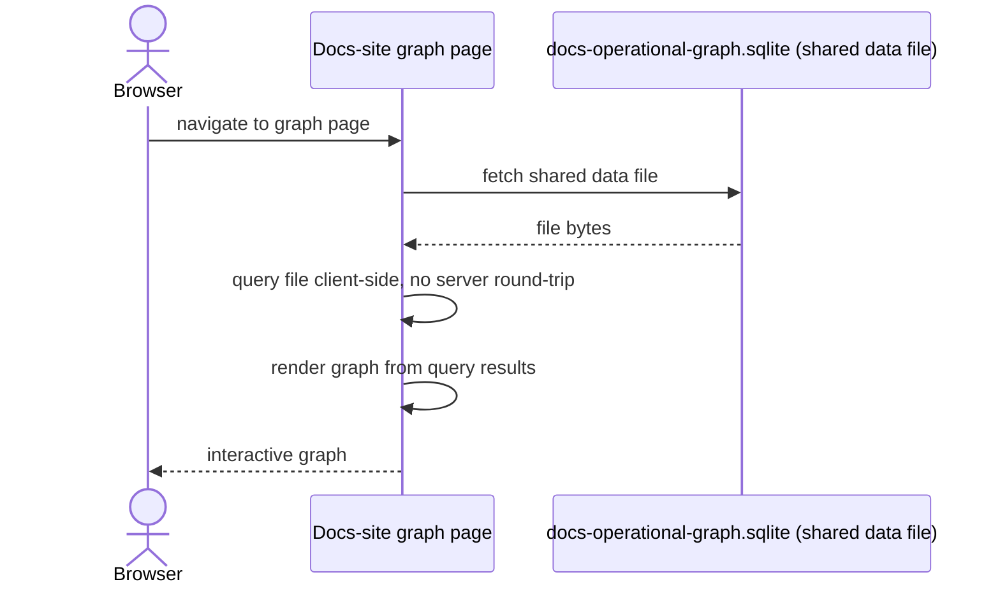

# Visualization Model

Two graph surfaces are required, and both read the one SQLite data file as their single source of truth: the docs-site Graph Explorer and the IDE-side `docs/.og/graph.mmd`, which `build` regenerates from that file. Neither required surface uses a separate export or a hand-maintained copy.

Web Explorer's Dogfood page is the one allowed exception: it renders `apps/web-explorer/src/pages/dogfood/graph.json`, a derived, non-authoritative copy that a developer refreshes by hand with the export script (see [Compatibility rule](#compatibility-rule)).

## Data-access pattern

The docs-site page fetches the shared data file and queries it directly in the browser, client-side, with no server round-trip and no JSON export in between. The specific browser-side query technology and the specific graph-rendering library are not fixed by this model.

The IDE-side representation, `docs/.og/graph.mmd`, comes from the same data file: `build` regenerates it on every run, so nobody edits or refreshes it by hand.

## Node coloring

> Applies from harness 4.2.0, which introduces OG schema v1.

The populated graph colors nodes by tier, reusing the palette already established for Mermaid diagrams across this repo:

| Tier             | Color                                                  |
| ---------------- | ------------------------------------------------------ |
| HLD              | `#1D4ED8` (blue)                                       |
| LLD              | `#0E7490` (teal)                                       |
| EngineeringGuide | `#065F46` (green)                                      |
| Story / Product  | `#D97706` (Story, amber) / `#7C3AED` (Product, purple) |

## Compatibility rule

> Applies from harness 4.2.0, which introduces OG schema v1.

The docs-site page reads only `docs.id`, `tier`, `path` and `title`, plus the `edges` contract: the `(from_id, to_id, edge_type)` composite uniqueness defined in `02 Storage and Build Model.md`. Schema v1 keeps these names.

Web Explorer's `apps/web-explorer/scripts/export-dogfood-graph.mjs` also reads the DB: `docs.id`, `tier`, `title` and `path`, and `edges.from_id`, `to_id` and `edge_type` where `derived = 0`. A schema change must keep this script working too.
