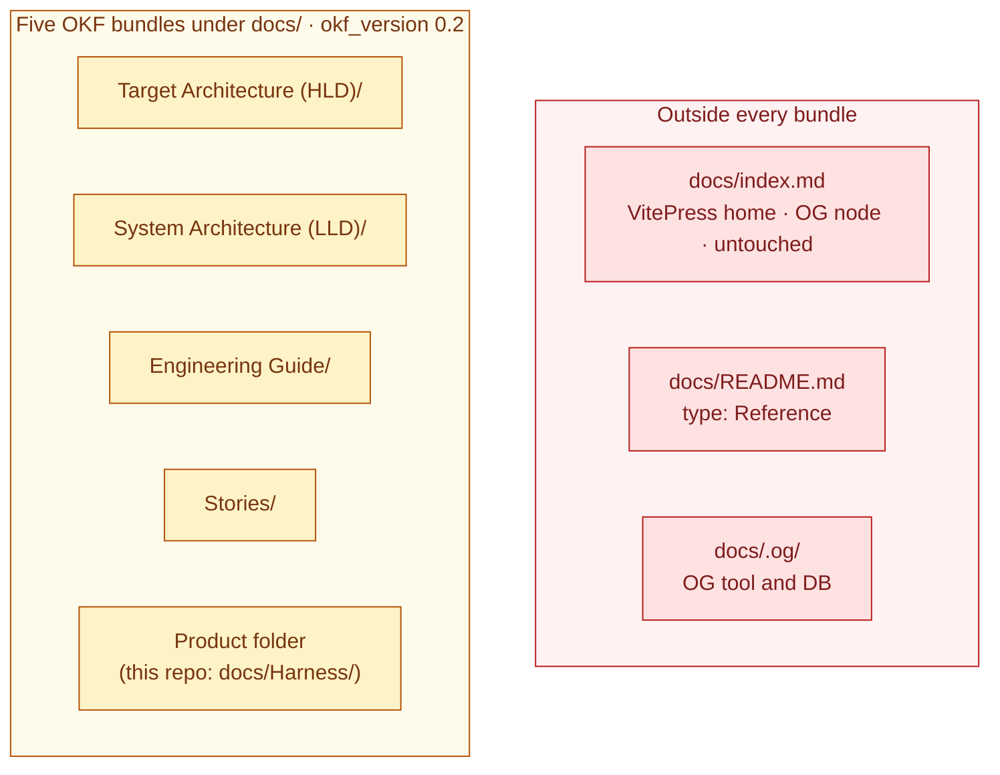

# Knowledge Base Format

> Applies from the major harness release that introduces OG schema v1.

The docs tree is an OKF 0.2 knowledge base: five OKF bundles, one frontmatter contract, and the operational graph (OG) as the only query source. Skills query OG only. No skill reads a bundle file as a query source.

## Bundles

Each OG tier root is one OKF bundle. Three items under `docs/` sit outside every bundle.



| Bundle            | Root                                                                                       |
| ----------------- | ------------------------------------------------------------------------------------------ |
| HLD               | `docs/Target Architecture (HLD)/`                                                          |
| LLD               | `docs/System Architecture (LLD)/`                                                          |
| Engineering Guide | `docs/Engineering Guide/`                                                                  |
| Stories           | `docs/Stories/`                                                                            |
| Product           | The Product folder, `productDir` in `docs/.og/og.config.json` (this repo: `docs/Harness/`) |

A missing tier root is an absent bundle. A project with no Product folder has four bundles.

| Outside item     | Role                                                                                                                     |
| ---------------- | ------------------------------------------------------------------------------------------------------------------------ |
| `docs/index.md`  | VitePress home. An in-scope OG node. `migrate` never changes it. The only doc with `layout`, `hero` and `features` keys. |
| `docs/README.md` | Root router. A graph node with `type: Reference`.                                                                        |
| `docs/.og/`      | OG tool, DB and `og.config.json`. Never a doc.                                                                           |

`log.md` is not adopted. The scope guard keeps every `index.md` and `log.md` except `docs/index.md` out of the graph. See [Ops Model → Scope guard](<./01 Ops Model.md#scope-guard>).

## Bundle root `index.md`

The bundle root `index.md` has one frontmatter key, `okf_version: "0.2"`, and a body of headings and link bullets.

```markdown
---
okf_version: '0.2'
---

# Registry

- [Component Registry](README.md) - Which LLD component docs exist and which container owns each

# Web Docs

- [Web Docs Overview](Web%20Docs/00.%20Overview.md) - DESCRIPTION
```

- The body is `# Section` headings, each followed by `* [Title](relative-url) - description` bullets.
- No other frontmatter key. No `id`. It is never a graph node.
- Single and double quotes are both accepted for `okf_version`. `*` and `-` bullets are both accepted.

| Situation                                               | Creator                                                                                          |
| ------------------------------------------------------- | ------------------------------------------------------------------------------------------------ |
| Greenfield launch                                       | Launch, one per tier root it creates. The Product root only when a Product folder is configured. |
| Project upgraded from an older harness                  | `migrate` creates a missing root `index.md` or adds `okf_version` to an existing one             |
| First doc written into a bundle with no root `index.md` | `@docs-writer`, with `okf_version: "0.2"` only and a bullets body                                |

## Section `index.md`

A section `index.md` is navigation only: no frontmatter, and only headings, blank lines and link bullets.

- It is optional. Story folders need none.
- It is never a graph node.
- Each bullet takes the target doc's `title` and `description`.
- Links are file-relative, with spaces URL-encoded (`00%20Overview.md`).

An `index.md` is content-bearing when its body holds anything besides headings, blank lines and link-only bullets (`* [Title](url)`, optionally followed by ` - text`). `migrate` moves the prose of a content-bearing `index.md` to `00 Overview.md` in the same folder. That page keeps the old index page's `id` and authored edges, and takes the bundle's mapped type. The `index.md` gets a first bullet linking `00 Overview`, then one bullet per concept doc in the folder, in file-name order. See [Storage and Build Model → `migrate`](<./02 Storage and Build Model.md#migrate>).

### Writer upkeep

Writers keep the folder `index.md` current. Writers are `@docs-writer`, `/design publish` and `/dev document`.

| Writer change                                          | `index.md` edit                                                  |
| ------------------------------------------------------ | ---------------------------------------------------------------- |
| Adds a concept doc                                     | Add a bullet in that folder's `index.md`, if the folder has one  |
| Adds the first doc to a bundle with no root `index.md` | Create the bundle root `index.md`                                |
| Renames or moves a doc                                 | Update the title and URL. Move the bullet if the folder changed. |
| Removes a doc                                          | Remove its bullet                                                |
| Changes a doc's `description`                          | Update the bullet description                                    |

## Frontmatter contract

Every in-scope doc carries the same keys in a fixed order: `id`, `type`, `title`, `description`, `tags`, `generated`, `updated`.

```yaml
---
id: f84dc7bb
type: Container
title: Discuss Container
description: One-line summary of what the doc is for
tags: [discuss, giscus, hld]
generated: { by: process:design-publish, at: 2026-11-02T09:00:00Z }
updated: { by: process:design-publish, at: 2026-11-17T10:00:00Z }
---
```

| Key           | Required by | Value                                                    | Owner                                                                 |
| ------------- | ----------- | -------------------------------------------------------- | --------------------------------------------------------------------- |
| `id`          | OG          | 8 hex chars, optional `-N` suffix                        | OG, once. Never reassigned.                                           |
| `type`        | OKF         | A type from the canonical type map                       | Template, or OG once from the type map when missing. Then the author. |
| `title`       | —           | Plain string                                             | `migrate` once from the H1. Then the writer.                          |
| `description` | Harness     | One line, quoted when it holds a YAML-reserved character | Writer                                                                |
| `tags`        | Harness     | Inline flow list `[a, b]`                                | Writer                                                                |
| `generated`   | —           | One-line mapping `{ by, at }`                            | Writer at creation, once                                              |
| `updated`     | —           | One-line mapping `{ by, at }`                            | Writer on each meaningful update                                      |

- Only `index --doc` and `migrate` stamp `type`. `reindex` and `build` write `id` only.
- OG never stamps time.
- Times are ISO 8601 in UTC with a `Z` suffix.

| `by` actor                    | Used by                                         |
| ----------------------------- | ----------------------------------------------- |
| `artisyn-harness/MAJOR.MINOR` | Agent writers                                   |
| `process:LIFECYCLE`           | A lifecycle step, e.g. `process:design-publish` |
| `process:okf-migration`       | `migrate`                                       |
| `human:…`                     | Never used. The docs site is public.            |

### Accepted YAML

Writers emit the canonical forms: an inline flow list for `tags` and a one-line `{ by, at }` mapping for `generated` and `updated`. OG also reads the forms below.

| Accepted                                                    | Rejected                      |
| ----------------------------------------------------------- | ----------------------------- |
| Plain scalars                                               | Nesting deeper than one level |
| Single- and double-quoted scalars                           | Anchors and aliases           |
| Inline flow lists, Prettier-wrapped flow lists, block lists | Multi-document blocks         |
| One-line flow mappings, one-level block mappings            |                               |

A rejected form never removes a doc from the graph.

| Command             | On a rejected form                                                      | Exit |
| ------------------- | ----------------------------------------------------------------------- | ---- |
| `index --doc`       | Stops and names the file and the line                                   | 1    |
| `reindex` / `build` | Indexes the keys it can parse. Lists the doc under `frontmatterErrors`. | 0    |
| `check`             | Lists the doc under `frontmatterErrors`                                 | 0    |
| `migrate`           | Leaves the file unchanged. Lists it under `needsWriter`.                | 0    |

## Canonical type map

OG gives a doc its default `type` from the canonical type map. Patterns are relative to the bundle root. Within a bundle the first match wins.

| Bundle            | Path pattern                      | `type`                        |
| ----------------- | --------------------------------- | ----------------------------- |
| HLD               | `**/Containers/*.md`              | `Container`                   |
| HLD               | `**/Non-Functional Concerns/*.md` | `Non-Functional Requirements` |
| HLD               | `**/System Overview.md`           | `System Overview`             |
| HLD               | `**/System Sizing.md`             | `System Sizing`               |
| HLD               | `README.md`                       | `Version Router`              |
| HLD               | fallback                          | `HLD`                         |
| LLD               | `README.md`                       | `Component Registry`          |
| LLD               | `*/*.md`                          | `Component Design`            |
| LLD               | fallback                          | `LLD`                         |
| Engineering Guide | any                               | `Guide`                       |
| Product           | any                               | `Product Concept`             |
| Stories           | `**/design/00 Frame.md`           | `Design Frame`                |
| Stories           | `**/design/01 Research*.md`       | `Design Research`             |
| Stories           | `**/design/02 Evaluate*.md`       | `Design Evaluation`           |
| Stories           | `**/design/Report.md`             | `Design Report`               |
| Stories           | `**/solution/Architecture.md`     | `Solution Architecture`       |
| Stories           | `**/solution/Design*.md`          | `Solution Design`             |
| Stories           | `**/solution/Stack.md`            | `Solution Stack`              |
| Stories           | `**/solution/Efforts.md`          | `Solution Efforts`            |
| Stories           | `**/impl/0-intent.md`             | `Dev Intent`                  |
| Stories           | `**/impl/1-plan.md`               | `Implementation Plan`         |
| Stories           | `**/impl/2-report.md`             | `Implementation Report`       |
| Stories           | fallback                          | `Story Note`                  |

- An untiered doc under `docs/` (for example `docs/README.md`) gets `Reference`.
- README routers stay concepts: `Version Router` and `Component Registry`.
- A `00 Overview.md` created by `migrate` takes its bundle's mapped type.

## Links and IDs

Links are file-relative. A doc's OKF concept ID is its path inside the bundle. A Story's concept IDs change when its folder moves to `approved/`, `declined/` or `archive/`. The OG `id` does not change, so graph edges stay attached.

## Conformance check

`node docs/.og/cli.mjs check --dir ROOT` prints a JSON conformance report and exits 0. It never writes files. `reindex-graph` prints it after `build`.

| Key                  | Lists                                                                           |
| -------------------- | ------------------------------------------------------------------------------- |
| `missingFields`      | In-scope docs that lack `type`, `description` or `tags`                         |
| `brokenIndexEntries` | `index.md` bullets that point at a missing file                                 |
| `unlistedConcepts`   | Concept docs whose own folder has an `index.md` that does not link them         |
| `unversionedBundles` | Present bundle roots with no `index.md`, or an `index.md` without `okf_version` |
| `frontmatterErrors`  | Docs whose frontmatter uses a rejected YAML form (path, line, reason)           |
| `counts`             | One count per key above                                                         |

`unlistedConcepts` checks only folders that have an `index.md`. `check` does not report `docs/index.md`.
