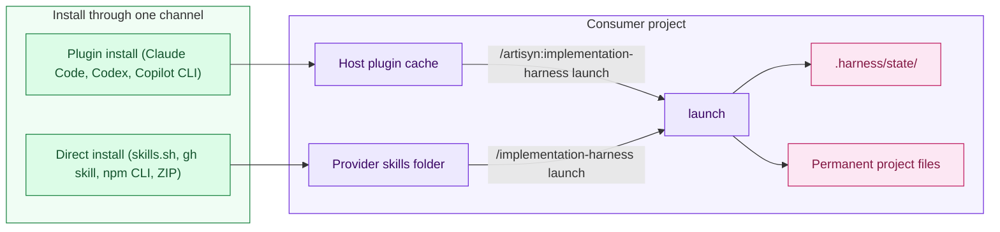

# Install

> Applies from release 4.0.0, the first release cut by the release pipeline.

Install the package through one channel, then run `launch`; launch creates the project's `.harness/state/`.



## Install by channel

Each channel has one install step and one launch command.

| Channel               | Install                                                                                                                                                                                                                                                                                                                | Launch                                                                                                                          |
| --------------------- | ---------------------------------------------------------------------------------------------------------------------------------------------------------------------------------------------------------------------------------------------------------------------------------------------------------------------- | ------------------------------------------------------------------------------------------------------------------------------- |
| Claude Code           | `claude plugin marketplace add DataArt/artisyn-implementation-harness`, then `claude plugin install artisyn@dataart`                                                                                                                                                                                                   | `/artisyn:implementation-harness launch`                                                                                        |
| Codex                 | `codex plugin marketplace add DataArt/artisyn-implementation-harness`, then install `artisyn` from `/plugins`                                                                                                                                                                                                          | `$artisyn:implementation-harness launch` (where Codex lists plugin skills without the prefix: `$implementation-harness launch`) |
| Copilot CLI           | `copilot plugin marketplace add DataArt/artisyn-implementation-harness`, then `copilot plugin install artisyn@dataart`                                                                                                                                                                                                 | `/artisyn:implementation-harness launch`                                                                                        |
| skills.sh             | `npx skills add DataArt/artisyn-implementation-harness --skill implementation-harness`                                                                                                                                                                                                                                 | `/implementation-harness launch`                                                                                                |
| gh skill              | `gh skill install DataArt/artisyn-implementation-harness implementation-harness@artisyn-implementation-harness-v<version> --scope project` (the `@<tag>` form is the only supported one)                                                                                                                               | `/implementation-harness launch`                                                                                                |
| npm (GitHub Packages) | `npx @dataart/artisyn-implementation-harness init`                                                                                                                                                                                                                                                                     | `/implementation-harness launch`                                                                                                |
| ZIP                   | Download `artisyn-implementation-harness-v<version>.zip` and its `.sha256` from the tag's GitHub Release, verify the checksum, unzip into `<provider>/skills/` (`.claude/skills/`, `.agents/skills/` or `.github/skills/`) — the ZIP's top folder is already `implementation-harness/` — or run the bundled CLI `init` | `/implementation-harness launch`                                                                                                |

Codex uses `$` instead of `/` for direct installs: `$implementation-harness launch`.

The `npx` commands are consumer-side: run them in the project that installs the harness. Inside this repository, the yarn-only rule still applies.

skills.sh discovery note: the repo's `skills.sh.json` (`paths: ["./skills"]`) only adds folders to the skills CLI's standard scan locations — it does not restrict discovery. The harness repo's own six deployed lifecycle skills stay out of the listing through `metadata.internal: true` in their frontmatter, so `npx skills add … --list` shows only the `implementation-harness` skill rather than the repo's internal skills.

## npm access

The npm channel needs a `read:packages` token; the token never goes into the repository.

```ini
@dataart:registry=https://npm.pkg.github.com
```

| Line          | Where it lives                                                       |
| ------------- | -------------------------------------------------------------------- |
| Scope mapping | The project `.npmrc`. It may be committed.                           |
| Token         | User npm config or an environment variable. Never in the repository. |

## What `init` does

`init` places the package and prepares the project for launch. The install CLI (`bin/artisyn-implementation-harness.mjs`, commands `init`, `update`, `doctor`) uses only Node built-ins and requires Node 22.2 or newer.

1. Detects `.claude/`, `.agents/` and `.github/` (in that order), or takes `--provider claude|codex|copilot` (repeatable). No provider found exits 2.
2. Places the package in the first selected provider's `skills/implementation-harness/`. A different installed version is refused unless `--force` is passed.
3. Creates `.harness/state/`, writes its ignore entries, and records the package with `--channel npm|zip` (default `npm`).
4. Prints the launch command in the provider's syntax.

| Option / variable              | Effect                                                                                   |
| ------------------------------ | ---------------------------------------------------------------------------------------- |
| `--dir <path>`                 | Project root. Default: the git top level, else the working directory                     |
| `ARTISYN_HARNESS_PROJECT_ROOT` | Environment override for the project root (CI and tests); checked before git             |
| `--release-base-url <url>`     | Release origin for the zip channel's `update`. Accepts `https:` or loopback `http:` only |

## Project state

Each project has one `.harness/state/` for all providers.

- It is resolved from the project root: `ARTISYN_HARNESS_PROJECT_ROOT`, else the git top level, else the working directory. It never depends on where the package lives, and it is never inside the package.
- It sits beside evolve's `.harness/evolve/` and `.harness/reflections/` and does not own them.
- Launch writes the ignore entries. It never untracks files.

| Path under `.harness/state/` | Rule   |
| ---------------------------- | ------ |
| `index.json`                 | Commit |
| `registry.md`                | Commit |
| `launch/answers.json`        | Commit |
| `launch/package.json`        | Commit |
| `patch/APPLIED.md`           | Commit |
| `objects/`                   | Ignore |
| `launch/runs/`               | Ignore |
| `launch/reports/`            | Ignore |
| `launch/package.local.json`  | Ignore |

`launch/package.json` records the installed package as `{name, version, channel}`. `launch/package.local.json` records the per-machine package path; launch re-creates it when it is missing.

→ Next: [Update](<./02 Update.md>).
