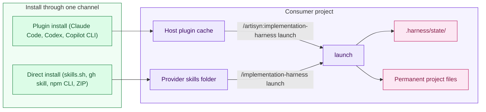

# Install

> Applies from release 4.0.0. Until then, install 3.x from the versioned ZIP as described in [Quick Start](<../02 Quick Start/index.md>).

Install the package through one channel, then run `launch`; launch creates the project's `.harness/state/`.



## Install by channel

Each channel has one install step and one launch command.

| Channel               | Install                                                                                                                                                                                                               | Launch                                                                                                                          |
| --------------------- | --------------------------------------------------------------------------------------------------------------------------------------------------------------------------------------------------------------------- | ------------------------------------------------------------------------------------------------------------------------------- |
| Claude Code           | `claude plugin marketplace add DataArt/artisyn-implementation-harness`, then `claude plugin install artisyn@dataart`                                                                                                  | `/artisyn:implementation-harness launch`                                                                                        |
| Codex                 | `codex plugin marketplace add DataArt/artisyn-implementation-harness`, then install `artisyn` from `/plugins`                                                                                                         | `$artisyn:implementation-harness launch` (where Codex lists plugin skills without the prefix: `$implementation-harness launch`) |
| Copilot CLI           | `copilot plugin marketplace add DataArt/artisyn-implementation-harness`, then `copilot plugin install artisyn@dataart`                                                                                                | `/artisyn:implementation-harness launch`                                                                                        |
| skills.sh             | `npx skills add DataArt/artisyn-implementation-harness --skill implementation-harness`                                                                                                                                | `/implementation-harness launch`                                                                                                |
| gh skill              | `gh skill install DataArt/artisyn-implementation-harness implementation-harness@artisyn-implementation-harness-v<version> --agent <host> --scope project` (the `@<tag>` form is the only supported one)               | `/implementation-harness launch`                                                                                                |
| npm (GitHub Packages) | `npx @dataart/artisyn-implementation-harness init`                                                                                                                                                                    | `/implementation-harness launch`                                                                                                |
| ZIP                   | Download `artisyn-implementation-harness-v<version>.zip` and its `.sha256` from the tag's GitHub Release, verify the checksum, unzip into `<provider>/skills/implementation-harness/` (or run the bundled CLI `init`) | `/implementation-harness launch`                                                                                                |

Codex uses `$` instead of `/` for direct installs: `$implementation-harness launch`.

## npm access

The npm channel needs a `read:packages` token; the token never goes into the repository.

```ini
@dataart:registry=https://npm.pkg.github.com
```

| Line          | Where it lives                                                       |
| ------------- | -------------------------------------------------------------------- |
| Scope mapping | The project `.npmrc`. It may be committed.                           |
| Token         | User npm config or an environment variable. Never in the repository. |

## What `init` does

`init` places the package and prepares the project for launch. It requires Node 22 or newer.

1. Detects `.claude/`, `.agents/` and `.github/`, or takes `--provider`.
2. Places the package in the first selected provider's skills folder, in that order.
3. Creates `.harness/state/`.
4. Prints the launch command.

## Project state

Each project has one `.harness/state/` for all providers.

- It is resolved from the project root: the git top level, else the working directory. It never depends on where the package lives.
- It sits beside evolve's `.harness/evolve/` and `.harness/reflections/` and does not own them.
- Launch writes the ignore entries. It never untracks files.

| Path under `.harness/state/` | Rule   |
| ---------------------------- | ------ |
| `index.json`                 | Commit |
| `registry.md`                | Commit |
| `launch/answers.json`        | Commit |
| `launch/package.json`        | Commit |
| `patch/APPLIED.md`           | Commit |
| `objects/`                   | Ignore |
| `launch/runs/`               | Ignore |
| `launch/reports/`            | Ignore |
| `launch/package.local.json`  | Ignore |

`launch/package.json` records the installed package as `{name, version, channel}`. `launch/package.local.json` records the per-machine package path; launch re-creates it when it is missing.

→ Next: [Update and Migration](<./02 Update and Migration.md>).
