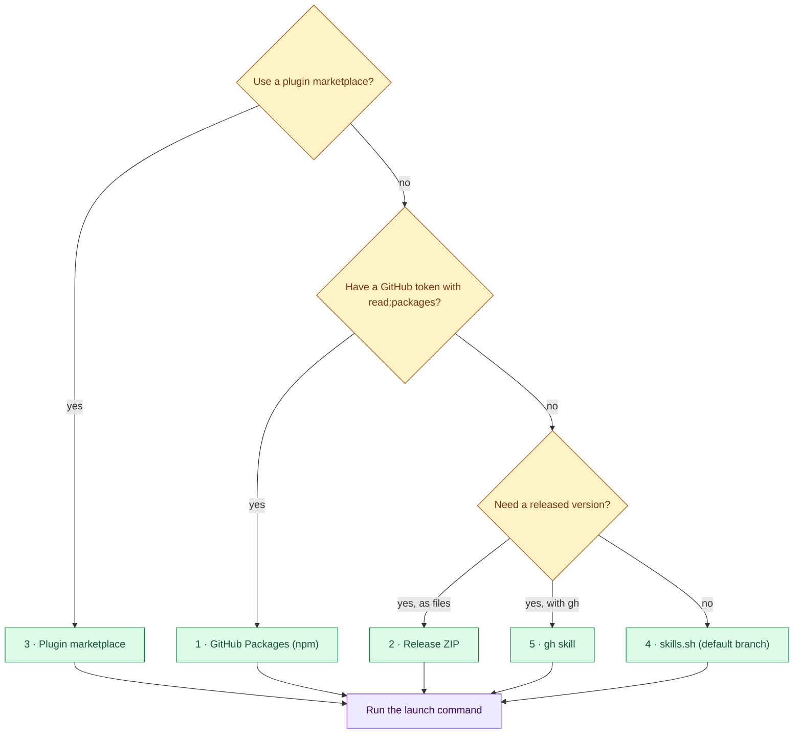

# Install

Pick one channel. Every channel installs the same package. The project's state lives in `.harness/state/`. After the install, run the launch command.

The examples use version `4.0.0`. Put the version you want in its place.



Run the commands below in the project that installs the harness. Inside the harness source repository, use `yarn` instead of `npm`/`npx`.

## 1. GitHub Packages (npm)

You need a GitHub token with `read:packages`.

Add `.npmrc` to the project. The scope line can be committed. The token comes from the environment, never from the repository.

```ini
@dataart:registry=https://npm.pkg.github.com
//npm.pkg.github.com/:_authToken=${GITHUB_TOKEN}
```

Install and check:

```bash
npx @dataart/artisyn-implementation-harness@4.0.0 init
npx @dataart/artisyn-implementation-harness@4.0.0 doctor
```

What you get:

- The package in `.claude/skills/implementation-harness/`, or in the first detected provider's skills folder. Pass `--provider claude|codex|copilot` to choose.
- `.harness/state/` created.
- The launch command printed.

## 2. Release ZIP

No token needed.

1. Open the release for the version, e.g. [v4.0.0](https://github.com/DataArt/artisyn-implementation-harness/releases/tag/artisyn-implementation-harness-v4.0.0).
2. Download `artisyn-implementation-harness-v4.0.0.zip` and `artisyn-implementation-harness-v4.0.0.zip.sha256`.
3. Verify:

   ```bash
   shasum -a 256 -c artisyn-implementation-harness-v4.0.0.zip.sha256
   gh attestation verify artisyn-implementation-harness-v4.0.0.zip --repo DataArt/artisyn-implementation-harness
   ```

4. Install one of two ways:
   - Unzip into the provider skills folder: `.claude/skills/`, `.agents/skills/` or `.github/skills/`. The ZIP's top folder is already `implementation-harness/`.
   - Or unzip outside the project and run the bundled install CLI from the project root:

     ```bash
     node implementation-harness/bin/artisyn-implementation-harness.mjs init --channel zip
     ```

     `--channel zip` lets `update` fetch later releases as ZIPs.

## 3. Plugin marketplace

Claude Code:

```bash
claude plugin marketplace add DataArt/artisyn-implementation-harness
claude plugin install artisyn@dataart
```

Then run `/artisyn:implementation-harness launch`.

The marketplace pins a release tag. A new version appears only after its release is approved and published.

Other hosts read the same marketplace `dataart`:

| Host        | Install                                                                                                                | Launch                                                                                                              |
| ----------- | ---------------------------------------------------------------------------------------------------------------------- | ------------------------------------------------------------------------------------------------------------------- |
| Codex       | `codex plugin marketplace add DataArt/artisyn-implementation-harness`, then install `artisyn` from `/plugins`          | `$artisyn:implementation-harness launch` (or `$implementation-harness launch` if Codex lists it without the prefix) |
| Copilot CLI | `copilot plugin marketplace add DataArt/artisyn-implementation-harness`, then `copilot plugin install artisyn@dataart` | `/artisyn:implementation-harness launch`                                                                            |

## 4. skills.sh

```bash
npx skills add DataArt/artisyn-implementation-harness --skill implementation-harness
```

skills.sh installs from the default branch. It can include changes that are not in a released version yet. The listing shows only `implementation-harness`; the repository's own lifecycle skills are marked `metadata.internal: true`.

## 5. gh skill

```bash
gh skill install DataArt/artisyn-implementation-harness implementation-harness@artisyn-implementation-harness-v4.0.0 --scope project
```

Always pin the tag with `@`.

## Check it works

Run the launch command once:

| Install                                           | Command                                  |
| ------------------------------------------------- | ---------------------------------------- |
| npm, ZIP, skills.sh, `gh skill` (Claude, Copilot) | `/implementation-harness launch`         |
| npm, ZIP, skills.sh, `gh skill` (Codex)           | `$implementation-harness launch`         |
| Plugin marketplace                                | `/artisyn:implementation-harness launch` |

`doctor` reports the installed packages, their versions and the health of `.harness/state/`. It exits 1 when it finds a problem.

## Known limits

- The Codex and Copilot CLI marketplace entries are not yet verified on a real host. Report problems as an issue on `DataArt/artisyn-implementation-harness`.
- On Windows, keep the project path short. Paths inside the package reach about 165 characters; the Windows limit is 260.

## Verifying a download

Every release artifact has a build attestation from the release workflow.

| Artifact              | How to verify                                                                                                                                                                                                              |
| --------------------- | -------------------------------------------------------------------------------------------------------------------------------------------------------------------------------------------------------------------------- |
| Release ZIP           | `shasum -a 256 -c` on the `.sha256` file, then `gh attestation verify` on the ZIP (step 2 above)                                                                                                                           |
| GitHub Packages (npm) | The published package is the attested tarball. Fetch it with `npm pack @dataart/artisyn-implementation-harness@4.0.0`, then run `gh attestation verify` on the `.tgz` with `--repo DataArt/artisyn-implementation-harness` |

## Install CLI options

The install CLI (`init`, `update`, `doctor`) ships in the npm package and the ZIP. It needs Node 22.2 or newer.

| Option / variable                   | Effect                                                                                                                    |
| ----------------------------------- | ------------------------------------------------------------------------------------------------------------------------- |
| `--provider claude\|codex\|copilot` | Provider to install for; repeatable. Default: detect `.claude/`, `.agents/`, `.github/` in that order. None found exits 2 |
| `--channel npm\|zip`                | How the package was obtained. Default `npm`                                                                               |
| `--force`                           | Replace a different installed version                                                                                     |
| `--dir <path>`                      | Project root. Default: the git top level, else the working directory                                                      |
| `ARTISYN_HARNESS_PROJECT_ROOT`      | Environment override for the project root (CI and tests); checked before git                                              |
| `--release-base-url <url>`          | Release origin for the zip channel's `update`. `https:` or loopback `http:` only                                          |

## Project state

Each project has one `.harness/state/` for all providers. It is found from the project root, never from where the package lives. Launch and `init` write the ignore entries; they never untrack files.

| Path under `.harness/state/` | Rule   |
| ---------------------------- | ------ |
| `index.json`                 | Commit |
| `registry.md`                | Commit |
| `launch/answers.json`        | Commit |
| `launch/package.json`        | Commit |
| `patch/APPLIED.md`           | Commit |
| `objects/`                   | Ignore |
| `launch/runs/`               | Ignore |
| `launch/reports/`            | Ignore |
| `launch/package.local.json`  | Ignore |

`launch/package.json` records the package as `{name, version, channel}`. `launch/package.local.json` holds this machine's package path; launch re-creates it when it is missing.

→ Next: [Update](<./02 Update.md>).
