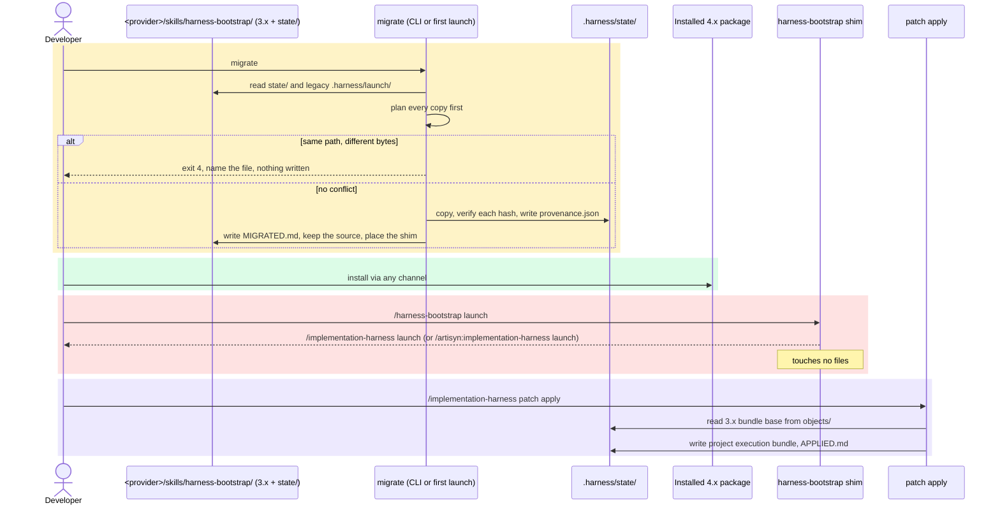

# Update and Migration

> Applies from release 4.0.0, the first release cut by the automatic release pipeline. 3.x ZIPs are no longer published from the repository.

Update the package through the channel it came from, then run `patch apply`.

## Update by channel

Each channel refreshes the package with its own pinned command; `doctor` prints the one for the recorded channel.

| Channel               | Update                                                                                                                                                                                                         |
| --------------------- | -------------------------------------------------------------------------------------------------------------------------------------------------------------------------------------------------------------- |
| Claude Code           | `claude plugin update artisyn@dataart`                                                                                                                                                                         |
| Codex                 | `codex plugin marketplace upgrade` (not yet verified on a real Codex host)                                                                                                                                     |
| Copilot CLI           | `copilot plugin update artisyn` (not yet verified on a real Copilot CLI host)                                                                                                                                  |
| skills.sh             | `npx skills update`                                                                                                                                                                                            |
| gh skill              | `gh skill install DataArt/artisyn-implementation-harness implementation-harness@artisyn-implementation-harness-v<version> --scope project`                                                                     |
| npm (GitHub Packages) | `npx @dataart/artisyn-implementation-harness@<version> update` — the CLI updates to its own version, so pin the version you want                                                                               |
| ZIP                   | Download `artisyn-implementation-harness-v<version>.zip` and its `.sha256` from that tag's Release, or run the bundled CLI: `node <package>/bin/artisyn-implementation-harness.mjs update --version <version>` |

After every update, run `/implementation-harness patch apply`. Plugin installs use `/artisyn:implementation-harness patch apply`.

Host-native installs (marketplace, skills.sh, `gh skill`) record their channel when launch runs with `--channel`; the CLI's `update` on those installs only prints the host command above.

## CLI update rules

The CLI verifies the new package before it replaces the installed one.

| Case         | Behavior                                                                                                                               |
| ------------ | -------------------------------------------------------------------------------------------------------------------------------------- |
| npm          | Copies from the CLI's own package tree; a `--version` other than the CLI's own exits 2 and prints the `npx …@<version> update` command |
| ZIP          | Downloads the ZIP and `.sha256`, checks the ZIP bytes before extraction, extracts to a scratch folder, checks the version, then swaps  |
| Failed check | Stops. The installed package stays unchanged.                                                                                          |
| Same version | No-op                                                                                                                                  |
| Downgrade    | Exits 3 unless `--force` is passed                                                                                                     |
| `--version`  | Must be a plain semver (`1.2.3` or `1.2.3-rc.1`); anything else exits 2                                                                |

## doctor

`npx @dataart/artisyn-implementation-harness doctor` reports the health of an install.

| Reports      | Detail                                                                    |
| ------------ | ------------------------------------------------------------------------- |
| Package      | Location and version per provider                                         |
| Version skew | Different package versions across providers                               |
| State        | Whether `.harness/state/` exists                                          |
| Migration    | Pending migration and any leftover legacy `state/`                        |
| Commands     | The pinned update command for the recorded channel and the launch command |

## Migrating from 3.x

Migration copies 3.x state into `.harness/state/`, verifies every copy and marks the source; it never deletes the source.

| Rule       | Contract                                                                                                                                                                                                                              |
| ---------- | ------------------------------------------------------------------------------------------------------------------------------------------------------------------------------------------------------------------------------------- |
| Sources    | `<provider>/skills/harness-bootstrap/state/`, a root-level `.canonical-implementation-harness/state/`, and legacy `.harness/launch/` records                                                                                          |
| Precedence | Package state first. A legacy `.harness/launch/` run is imported only when its run ID is absent from the package state.                                                                                                               |
| Conflict   | The same target path with different bytes — between two sources, or against a file already in `.harness/state/` — stops the run with exit 4 before anything is written, and names each file. Resolve it and run `migrate` again.      |
| Steps      | Plan all copies, copy, verify each by hash (a failed check rolls back only the files this run created, exit 4), record `provenance.json` in `.harness/state/`, then mark each source with `MIGRATED.md`. The source is never deleted. |
| Re-run     | Running it again changes nothing, except placing a shim an earlier run could not place.                                                                                                                                               |
| Trigger    | The CLI `migrate`, or `/implementation-harness launch`, which runs the migration first                                                                                                                                                |

## The old command

In 4.x, `/harness-bootstrap` is a shim: it prints the new command and touches no files.

- The plugin form is `/artisyn:harness-bootstrap`.
- `migrate` replaces the old folder's package files with the shim, keeping `state/`, only when its `SKILL.md` still names the old skill. It takes the shim from the package's `legacy/harness-bootstrap/SKILL.md`, else from a sibling `skills/harness-bootstrap/`; with neither, it warns and leaves the old folder as it is.
- After migration, the old folder holds only the shim and the marked `state/`. `doctor` reports it; the developer deletes it.
- The shim is removed in 5.0.0.

## Older patch bundles

Patch bundles from 3.x releases still apply.

- Old `release:artisyn-harness-bootstrap-v*.zip` refs are read through a label-only mapping; base content always comes from `.harness/state/objects/`.
- `patch apply` uses no network.
- A missing base stops the apply before any file is written.

→ Next: [Versioning and Releases](<./03 Versioning and Releases.md>).
