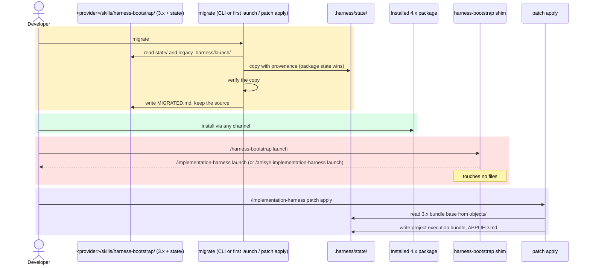

# Update and Migration

> Applies from release 4.0.0. Until then, install 3.x from the versioned ZIP as described in [Quick Start](<../02 Quick Start/index.md>).

Update the package through the channel it came from, then run `patch apply`.

## Update by channel

Each channel refreshes the package with its own command.

| Channel               | Update                                                  |
| --------------------- | ------------------------------------------------------- |
| Claude Code           | `claude plugin update artisyn@dataart`                  |
| Codex                 | `codex plugin marketplace upgrade`                      |
| Copilot CLI           | `copilot plugin update artisyn`                         |
| skills.sh             | `npx skills update`                                     |
| gh skill              | `gh skill install … implementation-harness@<new tag> …` |
| npm (GitHub Packages) | `npx @dataart/artisyn-implementation-harness update`    |
| ZIP                   | The bundled CLI `update`                                |

After every update, run `/implementation-harness patch apply`. Plugin installs use `/artisyn:implementation-harness patch apply`.

## CLI update rules

The CLI verifies the new package before it replaces the installed one.

| Case         | Behavior                                       |
| ------------ | ---------------------------------------------- |
| Verification | npm registry integrity, or the ZIP's `.sha256` |
| Failed check | Stops. The installed package stays unchanged.  |
| Same version | No-op                                          |
| Downgrade    | Needs `--force`                                |

## doctor

`npx @dataart/artisyn-implementation-harness doctor` reports the health of an install.

| Reports      | Detail                                             |
| ------------ | -------------------------------------------------- |
| Package      | Location and version per provider                  |
| Version skew | Different package versions across providers        |
| State        | Health of `.harness/state/`                        |
| Migration    | Pending migration and any leftover legacy `state/` |
| Commands     | The pinned install command and the launch command  |

## Migrating from 3.x

Migration copies 3.x state into `.harness/state/`, verifies it and marks the source; it never deletes the source.

| Rule       | Contract                                                                                                                                     |
| ---------- | -------------------------------------------------------------------------------------------------------------------------------------------- |
| Sources    | `<provider>/skills/harness-bootstrap/state/`, a root-level `.canonical-implementation-harness/state/`, and legacy `.harness/launch/` records |
| Precedence | Package state wins. Legacy records are imported with provenance when their IDs do not collide.                                               |
| Steps      | Copy, verify, then mark the source with `MIGRATED.md`. The source is never deleted.                                                          |
| Re-run     | Running it again changes nothing.                                                                                                            |
| Trigger    | The CLI `migrate`, or the first `launch` or `patch apply` that finds old state                                                               |

## The old command

In 4.x, `/harness-bootstrap` is a shim: it prints the new command and touches no files.

- The plugin form is `/artisyn:harness-bootstrap`.
- After migration, the old folder holds only the shim and the marked `state/`. The developer deletes it.
- The shim is removed in 5.0.0.

## Older patch bundles

Patch bundles from 3.x releases still apply.

- Base content comes from `.harness/state/objects/`.
- `patch apply` uses no network.
- A missing base stops the apply before any file is written.

→ Next: [Versioning and Releases](<./03 Versioning and Releases.md>).
