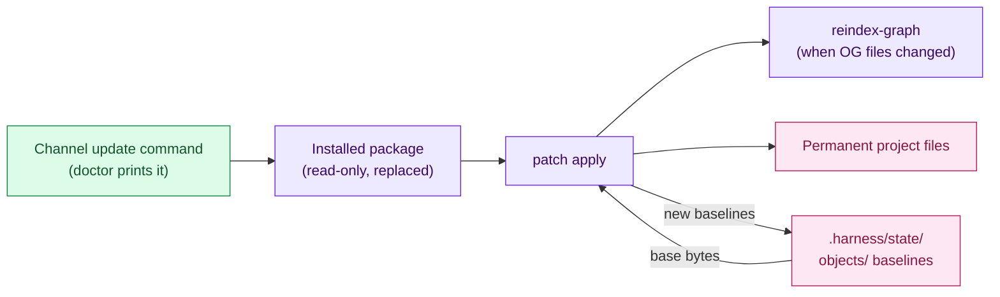

# Update

> Applies from release 4.0.0, the first release cut by the release pipeline.

Update the package through the channel it came from, then run `patch apply`. When `patch apply` reports that OG files changed, run `reindex-graph`.

## Update by channel

Each channel refreshes the package with its own pinned command; `doctor` prints the one for the recorded channel.

| Channel               | Update                                                                                                                                                                                                       |
| --------------------- | ------------------------------------------------------------------------------------------------------------------------------------------------------------------------------------------------------------ |
| Claude Code           | `claude plugin update artisyn@dataart`                                                                                                                                                                       |
| Codex                 | `codex plugin marketplace upgrade`                                                                                                                                                                           |
| Copilot CLI           | `copilot plugin update artisyn`                                                                                                                                                                              |
| skills.sh             | `npx skills update`                                                                                                                                                                                          |
| gh skill              | `gh skill install DataArt/artisyn-implementation-harness implementation-harness@v4.1.0 --scope project` (pin the tag of the version you want)                                                                |
| npm (GitHub Packages) | `npx @dataart/artisyn-implementation-harness@<version> update` — the CLI updates to its own version, so pin the version you want                                                                             |
| ZIP                   | Download `artisyn-implementation-harness-v4.1.0.zip` and its `.sha256` from the `v4.1.0` Release, or run the bundled CLI: `node <package>/bin/artisyn-implementation-harness.mjs update --version <version>` |

Releases from 4.1.0 are tagged `v<version>`; releases up to 4.0.2 keep the long tag `artisyn-implementation-harness-v<version>`. The CLI picks the right tag for the version you ask for, so `update --version 4.0.2` still finds the old release.

**One-time manual update for ZIP installs on 4.0.2 or earlier.** A ZIP install whose CLI is 4.0.2 or earlier builds the old long-tag URL, so its `update` cannot fetch 4.1.0 or later. Update it once by hand: download `artisyn-implementation-harness-v4.1.0.zip` and its `.sha256` from the `v4.1.0` release on the [releases page](https://github.com/DataArt/artisyn-implementation-harness/releases) and install it as in [Install](./01%20Install.md), or run `npx @dataart/artisyn-implementation-harness@4.1.0 update` from GitHub Packages. After that, `update` works again. The npm, marketplace, `gh skill` and skills.sh channels are unaffected.

After every update, run `/implementation-harness patch apply`. Plugin installs use `/artisyn:implementation-harness patch apply`.

When `patch apply` reports that OG files changed, run `/implementation-harness reindex-graph` (plugin installs: `/artisyn:implementation-harness reindex-graph`). From the major harness release that introduces OG schema v1, it also runs any pending docs migration after a dry-run and your confirmation. See [Ops Model → Bootstrap and upgrade wiring](<../07 Operational Graph/01 Ops Model.md#bootstrap-and-upgrade-wiring>).

Host-native installs (marketplace, skills.sh, `gh skill`) record their channel when launch runs with `--channel`; the CLI's `update` on those installs only prints the host command above.

## CLI update rules

The CLI verifies the new package before it replaces the installed one.

| Case         | Behavior                                                                                                                               |
| ------------ | -------------------------------------------------------------------------------------------------------------------------------------- |
| npm          | Copies from the CLI's own package tree; a `--version` other than the CLI's own exits 2 and prints the `npx …@<version> update` command |
| ZIP          | Downloads the ZIP and `.sha256`, checks the ZIP bytes before extraction, extracts to a scratch folder, checks the version, then swaps  |
| Failed check | Stops. The installed package stays unchanged.                                                                                          |
| Same version | No-op                                                                                                                                  |
| Downgrade    | Exits 3 unless `--force` is passed                                                                                                     |
| `--version`  | Must be a plain semver (`1.2.3` or `1.2.3-rc.1`); anything else exits 2                                                                |

## doctor

`npx @dataart/artisyn-implementation-harness doctor` reports the health of an install and exits 1 when it finds a problem.

| Reports      | Detail                                                                                                                                                            |
| ------------ | ----------------------------------------------------------------------------------------------------------------------------------------------------------------- |
| Package      | Location and version per provider                                                                                                                                 |
| Version skew | Different package versions across providers                                                                                                                       |
| Record       | The recorded package and whether it can be found on this machine                                                                                                  |
| State        | Whether `.harness/state/` exists                                                                                                                                  |
| Commands     | The pinned update command for the recorded channel and the launch command; for a ZIP install, the update hint names the release tag and the asset file separately |

## Baselines in patch apply

`patch apply` reads every base from `.harness/state/objects/`, never from the network.

- A `state/objects/<sha256>` snapshot names its object directly.
- A `release:` snapshot is a label only; the bytes are the object named by the entry's recorded sha256.
- A missing or mismatched base object stops the apply before any file is written.

→ Next: [Versioning and Releases](<./03 Versioning and Releases.md>).
