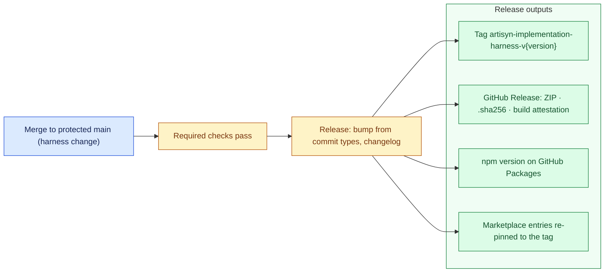

# Versioning and Releases

> Applies from release 4.0.0. Until then, install 3.x from the versioned ZIP as described in [Quick Start](<../02 Quick Start/index.md>).

The harness has one semantic version, and releases are cut automatically from merges to `main`.

## One version

The harness version is independent of the repository's own `v*` version.

- The plugin and marketplace entries always carry the same version as the package.
- The first release under the new name is 4.0.0.

## How releases happen

A merge to the protected `main` cuts a release after required checks pass when its harness commits call for a version bump. Nobody publishes by hand.

- Conventional-commit types decide the version bump.
- Each release creates the tag `artisyn-implementation-harness-v{version}`.
- It creates a GitHub Release with the ZIP, its `.sha256` and a build attestation.
- It publishes the npm version on GitHub Packages.
- It re-pins the marketplace entries to the new tag.
- The changelog is the package's `CHANGELOG.md`.

## Integrity

Each channel has its own integrity check.

| Channel                                           | How it is verified                                                   |
| ------------------------------------------------- | -------------------------------------------------------------------- |
| npm                                               | Registry integrity, checked by npm on install                        |
| ZIP                                               | `.sha256` next to the asset, checked by the CLI and the manual guide |
| Git channels (marketplace, skills.sh, `gh skill`) | The pinned tag or commit                                             |
| Build attestation                                 | Verifiable by maintainers with `gh attestation verify`               |

## Rollback

Rollback moves npm and the marketplace back to the previous good version.

| Channel     | Rollback                                                            |
| ----------- | ------------------------------------------------------------------- |
| npm         | The bad version is deprecated and the `latest` dist-tag moves back. |
| Marketplace | A patch release re-pins the entries to the previous tag.            |
| Consumers   | Stay on their pinned tag until they choose to move.                 |

## Legacy command end of life

The `harness-bootstrap` shim ships in 4.x and is removed in 5.0.0. See [The old command](<./02 Update and Migration.md#the-old-command>).
