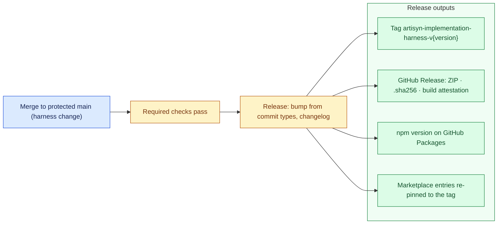

# Versioning and Releases

> Applies from release 4.0.0, the first release cut by the automatic release pipeline. 3.x ZIPs are no longer published from the repository.

The harness has one semantic version, and releases are cut automatically from merges to `main`.

## One version

The harness version is independent of the repository's own `v*` version.

- The single source is `skills/implementation-harness/package.json`. The release stamps it into the `SKILL.md` frontmatter of the harness and the shim, `.claude-plugin/plugin.json`, and both marketplace files (version and tag `ref`); a CI gate fails any PR where they disagree.
- Commits that touch the harness use scope `harness`; the root `v*` lane ignores them.
- The first release under the new name is 4.0.0, cut from the breaking `feat(harness)!:` rename commit.

## How releases happen

A push to the protected `main` runs `.github/workflows/release-harness.yml`; when the harness commits call for a version bump, it cuts a release in one run. Nobody publishes by hand.

- The workflow is off until the repository variable `HARNESS_RELEASE_ENABLED` is `true`.
- Conventional-commit types decide the bump (Nx Release, independent mode).
- It stamps the manifests, prepends the release to the package's `CHANGELOG.md`, and pushes the commit `chore(harness-release): <version> [skip ci]` and the tag `artisyn-implementation-harness-v{version}` together (atomic push).
- It builds the npm tarball and the ZIP with its `.sha256`, and attests both before anything is published.
- It publishes the npm version on GitHub Packages and creates the GitHub Release with the ZIP and `.sha256` attached.
- A re-run is safe: it finds the latest harness tag, checks whether the npm version and the Release assets already exist, says "fully published" and stops if so, and otherwise finishes only what is missing.

Setup and first-release steps are in the [Harness Release Runbook](<../../Engineering Guide/08 Harness Release Runbook.md>).

## Integrity

Each channel has its own integrity check.

| Channel                                           | How it is verified                                                                             |
| ------------------------------------------------- | ---------------------------------------------------------------------------------------------- |
| npm                                               | Registry integrity, checked by npm on install                                                  |
| ZIP                                               | `.sha256` next to the asset, checked by the CLI and the manual guide                           |
| Git channels (marketplace, skills.sh, `gh skill`) | The pinned tag or commit                                                                       |
| Build attestation                                 | Provenance for the tarball and the ZIP, verifiable by maintainers with `gh attestation verify` |

## Rollback

Rollback moves npm and the marketplace back to the previous good version.

| Channel     | Rollback                                                            |
| ----------- | ------------------------------------------------------------------- |
| npm         | The bad version is deprecated and the `latest` dist-tag moves back. |
| Marketplace | A patch release re-pins the entries to the previous tag.            |
| Consumers   | Stay on their pinned tag until they choose to move.                 |

## Legacy command end of life

The `harness-bootstrap` shim ships in 4.x and is removed in 5.0.0. See [The old command](<./02 Update and Migration.md#the-old-command>).
