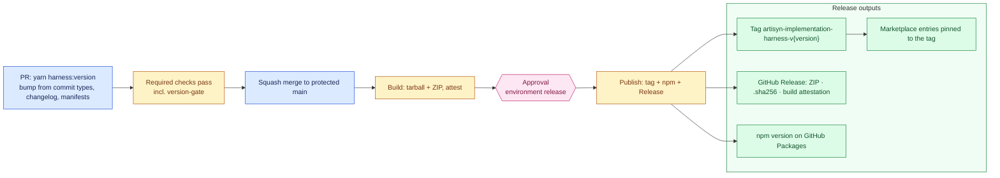

# Versioning and Releases

> Applies from release 4.0.0, the first release cut by the release pipeline.

The harness has one semantic version. The PR stamps it, the merge to `main` builds it, and a reviewer's approval publishes it.

## One version

The harness version is the only version the repository releases; the repository itself is not versioned.

- The single source is `skills/implementation-harness/package.json`. `yarn harness:version` stamps it into the harness `SKILL.md` frontmatter, `.claude-plugin/plugin.json`, and both marketplace files (version and tag `ref`); a CI gate fails any PR where they disagree.
- Commits that touch the harness use scope `harness`, so harness changes stand apart in history and the changelog.
- The first release is 4.0.0.

## How releases happen

The PR carries its own version; the merge builds it, and a reviewer decides when it is published. Nobody publishes by hand.

- On the feature branch, the developer runs `yarn harness:version`. Conventional-commit types since the latest harness tag decide the bump (Nx Release, independent mode). It stamps the manifests and writes the release entry in the package's `CHANGELOG.md`. The developer commits this as `chore(harness-release): <version>`.
- The required `version-gate` check fails any PR that is not stamped with the version its commits call for.
- Every push to the protected `main` runs `.github/workflows/release-harness.yml`. It never commits to `main`.
- The `build` job reads the version from `package.json`. If that version is already fully published, it stops. Otherwise it builds the npm tarball and the ZIP with its `.sha256`, and attests both.
- The `publish` job waits for a required reviewer of the `release` environment to approve.
- After approval it creates the tag `artisyn-implementation-harness-v{version}`, publishes the npm version on GitHub Packages, and publishes the GitHub Release with the ZIP and `.sha256` attached. The tag appears only now, so every channel opens at the same moment.
- Until approval, marketplace and `gh skill` installs of the new version fail: `main`'s manifests already pin the new tag, which does not exist yet.
- A re-run is safe: it finishes only what is missing, and an already-published Release keeps its assets.

Setup and first-release steps are in the [Harness Release Runbook](<../../Engineering Guide/08 Harness Release Runbook.md>).

## Integrity

Each channel has its own integrity check.

| Channel                                           | How it is verified                                                                             |
| ------------------------------------------------- | ---------------------------------------------------------------------------------------------- |
| npm                                               | Registry integrity, checked by npm on install                                                  |
| ZIP                                               | `.sha256` next to the asset, checked by the CLI and the manual guide                           |
| Git channels (marketplace, skills.sh, `gh skill`) | The pinned tag or commit                                                                       |
| Build attestation                                 | Provenance for the tarball and the ZIP, verifiable by maintainers with `gh attestation verify` |

## Rollback

Rollback moves npm and the marketplace back to the previous good version.

| Channel     | Rollback                                                            |
| ----------- | ------------------------------------------------------------------- |
| npm         | The bad version is deprecated and the `latest` dist-tag moves back. |
| Marketplace | A patch release re-pins the entries to the previous tag.            |
| Consumers   | Stay on their pinned tag until they choose to move.                 |
