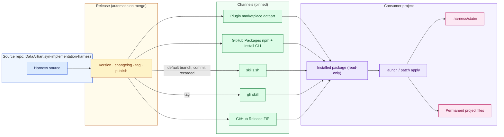

# Distribution

> Applies from release 4.0.0, the first release cut by the automatic release pipeline. 3.x ZIPs are no longer published from the repository.

Every harness release ships automatically to five channels, and every project installs a pinned version of the same read-only package.

## What is distributed

One package carries one name per role.

| Thing                    | Name                                                                                                                                                                                   |
| ------------------------ | -------------------------------------------------------------------------------------------------------------------------------------------------------------------------------------- |
| Source repository        | `DataArt/artisyn-implementation-harness`                                                                                                                                               |
| npm package              | `@dataart/artisyn-implementation-harness`                                                                                                                                              |
| Release tag              | `artisyn-implementation-harness-v{version}`                                                                                                                                            |
| Release ZIP              | `artisyn-implementation-harness-v{version}.zip`                                                                                                                                        |
| Skill                    | `implementation-harness`                                                                                                                                                               |
| Plugin                   | `artisyn` in marketplace `dataart`                                                                                                                                                     |
| Command, plugin installs | `/artisyn:implementation-harness launch` (Codex `$artisyn:implementation-harness launch`; where Codex lists plugin skills without the plugin prefix, `$implementation-harness launch`) |
| Command, direct installs | `/implementation-harness launch` (Codex `$implementation-harness launch`) — npm CLI, ZIP, skills.sh, `gh skill`                                                                        |

## Channels

The harness ships through five channels; only the npm channel needs a token.

| #   | Channel                                                                             | Access                |
| --- | ----------------------------------------------------------------------------------- | --------------------- |
| 1   | Plugin marketplace `dataart` in the harness repo — Claude Code, Codex, Copilot CLI  | No token              |
| 2   | GitHub Packages npm `@dataart/artisyn-implementation-harness`, with the install CLI | `read:packages` token |
| 3   | skills.sh                                                                           | No token              |
| 4   | `gh skill`                                                                          | No token              |
| 5   | GitHub Release ZIP, with `.sha256` and a build attestation                          | No token              |

The marketplace and `gh skill` channels read the repository at the release tag. skills.sh installs from the default branch and records the commit it resolved at install time. npm and the ZIP are artifacts the release workflow publishes. Codex and Copilot CLI marketplace values follow the official host documentation and are not yet verified on a real host.

Curated third-party directories are not a channel.

## Pinning

Every install pins a version: a release tag, a semver version, or (skills.sh) the default-branch commit recorded at install time.

- Marketplace entries and `gh skill` installs pin a release tag, never `main`.
- ZIP links point at the tag's Release page, never at `/releases/latest`.
- The repository's own `v*` releases have nothing to do with harness installs.

## Install contract

The installed package is read-only and replaceable; everything a project owns lives in the project.

| Rule             | Contract                                                                       |
| ---------------- | ------------------------------------------------------------------------------ |
| Package          | Read-only and replaceable. It can be removed after launch.                     |
| Consumer project | Runs `launch` and `patch apply` only.                                          |
| Source repo      | `patch harvest` and `patch prepare` run only in the harness source repository. |
| Update           | Refresh the package through its channel, then run `patch apply`.               |
| Runtime state    | Lives in the project at `.harness/state/`.                                     |

## Improvements from projects

Downstream teams send improvements to the source repository; they come back to every project with the next release.

1. A team reports a problem or proposes an improvement as an issue or PR on `DataArt/artisyn-implementation-harness`, using the existing issue forms.
2. Maintainers harvest it in the source repository.
3. It reaches projects in the next harness release through `patch apply`.

## In this section

| Page                                                            | Contents                                                                                     |
| --------------------------------------------------------------- | -------------------------------------------------------------------------------------------- |
| [01 Install](<./01 Install.md>)                                 | Install commands per channel, npm access, `init` options, skills.sh discovery, project state |
| [02 Update and Migration](<./02 Update and Migration.md>)       | Pinned update commands, `doctor`, migration from 3.x, the old command                        |
| [03 Versioning and Releases](<./03 Versioning and Releases.md>) | One version, the release workflow and re-runs, integrity, rollback                           |
