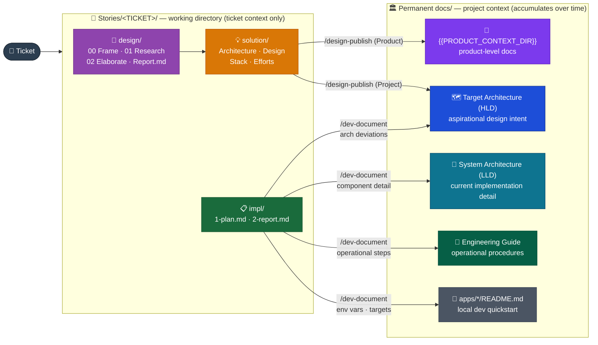

# Documents Flow

_How documentation is born, refined, and graduates to its permanent home._

---

## The pipeline

> _Context sources: Research and Elaborate phases read existing docs as context before producing options — Product designs read `{{PRODUCT_CONTEXT_DIR}}/`, Project designs read `Target Architecture (HLD)/`. The track is resolved once in Frame (`pattern-context-resolution.md`) and recorded in `Report.md`'s `## Context` section. This read direction is not shown above to keep the pipeline readable._

---

## Graduation rules

| Lifecycle phase                   | Produces                                                        | Lives in                                                                       | Mutability                                          |
| --------------------------------- | --------------------------------------------------------------- | ------------------------------------------------------------------------------ | --------------------------------------------------- |
| `/dev-plan`                       | `1-plan.md`                                                     | `Stories/<TICKET>/impl/`                                                       | Immutable after approval                            |
| `/dev-plan`                       | `2-report.md` (skeleton)                                        | `Stories/<TICKET>/impl/`                                                       | Living through the ticket                           |
| `/dev-implement`                  | Code commits                                                    | Codebase                                                                       | —                                                   |
| `/dev-document`                   | LLD updates                                                     | `System Architecture (LLD)/`                                                   | Living                                              |
| `/dev-document`                   | Engineering Guide entries                                       | `Engineering Guide/`                                                           | Living                                              |
| `/dev-document`                   | App README updates                                              | `apps/*/README.md`                                                             | Living                                              |
| `/dev-document` (deviation path)  | Container or NFR updates within the active version              | `Target Architecture (HLD)/<active>/Containers/` or `Non-Functional Concerns/` | Living                                              |
| `/design-elaborate`               | Recommendation + WAF assessment                                 | `Stories/<TICKET>/design/02 Elaborate.md` + `Report.md`                        | Immutable in Story                                  |
| `/design-solution`                | Certainty artifacts                                             | `Stories/<TICKET>/solution/`                                                   | Immutable after Publish gate                        |
| `/design-publish` (Product track) | Product architecture content                                    | `{{PRODUCT_CONTEXT_DIR}}/<resolved subfolder>`                                 | Living — accumulates over the product lifetime      |
| `/design-publish` (Project track) | Updates reviewed by `{{DESIGN_ARCHITECT_AGENT}}` (max 2 passes) | `{{DESIGN_DOCS_ROOT}}<resolved subfolder>`                                     | Living post-merge                                   |
| `/dev-document` (archive)         | Full Story folder                                               | `Stories/archive/`                                                             | Archived — no further edits                         |
| `/where-we-are` · `/war-*`        | Architecture audit snapshots                                    | `LLD/where-we-are/` or `HLD/WAR/<version>/`                                    | Append-only — see Architecture Lifecycle invariants |

---

## Lifecycle of a doc

**Creation** — all new docs are born in `Stories/<TICKET>/` as working drafts. No doc goes directly to HLD, LLD, or the Engineering Guide without passing through a ticket.

**Graduation** — content graduates at two points: during `/dev-document` (implementation outcomes) and during `/design-publish` (design outcomes). Only settled outcomes graduate — rationale, comparisons, and open questions stay in the Story. Where an implementation change lands (HLD vs LLD) is determined by the HLD/LLD placement matrix in `dev-document/SKILL.md`: HLD hit → update the relevant HLD doc and record detail in the LLD; HLD miss → create a minimal new HLD entry and capture full detail in the LLD. Design graduation is track-routed, resolved once in Frame and recorded in `Report.md`'s `## Context` section: Product lands in `{{PRODUCT_CONTEXT_DIR}}/`; Project lands in `Target Architecture (HLD)/`.

**Update** — permanent docs (HLD, LLD, Engineering Guide) are updated by subsequent tickets, not by reopening the original Story.

**Supersession** — HLD is versioned. Creating a new version is a human and business decision — the lifecycle never creates one automatically. When the team decides to cut a new version, the old version folder is kept as history and the README router is updated to point to the new active version. In-progress deviations always land in the current active version.

**Archival** — Stories are archived when `/dev-document` completes. Archived stories are read-only references.

---

## What does NOT graduate

| Content type                       | Stays in                                        |
| ---------------------------------- | ----------------------------------------------- |
| Rationale, trade-offs              | `Stories/<TICKET>/design/02 Elaborate.md`       |
| Rejected alternatives              | `Stories/<TICKET>/design/02 Elaborate.md`       |
| Open questions                     | `Stories/<TICKET>/design/02 Elaborate.md`       |
| WAF assessment                     | `Stories/<TICKET>/design/Report.md` WAF section |
| Implementation notes (2-report.md) | `Stories/<TICKET>/impl/2-report.md`             |
| Exploration drafts                 | `Stories/<TICKET>/design/`                      |
