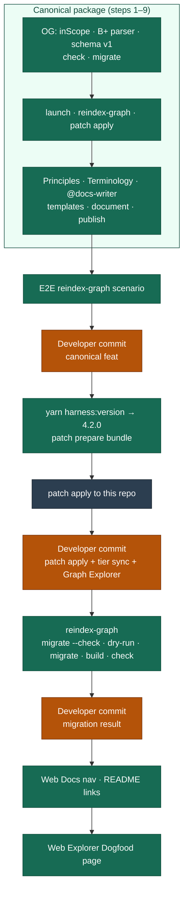

# DESIGN-20261117-7931: OKF-Compatible Knowledge Base — Plan

| Field   | Value                                          |
| ------- | ---------------------------------------------- |
| Ticket  | DESIGN-20261117-7931                           |
| Intent  | [0-intent.md](0-intent.md)                     |
| Branch  | `docs/design-20261117-7931-okf-knowledge-base` |
| Created | 2026-11-18                                     |

## Solution

Build the approved design
([Architecture.md](../../product-design/approved/[DESIGN-20261117-7931]%20OKF-Compatible%20Knowledge%20Base/solution/Architecture.md)
and its four Design files) in its fixed delivery order. First the canonical OG
(`skills/implementation-harness/canonical/docs/.og/`) gets the scope guard, the B+ parser and
writer, schema v1, and the `check` and `migrate` commands, all test-first in the existing
`node:test` suite `cli.test.mjs`. Next come the canonical harness flows (launch, `reindex-graph`,
patch apply) and the docs flow (Principles, Terminology, `@docs-writer`, templates, document and
publish steps). After that, the E2E scenario follows the key rename. The release is stamped as a
**minor** version (developer decision, see the intent) and bundled with `patch prepare`. Finally,
this repo receives the bundle through `patch apply`, migrates through `reindex-graph`, updates
its Web Docs nav, links and Graph Explorer, and gains a Web Explorer Dogfood page.

Containers touched: Implementation Harness E2E (the canonical package and its tests), Harness
Release Pipeline (version stamp), Web Docs and Web Explorer. Reused: the OG CLI shape,
`DocsStore.assign` as the single write path, the patch prepare and apply skills, and the
`yarn harness:version` release lane. No dependency is added.

Planning decisions:

- **Mid-phase commits.** Implement stops for developer commits at Steps 10, 11 and 12. There
  are three reasons:
  - `yarn harness:version` computes the bump from commits that already exist.
  - `migrate` refuses dirty `.md` files, and `patch apply` changes `.md` files under `docs/`
    and `.claude/`.
  - The idempotency rerun after the migration needs a clean tree too.

  These are developer-only operations, not extra gates. Between the Step 11 commit and the
  Step 12 `migrate`, nothing writes a story `.md` file. Step 11's report row is written before
  its commit, and Step 12's after its own commit (RF-013).

- **Backup ignore file ships as `gitignore`.** `yarn pack` always leaves out `.gitignore`
  (checked 2026-11-18 with a temporary probe file and `yarn pack --dry-run`), so a canonical
  `docs/.og/.gitignore` would never reach consumers. Canonical ships `docs/.og/gitignore`.
  `canonical/manifest.json` gets a rename rule `docs/.og/gitignore` → `docs/.og/.gitignore`,
  which launch, `reindex-graph` Step 0 and patch apply all honour, so no literal
  `docs/.og/gitignore` is ever deployed. The design's result, a git-ignored v0 backup, is
  unchanged (RF-005, RF-019).
- **Tier names.** `constants.mjs` exports a static `TIER_NAMES` list. `check-tier-sync.mjs`
  switches to it, because the tier prefixes become config-driven (RF-003, design D2 "Tier
  names").
- **Patch apply keeps recorded customizations.** Step 11 follows the patch-apply contract: no
  silent overwrite. Local-only customizations recorded in `.harness/state/index.json` (for
  example, Principles' concrete frontmatter block and embedded images) are kept. Any other
  overlapping conflict is brought to the developer in one combined question (RF-008).
- **Q10c asks for a folder.** Canonical `02-launch-questions.md` Q10c asks for the folder path
  under `docs/`, so new projects get a value `migrate` can use (RF-017).
- **Minor release.** Commits use `feat`/`fix`, with no `!` and no `BREAKING CHANGE` footer.
  Anywhere the design says "major" for this release, the plan reads "this release (4.2.0)". The
  read-compat window is still removed at the next major.
- **`answers.json` location.** The launch references say `.harness/state/launch/answers.json`,
  but this repo keeps the file at `.harness/state/answers.json`. `migrate` reads the first path
  that exists. It accepts the Q10c value only when it names an existing folder under `docs/`
  (a bare folder name or a `docs/…` path). Free text that names no folder counts as no answer,
  so `missingConfig` is reported and `reindex-graph` asks. This repo's Q10c is free text
  ("Harness (i.e. docs/Harness/ …)"), so Step 12 writes `{"productDir": "docs/Harness"}`
  through the `reindex-graph` prompt. Fixing the doc/state path mismatch itself is out of
  scope; it is recorded as tech debt in Step 9.
- **Canonical docs-flow drift.** The local `.claude` dev `06-document.md` and design
  `09-publish.md` carry a `purpose`/`keywords` step that canonical lacks. Step 8 adds the B+
  version of that step to canonical, so the patch replaces the local drift instead of fighting
  it.
- **OG tests stay local.** `cli.test.mjs` is not deployed to projects (reindex Step 0 never
  copies it) and is not run by CI. It runs with
  `node --test skills/implementation-harness/canonical/docs/.og/cli.test.mjs`. Wiring it into
  CI is out of scope and is recorded as tech debt in Step 9.
- **Golden round-trip test.** The test looks for this repo's root by going up from the test
  file to the first folder with both `docs/.og/cli.mjs` and `package.json` that is not the
  canonical copy. When no such folder exists (as in a consumer project), the test skips.

## Acceptance Criteria

- [ ] `AC-1` — `cli.test.mjs`: `index --doc` exits non-zero and names the rule
      (`Out of scope [<rule>]`) on each of these paths: `index.md` or `log.md` in a bundle and in a
      non-bundle folder, `Index.md`, `docs/.og/x.md`, `apps/x/README.md`, an `.ogignore`d path, and
      an `--to` target that is out of scope. `docs/index.md` is accepted. `DocsStore.assign` throws
      on the same paths. The walker skips them, and `reindex` exits 0.
- [ ] `AC-2` — `cli.test.mjs`: `scopeViolations` lists only out-of-scope files carrying `id:`.
      Prune keeps the row of an `index.md` that still carries its `id:`, and lists authored edges
      on pruned rows in `orphanedAuthored`. `EDGE_TYPES` has five entries, and `--edge impl-to-readme`
      is rejected. No `AppReadme` or `APP_README_PATTERN` remains in canonical OG.
- [ ] `AC-3` — The parser accepts every form in the YAML-subset table and refuses the rejected
      forms (with a line number). The golden round-trip test (parse → write → parse equal) passes
      over every `.md` under this repo's `docs/`, plus CRLF and UTF-8 BOM fixtures. Prettier over
      writer output changes nothing (`yarn prettier --check` on a written fixture). Wrapped flow
      lists parse to non-empty `tags`: the test counts this repo's docs whose `keywords` parsed
      empty under the old parser (about 50), and asserts the new parser gives all of them tags.
- [ ] `AC-4` — `index --doc` stamps a missing `type` from the type map. `reindex` and `build`
      write only `id`, and `check` lists the doc under `missingFields`. The read-compat window
      holds: an unmigrated fixture builds with `description`/`tags` read from `purpose`/`keywords`.
- [ ] `AC-5` — Schema: a v0 fixture opens at `user_version = 1`, keeps its rows and edges, and
      leaves `docs/.og/docs-operational-graph.v0.bak.sqlite`. A greenfield fixture is created at v1.
      A `user_version = 2` DB makes OG exit 1 with "database newer than this OG". The canonical
      seed DB reports `PRAGMA user_version` = 1. Canonical `docs/.og/gitignore` ignores the backup
      and is listed by `yarn pack --dry-run`.
- [ ] `AC-6` — `og.config.json`: a valid `productDir` gives the Product tier with a
      trailing-`/` match. An overlapping or outside-`docs/` value is reported as `invalidConfig`
      (exit 0), and `index --doc` on that path exits 1 naming `invalidConfig`.
      `list --missing description,tags` works, and `purpose`/`keywords` are rejected as
      `--missing` fields.
- [ ] `AC-7` — `migrate` (`cli.test.mjs` fixtures):
  - Authored edges after = before − `mergedEdges`, and `orphanedAuthored` is empty.
  - The `impl-to-readme` + `references` pair merges into one edge (`mergedEdges: 1`).
  - A second run reports `filesChanged: 0`.
  - `--check` and `--dry-run` write no doc file, and `--check` always exits 0.
  - A dirty `.md` under `docs/` makes it exit 1, and so does a dirty `apps/x/README.md` that
    stray-id cleanup would touch. Uncommitted `docs/.og/*` does not.
  - An overview collision is listed in `overviewConflicts`, and `index.md` stays byte-identical.
  - `docs/index.md` stays byte-identical and is never reported.
  - A stray `id:`-only file outside `docs/` is cleaned.
  - Seeded `at` values end in `Z`.
- [ ] `AC-8` — `check` (`cli.test.mjs` fixtures) prints JSON with `missingFields`,
      `brokenIndexEntries`, `unlistedConcepts`, `unversionedBundles`, `frontmatterErrors` and
      `counts`, and exits 0. It accepts single and double quotes and both `*` and `-` bullets.
- [ ] `AC-9` — Canonical launch writes `og.config.json` (`{}` for "none") and the bundle root
      `index.md` files with `okf_version: "0.2"` (Product only when Q10c names a folder). Q10c
      asks for a folder path. On brownfield, launch runs `migrate --dry-run` → confirm →
      `migrate --allow-dirty`. Graph verify runs `migrate --check` and `check`. A `cli.test.mjs`
      greenfield fixture shows the launch end state, once with `{}` and once with a `productDir`:
      zero missing `type`, four or five bundle roots with `okf_version: "0.2"`, and
      `migrate --check` not pending. Canonical `reindex-graph.md`:
  - Step 0 deploys `gitignore` as `.gitignore` and never overwrites `og.config.json`.
  - It runs `migrate --check`, asks on `missingConfig`, then dry-run → confirm → `migrate`,
    then `build`.
  - It stops and skips `build` on exit 1.
  - On decline it skips `migrate`, still runs `build` and `check`, and reports "migration
    pending".
  - It prints `check` and uses `list --missing description,tags`.

  Canonical `05-patch-apply.md` closing step points to `reindex-graph` when OG files changed.

- [ ] `AC-10` — Canonical Principles, Terminology, Lifecycles `05 Documents Flow.md` (App
      README row, archive frontmatter-only exception, `index.md` rule), `@docs-writer`, the dev and
      design templates,
      dev `06-document.md` and design `09-publish.md` carry B+ rules (`type`, `title`,
      `description`, `tags`, `generated`, `updated`, process actors only). They also carry
      template-meta stripping, `index.md` upkeep and bundle-root creation. Every `.md` template in
      canonical design and dev carries a `type`, and the design frame template gives
      `type: Design Frame` with `generated`. No canonical file mentions `impl-to-readme`, and no
      canonical writer instruction asks for `purpose:`/`keywords:` (checked by `grep`).
- [ ] `AC-11` — The E2E `reindex-graph` scenario asserts `description:`/`tags:`. Its fixture
      seeds `docs/.og/og.config.json` = `{}` and B+ docs, so an unattended run meets no
      `missingConfig` or confirmation prompt. `yarn nx run implementation-harness-e2e:unit`,
      `:unit-cli`, `:integration` and `:typecheck` pass. The live `agent-e2e` run (including the
      bootstrap case) is the developer's, because it is guarded.
- [ ] `AC-12` — `yarn harness:version` stamps `4.2.0`, a minor bump: no major, no `!`, no
      `BREAKING CHANGE` in this story's commits. Tags are fetched first, so the computation starts
      from `v4.1.0`. A `patch prepare` bundle exists under `skills/implementation-harness/patch/`
      with its `REGISTRY.md` entry, covers the canonical changes, and is committed in Step 11.
- [ ] `AC-13` — In this repo, after `patch apply` and `reindex-graph`:
  - `docs/.og/` matches canonical except `og.config.json`, the DB, the v0 backup,
    `graph.mmd`, `cli.test.mjs` (canonical only) and `gitignore` (deployed as `.gitignore`).
  - Authored-edge counts are compared against a baseline taken with the old OG before Step 11.
  - `og.config.json` is `{"productDir": "docs/Harness"}`.
  - The `migrate` JSON shows authored after = before − `mergedEdges`, with `orphanedAuthored`
    and `overviewConflicts` empty.
  - The 4 graduation edges resolve to `00 Overview.md` pages.
  - `docs/index.md` has no diff and both of its `references` edges remain.
  - `apps/web-explorer/README.md` has no `id:`.
  - All five bundle roots carry `okf_version: "0.2"`.
  - `check` reports zero `missingFields`, `brokenIndexEntries`, `unlistedConcepts`,
    `unversionedBundles` and `frontmatterErrors`, after the writer review of `needsWriter`.
  - After the developer commits the migration, a second `migrate` reports `filesChanged: 0`.
  - `yarn nx run web-docs:build` passes at the Step 11 commit, so CI stays green between
    commits.
- [ ] `AC-14` — Web Docs:
  - The seven nav entries point at `00 Overview`.
  - `docs/README.md` lines 29–31 point at `00 Overview` pages.
  - Graph Explorer has no `AppReadme` (`TIER_COLORS`, `TIER_RING`, comments).
  - `check-tier-sync.mjs` reads the static `TIER_NAMES` and no longer imports
    `APP_README_PATTERN`.
  - `yarn nx run web-docs:build` passes, and every nav, README and home hero/features link
    resolves to a built page.
- [ ] `AC-15` — Web Explorer has a Dogfood page reachable from the `Header` nav. It explains
      the idiom, that this repo is canonical source and first consumer, and the loop canonical →
      `patch prepare` → `patch apply` → `reindex-graph`, with Step 12's migration counts as the
      worked example. `yarn nx run web-explorer:build` passes, including the bundle budget.
- [ ] `AC-16` — Out of scope stays out: no typed edges in files, no change to
      `query`/`search`/`index`/`reindex` roles, no OKF trust fields, no `log.md`, no VitePress
      rewrites. `docs/index.md` has no diff.

## Dependencies

- None external. Steps 2–9 depend on Step 1's tests. Step 10 needs the first developer
  commit before stamping; Step 12 needs Step 11's commit (clean `.md` files for `migrate`).

## Steps

### Step 1 — Tests: canonical OG cases for AC-1 to AC-8

**Changes:**

- `skills/implementation-harness/canonical/docs/.og/cli.test.mjs` — new `node:test` cases,
  grouped by concern:
  - scope guard (AC-1, AC-2)
  - parser, golden round-trip, CRLF/BOM, `type` stamping, read-compat (AC-3, AC-4)
  - schema states and backup, config and CLI renames (AC-5, AC-6)
  - `migrate` fixtures (AC-7) and `check` fixtures (AC-8)

  Fixtures are built in scratch dirs with the existing `writeDoc` helper. Git-backed fixtures
  (`git init`, commit) cover date seeding and the dirty check. The existing tests that assert
  six edge types, `purpose`/`keywords` columns or `list --missing purpose` are updated to the
  new contract.

**Verification:**

> Run: `node --test skills/implementation-harness/canonical/docs/.og/cli.test.mjs` (Node 24 on PATH)
> Expected: suite runs; new cases fail for the expected reasons: no `inScope`, no `check`/`migrate`
> commands, `user_version` 0, six edge types. Unchanged cases still pass.

### Step 2 — Canonical OG: scope guard and retirements (WBS 1)

**Changes:**

- `utils.mjs` — `inScope(relPath, ignore)` with the four rules, in order, and stable messages.
  `listMarkdownFiles` returns in-scope files only.
- `docs.mjs` — `assign` calls `inScope` first and throws. `pruneExcept` keeps the row of an
  out-of-scope `index.md` still carrying the row's `id:`, and returns the pruned ids. The
  `AppReadme` branch is removed.
- `cli.mjs` — `index` checks `--to` before `assign`. `reindex`/`build` return
  `scopeViolations` and `orphanedAuthored`.
- `edges.mjs` — authored edges touching pruned ids are listed before removal.
- `constants.mjs` — remove `APP_README_PATTERN`, `TIER_COLORS.AppReadme` and `impl-to-readme`.

**Verification:**

> Run: `node --test skills/implementation-harness/canonical/docs/.og/cli.test.mjs`
> Expected: AC-1 and AC-2 cases pass; `grep -rn "AppReadme\|impl-to-readme\|APP_README" skills/implementation-harness/canonical/docs/.og/*.mjs` matches only test assertions.

### Step 3 — Canonical OG: frontmatter parser, B+ writer, type map (WBS 2)

**Changes:**

- `utils.mjs` — a YAML-subset `parseFrontmatter` returning `{data, body, errors}` (scalars,
  quotes, flow, wrapped and block lists, one-level flow and block maps; it refuses deeper
  nesting, anchors and multi-doc; it handles BOM and CRLF). A `writeFrontmatter` emits the
  canonical B+ order. `readFrontmatter` and `writeAdditiveId` move onto them, so `id` is still
  additive-only. `parseKeywords` reads parsed lists.
- `constants.mjs` — `TYPE_MAP` per bundle with fallbacks, `Reference` for untiered docs, and
  `B_PLUS_KEYS`.
- `docs.mjs` / `cli.mjs` — `index --doc` stamps a missing `type`, and exits 1 on unparseable
  frontmatter with file and line. `reindex`/`build` index the parseable keys and report
  `frontmatterErrors`. The read-compat window is `description ?? purpose`, `tags ?? keywords`.

**Verification:**

> Run: `node --test skills/implementation-harness/canonical/docs/.og/cli.test.mjs`
> Expected: AC-3 and AC-4 cases pass, including the golden test over this repo's `docs/`.
> Run: write a B+ fixture with `writeFrontmatter`, then `yarn prettier --check <fixture>`
> Expected: no changes reported.

### Step 4 — Canonical OG: schema v1, config, CLI renames (WBS 3)

Depends on Step 3.

**Changes:**

- `schema.mjs` — the v1 DDL and `SCHEMA_VERSION = 1`, plus the v0→v1 statements.
- `cli.mjs` `openStore` — read `user_version`: none → create v1; v0 → copy to
  `docs-operational-graph.v0.bak.sqlite`, migrate in one transaction, or roll back and exit 1
  naming the statement; above 1 → exit 1.
- `docs.mjs` — columns `type`, `description`, `tags`, `created_at`, `modified_at`,
  `indexed_at`.
- `constants.mjs` — a static `TIER_NAMES` export (`HLD`, `LLD`, `EngineeringGuide`,
  `Product`, `Story`), plus a prefix list built from `og.config.json` with validation and a
  trailing `/`.
- `cli.mjs` — `list --missing description,tags`; `search` and keyword-match use `tags`.
- New `canonical/docs/.og/gitignore` (no leading dot, because `yarn pack` drops `.gitignore`)
  ignoring the v0 backup. The seed `docs-operational-graph.sqlite` is regenerated at v1
  (empty build in a scratch dir, then copy).

**Verification:**

> Run: `node --test skills/implementation-harness/canonical/docs/.og/cli.test.mjs`
> Expected: AC-5 and AC-6 cases pass.
> Run: `node -e "const {DatabaseSync}=require('node:sqlite');console.log(new DatabaseSync('skills/implementation-harness/canonical/docs/.og/docs-operational-graph.sqlite').prepare('PRAGMA user_version').get())"`
> Expected: `{ user_version: 1 }`
> Run: `cd skills/implementation-harness && yarn pack --dry-run | grep "docs/.og/gitignore"`
> Expected: one line (the file ships).

### Step 5 — Canonical OG: `check` command (WBS 4, part 1)

**Changes:**

- `cli.mjs` — `check --dir`: bundle discovery from the tier roots, `missingFields`,
  `brokenIndexEntries` (bullet targets), `unlistedConcepts` (only folders with `index.md`),
  `unversionedBundles`, `frontmatterErrors`, `counts`; read-only; exit 0; `docs/index.md`
  never reported.
- `utils.mjs` — shared helpers for `index.md` bullet parsing and the content-bearing test,
  reused by `migrate`.

**Verification:**

> Run: `node --test skills/implementation-harness/canonical/docs/.og/cli.test.mjs`
> Expected: AC-8 cases pass.

### Step 6 — Canonical OG: `migrate` command (WBS 4, part 2)

Depends on Steps 2–5.

**Changes:**

- `cli.mjs` — `migrate --dir [--check] [--dry-run] [--allow-dirty]`, steps in the design
  order:
  1. Config from `answers.json` (both paths; Q10b Project-scoped → `{}`; folder-only Q10c).
  2. Prose move to `00 Overview.md` with `id` and navigation bullets.
  3. Edge re-type and merge.
  4. B+ rewrite seeded from `git log --follow --format=%aI` in UTC, falling back to now.
  5. `index.md` OG-key strip with the line-level fallback.
  6. Bundle roots.
  7. Stray-`id` cleanup through `git ls-files`.
  8. Reindex.
  9. JSON report: `pending`, `counts`, `filesChanged`, `mergedEdges`, `missingConfig`,
     `invalidConfig`, `needsWriter`, `overviewConflicts`, `orphanedAuthored`.

  Also:
  - The clean check covers `.md` files under `docs/` (excluding `docs/.og/`) plus the
    out-of-scope files stray-id cleanup will touch.
  - `--dry-run` runs every step on in-memory copies.
  - `docs/index.md` is skipped entirely.

- `docs.mjs` / `edges.mjs` — helpers for id move, re-type with merge, and counts.

**Verification:**

> Run: `node --test skills/implementation-harness/canonical/docs/.og/cli.test.mjs`
> Expected: AC-7 cases pass; the whole suite is green.
> Run: copy this repo's `docs/` (with its v0 DB) and `.git`-free `apps/web-explorer/README.md` into a scratch dir, `git init` + commit there, then `node skills/implementation-harness/canonical/docs/.og/cli.mjs migrate --dir <scratch> --dry-run`
> Expected: exit 0; `pending: true`; the 4 graduation edges' ids move to `00 Overview.md` pages; `orphanedAuthored` and `overviewConflicts` empty; `mergedEdges` reported. The live repo DB is never opened by the new OG before Step 11. Step 11's `web-docs:build` then migrates it to v1 on open (with the backup); until Step 12 writes `og.config.json`, the `docs/Harness/` docs have no Product tier in the graph, so the site is not deployed between the Step 11 and Step 12 commits (RF-021).

### Step 7 — Canonical harness flows: launch, reindex-graph, patch apply (WBS 5)

Depends on Step 6.

**Changes:**

- `references/launch/01c-launch-docs.md` — write `docs/.og/og.config.json` from Q10c (`{}` for
  none or Project-scoped). Create a bundle root `index.md` (`okf_version: "0.2"`, bullets) for
  each tier root created. Seeded overview prose goes to `00 Overview.md`. Seeded docs use B+.
  Brownfield: `migrate --dry-run` → confirm → `migrate --allow-dirty`.
- `references/launch/02-launch-questions.md` — Q10c asks for the Product folder path under
  `docs/` (or none).
- `references/launch/01d-launch-graph-verify.md` — after the build, `migrate --check` (expect
  not pending) and `check`.
- `references/reindex-graph.md`:
  - Step 0 deploy list: add `gitignore`, deployed as `docs/.og/.gitignore`; never copy over
    `og.config.json`.
  - New migration step before Step 1: `migrate --check` → `missingConfig` prompt → dry-run
    summary → confirm → `migrate`; on exit 1 stop and skip `build`; on decline skip `migrate`,
    still run `build` and `check`, and say "migration pending".
  - Step 1 prints `check` after `build`.
  - Step 2a uses `list --missing description,tags` and the B+ rule.
  - The staleness check and completion evidence are updated.
- `references/patch/05-patch-apply.md` §3 — when the bundle changed `docs/.og/*`, the report
  ends with "run `/implementation-harness reindex-graph` next". Apply never runs `migrate`.
- `canonical/manifest.json` — a rename rule for `docs/.og/gitignore` → `docs/.og/.gitignore`.
  The deploy steps that copy canonical files honour it: `01b-launch-install.md`,
  `reindex-graph.md` Step 0, and the patch apply mapping in `05-patch-apply.md`.

**Verification:**

> Run: `grep -n "migrate --check\|og.config.json\|okf_version\|description,tags" skills/implementation-harness/references/launch/01c-launch-docs.md skills/implementation-harness/references/launch/01d-launch-graph-verify.md skills/implementation-harness/references/reindex-graph.md skills/implementation-harness/references/patch/05-patch-apply.md`
> Expected: each rule in AC-9 has a matching line; `grep -n "purpose,keywords" skills/implementation-harness/references` returns nothing.
> Run: `yarn nx run implementation-harness-e2e:unit-cli`
> Expected: passes (reference-shape checks, if any, still hold).
> Run: `node --test skills/implementation-harness/canonical/docs/.og/cli.test.mjs` with the greenfield fixtures added here (`{}` and `productDir` variants mirroring what `01c` writes)
> Expected: zero missing `type`, four or five versioned bundle roots, `migrate --check` not pending (AC-9).

### Step 8 — Canonical docs flow: writers, rules, templates (WBS 6)

Depends on Steps 2 and 3 (the contract they implement).

**Changes:**

- `canonical/docs/Engineering Guide/Documentation/01 Principles.md` — the
  "Operational graph frontmatter" rule becomes the B+ contract (key order, ownership, `by`
  actors, UTC times), plus the `index.md` rule (no frontmatter, bullets kept current, bundle
  root `okf_version`).
- `…/07 Terminology.md` — the B+ and OKF terms (the same 7 rows Publish added locally).
- `canonical/docs/Engineering Guide/Lifecycles/05 Documents Flow.md` — the App README row
  (recorded in the report only, no graph edge), the archive frontmatter-only exception, the
  `index.md` rule and B+.
- `canonical/agents/docs-writer/TEMPLATE.md` — write B+, keep `index.md` bullets, create a
  missing bundle root `index.md`, set `updated` on meaningful edits.
- `canonical/skills/design/templates/*.md` and `canonical/skills/dev/templates/*.md` — a `type`
  per the type map, plus `generated`. The template meta stays, and each copy step strips it:
  - dev `01-context-gathering.md`, `03-plan.md`
  - design `01-context-gathering.md`, `03-frame.md`, `04-research.md`, `05-evaluate.md`
- `canonical/skills/dev/references/06-document.md` — Step 4 lists three `impl-to-*` types (no
  `impl-to-readme`; an app README update is recorded in the report only), plus the B+ and
  `index.md` upkeep step.
- `canonical/skills/design/references/09-publish.md` — the same B+ and `index.md` upkeep step.

**Verification:**

> Run: `grep -rn "purpose:\|keywords:\|impl-to-readme\|--missing purpose" skills/implementation-harness/canonical --include=*.md`
> Expected: no writer instruction matches (only historical or test text, if any, explained in the step note).
> Run: `grep -rln "^type:" skills/implementation-harness/canonical/skills/design/templates skills/implementation-harness/canonical/skills/dev/templates`
> Expected: every `.md` template is listed; `frame.md` has `type: Design Frame` and a `generated` line.

### Step 9 — Implementation Harness E2E: follow the key rename

**Changes:**

- `apps/implementation-harness-e2e/src/scenarios/reindex-graph.ts` — assert `description:` and
  `tags:` (L83–91), with an updated comment. `seedMaterializedGraph` seeds
  `docs/.og/og.config.json` = `{}` and B+ docs (with `type`), so `migrate --check` is not
  pending and the unattended agent run meets no prompt. Any fixture or grader that seeds
  `purpose`/`keywords` is updated the same way (found by `grep`).
- `apps/implementation-harness-e2e/src/graders/docs-adoption.grader.ts` (+ spec) — assert
  `docs/.og/.gitignore` is present and the literal `docs/.og/gitignore` is absent after
  launch (RF-022).
- `2-report.md` Tech Debt — two rows: the `answers.json` path mismatch (docs say
  `state/launch/`, the repo uses `state/`), and `cli.test.mjs` not run by CI.

**Verification:**

> Run: `yarn nx run implementation-harness-e2e:typecheck`, `:unit`, `:unit-cli` and `:integration`
> Expected: all pass. The live `agent-e2e` (reindex-graph and bootstrap cases) is listed for the developer (guarded).

### Step 10 — Release: commit, minor version stamp, patch prepare (WBS 7)

Depends on Steps 1–9 passing.

**Changes:**

- **Developer commit 1** (stop): the canonical and E2E changes, e.g.
  `feat(implementation-harness): OKF knowledge base, OG scope guard, schema v1, migrate and check`,
  with no `!`.
- `git fetch --tags`, then check that `git tag --list v4.1.0` is not empty. The local repo
  currently has only up to `v4.0.2`, so without the fetch the stamp would compute from the
  wrong base.
- `yarn harness:version` → stamps `4.2.0` into `package.json`, the manifests and `CHANGELOG.md`.
  **Developer commit 2** (stop): `chore(harness-release): 4.2.0`.
- `/implementation-harness patch prepare` — a bundle under `skills/implementation-harness/patch/`
  (with its `REGISTRY.md` entry) from the canonical changes. It is committed with Step 11.

**Verification:**

> Run: `git log --format=%s main..HEAD | grep -E '!:|BREAKING CHANGE'` → no output; `grep '"version"' skills/implementation-harness/package.json` → `4.2.0`; `node scripts/release/version-harness.mjs --check` → exit 0.
> Run: `ls skills/implementation-harness/patch/` → the new bundle folder; its manifest lists the OG, launch, reindex, patch, docs-flow and template files.

### Step 11 — This repo: patch apply (WBS 8, part 1)

Depends on Step 10.

**Changes:**

- **Baseline first, with the old OG:** record node and edge counts (authored and derived) from
  the current v0 DB into the Step 11 implementation note.
- `/implementation-harness patch apply` with the Step 10 bundle. It updates `docs/.og/*`
  (`gitignore` deployed as `.gitignore`), `.claude/` skills and agents, and
  `docs/Engineering Guide/*`. It follows the apply contract: recorded customizations in
  `.harness/state/index.json` are kept, and any other overlap goes to the developer in one
  question.
- The same change keeps CI green after the `APP_README_PATTERN` export is removed:
  - `scripts/ci/check-tier-sync.mjs` switches to the static `TIER_NAMES` and drops the
    `APP_README_PATTERN` import and the `AppReadme` add.
  - `apps/web-docs/.vitepress/theme/GraphExplorer/cytoscapeStyle.ts` drops `AppReadme` from
    `TIER_COLORS` and `TIER_RING` and fixes its comment. `script.ts` and `docUrl.ts` get their
    `AppReadme` comments fixed.
- **Developer commit** (stop), e.g. `chore(implementation-harness): apply 4.2.0 patch`. It
  includes the Step 10 bundle folder and this step's report row, so `migrate` sees clean `.md`
  files.

**Verification:**

> Run: `diff -rq skills/implementation-harness/canonical/docs/.og docs/.og`
> Expected: differences only in `cli.test.mjs` (canonical only), `gitignore`/`.gitignore`, the DB and `graph.mmd`.
> Run: `test -f docs/.og/.gitignore && test ! -e docs/.og/gitignore && git check-ignore docs/.og/docs-operational-graph.v0.bak.sqlite`
> Expected: exit 0 (the rename rule applied; the backup is ignored).
> Run: `yarn nx run web-docs:build` (OG build, which migrates the DB schema on open with a backup, then the tier sync and VitePress)
> Expected: passes. The apply report ends with the "run reindex-graph next" line. `git status` is clean after the commit.

### Step 12 — This repo: reindex-graph migration (WBS 8, part 2)

Depends on Step 11's commit.

**Changes:**

- No story `.md` file is written between the Step 11 commit and `migrate`.
- `/implementation-harness reindex-graph`:
  - `migrate --check` → `missingConfig` (free-text Q10c) → write `{"productDir": "docs/Harness"}`.
  - `--dry-run` summary → **developer confirms** (stop).
  - `migrate` → `build` → `check`.
- Writer review of `needsWriter`: `@docs-writer` adds `description`/`tags` to the listed docs
  (frontmatter only on archived and approved Story files) and re-checks moved `00 Overview`
  pages.
- This step's report row and implementation note.
- **Developer commit** (stop), e.g. `chore(docs): migrate docs to OKF 0.2 knowledge base`.
- After the commit: rerun `migrate` for idempotency.

**Verification:**

> Run: the `migrate` JSON. Expected: AC-13 numbers against the Step 11 baseline.
> Run: `node docs/.og/cli.mjs query --dir . --related-to "docs/Harness/00 Overview.md"` and the HLD and Engineering Guide overviews. Expected: the 4 graduation edges arrive there.
> Run: `git diff --quiet main -- docs/index.md` → exit 0; `node docs/.og/cli.mjs check --dir .` → zero counts; `migrate --check` → `pending: false`.
> After the commit: `node docs/.og/cli.mjs migrate --dir .` → `filesChanged: 0` and `git status --porcelain -- '*.md'` empty. The tracked DB and `graph.mmd` may change (reindex stamps `indexed_at`); they go into the Implement phase-end commit (RF-020).

### Step 13 — Web Docs: nav and README links (WBS 8, part 3)

Depends on Step 12. The Graph Explorer and tier-sync edits moved to Step 11 (RF-002).

**Changes:**

- `apps/web-docs/.vitepress/config.ts` L93–101 — the seven nav entries point at
  `…/00%20Overview`.
- `docs/README.md` L29–31 — point at `00 Overview` pages.

**Verification:**

> Run: `yarn nx run web-docs:build`
> Expected: passes (the OG build, the tier sync and VitePress). Every nav, README and home link target exists under `apps/web-docs/.vitepress/dist` (a link check script over `config.ts` nav, `docs/README.md` and `docs/index.md` hero/features).
> Then: the developer opens `yarn nx run web-docs:preview` and confirms that a content-moved section route renders its bullet page and the Graph Explorer shows no AppReadme tier.

### Step 14 — Web Explorer: Dogfood page (WBS 9)

Depends on Step 12 (worked-example numbers).

**Changes:**

- `apps/web-explorer/src/pages/dogfood/Dogfood.tsx` (+ css) — the page content per AC-15,
  rendering `Header`.
- `apps/web-explorer/src/main.tsx` — a lazy route `/dogfood`.
- `apps/web-explorer/src/components/Header.tsx` — a `Dogfood` link.

**Verification:**

> Run: `yarn nx run web-explorer:typecheck`, `:lint`, `:build`
> Expected: all pass, including the bundle budget check.
> Then: the developer opens `yarn nx run web-explorer:preview`, clicks Dogfood in the header, and confirms the content and the worked example.

Run required verification before dependent steps; request human verification only when needed.
