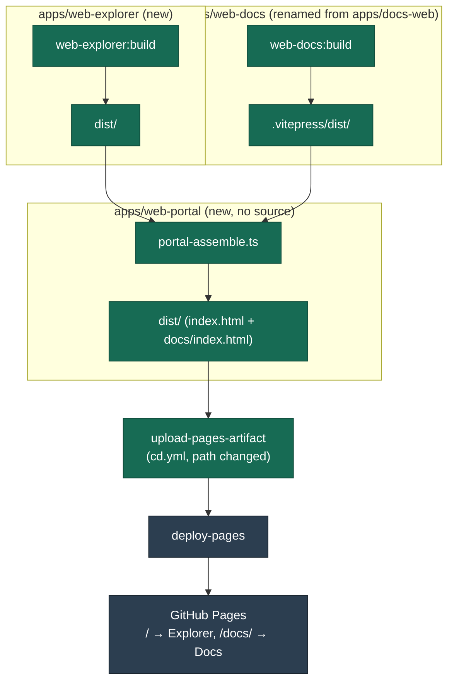

# DEV-20261109-J5LS: Web Explorer Landing Page & Web Portal Site Routing — Plan

| Field   | Value                                                               |
| ------- | ------------------------------------------------------------------- |
| Ticket  | DEV-20261109-J5LS                                                   |
| Intent  | [0-intent.md](0-intent.md)                                          |
| Branch  | `docs/design-20261108-1l8p-web-explorer-landing-web-portal-routing` |
| Created | 2026-11-09                                                          |

## Solution

Implement the approved design's settled decisions (`solution/Architecture.md`) in full, as one combined change per the developer's explicit choice (not the design's 2-PR sequencing — see intent's "Resolved during sign-off"). Three containers in the Web layer: rename `apps/docs-web` → `apps/web-docs` (VitePress `base` moves `/artisyn-implementation-harness/` → `/artisyn-implementation-harness/docs/`); register the developer's reference scaffold as `apps/web-explorer` (React 19 + Vite + Tailwind 4 + Motion, TS/Vite ranges pinned to root-compatible majors — root TS stays `^5.7.0`, not bumped); add `apps/web-portal`, a source-less Nx project whose `build` target depends on both (`implicitDependencies` for the `nx affected` graph edge, `dependsOn` for task ordering) and runs a typed assemble script that copies both builds into one tree and asserts both entry points exist. `.github/workflows/cd.yml`'s `upload-pages-artifact` path moves to `apps/web-portal/dist`.



Planning decisions:

- Bundle-size budget for `apps/web-explorer` (design decision 1's required check): a new `scripts/ci/check-bundle-budget.mjs`, threshold 600 KB combined raw JS+CSS under `dist/`, wired as the last command in the app's `build` target. Chosen as a concrete, generous-but-meaningful starting number (React 19 + Motion + Tailwind 4 typically lands well under this); adjustable later without a design change.
- ESLint: no React-specific plugin added (React 19's `jsx: "react-jsx"` transform needs no `React` global, and `@typescript-eslint/parser` parses `.tsx` JSX natively). Add one scoped block to root `eslint.config.js` for `apps/web-explorer/**/*.{ts,tsx}` with `globals.browser`, since the app's source uses DOM APIs (`document`, `window`) that the current config has no browser-global block for.
- Exact Vite major (intent's open question): pin to the latest Vite major whose peer range accepts TypeScript `^5.7` and Node `>=24` — resolved as a live check in Step 2's verification (`yarn install` succeeding is the test), not pre-guessed here.
- `apps/web-portal`'s build command mirrors `apps/docs-web`'s existing pattern (a script invoked via `nx:run-commands`, not inline shell in `project.json`) for consistency: `tsx scripts/ci/portal-assemble.ts`.

## Acceptance Criteria

- [ ] `AC-1` — `apps/web-explorer` exists in the workspace; `yarn nx run web-explorer:build` succeeds and produces `apps/web-explorer/dist/index.html`
- [ ] `AC-2` — `apps/web-docs` exists (renamed from `apps/docs-web`); `yarn nx run web-docs:build` succeeds and produces `apps/web-docs/.vitepress/dist/index.html`; no dead-link failures (NFR-5 still enforced)
- [ ] `AC-3` — `apps/web-portal` exists with no application source; `yarn nx run web-portal:build` succeeds and produces both `apps/web-portal/dist/index.html` and `apps/web-portal/dist/docs/index.html`
- [ ] `AC-4` — `apps/web-portal/project.json` declares `implicitDependencies: ["web-explorer", "web-docs"]`; `yarn nx show project web-portal --json` includes both as dependencies
- [ ] `AC-5` — `.github/workflows/cd.yml`'s `upload-pages-artifact` step's `path` is `apps/web-portal/dist`
- [ ] `AC-6` — `yarn nx run-many --target=lint,typecheck --projects=web-explorer,web-docs,web-portal` passes (only targets that exist per project)
- [ ] `AC-7` — `apps/web-explorer`'s built `dist/` is under the 600 KB combined JS+CSS budget (`scripts/ci/check-bundle-budget.mjs` exits 0)
- [ ] `AC-8` — Out of scope respected: no new auth/analytics/CMS/backend added; `apps/docs-web/.vitepress/theme/GiscusComments.vue`'s logic is untouched beyond the path rename already published in the HLD docs (Discuss container unaffected beyond that)
- [ ] `AC-9` — root `yarn install` resolves with one lockfile; no standalone `package-lock.json` remains under `apps/web-explorer`

## Steps

### Step 1 — Tests: skipped because there is no test framework for these layers

None of `apps/docs-web`, the reference scaffold, or the planned `apps/web-portal` composition script have an existing unit/integration test setup (only `apps/harness-bootstrap-e2e` has one, for an unrelated e2e harness). This is a static-site build and CI-composition change with no application logic to unit test; verification throughout is live build/output checks instead (each step's own Verification block).

### Step 2 — Web Docs: rename `apps/docs-web` → `apps/web-docs`, move base path to `/docs/`

**Changes:**

- `git mv apps/docs-web apps/web-docs`
- `apps/web-docs/project.json` — `name: "site"` → `"web-docs"`; `root`/`sourceRoot` (`"apps/docs-web"` → `"apps/web-docs"`); both `serve.configurations` and `build.configurations`' `dev`/`prod` `envFile` strings (`"apps/docs-web/.env.dev"`/`"apps/docs-web/.env.prod"` → `"apps/web-docs/.env.dev"`/`"apps/web-docs/.env.prod"`) — **RF-1, auto-applied from architecture audit**: these 4 fields are literal path strings, not `{projectRoot}` tokens, so the bare `git mv` leaves them stale, which breaks local `serve`/`build --configuration=dev|prod` (CI's `configuration=ci` has no `envFile`, so this would otherwise pass CI while being broken locally)
- `apps/web-docs/package.json` — `"name": "@artisyn-harness/docs-web"` → `"@artisyn-harness/web-docs"`
- `apps/web-docs/.vitepress/config.ts` — `base` constant: `/artisyn-implementation-harness/` → `/artisyn-implementation-harness/docs/` (comment above it updated to match)
- `scripts/ci/site-build.sh` — `(cd apps/docs-web && ...)` → `(cd apps/web-docs && ...)`
- `scripts/ci/check-tier-sync.mjs` — **RF-2, auto-applied from architecture audit**: the hardcoded path `'../../apps/docs-web/.vitepress/theme/GraphExplorer/cytoscapeStyle.ts'` (line 16) and its error-message string (line 37) both → `apps/web-docs/...`; `site-build.sh` runs this script before `vitepress build`, so leaving it stale would fail `web-docs:build` immediately post-rename, contradicting this step's own Verification

**Verification:**

> Run: `yarn nx run web-docs:build`
> Expected: build succeeds, `apps/web-docs/.vitepress/dist/index.html` exists, no dead-link failures printed (VitePress's default `ignoreDeadLinks: false` behavior still active — NFR-5 unchanged)

### Step 3 — Web Explorer: register `apps/web-explorer` in the workspace

**Changes:**

- `git mv "docs/Stories/design/approved/[DESIGN-20261108-1L8P] Web Explorer Landing Page & Web Portal Site Routing/design/reference/web-explorer" apps/web-explorer`
- `apps/web-explorer/package.json` — pin `"typescript": "^5.7.0"` (down from `^6.0.0`, matching root); pin `"vite"` to the major resolved in this step's verification (down from `^8.0.0`); remove `"private": true` is already set, keep as-is
- Delete `apps/web-explorer/package-lock.json` (single root lockfile going forward)
- `apps/web-explorer/tsconfig.json` — add `"extends": "../../tsconfig.base.json"` (matching `apps/web-docs/tsconfig.json`'s convention), keep its own `jsx`/`lib`/`types` overrides
- Create `apps/web-explorer/project.json` (new Nx project, mirroring `apps/web-docs/project.json`'s shape):
  ```json
  {
    "$schema": "../../node_modules/nx/schemas/project-schema.json",
    "name": "web-explorer",
    "projectType": "application",
    "root": "apps/web-explorer",
    "sourceRoot": "apps/web-explorer/src",
    "targets": {
      "typecheck": {
        "executor": "nx:run-commands",
        "options": { "command": "tsc --noEmit -p tsconfig.json", "cwd": "apps/web-explorer" }
      },
      "lint": {
        "executor": "nx:run-commands",
        "options": { "command": "eslint src", "cwd": "apps/web-explorer" }
      },
      "build": {
        "executor": "nx:run-commands",
        "cache": true,
        "inputs": ["default", "^default"],
        "outputs": ["{projectRoot}/dist"],
        "options": { "command": "bash scripts/ci/web-explorer-build.sh" }
      }
    }
  }
  ```
- Root `package.json` — no change needed (`workspaces: ["apps/*"]` already covers the new path)

**Verification:**

> Run: `yarn install` from repo root
> Expected: resolves with the single root lockfile, no error about conflicting `typescript`/`vite` peer ranges — this is the live check for the intent's open question (exact Vite major) and design decision 2's version-reconciliation risk. If `yarn install` reports an unresolvable peer conflict for `vite`, lower `apps/web-explorer/package.json`'s `vite` range one major at a time and re-run until it resolves; record the final pinned version in `2-report.md`'s Implementation Notes.

### Step 4 — Web Explorer: base path, build script, bundle budget, lint fix-up

**Changes:**

- `apps/web-explorer/vite.config.ts` — add `base` matching the tokenization approach `apps/web-docs/.vitepress/config.ts` uses (same project-site root literal, no `/docs/` suffix — Web Explorer serves at root)
- `scripts/ci/check-bundle-budget.mjs` (new) — sums the byte size of every `.js`/`.css` file under a `dist/` path given as `argv[2]`, exits 1 with a clear message if the total exceeds 600 KB (614400 bytes), exits 0 otherwise
- `scripts/ci/web-explorer-build.sh` (new, mirrors `scripts/ci/site-build.sh`'s pattern) —
  ```bash
  #!/usr/bin/env bash
  set -euo pipefail
  (cd apps/web-explorer && ../../node_modules/.bin/tsc -b && ../../node_modules/.bin/vite build)
  node scripts/ci/check-bundle-budget.mjs apps/web-explorer/dist
  ```
- Root `eslint.config.js` — add one block: `{ files: ['apps/web-explorer/**/*.{ts,tsx}'], languageOptions: { globals: globals.browser } }`
- Fix any lint errors `yarn nx run web-explorer:lint` surfaces in the moved source (expected to be none or trivial, since the scaffold was written cleanly, but the root config's stricter `tseslint.configs.recommended` + `js.configs.recommended` have not run against it before)

**Verification:**

> Run: `yarn nx run web-explorer:build`
> Expected: succeeds; `apps/web-explorer/dist/index.html` and its hashed asset files exist; `check-bundle-budget.mjs` prints the total size and exits 0
>
> Run: `yarn nx run web-explorer:lint && yarn nx run web-explorer:typecheck`
> Expected: both pass with no errors
>
> Run: `grep -rn "dangerouslySetInnerHTML\|<script" apps/web-explorer/src`
> Expected: no matches — the live check for Web Explorer's HLD-stated guarantee (no raw HTML/script execution)

### Step 5 — Web Explorer: adopt the scaffold's own docs into their native permanent location, retire the rest

The moved scaffold brought its own `apps/web-explorer/docs/` subfolder (`IMPLEMENTATION_BRIEF.md`, `DESIGN_SYSTEM.md`, `CONTENT_AND_DEMO.md`, `TECH_STACK.md`, `SOURCES.md`) — authoring notes for building and integrating the scaffold, sitting in the wrong place for a permanent home. Per `Documentation/02 Structure.md`'s "App README scope": a README is a local dev quickstart only (what the app does, how to run it, links to HLD + LLD) — "if a README exceeds one page, something is in the wrong place, move it to `docs/`." **RF-4, revised from this step's first draft (architecture re-audit)**: the design-system/content/provenance material is architecture-descriptive, not a quickstart — it belongs in LLD, not folded into the README.

**Changes:**

- Read all 5 files in full
- Create `docs/System Architecture (LLD)/Web Explorer/00. Overview.md` (new LLD folder — closes part of the existing, already-accepted HLD/LLD gap the Web layer's 3-way split left behind; mirrors `docs/System Architecture (LLD)/Web/00. Overview.md`'s shape). Consolidate the lasting content: design-system tokens and visual rules (`DESIGN_SYSTEM.md`), the content-accuracy and "simulated, not live" boundaries (`CONTENT_AND_DEMO.md`), and the brand-asset provenance/approval-status note (`SOURCES.md`) — rewritten as implementation detail, not copied verbatim
- Update `docs/System Architecture (LLD)/README.md`'s container table to add the `Web Explorer` row (same mirroring convention the HLD index already follows)
- Write a short `apps/web-explorer/README.md` (replacing the scaffold's own starter README from Step 3's move): what the app is, how to run/build it locally, links to `Containers/Web Explorer.md` (HLD) and the new LLD overview — one page, matching `apps/docs-web/README.md`'s actual shape
- Do not carry forward `TECH_STACK.md`'s monorepo-integration instructions or `IMPLEMENTATION_BRIEF.md`'s "ready-to-use coding-agent brief" — both describe exactly the integration Steps 3–4 just performed; their job is done. `IMPLEMENTATION_BRIEF.md`'s positioning/audience framing is already covered by the HLD container doc and Frame's known ECs — not duplicated a third time
- Delete `apps/web-explorer/docs/` once its content is placed

**Verification:**

> Run: `ls apps/web-explorer/docs/ 2>&1`
> Expected: `No such file or directory` — the subfolder is gone
>
> Run: `wc -l apps/web-explorer/README.md`
> Expected: comparable length to `apps/docs-web/README.md` (one page) — not a re-expansion of the deleted `docs/` subfolder's content
>
> Run: `cat "docs/System Architecture (LLD)/Web Explorer/00. Overview.md"`
> Expected: reads as implementation detail for the Web Explorer container, in the same register as `docs/System Architecture (LLD)/Web/00. Overview.md`

### Step 6 — Web Portal: create the composition project

**Changes:**

- `apps/web-portal/project.json` (new):
  ```json
  {
    "$schema": "../../node_modules/nx/schemas/project-schema.json",
    "name": "web-portal",
    "projectType": "application",
    "root": "apps/web-portal",
    "sourceRoot": "",
    "implicitDependencies": ["web-explorer", "web-docs"],
    "targets": {
      "build": {
        "executor": "nx:run-commands",
        "cache": true,
        "dependsOn": ["web-explorer:build", "web-docs:build"],
        "outputs": ["{projectRoot}/dist"],
        "options": { "command": "tsx scripts/ci/portal-assemble.ts" }
      }
    }
  }
  ```
- `scripts/ci/portal-assemble.ts` (new) — `fs.cpSync('apps/web-explorer/dist', 'apps/web-portal/dist', { recursive: true })`; `fs.cpSync('apps/web-docs/.vitepress/dist', 'apps/web-portal/dist/docs', { recursive: true })`; then assert both `apps/web-portal/dist/index.html` and `apps/web-portal/dist/docs/index.html` exist via `fs.existsSync`, `throw new Error(...)` naming which one is missing if not

**Verification:**

> Run: `yarn nx run web-portal:build`
> Expected: both dependency builds run first (visible in Nx's output order), then the assemble script runs, prints success, and exits 0; `apps/web-portal/dist/index.html` and `apps/web-portal/dist/docs/index.html` both exist (`ls apps/web-portal/dist apps/web-portal/dist/docs`)
>
> Run: `yarn nx show project web-portal --json | grep -A2 implicitDependencies` (or equivalent `nx graph` inspection)
> Expected: `web-explorer` and `web-docs` both listed as dependencies — the live proof that `nx affected` will correctly mark `web-portal` affected when either changes (AC-4)

### Step 7 — CI/CD: point the deploy pipeline at the composed artifact

**Changes:**

- `.github/workflows/cd.yml` — `Upload artifact` step's `path` input: `apps/docs-web/.vitepress/dist` → `apps/web-portal/dist`

**Verification:**

> Run: `rm -rf apps/web-explorer/dist apps/web-docs/.vitepress/dist apps/web-portal/dist && yarn nx run web-portal:build` (clean rebuild, simulating what CI's `nx affected --target=build` produces)
> Expected: succeeds end to end; `apps/web-portal/dist/` contains `index.html` at its root and a `docs/` subdirectory with its own `index.html` — this is the exact artifact tree `cd.yml`'s `upload-pages-artifact` step will now upload, confirming the path change in this step points at something real
>
> Live GitHub Pages serving (root → Web Explorer, `/docs/` → Web Docs, `actions/configure-pages` auto-detection against this merged tree) can only be confirmed once this lands on `main` and the workflow runs — flag this to the developer as a post-merge check, not something this step can verify locally.

**Note (not a step, flagged by architecture audit):** `docs/Target Architecture (HLD)/v1/Non-Functional Concerns/Requirements.md`'s NFR-5/NFR-7/NFR-10 verification text still cites `apps/docs-web/...` paths — already stale relative to the published `Web Docs.md`/`Web Explorer.md`/`Web Portal.md` container docs, and will be further stale once this plan's Step 2 lands. Pre-existing inconsistency, not introduced by this plan; the Document stage should pick it up.
