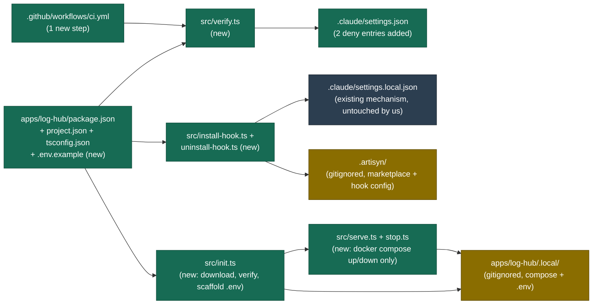

# DEV-20261115-BM9L: Log Hub Session Telemetry Integration — Plan

| Field   | Value                                                            |
| ------- | ---------------------------------------------------------------- |
| Ticket  | DEV-20261115-BM9L (local ID; design source DESIGN-20261115-V98J) |
| Intent  | [0-intent.md](0-intent.md)                                       |
| Branch  | `docs/design-20261115-v98j-log-hub-telemetry`                    |
| Created | 2026-11-15                                                       |

## Solution

Build the `log-hub` Nx project at `apps/log-hub/` exactly as `solution/Architecture.md` and `solution/Design.md` specify: a wrapper around the upstream Artisyn Log Hub release (pinned `v1.4.1`, confirmed on GitHub Releases) and its Claude Code hook installer, registered at **local** Claude Code scope only. Touches one new HLD container (Log Hub, already documented at design Publish) and two existing files: `.claude/settings.json` (two new `permissions.deny` entries, no other change) and `.github/workflows/ci.yml` (one new step). Nothing else in the repo changes.

**Planning decisions:**

- **Spike WBS #3 resolved during planning, not as an implementation step.** Ran a live test against a scratch repo: `claude plugin marketplace add <path> --scope local` followed by `claude plugin install <plugin>@<marketplace> --scope local` registers cleanly into `.claude/settings.local.json`'s `extraKnownMarketplaces`/`enabledPlugins`, with zero writes to any committed file. This confirms the primary layout (Decision 5) works; the Decision 6 fallback is not needed and is out of scope for this plan, consistent with the intent.
- **Spike WBS #7/#8 cannot be live-verified in this environment.** Docker's daemon is not reachable here (Rancher Desktop VM did not come up in time), so `docker compose up` and a live hook-installer fetch from a running server cannot be exercised. Scripts are written defensively and unit-tested wherever logic doesn't require a live Docker/network call; the plan ends with an explicit developer verification step for the Docker-dependent paths (`log-hub:serve`, `log-hub:install-hook` end to end), since that needs the developer's own Docker-capable machine.
- **Release pin:** `v1.4.1` (current latest on `DataArt/artisyn-log-hub`), confirmed via GitHub Releases API. Asset names confirmed: `install.sh`, `docker-compose.yml`, `env.example`, `SHA256SUMS`.
- **Language: TypeScript, not plain `.mjs` — developer decision, deviates from `solution/Stack.md`. Refined twice during planning to match this repo's own `apps/harness-bootstrap-e2e` precedent exactly.** `solution/Stack.md` confirmed plain Node.js `.mjs` scripts at design time, matching `.canonical-implementation-harness/scripts/*.mjs`. The developer asked to switch to TypeScript, then asked specifically to match the `harness-bootstrap-e2e` app's own shape: a dedicated `apps/log-hub/package.json` (`"name": "@artisyn-harness/log-hub"`, `"type": "module"`, `"private": true`, `tsx`+`typescript` devDependencies), a dedicated `apps/log-hub/tsconfig.json` extending the root `tsconfig.base.json`, plain `.ts` files (no `.mts` — `"type": "module"` at the package level makes `.ts` resolve as ESM) under `apps/log-hub/src/` (matching `harness-bootstrap-e2e`'s `sourceRoot: apps/harness-bootstrap-e2e/src`), run via `tsx` (the same runtime shim the root `bootstrap:client` script uses) — no build step, no `dist/` output. `typecheck` and `lint` targets are added so `log-hub` participates in the existing `nx affected --target=typecheck|lint` CI steps like every other TS project in the workspace — additive quality coverage, not a new CI dependency, and does not touch Decision 10's exclusion of the Docker-dependent lifecycle targets from `nx affected`. Recorded as RF-001 in `2-report.md` (deviation from the approved `Stack.md`, developer-attributed, accepted — not escalated further since the developer decided it directly in this session).
- **Test convention:** `node:test` + `node:assert/strict`, run through `tsx --test` so the same assertions work against `.ts` sources — matching the test style in `.claude/skills/design/scripts/design-metrics.test.mjs`, adapted for TypeScript.
- **Ops model split into `init` then `serve` — developer decision, refines Design.md's `serve.ts`/`upgrade` shape.** Design.md described one `serve.ts` doing download+checksum+`.env`-scaffold+`docker compose up` together. The developer asked to split this into two explicit steps: `yarn nx run log-hub:init` (one-time: download the pinned release, verify checksums, scaffold `.local/.env` from a new committed `apps/log-hub/.env.example`) and `yarn nx run log-hub:serve` (every time: `docker compose pull && up -d` against what `init` already scaffolded; aborts with a clear message if `init` hasn't run). `upgrade` re-runs `init`'s download/verify for a newly pinned `VERSION` (never touching `.local/.env`) and then performs the same `docker compose pull && up -d` as `serve`. This is an additive clarification of Decision 2/3/4's existing contract, not a new decision — the committed `.env.example` documents the non-secret defaults this design already settled (`AUTH_MODE=none`, `LOG_HUB_DATA_DIR` outside the repo tree) instead of leaving them implicit in script logic. Recorded as RF-002 in `2-report.md`.

## Acceptance Criteria

- [ ] `AC-1` — `yarn nx show projects` lists `log-hub` (intent: "better looks like", Architecture Decision 1 verification).
- [ ] `AC-2` — `apps/log-hub/VERSION` contains `1.4.1`, committed plain text (Decision 2 verification).
- [ ] `AC-3` — `tsx --test apps/log-hub/src/checksums.test.ts` passes, including a case where a tampered download is rejected (Decision 3 verification — "fails closed on checksum mismatch").
- [ ] `AC-4` — `apps/log-hub/.local/` and `.artisyn/` are present in `.gitignore`; `git status` after a dry `log-hub:init` invocation (mocked network/checksum) shows nothing untracked outside those paths (Decision 4).
- [ ] `AC-4b` — `tsx --test apps/log-hub/src/init.test.ts` passes, including: checksum failure aborts before scaffolding; `.local/.env` is created from `.env.example` with `LOG_HUB_DATA_DIR` and both secrets filled; a second run is byte-identical; a partially hand-filled `.env` only has its empty lines filled (developer ops-model decision — RF-002).
- [ ] `AC-5` — `tsx --test apps/log-hub/src/install-hook.test.ts` passes, including the case where `.claude/settings.json` differs after the restore step and the script aborts non-zero (Decision 5/Design.md failure mode).
- [ ] `AC-6` — `tsx --test apps/log-hub/src/uninstall-hook.test.ts` passes, including idempotency (running twice does not error) (Design.md `uninstall-hook.ts` contract).
- [ ] `AC-7` — `tsx --test apps/log-hub/src/verify.test.ts` passes against fixtures for: clean repo (pass), a stray `enabledPlugins` key present (fail, names the exact assertion), `.artisyn/` tracked by git (fail), canonical hash mismatch (fail) (Decision 8).
- [ ] `AC-8` — `yarn nx run log-hub:verify` passes against this repo's actual current state (not just fixtures) — proves canonical isolation holds today (Decision 8 end to end).
- [ ] `AC-9` — `.claude/settings.json` diff shows exactly two new `permissions.deny` entries (`Read(./apps/log-hub/.local/**)`, `Read(./.artisyn/**)`) and no other key changed (Decision 7).
- [ ] `AC-10` — `.github/workflows/ci.yml` diff shows exactly one new step running `yarn nx run log-hub:verify`; no existing step changed (Decision 8/10).
- [ ] `AC-11` — none of `init`, `serve`, `stop`, `upgrade`, `install-hook`, `upgrade-hook`, `uninstall-hook` targets carry a `ci`-affected tag or run in `nx affected` (Decision 10) — `yarn nx show project log-hub --json` inspected for target `inputs`/cache config confirms no default-project-graph inclusion beyond `verify`.
- [ ] `AC-12` — `yarn nx run web-portal:build` output is unchanged (byte-identical file list) after adding `log-hub` (Decision 1 — "no change to `apps/web-portal`'s composed deploy tree").
- [ ] `AC-13` — `yarn nx run log-hub:typecheck` and `yarn nx run log-hub:lint` both pass once every script from Steps 2–6 exists (TypeScript switch, developer decision — RF-001).
- [ ] `AC-14` — `log-hub:serve` run without `log-hub:init` having run first aborts with a message naming `log-hub:init`, not a Docker or missing-file stack trace (ops-model split, developer decision — RF-002).

## Dependencies

None outside this repo. Live verification of `log-hub:serve` and `log-hub:install-hook` end to end requires a Docker-capable machine; not available in this execution environment (see Step 7).

## Steps

### Step 1 — Scaffold the `log-hub` Nx project

**What changes:**

- `apps/log-hub/package.json` — new file, same shape as `apps/harness-bootstrap-e2e/package.json`: `"name": "@artisyn-harness/log-hub"`, `"version": "0.0.0"`, `"private": true`, `"type": "module"`, `devDependencies: { "tsx": "^4.0.0", "typescript": "^5.0.0", "@types/node": "^24" }`.
- `apps/log-hub/project.json` — new Nx project, `sourceRoot: "apps/log-hub/src"`, `nx:run-commands` executor for every target, `cwd: "{projectRoot}"`, same shape as `apps/harness-bootstrap-e2e/project.json`. Targets declared now (implementations added in later steps): `init`, `serve`, `stop`, `upgrade`, `install-hook`, `upgrade-hook`, `uninstall-hook`, `verify`, plus `typecheck` (`tsc --noEmit -p tsconfig.json`) and `lint` (`eslint src`), both wired now since they need no later implementation.
- `apps/log-hub/tsconfig.json` — new file, extends `../../tsconfig.base.json`, same shape as `apps/harness-bootstrap-e2e/tsconfig.json` (`target: ES2022`, `types: ["node"]`, `noEmit: true`, `allowImportingTsExtensions: true`, `include: ["src"]`).
- `apps/log-hub/VERSION` — new file, content `1.4.1` (plain text, no trailing decoration beyond a newline).
- `apps/log-hub/.env.example` — new file, committed. Template for the scaffolded `.local/.env`, prepopulated with this design's settled defaults: `AUTH_MODE=none` (Decision 2), `POSTGRES_USER=postgres`, `POSTGRES_DB=a-log`, and three lines left empty on purpose for `init.ts` (Step 3a) to fill on first run only: `LOG_HUB_DATA_DIR=` (filled with an absolute, repo-slug-derived path outside the repo tree, per Decision 4 — a relative value here would resolve against `.local/`'s own directory per upstream's own documented behavior, landing it back inside the repo), `POSTGRES_PASSWORD=` and `SESSION_SECRET=` (filled with generated random values). Every other upstream optional setting (SMTP, Azure, retention windows, outbound version/pricing checks) stays commented out exactly as upstream's own `env.example` ships it, so this file stays a thin, reviewable diff of only what this design actually settles.
- `apps/log-hub/README.md` — new file, one paragraph pointing to `Containers/Log Hub.md` and `Engineering Guide/07 Log Hub Setup.md` (both already published), naming the two-command ops model: `log-hub:init` once, then `log-hub:serve`.
- `.gitignore` — add `apps/log-hub/.local/` and `.artisyn/` (after the existing `.env`/`.bak` block, same style).
- Root `package.json` `workspaces` — already `["apps/*"]`; no change needed. `yarn install` picks up the new workspace package from its own `package.json`.

**Verification:**

- `yarn nx show projects` includes `log-hub`.
- `yarn nx show project log-hub --json` parses and lists all ten target names (`init` + seven lifecycle/verify targets plus `typecheck`/`lint`), and `sourceRoot` reads `apps/log-hub/src`.
- `cat apps/log-hub/VERSION` → `1.4.1`.
- `apps/log-hub/.env.example` parses as valid dotenv syntax (no malformed lines) and contains `AUTH_MODE=none` uncommented.
- `git check-ignore -v apps/log-hub/.local/anything .artisyn/anything` both report a match against the new `.gitignore` lines.
- `yarn install` resolves the new workspace package with no errors.
- `yarn nx run log-hub:typecheck` passes against the empty `src/` directory (trivially, before Step 2 adds content) — confirms the `package.json`/`tsconfig.json` wiring itself is correct before real code depends on it.

### Step 2 — Checksum verification module and tests

**What changes:**

- `apps/log-hub/src/checksums.ts` — exports `verifySha256Sums(dir, sumsFileContent)`: parses a `SHA256SUMS`-format file (`<hex>␠␠<filename>` per line), hashes each named file under `dir` with `node:crypto`, throws a descriptive error naming the first mismatching or missing file.
- `apps/log-hub/src/checksums.test.ts` — `node:test` cases: all files match (pass); one file's content tampered (throws, names the file); a file referenced in SHA256SUMS missing from disk (throws, names the file); SHA256SUMS line with extra whitespace/CRLF parses correctly.

**Verification:**

- `tsx --test apps/log-hub/src/checksums.test.ts` — all cases pass, including the tampered-file case asserting the thrown error's message names the exact file.

### Step 3a — `init.ts` (target: `init`) — download, verify, scaffold `.env`

**What changes:**

- `apps/log-hub/src/init.ts` — exports `fetchAndVerifyRelease(version)` (used again by Step 3b's `upgrade`) and the `init` target: downloads `install.sh`, `docker-compose.yml`, `SHA256SUMS` from `https://github.com/DataArt/artisyn-log-hub/releases/download/v{VERSION}/` (VERSION read from `apps/log-hub/VERSION`) into `apps/log-hub/.local/`; calls `verifySha256Sums` from Step 2 on the downloaded files before doing anything else; aborts non-zero on mismatch; if `.local/.env` is absent, copies it from `apps/log-hub/.env.example` (Step 1), then fills each still-empty line: `LOG_HUB_DATA_DIR` with `$HOME/.cache/artisyn-log-hub/<repo-slug>/pgdata` (repo-slug derived from `git remote get-url origin`, falling back to the checkout path's basename when there is no remote), `POSTGRES_PASSWORD`/`SESSION_SECRET` with generated random values (`node:crypto.randomBytes(32).toString('hex')`); never overwrites an existing `.local/.env`, even a partially filled one — only lines still empty are ever touched, and only on first run. Does **not** run any `docker compose` command.
- `apps/log-hub/src/init.test.ts` — unit tests, no Docker: checksum-failure aborts before any file is scaffolded (mock `verifySha256Sums` to throw); first run with no `.env.example`-derived `.env` present creates one from the fixture example with a non-empty `LOG_HUB_DATA_DIR` and random non-empty secrets; a second run against an already-scaffolded `.env` changes nothing (byte-identical before/after); a fixture `.env` with some but not all of the three lines already filled in by hand leaves the filled ones untouched and fills only the empty ones.

**Verification:**

- `tsx --test apps/log-hub/src/init.test.ts` passes.
- **Live, requires network + Docker-free (flagged for the developer in Step 7):** `yarn nx run log-hub:init` downloads the pinned release, verifies checksums, and leaves `apps/log-hub/.local/.env` populated with a non-empty `LOG_HUB_DATA_DIR` and non-placeholder `POSTGRES_PASSWORD`/`SESSION_SECRET` values; running it again leaves the file byte-identical.

### Step 3b — `serve.ts` and `stop.ts` (targets: `serve`, `stop`, `upgrade`)

**What changes:**

- `apps/log-hub/src/serve.ts` — `serve` target: if `apps/log-hub/.local/docker-compose.yml` is missing, aborts with "run `yarn nx run log-hub:init` first"; otherwise runs `docker compose --env-file .local/.env -f .local/docker-compose.yml pull` then `up -d` via `node:child_process.execFileSync`, `cwd` resolved relative to the Nx project root so the compose file's own relative paths resolve correctly. `upgrade` target: calls `init.ts`'s exported `fetchAndVerifyRelease(VERSION)` to re-download/re-verify the (possibly bumped) pinned release into `.local/` without touching `.local/.env`, then runs the same `docker compose pull && up -d` as `serve`.
- `apps/log-hub/src/stop.ts` — `stop` target: `docker compose -f .local/docker-compose.yml down`; no-op (exit 0) if `.local/docker-compose.yml` doesn't exist yet.
- `apps/log-hub/src/serve.test.ts` — unit tests that don't require Docker: `serve` aborts with the "`run init first`" message when `.local/docker-compose.yml` is absent (mock filesystem); argument assembly for the `docker compose` invocation (mock `execFileSync`, assert the exact argv); `upgrade` calls `fetchAndVerifyRelease` before `execFileSync` (mock both, assert call order) and never touches `.local/.env` (fixture with existing `.env`, assert untouched after a mocked `upgrade` run).

**Verification:**

- `tsx --test apps/log-hub/src/serve.test.ts` passes.
- **Live, requires Docker (flagged for the developer in Step 7):** `yarn nx run log-hub:init` then `yarn nx run log-hub:serve` actually brings up the container on `127.0.0.1:5003`; `docker compose -f apps/log-hub/.local/docker-compose.yml ps` shows it bound to loopback only. Running `serve` directly without `init` first aborts with the expected message.

### Step 4 — `install-hook.ts` (targets: `install-hook`, `upgrade-hook`)

**What changes:**

- `apps/log-hub/src/install-hook.ts` — prints the exact disclosure text from `docs/Engineering Guide/07 Log Hub Setup.md` and requires a literal `yes` on stdin before continuing; prompts for the API key; fetches the hook installer tarball from `http://127.0.0.1:5003/static/artisyn-hooks-installer.tgz` via `yarn dlx` (viability confirmed in this plan's Step 8 live-check item; falls back to a scoped `npx` call — logged as a one-line notice, never silent — only if `yarn dlx` exits non-zero resolving the tarball URL); runs the installer with `--server-url http://127.0.0.1:5003 --api-key <prompted>`; snapshots `.claude/settings.json`'s content before running, restores it byte-for-byte from the installer's own `.bak` after, then asserts the live file now matches the pre-run snapshot — aborts non-zero naming the diff if it does not; runs `claude plugin marketplace add ./.artisyn/marketplace --scope local` and `claude plugin install log-hub-hooks@<marketplace-name> --scope local` (confirmed mechanically working in this plan's spike); writes `.artisyn/config/log-hub.json` with `otelTraces` and the cost-advisor keys absent (off by default).
- `apps/log-hub/src/install-hook.test.ts` — unit tests with all external calls (installer tarball fetch, `claude plugin …`, prompts) mocked: the settings.json integrity guard fires and aborts when a fixture's "after" content differs from "before"; the disclosure-confirmation gate blocks when stdin is not `yes`; the default config (no `otelTraces` key) is written correctly.

**Verification:**

- `tsx --test apps/log-hub/src/install-hook.test.ts` passes.
- **Live, requires Docker + a running `log-hub:serve` (flagged in Step 7):** full install against a scratch clone, confirming `.claude/settings.json` is byte-identical before/after and `claude plugin list` shows the hook enabled at local scope.

### Step 5 — `uninstall-hook.ts` (target: `uninstall-hook`)

**What changes:**

- `apps/log-hub/src/uninstall-hook.ts` — runs the upstream uninstall command if the plugin is installed; then explicitly reads `.claude/settings.local.json` and removes any `enabledPlugins`/`extraKnownMarketplaces` keys whose name starts with `log-hub-hooks@` or `artisyn-` (the gap this design's Architecture.md Decision 5/Design.md names in upstream's own uninstall); exits 0 if nothing is installed.
- `apps/log-hub/src/uninstall-hook.test.ts` — fixture `.claude/settings.local.json` with the two keys present → both removed, other keys untouched; fixture with nothing installed → exits 0, file untouched; running twice in a row is a no-op the second time.

**Verification:**

- `tsx --test apps/log-hub/src/uninstall-hook.test.ts` passes, including the idempotency case.

### Step 6 — `verify.ts` (target: `verify`) — the CI-facing check

**What changes:**

- `apps/log-hub/src/verify.ts` — no Docker, no network. Four assertions, each printing which one failed on non-zero exit:
  1. `.claude/settings.json` (parsed JSON) has no `enabledPlugins` or `extraKnownMarketplaces` key whose name matches `log-hub-hooks@*` or `artisyn-*`.
  2. `.artisyn/` and `apps/log-hub/.local/` both appear covered by `.gitignore` (via `git check-ignore`) and neither has any tracked file under it (via `git ls-files`).
  3. `.claude/settings.json`'s two new `permissions.deny` entries (`Read(./apps/log-hub/.local/**)`, `Read(./.artisyn/**)`) are present.
  4. `.canonical-implementation-harness/canonical/settings.json`'s current sha256 (via `node:crypto`) matches `.canonical-implementation-harness/state/index.json`'s `canonical["canonical/settings.json"].recorded_sha256`.
- `apps/log-hub/src/verify.test.ts` — one fixture directory per failure mode (stray plugin key; tracked `.artisyn/` file; missing deny entry; tampered canonical hash) plus one clean-pass fixture; each test spawns `verify.ts` via `node:child_process.spawnSync` against a temp copy of the fixture and asserts both the exit code and that stdout/stderr names the specific failed assertion.

**Verification:**

- `tsx --test apps/log-hub/src/verify.test.ts` — all five fixtures behave as asserted.
- `yarn nx run log-hub:verify` run against this actual repo (not a fixture) exits 0 once Steps 1–7 are complete — the live proof that canonical isolation holds today, not just in test fixtures.

### Step 7 — Wire `.claude/settings.json`, `.gitignore` (already in Step 1) and CI

**What changes:**

- `.claude/settings.json` — add exactly two entries to the existing `permissions.deny` array: `"Read(./apps/log-hub/.local/**)"`, `"Read(./.artisyn/**)"`. No other key touched.
- `.github/workflows/ci.yml` — add one step after the existing `Build (affected)` step: `- name: Log Hub canonical isolation\n  run: yarn nx run log-hub:verify` (direct invocation, not `nx affected`-gated, since it must always run regardless of what changed — Decision 8/10's intent is a standing guarantee, not a diff-triggered one).

**Verification:**

- `git diff .claude/settings.json` shows exactly the two new lines, nothing else.
- `git diff .github/workflows/ci.yml` shows exactly the one new step.
- `yarn nx run log-hub:verify` (live, against the real repo state after this step) exits 0 — AC-8.
- A local dry run of the new CI step's command (`yarn nx run log-hub:verify`) is the same command the workflow YAML declares — confirmed by reading both side by side, since this environment cannot execute GitHub Actions directly.

### Step 8 — Developer-side live verification (Docker-dependent, flagged, not run by this plan)

This step has no file changes. It is the explicit handoff for the parts this execution environment cannot verify:

1. On a machine with Docker running: `yarn nx run log-hub:init` — confirm it downloads and verifies the pinned release and scaffolds `apps/log-hub/.local/.env` with real generated secrets, then `yarn nx run log-hub:serve` — confirm the container comes up on `127.0.0.1:5003` only, and `docker compose ps` shows it healthy.
2. `yarn nx run log-hub:install-hook` — confirm the disclosure prints, the prompt works, and `git diff --exit-code .claude/settings.json` reports no change afterward.
3. `yarn nx run log-hub:verify` — confirm it still passes with the hook actually installed.
4. `yarn nx run log-hub:uninstall-hook` then `log-hub:verify` again — confirm clean teardown.
5. `yarn nx run log-hub:upgrade` against a different pinned `VERSION` — confirm `.local/.env` is untouched and the container restarts on the new image.

**Verification:** the developer reports the outcome of these four live checks; recorded in `2-report.md`'s Implementation Notes as developer-attributed evidence, not self-reported by the agent.
