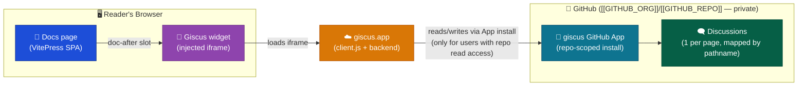

# ADLC-000: Giscus Comments for VitePress

| Field   | Value                            |
| ------- | -------------------------------- |
| Ticket  | ADLC-000                         |
| Branch  | `feat/adlc-000-giscus-vitepress` |
| Created | 2026-08-01                       |

## Problem

The VitePress docs site has no way for readers to leave feedback or discuss a specific page. Giscus is a comments widget backed by GitHub Discussions — it needs no backend of its own, matches this site's "no server-side runtime" Web container design, and reuses the existing private GitHub repo (`[[GITHUB_ORG]]/[[GITHUB_REPO]]`) as the storage/identity layer.

Access model (confirmed with developer): giscus's access control rides on GitHub repo permissions, not the site's Lambda@Edge basic auth. Only GitHub users with read access to the private repo can view/post comments — a subset of everyone who can reach the site via the shared password. This is expected and accepted.

## Scope

**In scope:**

- Enable GitHub Discussions on `[[GITHUB_ORG]]/[[GITHUB_REPO]]` and install the giscus GitHub App (developer-performed, external to this repo's code)
- Embed the giscus comments widget at the bottom of documentation pages via VitePress's `doc-after` slot
- SPA-safe reload of the widget on client-side navigation between docs pages

**Out of scope:**

- Custom moderation tooling, notification wiring, or Discussions category structure beyond the one category giscus needs
- Widget on the homepage (`docs/index.md`, `layout: home`) — home pages are outside the `doc-after` slot by design
- Light/dark theme sync with the site's manual toggle — using giscus's `preferred_color_scheme` (OS-level) for now

## Acceptance Criteria

- [ ] `AC-1` — giscus GitHub App is installed on `[[GITHUB_ORG]]/[[GITHUB_REPO]]` and Discussions is enabled with a category dedicated to giscus mapping (verified in GitHub repo settings)
- [ ] `AC-2` — running `yarn nx run site:serve` and opening any documentation page (e.g. `/Engineering Guide/01 Conventions`) shows the giscus widget rendered at the bottom of the content, below the page footer/prev-next links
- [ ] `AC-3` — the widget is mapped to the page (`data-mapping="pathname"` or equivalent) — opening two different doc pages shows two distinct discussion contexts, not the same one
- [ ] `AC-4` — navigating between two doc pages via a sidebar/nav link (no full browser reload) updates the widget to reflect the new page, confirmed via Network tab showing a fresh giscus request after client-side navigation
- [ ] `AC-5` — the homepage (`/`) does NOT render the giscus widget
- [ ] `AC-6` — `yarn nx run site:build` completes successfully with the new component compiled in
- [ ] `AC-7` — no secrets, credentials, or region strings are introduced; giscus config values (repo id / category id) are the public, non-secret identifiers giscus's own docs describe as safe to embed in client-side source

## Dependencies

- Step 1 (GitHub-side setup) must be completed and its two output values (repo id, category id) in hand before Step 2 can be written with real config — not something this plan automates.

## Steps



### Step 1 — External: GitHub Discussions & giscus App setup

No code changes — this step is developer-performed setup on GitHub, gating the config values Step 2 needs.

**Changes:**

- None (repo settings on `[[GITHUB_ORG]]/[[GITHUB_REPO]]`, outside this codebase)

**Actions:**

1. In `[[GITHUB_ORG]]/[[GITHUB_REPO]]` GitHub repo settings → enable **Discussions**
2. Create a Discussions category for giscus (e.g. "Page Comments", format: _Announcements_ so only giscus/maintainers start new discussions — recommended by giscus)
3. Install the **giscus** GitHub App (https://github.com/apps/giscus) scoped to `[[GITHUB_ORG]]/[[GITHUB_REPO]]`
4. Because the repo is **private**, giscus.app's configurator cannot verify it (its "✔️ compatible" check is an anonymous, unauthenticated API call and can't see private repos — this is expected, not a sign of misconfiguration). Instead, get the two IDs directly via GitHub's authenticated GraphQL API Explorer (https://docs.github.com/en/graphql/overview/explorer), signed in as an account with read access to the repo:

   ```graphql
   query {
     repository(owner: "[[GITHUB_ORG]]", name: "[[GITHUB_REPO]]") {
       id
       discussionCategories(first: 10) {
         nodes {
           id
           name
         }
       }
     }
   }
   ```

   `repository.id` → `data-repo-id`. The `id` of the category created in step 2 → `data-category-id`. Keep both values on hand for Step 2.

**Verification:**

> Check: GitHub repo → **Settings → General → Features** shows Discussions enabled
> Check: GitHub repo → **Settings → Integrations → Applications** (or **Discussions** tab) shows the giscus App installed
> Check: the GraphQL query above returns a non-null `repository.id` and a `discussionCategories.nodes` entry matching the category created in step 2

⚠️ **Stop here. Confirm both IDs are captured before proceeding.**

### Step 2 — Web: Mount a static giscus widget on doc pages

Depends on Step 1's `data-repo-id` / `data-category-id`. Ships the widget rendering correctly on a normal (hard) page load — SPA-navigation reactivity is deferred to Step 3.

**Changes:**

- `apps/docs-web/.vitepress/theme/GiscusComments.vue` — new component. Renders a mount `<div>` and imperatively injects the `https://giscus.app/client.js` script on mount (per giscus's official framework-agnostic embed method — no new npm dependency). Config (`data-repo="[[GITHUB_ORG]]/[[GITHUB_REPO]]"`, `data-repo-id`, `data-category`, `data-category-id`, `data-mapping="pathname"`, `data-theme="preferred_color_scheme"`) as constants at the top of the file, with `data-repo-id`/`data-category-id` filled in from Step 1.
- `apps/docs-web/.vitepress/theme/Layout.vue` — new component wrapping `DefaultTheme.Layout`, adding `<GiscusComments />` in the `#doc-after` slot (VitePress's built-in slot that only renders on pages using the `doc` layout — automatically excludes `docs/index.md`'s `layout: home`).
- `apps/docs-web/.vitepress/theme/index.ts` — add `Layout` (from the new `Layout.vue`) to the exported theme object alongside the existing `extends: DefaultTheme` and `setup()`; no changes to the existing zoom logic.

**Verification:**

> Run: `yarn nx run site:serve`
> Open (full browser load, e.g. paste URL and hit enter): `http://localhost:5173/Engineering%20Guide/01%20Conventions` (or any doc page)
> Expected: giscus widget visible at the bottom of the page, below the doc content, showing "Sign in with GitHub" (or existing comments if any)
>
> Open a different doc page directly (full reload) and confirm it also renders, mapped to that page
>
> Open `http://localhost:5173/` (homepage) and confirm no giscus widget renders
>
> Run: `yarn nx run site:build`
> Expected: build completes with exit code 0, no errors referencing the new components

⚠️ **Stop here. Verify this step before proceeding.**

### Step 3 — Web: SPA-navigation reactivity

Depends on Step 2's `GiscusComments.vue`. Without this, the widget only reflects the page it was first loaded on — navigating client-side (no full reload) leaves it stuck on the original page's discussion.

**Changes:**

- `apps/docs-web/.vitepress/theme/GiscusComments.vue` — watch VitePress's `route.path` (same reactive pattern already used in `theme/index.ts` for the zoom feature) and, on change, remove the existing giscus iframe/script and re-inject with the new `data-mapping` target so the widget updates without a full page reload.

**Verification:**

> Run: `yarn nx run site:serve`
> Open a doc page, then click a sidebar/nav link to a different doc page (not address bar — must be client-side navigation)
> Expected: widget updates to the new page's discussion context; confirm via browser DevTools → Network → filter `giscus`, showing a fresh request fired after the navigation (not just on initial load)
>
> Click back and forth between two pages a few times and confirm the widget consistently matches the current page each time

⚠️ **Stop here. Verify this step before proceeding.**
