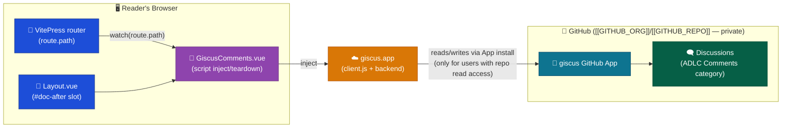

# Architecture Notes — ADLC-000 Giscus Comments

## What changed structurally

`apps/docs-web/.vitepress/theme/index.ts` previously only used `extends: DefaultTheme` with a `setup()` hook — no `Layout` override existed. This ticket introduces the site's first custom `Layout.vue`, which wraps `DefaultTheme.Layout` and injects a new `GiscusComments.vue` component into VitePress's built-in `#doc-after` slot. This is a new layer pattern other future theme customizations can reuse (e.g. TD-1 proposes migrating the existing zoom `setup()` logic into this same `Layout.vue`).

It also introduces the Web container's first runtime (browser-side) integration with an external system beyond the CDN/S3 origin: giscus.app, which itself talks to GitHub's Discussions API on the private `[[GITHUB_ORG]]/[[GITHUB_REPO]]` repo. This is a purely client-side, unauthenticated-by-us integration — no new backend, no new AWS resource, no change to the CloudFront/Lambda@Edge auth gate. Access to comments is scoped by GitHub repo permissions, independently of this site's basic auth (see `1-plan.md` Problem section for the confirmed access model).

## Target state

Note this diverges from `1-plan.md`'s original diagram in one detail: mapping uses `data-mapping="specific"` with an explicit, decoded `data-term`, not `data-mapping="pathname"` — fixed mid-implementation to avoid `%20`-encoded discussion titles (see `2-report.md` Step 2 notes).

## Follow-up

TD-2 (tracked in `2-report.md`) proposes folding this diagram's runtime flow into the permanent `docs/Target Architecture (HLD)/v1/Containers/Web.md` baseline diagram during the Document phase.
