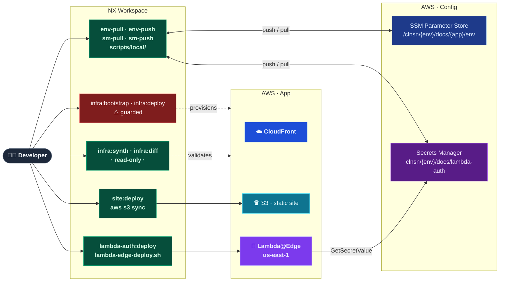

# ADLC-003: CDK Infrastructure & Secrets Management

| Field   | Value                     |
| ------- | ------------------------- |
| Ticket  | ADLC-003                  |
| Branch  | `feat/adlc-003-cdk-infra` |
| Created | 2026-07-15                |

## Problem

`apps/infra/` still contains a full Terraform implementation (6 modules, S3 backend, provider aliases)
despite the HLD mandating AWS CDK (NFR-4). The four secrets management NX targets (`env-pull`,
`env-push`, `sm-pull`, `sm-push`) exist in all three `project.json` files but are missing their
executor in `nx.json targetDefaults` — they would fail if invoked. Root-level scripts in
`scripts/local/` are unfinished drafts. There is no `.gitignore`. Doc 07 still references Terraform
artifacts. This ticket completes the CDK migration, wires the secrets management targets end-to-end,
and produces a runnable local provisioning + deployment workflow.

## Scope

**In scope:**

- Remove all Terraform files from `apps/infra/` (`.tf` files, `modules/`, `scripts/bootstrap-tfstate.sh`)
- Scaffold and implement CDK application in `apps/infra/` using standard `bin/` + `lib/` layout (TypeScript, CJS, L2 constructs)
- Update `nx.json` `targetDefaults` to wire the four secrets management scripts
- Update `apps/infra/project.json` with CDK targets replacing Terraform targets
- Add `.env.example` and `.secrets.example` to all three apps
- Wire and verify `sm-push` end-to-end (confirms secrets management flow is complete)
- Fix cross-platform issue in `scripts/local/env-pull.sh` and `scripts/local/sm-pull.sh`
- Create `.gitignore` at repo root
- Update `docs/Engineering Guide/07 Configuration & Secrets.md` (remove all TF references)
- Update `docs/Target Architecture (HLD)/v1/Containers/Auth.md` (fix "no external calls" constraint — SM `GetSecretValue` is permitted)

**Out of scope:**

- Actual CDK deploy or destroy execution (guarded — presented as developer instructions)
- CI/CD pipeline changes
- S3 Terraform remote state cleanup (pre-existing AWS resource; left as manual cleanup)

## Acceptance Criteria

- [ ] `AC-1` — `apps/infra/` contains no `.tf` files or `modules/` directory
- [ ] `AC-2` — `yarn nx run infra:typecheck` exits 0 with no TypeScript errors
- [ ] `AC-3` — `yarn nx run infra:deploy:dev` completes; `yarn nx run infra:output:dev` shows real AWS resource IDs for `CloudFrontDistributionId`, `SiteBucketName`, `AuthSecretName`, `AuthLambdaFunctionName`
- [ ] `AC-4` — `DocsStack.template.json` includes resources for CloudFront, S3, Lambda, IAM, SecretsManager
- [ ] `AC-5` — `yarn nx run lambda-auth:env-pull:dev --verbose` output shows `bash scripts/local/env-pull.sh` being invoked
- [ ] `AC-6` — `yarn nx run site:env-pull:dev --verbose` output shows `bash scripts/local/env-pull.sh` being invoked
- [ ] `AC-7` — `shellcheck scripts/local/env-pull.sh scripts/local/sm-pull.sh` exits 0 with no errors
- [ ] `AC-8` — `.gitignore` exists at repo root and matches `*.env.*`, `*.secrets.*`, `cdk.out/`, `node_modules/`
- [ ] `AC-9` — `grep -in "providers\.tf\|terraform\|TF_VAR" "docs/Engineering Guide/07 Configuration & Secrets.md"` returns no matches (case-insensitive; catches both "terraform" and "Terraform")
- [ ] `AC-10` — `grep -n "no external calls" "docs/Target Architecture (HLD)/v1/Containers/Auth.md"` returns no matches (constraint updated to permit SM `GetSecretValue`)
- [ ] `AC-11` — `yarn nx run lambda-auth:sm-push:dev --verbose` output shows `bash scripts/local/sm-push.sh` being invoked (wiring verified; actual SM push requires credentials)

## Target state



## Steps

---

### Step 1 — Infra: Remove Terraform

**Changes:**

- `apps/infra/` — delete `backend.tf`, `locals.tf`, `main.tf`, `outputs.tf`, `providers.tf`, `variables.tf`, `versions.tf`
- `apps/infra/modules/` — delete entire directory (cloudfront, lambda-edge-auth, s3-bucket, s3-bucket-policy, s3-logs-bucket, sm-secret)
- `apps/infra/scripts/bootstrap-tfstate.sh` — delete (TF-specific; CDK bootstrap runs via `yarn cdk bootstrap` in the NX target — no wrapper script needed)
- `apps/infra/scripts/` — remove directory if empty after above deletion

**Verification:**

> Run: `ls apps/infra/`
> Expected: only `project.json` — no `.tf` files, no `modules/`, no `scripts/`

⚠️ **Stop here. Verify this step before proceeding to Step 2.**

---

### Step 2 — Infra: Scaffold CDK app + env files + deploy to AWS

CDK app in CJS mode (no `"type": "module"`) for maximum CDK CLI compatibility.
`experimental.EdgeFunction` handles the Lambda@Edge us-east-1 constraint via an internal nested stack —
no hardcoded region in source. CDK bootstrap runs `cdk bootstrap` for both the deployment region and
`us-east-1` (required for the nested stack) via a single NX target.

**Changes:**

- `.gitignore` — new at repo root; patterns: `node_modules/`, `cdk.out/`, `dist/`, `*.env.*`, `*.secrets.*`, `*.bak` — created first so `.env.dev` is protected from the moment it's written
- `apps/infra/package.json` — new; CJS (no `"type": "module"`); deps: `aws-cdk-lib`, `constructs`; devDeps: `aws-cdk`, `tsx`, `typescript`
- `apps/infra/tsconfig.json` — new; extends `../../tsconfig.base.json`; overrides `module: CommonJS`, `moduleResolution: node`, `outDir: dist`
- `apps/infra/cdk.json` — new; `app: "../../node_modules/.bin/tsx bin/app.ts"`
- `apps/infra/bin/app.ts` — CDK app entry; instantiates `DocsStack`; reads `ENVIRONMENT`, `WORKLOAD`, `LOCATION_SHORT`, `CF_PRICE_CLASS` from `process.env`
- `apps/infra/lib/edge-stack.ts` — separate CDK stack with `env: { region: 'us-east-1' }` (hard AWS platform requirement for Lambda@Edge — not a deployment preference, therefore not an NFR-3 violation):
  - `aws_lambda.Function` — placeholder code, `NODEJS_22_X`, 5s timeout, IAM role with least-privilege `secretsmanager:GetSecretValue`; real code deployed in Step 4
  - Exports: `functionArn`, `functionVersion` via cross-stack reference
- `apps/infra/lib/docs-stack.ts` — main stack definition; L2 constructs:
  - S3 site bucket — versioned, OAC, `removalPolicy: RETAIN`, `enforceSSL: true`
  - SM secret — `{}` placeholder, `removalPolicy: RETAIN` (value managed by `lambda-auth:sm-push`)
  - CloudFront distribution — OAC, redirect-to-HTTPS; `defaultBehavior.edgeLambdas: [{ functionVersion: edgeStack.authFnVersion, eventType: LambdaEdgeEventType.VIEWER_REQUEST }]` (standard `aws-cdk-lib/aws-cloudfront.EdgeLambda` — no `@aws-cdk/aws-cloudfront-experimental` required)
  - `CfnOutput`: `CloudFrontDomain`, `CloudFrontDistributionId`, `SiteBucketName`, `AuthSecretArn`, `AuthSecretName`, `AuthLambdaFunctionName`
- `apps/infra/project.json` — replace all Terraform targets with CDK targets:
  - `typecheck` — `tsc --noEmit -p tsconfig.json` (cwd: projectRoot)
  - `synth` — `yarn cdk synth` (cwd: projectRoot; dev + prod configurations)
  - `diff` — `yarn cdk diff` (cwd: projectRoot; dev + prod configurations)
  - `output` — `aws cloudformation describe-stacks --stack-name DocsStack --query 'Stacks[0].Outputs' --output table` (dev + prod configurations)
  - `bootstrap` (⚠️ guarded) — two sequential commands: `yarn cdk bootstrap` + `yarn cdk bootstrap --region us-east-1` (dev + prod configurations)
  - `deploy` (⚠️ guarded) — `yarn cdk deploy --require-approval never` (dev + prod configurations)
  - `destroy` (⚠️ guarded) — `yarn cdk destroy` (dev + prod configurations)
  - keep existing `env-push`, `env-pull`, `sm-push`, `sm-pull` configurations (executor wired in Step 3)
- `apps/infra/.env.example` — keys: `ENVIRONMENT`, `WORKLOAD=docs`, `LOCATION_SHORT`, `CF_PRICE_CLASS`
- `apps/infra/.env.dev` — developer populates before running bootstrap/deploy; same keys as `.env.example`
- `apps/infra/.secrets.example` — empty (infra owns no secret values)

Resource naming: `clnsn-{env}-{wl}-{locationShort}-{type}-{index}` (all tokens from `process.env`).
SM secret name: `clnsn/{env}/{wl}/lambda-auth`.
Lambda function name: `clnsn-{env}-{wl}-{locationShort}-fn-01`.

**Verification:**

> Run: `yarn install && yarn nx run infra:typecheck`
> Expected: exits 0, no TypeScript errors

> Run: `yarn nx run infra:synth:dev`
> Expected: `cdk.out/DocsStack.template.json` includes `AWS::CloudFront::Distribution`, `AWS::S3::Bucket`, `AWS::Lambda::Function`, `AWS::SecretsManager::Secret`

> **Live deploy** (⚠️ guarded — run manually):
>
> ```bash
> yarn nx run infra:bootstrap:dev   # first time only — bootstraps both regions
> yarn nx run infra:deploy:dev
> yarn nx run infra:output:dev      # copy the output values for Step 3
> ```
>
> Expected: CloudFormation outputs table shows real AWS resource IDs for all six outputs

⚠️ **Stop here. Verify this step before proceeding to Step 3.**

---

### Step 3 — NX: Wire targetDefaults + populate all app env files + push to SSM/SM

**Changes:**

- `nx.json` — add to `targetDefaults`: `env-pull`, `env-push`, `sm-pull`, `sm-push` — each with `executor: "nx:run-commands"` and `options.command` pointing to the matching `scripts/local/` script
- `apps/lambda-auth/.env.example` — keys: `LAMBDA_FUNCTION_NAME`, `LAMBDA_ZIP_PATH=apps/lambda-auth/dist/lambda-auth.zip`, `CF_DISTRIBUTION_ID`, `SM_SECRET_NAME`, `SM_REGION`, `CW_LOG_GROUP`; note: `SM_SECRET_NAME` and `SM_REGION` are esbuild `--define` constants baked into the Lambda bundle at build time
- `apps/lambda-auth/.env.dev` — populate from Step 2 CDK outputs (`LAMBDA_FUNCTION_NAME`, `CF_DISTRIBUTION_ID`, `SM_SECRET_NAME`) + set `SM_REGION` to the SM secret's region + `CW_LOG_GROUP`
- `apps/lambda-auth/.secrets.example` — key: `DOCS_BASIC_AUTH_HASH` blank; comment with generation command using `bcryptjs`
- `apps/lambda-auth/.secrets.dev` — populate `DOCS_BASIC_AUTH_HASH` with a bcrypt hash of the dev password
- `apps/docs-web/.env.example` — keys: `S3_BUCKET_NAME`, `CF_DISTRIBUTION_ID`
- `apps/docs-web/.env.dev` — populate from Step 2 CDK outputs (`S3_BUCKET_NAME`, `CF_DISTRIBUTION_ID`)
- `apps/docs-web/.secrets.example` — empty (docs-web owns no secrets)

Then run push targets to persist config to AWS:

```bash
yarn nx run infra:env-push:dev          # infra config → SSM
yarn nx run lambda-auth:env-push:dev    # lambda-auth config → SSM
yarn nx run lambda-auth:sm-push:dev     # DOCS_BASIC_AUTH_HASH → Secrets Manager
yarn nx run site:env-push:dev           # docs-web config → SSM
```

**Verification:**

> Run: `yarn nx show project lambda-auth --json | python3 -c "import sys,json; t=json.load(sys.stdin)['targets']; print(t.get('env-push',{}).get('executor'))"`
> Expected: `nx:run-commands` (inherited from targetDefaults)

> Run: `aws ssm get-parameter --name /clnsn/dev/docs/lambda-auth/env --query Parameter.Value --output text`
> Expected: JSON containing `LAMBDA_FUNCTION_NAME`, `CF_DISTRIBUTION_ID`, `SM_SECRET_NAME`

> Run: `aws secretsmanager get-secret-value --secret-id clnsn/dev/docs/lambda-auth --query SecretString --output text`
> Expected: JSON containing `DOCS_BASIC_AUTH_HASH`

⚠️ **Stop here. Verify this step before proceeding to Step 4.**

---

### Step 4 — Deploy code to provisioned resources

Depends on Step 3: `.env.dev` for both apps must be populated and CDK infra must be live.

**Changes:** none — this step runs existing NX targets against the live AWS resources.

```bash
yarn nx run lambda-auth:deploy:dev   # build + zip + update Lambda code + update CF association
yarn nx run site:deploy:dev          # vitepress build + s3 sync + CF invalidation
```

**Verification:**

> Open: `https://{CloudFrontDomain}` (from Step 2 output)
> Expected 1: browser shows `401 WWW-Authenticate: Basic realm="Docs"` challenge
> Expected 2: enter dev credentials → site renders correctly
> Expected 3: wrong password → 401 re-challenged

⚠️ **Stop here. Verify this step before proceeding to Step 5.**

---

### Step 5 — Scripts: Fix cross-platform sed

**Changes:**

- `scripts/local/env-pull.sh` — replace `sed -i '' "s|...|...|" "$ENV_TARGET_FILE"` with `sed -i.bak "s|...|...|" "$ENV_TARGET_FILE" && rm -f "${ENV_TARGET_FILE}.bak"`
- `scripts/local/sm-pull.sh` — same fix for `sed -i ''` → `sed -i.bak ... && rm -f ...`
- No changes to `env-push.sh`, `sm-push.sh`, or `scripts/ci/lambda-edge-deploy.sh`

**Verification:**

> Run: `shellcheck scripts/local/env-pull.sh scripts/local/sm-pull.sh scripts/local/env-push.sh scripts/local/sm-push.sh`
> Expected: exits 0, no warnings

⚠️ **Stop here. Verify this step before proceeding to Step 6.**

---

### Step 6 — Docs: Update doc 07 and HLD container docs

**Changes:**

- `docs/Engineering Guide/07 Configuration & Secrets.md`:
  - Add the target-state diagram from `1-plan.md` (the coloured LR flowchart) as the opening diagram — replaces the existing text-only flowchart
  - Shell env tier table — remove `Terraform inputs (TF_VAR_*)` row
  - Line ~96 — replace "no Terraform provisioning required" with "no infrastructure provisioning required"
  - Line ~142 — remove "or Terraform state" from the secrets-never-in-source table
  - "One AWS-imposed exception" footnote — replace reference to `apps/infra/providers.tf` with: the Lambda@Edge function is deployed via a dedicated CDK stack scoped to us-east-1 (hard AWS platform requirement — not a deployment preference); the main stack and all other resources remain region-agnostic
  - Add developer onboarding flow callout: `infra:output` → populate `.env.dev` files → `env-push` each app → `sm-push lambda-auth`
- `docs/Target Architecture (HLD)/v1/Containers/Infrastructure.md`:
  - Remove `_(target — current implementation: Terraform, pending migration)_` from IaC row and key paths note
- `docs/Target Architecture (HLD)/v1/Containers/Auth.md`:
  - Fix "No external calls" constraint: replace with "Secrets Manager `GetSecretValue` is the only permitted external call — no VPC access, no async file I/O beyond the SDK call"

- `docs/Engineering Guide/XX Local Provisioning Runbook.md` — new; port the **Local provisioning runbook** section from the bottom of `1-plan.md` into a permanent Engineering Guide document; number it in sequence after the current highest EG doc number

**Verification:**

> Run: `grep -rn "providers\.tf\|terraform\|TF_VAR" "docs/Engineering Guide/07 Configuration & Secrets.md"`
> Expected: no matches

> Run: `grep -n "pending migration\|Terraform" "docs/Target Architecture (HLD)/v1/Containers/Infrastructure.md"`
> Expected: no matches

> Run: `ls "docs/Engineering Guide/" | grep -i "provision\|runbook"`
> Expected: new runbook file present

⚠️ **Stop here. All steps complete.**

---

## Local provisioning runbook (reference)

After all six steps are merged and CDK bootstrap has run:

```bash
# One-time CDK bootstrap (guarded — run manually)
# yarn nx run infra:bootstrap:dev

# Provision infrastructure (guarded — run manually)
# yarn nx run infra:deploy:dev

# Capture outputs and populate env files
yarn nx run infra:output:dev     # copy CF_DISTRIBUTION_ID, LAMBDA_FUNCTION_NAME, etc.
# → manually fill apps/lambda-auth/.env.dev and apps/docs-web/.env.dev

# Push env config to SSM (each app)
yarn nx run infra:env-push:dev
yarn nx run lambda-auth:env-push:dev
yarn nx run site:env-push:dev

# Push lambda-auth secret (DOCS_BASIC_AUTH_HASH)
yarn nx run lambda-auth:sm-push:dev

# Deploy apps
yarn nx run lambda-auth:deploy:dev    # uploads code + updates CF Lambda association
yarn nx run site:deploy:dev           # syncs VitePress build to S3
```
