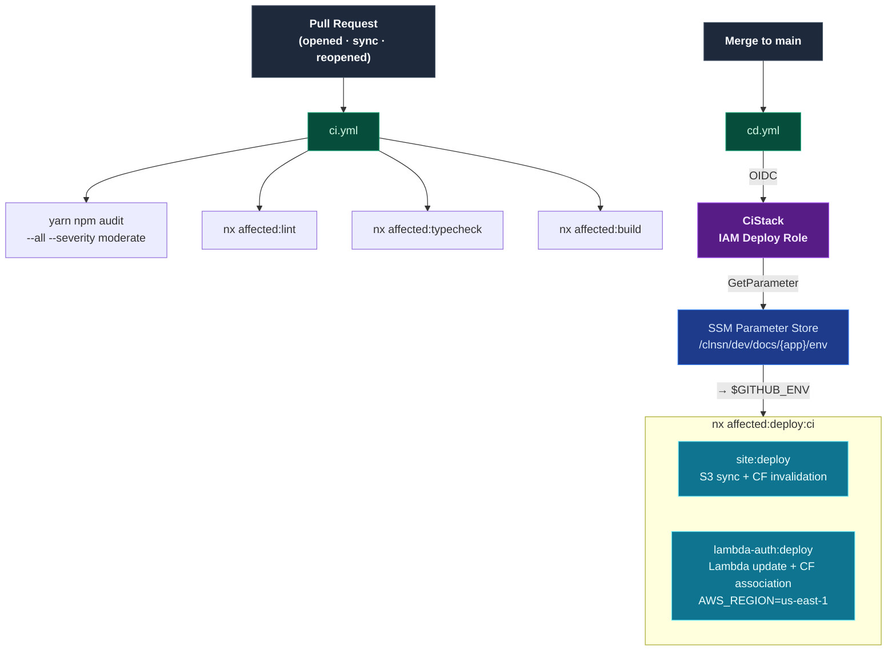

# ADLC-004: CI/CD — GitHub Actions with AWS OIDC

| Field   | Value                 |
| ------- | --------------------- |
| Ticket  | ADLC-004              |
| Branch  | `feat/adlc-004-ci-cd` |
| Created | 2026-07-16            |

## Problem

The repo has no automated pipeline. Merges to `main` are deployed manually and there is no quality gate on PRs. We need a CI workflow that runs on every PR (audit, lint, typecheck, build) and a CD workflow that deploys affected apps on merge — both authenticated to AWS via OIDC with no long-lived credentials in GitHub.

All deployment configuration lives in SSM Parameter Store. GitHub stores only the SSM parameter path(s) and the minimum bootstrap values needed to reach AWS (role ARN, region). Everything else — bucket names, distribution IDs, function names — is fetched from SSM at runtime.

## Scope

**In scope:**

- CDK `CiStack`: GitHub OIDC provider + scoped IAM deploy role
- `scripts/ci/env-export.sh`: SSM → `$GITHUB_ENV` helper
- NX `ci` deploy configuration (no `envFile`) on `site` and `lambda-auth`
- `.github/workflows/ci.yml`: audit + affected lint / typecheck / build on PR
- `.github/workflows/cd.yml`: SSM env fetch → affected deploy on merge to `main`
- Engineering Guide update: CI/CD section, required GitHub variables table

**Out of scope:**

- `infra:deploy` in the CD pipeline — CDK deploy remains a guarded manual operation
- `prod` environment — `dev` only for this ticket
- PR preview environments

## Acceptance Criteria

- [ ] `AC-1` — `yarn nx run infra:synth:dev` succeeds and `cdk.out/CiStack.template.json` exists
- [ ] `AC-2` — `CiStack` template contains `AWS::IAM::OIDCProvider` for `token.actions.githubusercontent.com`
- [ ] `AC-3` — IAM role trust condition is `StringLike` scoped to `repo:[[GITHUB_ORG]]/[[GITHUB_REPO]]:*` — no broader wildcard
- [ ] `AC-4` — IAM role has no `*` actions — all permissions are explicitly listed
- [ ] `AC-5` — CI workflow runs on every PR and executes audit, lint, typecheck, build in sequence
- [ ] `AC-6` — `yarn npm audit --all --severity moderate` exits non-zero on moderate-or-higher vulnerability, failing the job
- [ ] `AC-7` — CD workflow triggers on merge to `main`, fetches env from SSM, and deploys affected apps
- [ ] `AC-8` — `infra` is excluded from the CD deploy step
- [ ] `AC-9` — No AWS credentials or app config values (bucket names, distribution IDs) are stored as GitHub secrets/variables — only role ARN, bootstrap region, and SSM param paths
- [ ] `AC-10` — Site at https://d2j68yau369922.cloudfront.net/ reflects merged content after a PR merge triggers the CD workflow

## Target State

## Steps

### Step 1 — Infra: `CiStack` (OIDC provider + IAM deploy role)

**Changes:**

- `apps/infra/lib/conventions.ts` — add `ciDeployRole` key to `naming()` return: `clnsn-ci-${wl}-${loc}-role`
- `apps/infra/lib/ci-stack.ts` — new stack:
  - `iam.OpenIdConnectProvider` for `token.actions.githubusercontent.com` with thumbprint `6938fd4d98bab03faadb97b34396831e3780aea1`
  - IAM role using the OIDC provider as principal with `StringLike` condition `repo:[[GITHUB_ORG]]/[[GITHUB_REPO]]:*`
  - Inline policies (all resources scoped by naming convention — no `*` actions):
    - **S3**: `s3:PutObject`, `s3:DeleteObject`, `s3:GetObject`, `s3:ListBucket` on `arn:aws:s3:::${names.siteBucket}` and `…/*`
    - **CloudFront**: `cloudfront:CreateInvalidation`, `cloudfront:GetDistributionConfig`, `cloudfront:UpdateDistribution`, `cloudfront:GetDistribution` on `arn:aws:cloudfront::${account}:distribution/*`
    - **Lambda**: `lambda:UpdateFunctionCode`, `lambda:PublishVersion`, `lambda:AddPermission`, `lambda:RemovePermission`, `lambda:ListVersionsByFunction`, `lambda:GetFunction`, `lambda:GetFunctionConfiguration` on `arn:aws:lambda:*:${account}:function:${names.authFn}`
    - **SSM**: `ssm:GetParameter` on `arn:aws:ssm:${region}:${account}:parameter/clnsn/${env}/*`
  - `CfnOutput` for role ARN (set as GitHub variable after deploy)
- `apps/infra/bin/app.ts` — instantiate `CiStack` (same region as `DocsStack`)

**Verification:**

> Run: `yarn nx run infra:synth:dev`
> Expected: exits 0; `apps/infra/cdk.out/CiStack.template.json` exists; contains `AWS::IAM::OIDCProvider` and `AWS::IAM::Role` resources

⚠️ **Stop here. Verify before proceeding to Step 2.**

---

### Step 2 — Cross-cutting: `env-export.sh` + NX `ci` deploy configurations

**Changes:**

- `scripts/ci/env-export.sh` — new script:
  - Reads `ENV_PARAM_NAME` from env
  - Calls `aws ssm get-parameter --name "$ENV_PARAM_NAME" --query Parameter.Value --output text`
  - Parses JSON response with Python (same method as `env-pull.sh`)
  - Appends `KEY=VALUE` lines to `$GITHUB_ENV`
- `apps/docs-web/project.json` — add `"ci": {}` to `deploy.configurations` (no envFile; shell env vars are used directly)
- `apps/lambda-auth/project.json` — add `"ci": {}` to `deploy.configurations`

**Verification:**

> Run: `ENV_PARAM_NAME=dummy AWS_REGION=eu-west-1 bash scripts/ci/env-export.sh 2>&1 | head -5`
> Expected: fails with an SSM error (no real param), **not** a script syntax error — confirms the script is valid

> Run: `yarn nx run site:deploy:ci --dry-run 2>&1`
> Expected: NX resolves the target without an "envFile not found" error

⚠️ **Stop here. Verify before proceeding to Step 3.**

---

### Step 3 — GitHub Actions: CI workflow

**Changes:**

- `.github/workflows/ci.yml` — new workflow:
  - Trigger: `pull_request` (types: opened, synchronize, reopened), branches: `['main']`
  - Single job `ci`, runs-on `ubuntu-latest`
  - Steps:
    1. `actions/checkout@v4` (`fetch-depth: 0`)
    2. `actions/setup-node@v4` (node 24, cache yarn)
    3. `yarn install --immutable`
    4. `yarn npm audit --all --severity moderate`
    5. `yarn nx affected --target=lint --base=origin/${{ github.base_ref }} --head=HEAD`
    6. `yarn nx affected --target=typecheck --base=origin/${{ github.base_ref }} --head=HEAD`
    7. `yarn nx affected --target=build --base=origin/${{ github.base_ref }} --head=HEAD`
  - No AWS credentials — pure code quality

**Verification:**

> Push the branch and open (or re-push to) the open PR.
> Expected: Actions tab shows the `CI` workflow; all 7 steps complete green

⚠️ **Stop here. Verify before proceeding to Step 4.**

---

### Step 4 — GitHub Actions: CD workflow

**Changes:**

- `.github/workflows/cd.yml` — new workflow:
  - Trigger: `push`, branches: `['main']`
  - permissions: `id-token: write`, `contents: read`
  - Single job `deploy`, runs-on `ubuntu-latest`
  - Steps:
    1. `actions/checkout@v4` (`fetch-depth: 0`)
    2. `actions/setup-node@v4` (node 24, cache yarn)
    3. `yarn install --immutable`
    4. `aws-actions/configure-aws-credentials@v4` — role `${{ vars.IAM_ROLE_ARN }}`, region `${{ vars.AWS_REGION }}`
    5. Compute affected: `yarn nx show projects --affected --base=HEAD~1 --head=HEAD` → store project list in step output
    6. **If `site` affected**: run `ENV_PARAM_NAME=${{ vars.SITE_SSM_ENV_PARAM }} bash scripts/ci/env-export.sh` then `yarn nx run site:deploy:ci`
    7. **If `lambda-auth` affected**: run `ENV_PARAM_NAME=${{ vars.LAMBDA_AUTH_SSM_ENV_PARAM }} bash scripts/ci/env-export.sh` then `yarn nx run lambda-auth:deploy:ci`
  - `infra` is never deployed by CD

- Required GitHub Actions **variables** to set (Settings → Secrets and variables → Actions → Variables):

  | Variable                    | Value (example)                                                         |
  | --------------------------- | ----------------------------------------------------------------------- |
  | `IAM_ROLE_ARN`              | CiStack output — `arn:aws:iam::{account}:role/clnsn-ci-docs-{loc}-role` |
  | `AWS_REGION`                | Main deployment region (e.g. `eu-west-1`)                               |
  | `SITE_SSM_ENV_PARAM`        | `/clnsn/dev/docs/site/env`                                              |
  | `LAMBDA_AUTH_SSM_ENV_PARAM` | `/clnsn/dev/docs/lambda-auth/env`                                       |

**Verification:**

> Merge a trivial change to `main` (e.g. whitespace in a doc file — touches `site` via `implicitDependencies`).
> Expected: Actions tab shows `CD` workflow; env-export step sets env vars; `site:deploy:ci` runs; S3 sync and CF invalidation appear in AWS console logs

⚠️ **Stop here. Verify before proceeding to Step 5.**

---

### Step 5 — Docs: Engineering Guide update

**Changes:**

- `docs/Engineering Guide/07 Configuration & Secrets.md` — expand CI/CD section with:
  - OIDC flow description and diagram update (show SSM fetch step in CI lane)
  - GitHub variables table (from Step 4)
  - Note: `infra:deploy` remains a guarded manual operation
  - Embed the CI/CD target-state Mermaid diagram from `1-plan.md` (the flowchart showing PR → CI workflow and Merge → CD workflow → OIDC → SSM → deploy targets)

**Verification:**

> Run: `yarn nx run site:build`
> Expected: build exits 0 with no dead-link errors

⚠️ **Stop here. Verify before proceeding to Document phase.**

---

## Architecture Deviations

| #   | Deviation | Justification |
| --- | --------- | ------------- |
