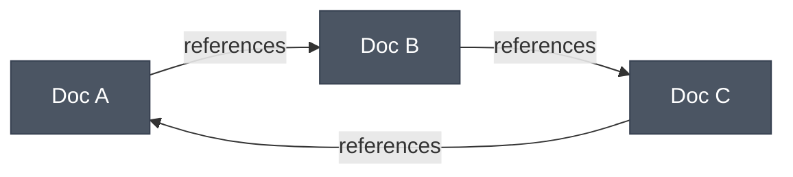
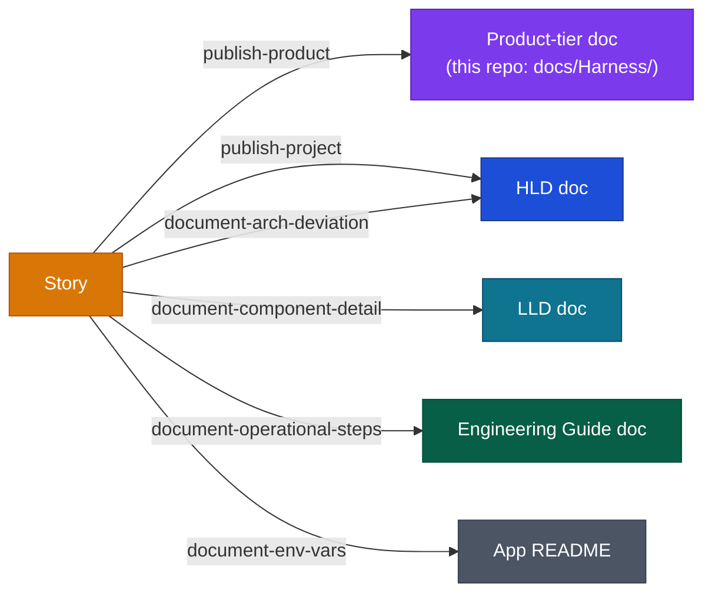
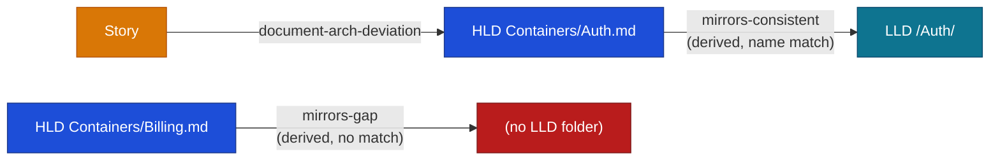
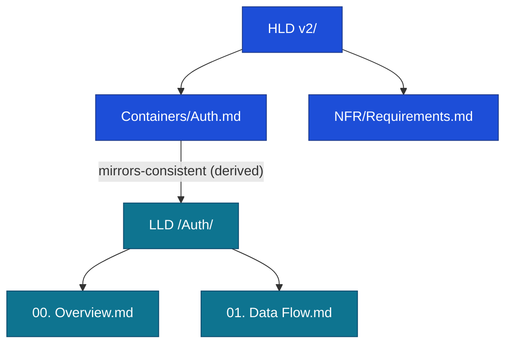

# DESIGN-20261102-Q5MU: Deterministic Docs Knowledge Graph — Research: Graph structure and topology

_Produced by the 🔍 Research phase. Owned by `@product-architect`. Do not edit after Evaluate phase begins._

## Context

This decision covers only what the graph's nodes and edges model — not storage format, infra footprint, visualization, or lifecycle/bootstrap wiring, which are separate decisions in the same multi-decision design. This research was reworked once already: an earlier draft invented an abstract relation vocabulary (`implements`/`informed-by`/`supersedes`/`produced-by`) ungrounded in this repo's actual documented model. It was redone grounded in two authoritative docs: `docs/Engineering Guide/Lifecycles/05 Documents Flow.md` (the real, named graduation edges — `/design publish (Product)`, `/design publish (Project)`, and four `/dev document` variants, each routing Story content to a specific destination tier) and `docs/Engineering Guide/Documentation/02 Structure.md` (the three-tier model: HLD aspirational/design-intent, LLD descriptive/current-state — with LLD container folder names required to mirror HLD container names exactly, a deterministic, already-enforced convention — Engineering Guide procedural/numbered-articles, Stories transient/per-ticket, and a fifth category, the Product tier, explicitly "not a project-knowledge tier" in Structure.md's own words).

> **Genericity note:** in this repo, the Product tier is instantiated as `docs/Harness/` — this project's own product-context layer, since this repo bootstraps the harness into other projects. A project bootstrapping the harness elsewhere would name and shape its own Product tier differently — it is not "the Harness tier," it is "whatever that project's product-context layer is called." The options below model this as a generic **Product** node category, never hardcoding "Harness" as the type name. Separately: this repo currently has two differently-worded copies of "Documents Flow" at different paths (`docs/Harness/03 Lifecycles/05 Documents Flow.md` and `docs/Engineering Guide/Lifecycles/05 Documents Flow.md`) — a live example of the implicit-relationship problem this whole design exists to fix, noted here as evidence, not resolved by this decision.

## Options

### Option 1 — Flat, untyped doc-graph (minimal change)

**Description:** Single node type (`Doc`), single edge type (`references`), no tier typing at all. An edge exists wherever one doc's frontmatter links to another doc's ID, regardless of which tier either side lives in or which lifecycle action produced the link. This is the closest thing to "do nothing structurally" — it adds deterministic IDs and an index without modeling the pipeline in Documents Flow at all.

**Industry precedent:** Flat wiki backlink graphs (Obsidian, Roam Research's "linked references," MediaWiki's "What links here") — untyped, bidirectional, no schema beyond "page links to page."

**Diagram:**

**Pros:**

- Simplest possible schema; fastest to ship; satisfies EC2 (deterministic relation table) literally.
- No risk of mis-typing a tier or edge — there's only one of each to get wrong.
- Degrades gracefully by construction — aligns directly with the proposed EC on graceful coverage degradation.

**Cons:**

- Throws away the one thing Documents Flow already gives for free: that every graduation edge has a specific, named origin and destination tier. A reader of the graph can't distinguish "this Story produced this HLD container" from "this LLD doc happens to mention this Engineering Guide article."
- Cannot support the HLD↔LLD mirror/delivery-gap check at all, since there is no HLD-container or LLD-container-folder node type to compare.
- Does not honor the Product-tier-is-not-a-project-knowledge-tier distinction — a Product-tier doc and an HLD doc are structurally identical nodes.

**Unknowns / risks:**

- Whether "minimal" is actually acceptable given Decision 5 (lifecycle impact) and Decision 6 (bootstrap impact) both assume the graph can answer tier-aware questions.

---

### Option 2 — Tier-typed nodes, lifecycle-action edge types (doc-level)

**Description:** Node types mirror the real tiers: `HLD` (carrying version/Containers/NFR as attributes, not separate node types yet), `LLD`, `EngineeringGuide`, `Story` (with design/solution/impl as attributes), `Product` (this repo's instance: `docs/Harness/` — its own node type, kept categorically separate from HLD/LLD per Structure.md's explicit callout), and `AppReadme`. Edge types are taken verbatim from the Documents Flow pipeline rows rather than invented: `publish-product` (Story → Product, via `/design publish (Product)`), `publish-project` (Story → HLD, via `/design publish (Project)`), `document-arch-deviation` (Story → HLD, via `/dev document`), `document-component-detail` (Story → LLD, via `/dev document`), `document-operational-steps` (Story → EngineeringGuide, via `/dev document`), `document-env-vars` (Story → AppReadme, via `/dev document`). Granularity stays at whole-doc level — one node per file.

**Industry precedent:** Data-lineage graphs such as OpenLineage, where edge types are named after the actual pipeline job/operation that produced the data relationship, not abstract/inferred semantic verbs.

**Diagram:**

**Pros:**

- Every edge type corresponds 1:1 to a named lifecycle action already documented and already performed by an existing skill, so there is no vocabulary invented — the graph is literally a materialized view of Documents Flow's graduation table.
- Directly supports Decision 5 (lifecycle impact): the edge set is the set of write operations `/dev` and `/design` already perform.
- Honors the Product tier's categorical separateness from HLD/LLD as a first-class node type.

**Cons:**

- No support for the HLD↔LLD naming-mirror relation (no container-level nodes to compare) — that check still requires manual grep/convention-checking.
- Doc-level granularity hides sub-structure (HLD's System Overview/System Sizing/Containers/NFR split; LLD's numbered sub-docs; Product tier's own numbered sections) — a query like "which LLD sub-doc describes this HLD container" isn't answerable from the graph alone.
- Supersession (HLD versioning) isn't represented as an edge — Documents Flow describes it as a human-triggered folder/README-router change, not a lifecycle-action edge.

**Unknowns / risks:**

- Whether `publish-product` and `publish-project` should be a single parameterized edge type (`publish`, with a `track` attribute) or two distinct edge types.
- Mapping of the first pass's invented verbs: `produced-by` maps cleanly onto the inverse of these six graduation edges — redundant with, not additive to, this option's named edges. `implements` and `informed-by` do not map onto anything in Documents Flow at this doc-level granularity (see Option 3). `supersedes` partially maps to HLD versioning but is not itself a named pipeline edge — it's a manual, human-triggered operation, a weaker guarantee than the other edges here.

---

### Option 3 — Option 2 plus a derived "mirror" edge layer (authored edges + computed edges)

**Description:** All of Option 2's node and edge types, plus a second edge-type layer that is never authored and never written by a lifecycle action — it is computed at graph-build time purely from the naming convention Structure.md already enforces: for every `HLD/<Version>/Containers/<Name>.md`, check whether `LLD/<Name>/` exists; if it does, emit a `mirrors-consistent` edge; if it doesn't, emit a `mirrors-gap` edge (a delivery gap, "by design, not an error" per Structure.md). This requires HLD-container and LLD-container-folder to be addressable as their own node sub-kind (still within the `HLD`/`LLD` node types from Option 2, distinguished by a path-pattern attribute, not a new top-level node type).

**Industry precedent:** Monorepo build-graph tools (Nx, Bazel) that infer a subset of the dependency graph purely from file/target naming and folder-ownership conventions, with no manual edge declaration required for that subset, while still allowing explicitly authored edges elsewhere in the same graph.

**Diagram:**

**Pros:**

- This is the one genuinely new capability: a relation requiring zero manual authoring, zero frontmatter ID, and zero lifecycle-action write — re-derivable from existing folder/file names alone, satisfying the Frame's EC on deterministic regenerability even more strongly (this edge needs no frontmatter at all).
- Gives a concrete, automatic implementation of the first pass's `implements` verb, but grounded: it's literally the name-equality check Structure.md already mandates.
- Directly produces a live "delivery gap" signal consumable by `/where-we-are` without that skill needing to re-walk the filesystem itself.

**Cons:**

- Introduces a second kind of edge (computed, not authored) into the same graph as Option 2's authored edges — the storage-format and infra-footprint decisions both need to account for a build step that diffs two folder trees, not just one that parses frontmatter.
- Only covers the HLD-container ↔ LLD-container-folder pair specifically; it does not generalize to Engineering Guide or the Product tier, which have no equivalent enforced name-matching rule — this layer is necessarily partial.
- Risk of false-positive gaps if the name-matching logic doesn't account for legitimate variations (case, spacing) already tolerated in practice.

**Unknowns / risks:**

- Whether `mirrors-gap` edges should be surfaced as a distinct node annotation or as an edge to a synthetic "missing" node — a representation choice that bleeds into the visualization-surface decision.

---

### Option 4 — Sub-document / section-level granularity

**Description:** Same tier typing and edge typing as Option 3, but nodes are addressed one level finer, matching the sub-structure each tier already has in Structure.md: `HLD` nodes split into `System Overview.md`, `System Sizing.md`, each `Containers/<Name>.md`, and each `Non-Functional Concerns/<Concern>.md`; `LLD` nodes split into each container's numbered sub-docs (`00. Overview.md`, `01. Data Flow.md`, ...); `EngineeringGuide` nodes are already flat numbered articles, so no further split is needed there; `Product`-tier nodes split into its own numbered sections (this repo's `docs/Harness/` already follows the same numbered-article convention as Engineering Guide).

**Industry precedent:** DITA topic-based authoring, where each topic (not each file) is the addressable unit with typed relationships (`conref`, `xref`) between topics; also Sphinx/Docusaurus intersphinx cross-referencing, which resolves links at section/anchor granularity.

**Diagram:**

**Pros:**

- Matches EC3/EC4's intent most precisely — an agent or reader navigating the IDE or VitePress site is almost always at section granularity, not "the whole HLD tier."
- The mirror-edge from Option 3 becomes more precise: instead of "this HLD container has an LLD folder," it can say "this HLD container doc is mirrored by these specific LLD sub-docs."
- Still fully grounded — no new node types beyond what Structure.md already documents as the internal shape of each tier.

**Cons:**

- Highest cardinality of the four options — most nodes, most edges, most build/maintenance cost, which has to be weighed against the infra-footprint decision's "minimal or no new operational infrastructure" constraint and Roadmap §5.9's caution against indexing speculatively ahead of measured need.
- Stories' internal sub-structure (design/solution/impl) would need the same treatment for symmetry, but Stories are explicitly transient ("archived after completion... not permanent reference docs" per Structure.md) — modeling them at the same durability/granularity as permanent tiers may misrepresent their lifecycle status.
- Higher risk of drift: finer-grained nodes multiply the number of places an ID can go stale relative to Option 2/3's one-ID-per-file model.

**Unknowns / risks:**

- Whether section-level granularity is actually required by any of the Frame's known ECs (EC1–EC5) or whether it's anticipatory scope the Roadmap's §5.9 caution would flag.

---

## Open Questions

| #    | Question                                                                                                                                                                                                                                                                                                        | Owner               | Resolution / status                                                                                                                                                                                                                                                                             |
| ---- | --------------------------------------------------------------------------------------------------------------------------------------------------------------------------------------------------------------------------------------------------------------------------------------------------------------- | ------------------- | ----------------------------------------------------------------------------------------------------------------------------------------------------------------------------------------------------------------------------------------------------------------------------------------------- |
| OQ-1 | (E) Does `publish-product` vs. `publish-project` need to be two distinct edge types, or one parameterized `publish` edge with a `track` attribute?                                                                                                                                                              | Evaluate            | Deferred to Evaluate Step 3 (affects the storage-format decision's schema, not this decision)                                                                                                                                                                                                   |
| OQ-2 | (V) Should HLD version supersession (a human-triggered, non-lifecycle-action folder/router change) be modeled as a graph edge at all, or left out entirely?                                                                                                                                                     | Research (resolved) | Resolved: leave out — consistent with this design's earlier resolution that folder/router-based versioning already satisfies this; the graph is not required to answer "what did version N-1 map to"                                                                                            |
| OQ-3 | (E) For the Option 3/4 mirror-edge: does name-matching need normalization rules (case, spacing, punctuation) beyond exact string equality, and who owns deciding what counts as a false-positive gap vs. a real one?                                                                                            | Evaluate            | Deferred to Evaluate Step 3                                                                                                                                                                                                                                                                     |
| OQ-4 | (E) Is Product-tier node granularity (doc-level per Option 2/3, or section-level per Option 4) expected to be decided by the same answer as HLD/LLD, or could it reasonably differ, since the Product tier has no LLD-style "mirror" counterpart to make section-level granularity pay for itself the same way? | Evaluate            | Deferred to Evaluate Step 3                                                                                                                                                                                                                                                                     |
| OQ-5 | (E) Does `apps/*/README.md` need its own first-class node type across all four options, or can it be treated as an edge-case leaf with no further sub-structure, given App README scope is explicitly capped at one page in Structure.md?                                                                       | Evaluate            | Deferred to Evaluate Step 3                                                                                                                                                                                                                                                                     |
| OQ-6 | (V) Should Stories' internal design/solution/impl subfolders be modeled as attributes of a single `Story` node, or as their own sub-nodes?                                                                                                                                                                      | Research (resolved) | Resolved: attributes only, not sub-nodes — Stories are explicitly transient and archived (not a permanent reference tier per Structure.md), so they should not receive the same durability/granularity treatment as HLD/LLD; this rules out extending Option 4's section-level logic to Stories |
