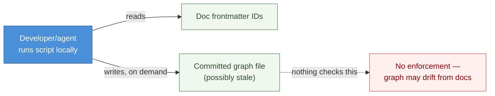
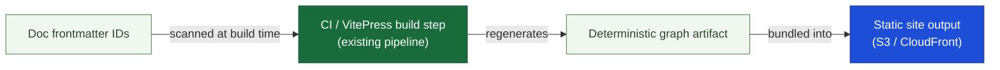
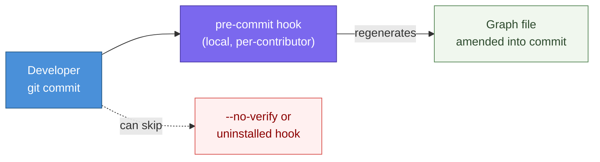
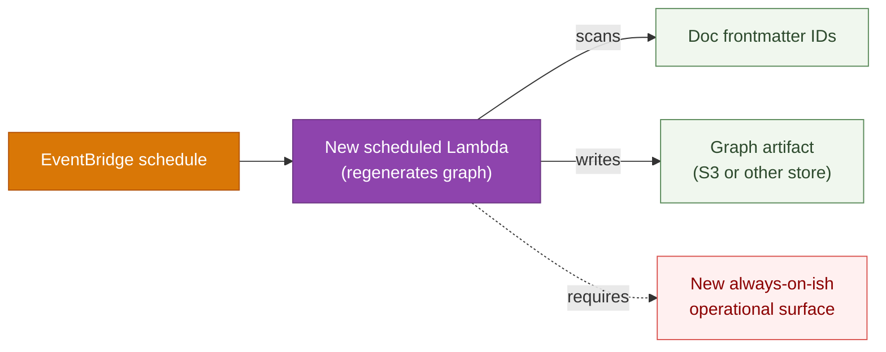
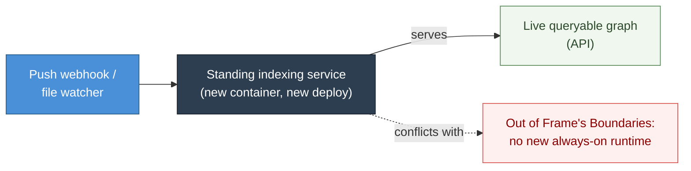

# DESIGN-20261102-Q5MU: Deterministic Docs Knowledge Graph — Research: Representation / infra footprint

_Produced by the 🔍 Research phase. Owned by `@product-architect`. Do not edit after Evaluate phase begins._

## Context

This decision covers only how the graph is produced and kept fresh — the build mechanism. It does not cover storage format, topology, visualization, or lifecycle/bootstrap wiring; those are separate decisions. `CLAUDE.md`'s Architecture table confirms the current footprint: a VitePress static site, a narrowly scoped Lambda@Edge auth function, CDK-managed CDN/origin infrastructure, and CloudFront/S3 serving the build — no running application server for docs tooling, only a static site build and CI. `docs/Harness/06 Roadmap/01 Harness Roadmap.md` §5.9 cautions against building indexing capability speculatively, ahead of a measured need.

## Options

### Option A — Manual / ad-hoc regeneration (no automation)

**Description:** A developer or agent runs a script locally, on demand, whenever they want an updated graph; output is committed like any other doc artifact. No CI step, no hook, no schedule.

**Industry precedent:** Many small wikis/README-linked-doc setups work this way before adopting tooling — effectively the pre-Sphinx/pre-Docusaurus baseline most static-doc tools were built to replace.

**Diagram:**

**Pros:**

- Zero infra of any kind.
- Fastest to stand up; trivially reversible.
- Matches a minimal baseline.

**Cons:**

- Graph can silently go stale — nothing forces regeneration.
- No enforcement that the published graph matches current frontmatter at merge time.
- Relies on human discipline, which the harness's existing doc-graduation model generally avoids.

**Unknowns / risks:**

- How would staleness ever be detected/surfaced to a developer, given no CI check exists?

---

### Option B — Build-time script in CI / VitePress build (no new always-on infra)

**Description:** A script (VitePress build plugin or pre-build CI step) scans doc frontmatter and regenerates the relation graph as part of the existing `yarn build`/CI pipeline. No new deployable component; the graph artifact ships alongside the VitePress build output.

**Industry precedent:** Docusaurus plugins and Sphinx both build their link indexes as part of the static build, with no separate running service. Backstage TechDocs generates its doc index at publish/build time via its pipeline, not a persistent indexing daemon.

**Diagram:**

**Pros:**

- Adds no new operational infrastructure.
- Deterministic: every build regenerates from frontmatter.
- Fits the existing data flow with no new moving parts between CloudFront and S3.
- Failure mode is visible (build fails/warns in CI, same as any other build step).

**Cons:**

- Graph freshness is bound to build cadence — only as current as the last CI run/deploy.
- Requires the build script to be written and maintained somewhere.

**Unknowns / risks:**

- Where exactly the script lives and how it's invoked in the VitePress build is an implementation choice outside this design's governance altitude.
- Build time impact of scanning all doc files has not been measured.

---

### Option C — Pre-commit / git-hook generator

**Description:** A git hook (pre-commit or pre-push) regenerates the graph locally and amends the commit whenever a tracked doc's frontmatter changes, so the committed graph file is always in sync with the docs in the same commit.

**Industry precedent:** Comparable to pre-commit-managed generators used in some docs-as-code setups — common in OSS repos but often paired with a CI check anyway.

**Diagram:**

**Pros:**

- No CI or infra addition at all — runs entirely client-side.
- Keeps the graph in version control in lock-step with doc changes, giving reviewers a diffable graph artifact at PR time.

**Cons:**

- Depends on every contributor having the hook installed and not bypassing it (`git commit --no-verify`) — weaker determinism guarantee than CI-enforced.
- Adds a new local developer-tooling dependency (hook installation/maintenance) not part of today's conventions.

**Unknowns / risks:**

- How hook installation/distribution would work for a harness bootstrapped into other repos (ties into the bootstrap-impact decision) — no established mechanism exists today, which weakens this option without fully disqualifying it.

---

### Option D — Scheduled Lambda job

**Description:** A small AWS Lambda function runs on a schedule (EventBridge-triggered), scans the doc tree, regenerates the graph, and writes it to the static site's S3 origin or a separate store.

**Industry precedent:** Backstage's own catalog-processor can run as a continuously-refreshing backend service, justified there by Backstage being a live internal developer portal with a running backend already — which this repo does not have.

**Diagram:**

**Pros:**

- Decouples graph freshness from build/commit cadence.
- Reuses the existing AWS/CDK/Lambda stack already present for Auth.

**Cons:**

- This is new always-on(-ish) infrastructure — a scheduled function, its IAM permissions, its monitoring/alerting, its own deploy pipeline — which directly conflicts with the "minimal or no new operational infrastructure" proposed EC.
- Also implicated by Roadmap §5.9's caution against speculative indexing capability — later resolved (V-tier): no measured gap exists to justify this.

**Unknowns / risks:**

- No stated requirement in Frame for graph freshness between commits.

---

### Option E — Small running indexing service

**Description:** A standalone service stays up continuously, watches the doc tree (webhook on push, or file-watch), and keeps a live index/graph queryable via an API, potentially also serving IDE-side queries directly.

**Industry precedent:** Backstage's catalog/software-graph backend is the closest analogue — a running service that indexes and serves relationship data — but Backstage is built as a persistent developer portal from the ground up, a materially different platform shape than this repo's.

**Diagram:**

**Pros:**

- Could support live, on-demand graph queries without waiting for a build, and richer query patterns than a static artifact.

**Cons:**

- The most infra-heavy option — a persistent runtime with its own deploy, scaling, monitoring, and security surface, on a platform whose current container list has exactly one non-static-site exception (Lambda@Edge auth, narrowly scoped and stateless).
- This is the clearest case of what Frame's Boundaries explicitly exclude: "any new always-on runtime service beyond the existing static-site + CI footprint."
- Strongly implicated by the same Roadmap §5.9 caution as Option D, more so given the standing nature of the service — later resolved (V-tier): no known use case requires live queries, disqualifying this option.

**Unknowns / risks:**

- No stated use case in Frame requiring live/interactive graph queries.
- Would need its own auth story, consistent with the basic-auth-on-all-routes NFR.

---

## Open Questions

| #    | Question                                                                                                                                                                                                         | Owner               | Resolution / status                                                                                  |
| ---- | ---------------------------------------------------------------------------------------------------------------------------------------------------------------------------------------------------------------- | ------------------- | ---------------------------------------------------------------------------------------------------- |
| OQ-1 | (V) Does any stated use case (IDE representation, VitePress representation, lifecycle integration) actually require live/interactive graph queries, or is a periodically-regenerated static artifact sufficient? | Research (resolved) | Resolved: no — no known use case requires live queries; Options D and E are disqualified             |
| OQ-2 | (V) What is the measured gap (per Roadmap §5.9) that would justify Option D or E's standing infrastructure over a build-time approach?                                                                           | Research (resolved) | Resolved: none established — confirms disqualification of D and E                                    |
| OQ-3 | (E) Is there a tolerance threshold for graph staleness that would rule out Option A or C on their own?                                                                                                           | Evaluate            | Deferred to Evaluate Step 3                                                                          |
| OQ-4 | (V) Does the harness's bootstrap path have any existing mechanism for distributing/installing git hooks into downstream repos, or would this be a new distribution problem?                                      | Research (resolved) | Resolved: no established mechanism exists today — Option C is weakened/conditional, not disqualified |
| OQ-5 | (E) Is CI build-time cost (scanning the full doc tree on every build) a concern at current/projected doc-tree size?                                                                                              | Evaluate            | Deferred to Evaluate Step 3                                                                          |
