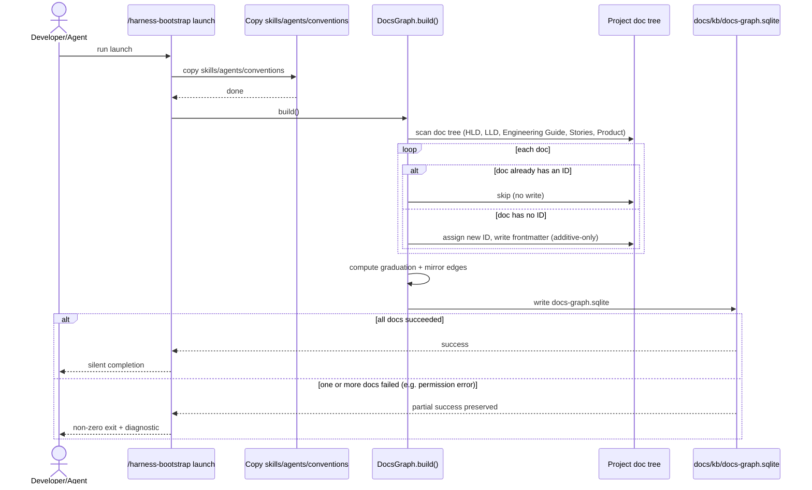

# DESIGN-20261102-Q5MU: Deterministic Docs Knowledge Graph — Design: Harness bootstrap impact

`/harness-bootstrap launch` calls `DocsGraph.build()` as its last step: it assigns
a deterministic, collision-safe frontmatter ID to every doc that lacks one, then
builds the initial graph. Success is silent — no confirmation prompt. Failure
exits non-zero with a diagnostic and preserves whatever succeeded.

## Trigger and sequence

`DocsGraph.build()` is the same module and method defined in
`solution/Design - Representation infra footprint.md`; bootstrap is one of its
two invocation contexts (the other is the VitePress build hook). `launch`'s
existing steps — copying skills, agents, conventions — run first; this call is
additive at the end of that sequence and is not inserted in the middle of it.

## ID assignment — settled properties

The exact generation algorithm is an `Efforts.md` spike. This design settles only
the properties the scheme must have and the order of operations:

1. Scan the project's doc tree: HLD, LLD, Engineering Guide, Stories, Product-tier
   docs (each project names its own instance — e.g. `docs/Product/` as a
   generic placeholder — never hardcoded to a specific project's folder name).
2. For each doc, check its frontmatter for an existing ID field.
   - Present → skip. Never reassigned, never overwritten.
   - Absent → generate one.
3. A generated ID is deterministic given the same input, collision-proof (checked
   against every ID already assigned in the same run), and stable thereafter —
   once written, that doc's ID is never regenerated by a later run.
4. The ID is written into the doc's frontmatter. This is additive-only: the ID
   field is the only thing touched. No other frontmatter key, body content, or
   formatting is modified.
5. Once every doc has an ID, `build()` proceeds through its normal flow: index all
   docs, compute graduation edges (the six named actions in
   `docs/Harness/03 Lifecycles/05 Documents Flow.md`) and the derived
   `mirrors-consistent` / `mirrors-gap` edge.

## State and data changes

The only mutation bootstrap makes to the existing doc tree, anywhere: each doc
previously missing an ID gains exactly one new frontmatter field. No other field,
body content, or file is touched. This holds at every trigger point for ID
assignment — bootstrap here, and the lifecycle-wired writes in
`solution/Design - Harness lifecycle impact.md` — bootstrap is called out
separately because it is the one trigger that runs against the tree's entire
pre-existing doc set, not a single newly-authored doc.

## Output

After `launch` completes, `docs/kb/docs-graph.sqlite` exists and is populated —
including for a project with substantial pre-existing documentation and zero
frontmatter IDs before this run.

## Failure and recovery

A failure during ID assignment or the build (e.g. a file-write permission error
on one doc) skips and reports that one doc; it does not abort the run. The
overall `launch` run exits non-zero with a diagnostic, but every doc that
succeeded keeps its new ID and the graph reflects partial success. `launch`'s
other steps — copying skills, agents, conventions — are not rolled back and are
not blocked by a graph-indexing failure. Launch-time silence applies only to the
success path; failures are always visible, consistent with
`solution/Architecture.md`'s reconciled visible-failure principle.

## Compatibility rule

Running `launch` a second time against an already-indexed project is a no-op for
ID assignment (every doc already has one) and a safe full re-index for the
graph. This operation is safe to repeat.

## Migration and rollout

No migration step, no schema version to upgrade, no rollback procedure. The only
change — one new frontmatter field per previously-ID-less doc — is trivially
reversible by a plain `git revert`, though no rollback is anticipated.

## Packaging

This mechanism is what `docs/Harness/package/` ships once that package is built:
`docs-graph.mjs` lives inside it, invoked by whatever `launch` mechanism the
package defines. This design does not assume or depend on that package folder
existing in this repo checkout today.

## Verification

A fixture test runs the ID-assignment pass against a representative doc tree —
some docs with IDs, some without, at least one edge-case filename — and
confirms: no existing ID is ever touched; every doc without one gets exactly one
new unique ID; running the pass twice produces no changes on the second run.
