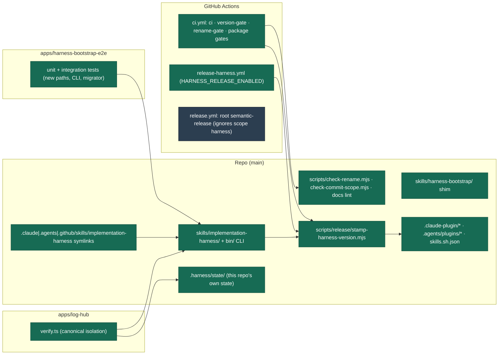

# DEV-20261115-5DUE: Harness Distribution and Release Channels — Plan

| Field   | Value                                            |
| ------- | ------------------------------------------------ |
| Ticket  | DEV-20261115-5DUE                                |
| Intent  | [0-intent.md](0-intent.md)                       |
| Branch  | `docs/design-20261115-co1t-harness-distribution` |
| Created | 2026-11-15                                       |

## Solution

Implement the approved design (`DESIGN-20261115-CO1T`, `solution/Architecture.md` D-01…D-18) in the order of its Efforts tickets 1–9, with ticket 11's docs written in the Document stage and tickets 10 and 12 handed over as a runbook. The harness package moves to `skills/implementation-harness/` and keeps its code (launch scripts, procedures) but loses its own state: launch and patch write only to `.harness/state/`, resolved from the project root. A migrator and a read-time legacy mapping carry 3.5.0 installs over. One dependency-free Node CLI (`init` / `update` / `migrate` / `doctor`) installs and updates the package. The repo root becomes the plugin root for three marketplace manifests. A version-stamping script, CI gates and one release workflow (Nx Release, independent mode) publish to GitHub Packages and the Release ZIP. The committed ZIPs and the manual release script are removed. Containers touched: Harness Bootstrap E2E (paths, new tests), Log Hub (its canonical-isolation check reads the moved folder), and the new release pipeline (no HLD container yet; the Document stage adds one).

Planning decisions:

- **New unit tests live in `apps/harness-bootstrap-e2e`.** It already holds Vitest unit tests for the package scripts; no new framework is added.
- **Yarn, not npm, for this repo's package checks.** The design names `npm pack --dry-run`; this repo's rule is yarn-only, so the gate uses `yarn pack --dry-run`. Consumer docs still show `npx`, as the design settled.
- **Update by channel.** For `npm`, `npx …@<version> update` runs the new CLI from the new tree, so `update` copies from its own tree (npm verified integrity). Only the `zip` channel fetches (ZIP + `.sha256`), through a small in-repo zip reader on `node:zlib`; no dependencies.
- **Docs (ticket 11) are written in the Document stage** by `@docs-writer`. This plan changes only what the package itself needs (its procedures, README aliases) and code-adjacent text. The repo-wide rename gate is therefore green only after Document; see AC-2 and AC-3.
- **Patch bundle for 4.0.0 is a maintainer handoff.** `patch prepare` needs the release tag in its snapshot refs, so it runs after the first release. Not in this plan.
- **First release baseline.** Nx Release needs a tag baseline; Step 17 configures `fallbackCurrentVersionResolver: "disk"` and proves 4.0.0 with a dry run. If Nx cannot do it, the fallback is a documented one-time `--first-release`.
- **Release tooling tests sit in the E2E container** (RF-005). This widens its HLD role from "validates the package" to "validates the package and its release tooling". The Document stage records it in the container's HLD doc. The alternative, a separate Nx project, is not worth a second test setup.
- **The shim reaches the tarball and ZIP through a generated copy** (RF-001). `skills/harness-bootstrap/SKILL.md` stays the source (plugin and skills.sh discover it there). Packing copies it to `<package>/legacy/harness-bootstrap/SKILL.md` (generated, gitignored); the migrator and `init` read it from there.
- **Publish steps run from the tag, not from the version step** (RF-002). A re-run after a failed publish finds no new version, so publish, ZIP, upload and attest read the version at the release tag and check registry and Release existence first.
- **Release identity** (RF-004, RF-016). Checkout uses `secrets.HARNESS_RELEASE_TOKEN` (a release GitHub App token). There is no `github.token` fallback: the Actions bot cannot push to the protected `main`, so the job fails fast when the secret is missing. The actor guard names the App's bot identity. Ticket 10's runbook sets the secret and the bypass actor.
- **Fetch origin is a test seam, not a user option** (RF-008). The ZIP origin is fixed to the GitHub Release URL; an override is accepted only through `--release-base-url` and only for `https:` or loopback `http:`.
- **`update` on channel `npm` means "run the newer CLI"** (RF-009). `doctor` prints `npx @dataart/artisyn-implementation-harness@<version> update`.
- **Accepted windows** (RF-012, RF-013). Until 4.0.0 is cut, the marketplace manifests on `main` point at a tag that does not exist and no 3.5.0 ZIP is downloadable from git; both are listed in the runbook. Ticket 12 closes them.
- **Commit shape.** The rename lands as `feat(harness)!:`; other package changes use scope `harness`. The developer runs all commits; the commit proposals follow the step groups.

## Acceptance Criteria

- [ ] `AC-1` — `skills/implementation-harness/SKILL.md` has `name: implementation-harness` and a single `metadata.version`; `.canonical-implementation-harness/` is gone; `.claude/skills/implementation-harness`, `.agents/skills/implementation-harness` and `.github/skills/implementation-harness` resolve to it; no `harness-bootstrap` symlink remains.
- [ ] `AC-2` — `node scripts/check-rename.mjs` reports no stray `harness-bootstrap` and no `artisyn-implementation-harness` used as a skill/folder/command name outside docs scope (`docs/`, `CLAUDE.md`, `README.md`, `CHANGELOG.md`); unit tests cover both rules and the allowlist.
- [ ] `AC-3` — After the Document stage, `node scripts/check-rename.mjs` and the docs lint (`scripts/check-docs.mjs`: no `/releases/latest`, every `gh skill install` example pinned with `@<tag>`) exit 0 on the whole repo.
- [ ] `AC-4` — `patch/**` is byte-identical: `git diff -M --name-status main -- skills/implementation-harness/patch .canonical-implementation-harness/patch` shows only `R100` entries.
- [ ] `AC-5` — Launch materialize and finalize write receipts, runs and reports only under `<project>/.harness/state/`; no path under the package folder is written; unit tests assert it, including the symlink guards.
- [ ] `AC-6` — Project root resolves as `ARTISYN_HARNESS_PROJECT_ROOT` → `git rev-parse --show-toplevel` → cwd; the consumer `.gitignore` gets the four ignore entries idempotently and never untracks; covered by unit tests.
- [ ] `AC-7` — The `package:` record is split into committed `launch/package.json` `{name, version, channel}` and ignored `launch/package.local.json` `{path}`; a missing local file is re-resolved from provider skills folders or the host plugin cache by name and version; unit-tested.
- [ ] `AC-8` — This repo's tracked state lives under `.harness/state/` (no tracked file under `skills/implementation-harness/state/`, none at `registry.md` in the package root); `yarn nx run log-hub:verify` passes.
- [ ] `AC-9` — Migrator on a 3.5.0 fixture copies state to `.harness/state/` with hash-verified copies, `provenance.json`, a `MIGRATED.md` marker at the source and the source kept; a second run changes nothing; same ID with a different hash exits 4 and moves nothing; package state wins over legacy `.harness/launch/`.
- [ ] `AC-10` — After `migrate` a 3.5.0 project has exactly one `harness-bootstrap/` folder holding only the shim and the marked legacy `state/`.
- [ ] `AC-11` — The legacy mapping reads `release:artisyn-harness-bootstrap-v{ver}.zip` as `release:artisyn-implementation-harness-v{ver}` and `harness-bootstrap.md` as `implementation-harness.md`, resolves bytes from `.harness/state/objects/` only, and a missing base aborts before any write; tested on the migrated fixture.
- [ ] `AC-12` — `init` places the package in the first detected provider's skills folder (`.claude` > `.agents` > `.github`), creates `.harness/state/`, writes both `package:` files, prints the launch command in the provider's syntax, refuses a different existing version without `--force` and rolls back on a copy error.
- [ ] `AC-13` — `update` on channel `npm` copies from its own tree (the newer CLI started with `npx …@<version> update`, which `doctor` prints); on channel `zip` verifies the downloaded ZIP bytes against the `.sha256` before extraction and swap; a mismatch aborts with the installed package unchanged; same version is a no-op (exit 0); a downgrade without `--force` exits 3; it prints the `patch apply` command.
- [ ] `AC-14` — `doctor` prints providers, package path/version/channel, state health, version skew between providers, pending migration, a legacy `state/` next to the shim, and the pinned install command for the recorded channel.
- [ ] `AC-15` — The CLI imports only `node:` modules and runs on Node 22 and 24; path handling is unit-tested with Windows-style paths.
- [ ] `AC-16` — `skills/harness-bootstrap/SKILL.md` exists with `deprecated: "true"`, `removed-in: "5.0.0"`, instructs the agent to print the migration steps and stop, and mentions no file access or `package:` resolution.
- [ ] `AC-17` — `yarn pack --dry-run` in `skills/implementation-harness` lists exactly the `files` allowlist plus `bin/` and `legacy/harness-bootstrap/SKILL.md` (the shim copy) and excludes state, `.DS_Store`, `*.local.*`, `.env*` and fixtures; `package.json` has name `@dataart/artisyn-implementation-harness`, version `3.5.0`, `bin`, `publishConfig.registry`, `engines.node >=22`; the package joins Yarn workspaces and is Nx project `artisyn-implementation-harness`.
- [ ] `AC-18` — `claude plugin validate --strict` passes for the repo root; `.claude-plugin/marketplace.json` (marketplace `dataart`, plugin `artisyn`) has one `github` entry with `ref` equal to the release tag, never `main`; `.agents/plugins/marketplace.json` has `git-subdir`, `policy.installation`, `policy.authentication`, `category`; `skills.sh.json` is `{"paths": ["skills"]}`; the plugin skills list holds the harness and the shim.
- [ ] `AC-19` — `node scripts/release/stamp-harness-version.mjs` writes the harness version into `SKILL.md`, the shim, `plugin.json` and both marketplace entries (version and `ref`); `--check` exits 0 when consistent and 1 on any mismatch (tested by tampering each target).
- [ ] `AC-20` — Root semantic-release produces no release for `feat(harness): x`, `feat(harness)!: x`, a `BREAKING CHANGE:` footer on a `harness` commit and `chore(harness-release): x`, and still releases for `feat(web-docs): x`, shown by running the commit-analyzer with `release.config.js` rules; `scripts/check-commit-scope.mjs` fails a commit touching `skills/implementation-harness/**` without scope `harness`.
- [ ] `AC-21` — `yarn nx release version --dry-run` for `artisyn-implementation-harness` reports `4.0.0` from the breaking rename commit, tag pattern `artisyn-implementation-harness-v4.0.0`.
- [ ] `AC-22` — `.github/workflows/release-harness.yml` parses and a unit test asserts: trigger push to `main`, `concurrency: release-harness`, permissions `contents/packages/id-token/attestations: write`, the actor guard, `[skip ci]` in the release commit message, the `HARNESS_RELEASE_ENABLED == 'true'` condition, the checkout token `HARNESS_RELEASE_TOKEN` with a fail-fast check when it is missing (no `github.token` fallback), attestations for tarball and ZIP, ZIP + `.sha256` upload; and the re-run path: on a re-run checked out at the original merge SHA, with the tag already present and no new version, the publish, ZIP, upload and attest steps resolve the latest harness tag reachable from `origin/main` and still run, each skipping what already exists.
- [ ] `AC-23` — `.github/workflows/ci.yml` runs the new gates as separate jobs `version-gate`, `rename-gate` and a package-gates job (pack allowlist, plugin validate, release dry run, docs lint), and runs the CLI unit tests on `ubuntu`, `macos` and `windows`; the workflow parses.
- [ ] `AC-24` — `git ls-files releases/` is empty; `scripts/release/release-harness-bootstrap.mjs` and the `release:harness-bootstrap` script are gone; `references/patch/07-patch-prepare.md` no longer bumps the version or edits `CHANGELOG.md`; `CHANGELOG.md` points to the versioning rule and has a curated-history cut line.
- [ ] `AC-25` — `yarn nx run harness-bootstrap-e2e:test` (unit + integration), `:typecheck`, `:lint`, `yarn nx run log-hub:verify` and `yarn lint` / `yarn format:check` pass on the final layout; `agent-e2e` is not run (guarded).
- [ ] `AC-26` — No public npmjs publishing config, no committed token or `.npmrc` credential, no hardcoded region anywhere in the diff; no consumer-side `patch harvest`/`prepare` instruction is added.
- [ ] `AC-27` — The Document stage delivers: the `docs/Harness/` pages and Engineering Guide, HLD/LLD, `CLAUDE.md`, README and issue-template changes listed in the design's ticket-11 deferral table; a runbook for tickets 10 and 12 (ruleset and bypass actor settings, `HARNESS_RELEASE_ENABLED`, first release steps, per-channel smoke checklist, the unverified Codex/Copilot values).

- [ ] `AC-28` — The Web Explorer shows `/implementation-harness launch` (hero preview, scenarios, landing) and its build output holds no `harness-bootstrap`; it ships in the same MR as the release machinery, and the runbook says the flip of `HARNESS_RELEASE_ENABLED` follows the merge directly.

## Dependencies

- Tickets 10 and 12 need the developer's GitHub admin access and live hosts; they are a runbook, not steps here.
- Real-host checks (Codex `policy.authentication` value, Copilot plugin kind for a Claude-format plugin) are unverified until the developer runs them; Step 12 takes the values from official docs.

## Steps

### Step 1 — Tests: new gates, state root, migrator, CLI

**Changes:**

- `apps/harness-bootstrap-e2e/src/tests/unit/release/check-rename.spec.ts`, `stamp-harness-version.spec.ts`, `check-commit-scope.spec.ts`, `release-config.spec.ts`, `workflows.spec.ts`, `docs-lint.spec.ts` — cases for AC-2, AC-3, AC-19, AC-20, AC-22, AC-23; type: unit, framework: Vitest (existing)
- `apps/harness-bootstrap-e2e/src/tests/unit/state-root.spec.ts`, `legacy-map.spec.ts`, `migrator.spec.ts` — cases for AC-5…AC-11
- `apps/harness-bootstrap-e2e/src/tests/unit/cli/*.spec.ts` — `providers`, `placer`, `zip`, `init`, `update`, `migrate`, `doctor` on temp projects (AC-12…AC-15), including Windows-style paths
- `apps/harness-bootstrap-e2e/fixtures/legacy-3.5.0/` — a trimmed real 3.5.0 install: package `state/` slice (`index.json`, a few `objects/`, `launch/answers.json`, one run, `operations/`, `patch/APPLIED.md`) cut from this repo's current tracked state, plus a legacy `.harness/launch/` slice with one colliding and one new run ID
- the new fixture path is added to the rename-gate allowlist in Step 15

**Verification:**

> Run: `yarn nx run harness-bootstrap-e2e:unit`
> Expected: suite runs; the new cases fail because the modules and scripts do not exist yet (import or file-not-found errors, not syntax errors); the existing cases still pass

### Step 2 — Package: move to `skills/implementation-harness/` and rename

Depends on Step 1.

**Changes:**

- `git mv .canonical-implementation-harness skills/implementation-harness` — whole tree, `patch/**` unchanged
- `.claude/skills`, `.agents/skills`, `.github/skills` — symlink `harness-bootstrap` replaced by `implementation-harness` → `../../skills/implementation-harness` (git mv of the link, retarget)
- `skills/implementation-harness/SKILL.md` — `name: implementation-harness`, only `metadata.version`, body `Version:` line removed, commands `/implementation-harness …`
- `skills/implementation-harness/harness-bootstrap.md` → `implementation-harness.md`; README, `references/launch/01-launch.md` (task prefix `[implementation-harness <run_id>]`), `references/patch/03-patch.md`, `reports/report.template.md` — command and name strings
- `.gitignore` (answers.json line stays until Step 7), `.gitattributes`, `.prettierignore` — new path

**Verification:**

> Run: `ls -la .claude/skills .agents/skills .github/skills | grep implementation-harness && test ! -e .canonical-implementation-harness && head -8 skills/implementation-harness/SKILL.md`
> Expected: three symlinks pointing to `../../skills/implementation-harness`, folder gone, `name: implementation-harness`
>
> Run: `git diff -M --name-status HEAD -- skills .canonical-implementation-harness | grep patch/ | grep -v '^R100'`
> Expected: no output (AC-4)
>
> Run: `git grep -n "/harness-bootstrap\|\[harness-bootstrap" -- skills/implementation-harness ':!skills/implementation-harness/patch' ':!skills/implementation-harness/state'`
> Expected: no hits, except the version history lines in `CHANGELOG.md`

### Step 3 — Harness Bootstrap E2E: new path and skill name

Depends on Step 2.

**Changes:**

- `apps/harness-bootstrap-e2e/project.json` — `namedInputs.default` paths to `skills/implementation-harness/**`
- `src/utils/paths.ts`, `src/utils/fixture.ts` (`PACKAGE_RELATIVE_PATH` and the install name `implementation-harness`), `src/utils/constants.ts` (kept as is until Step 6), graders, scenarios, `src/tests/**`, `fixtures/**`, `README.md` — path and name strings; the project name `harness-bootstrap-e2e` stays (agreed in the intent)

**Verification:**

> Run: `yarn nx run harness-bootstrap-e2e:typecheck && yarn nx run harness-bootstrap-e2e:lint && yarn nx run harness-bootstrap-e2e:unit`
> Expected: typecheck and lint clean; only the Step 1 cases (state root, migrator, CLI, release) still fail; every pre-existing case passes
>
> Run: `yarn nx run harness-bootstrap-e2e:integration`
> Expected: boot-001…boot-005 pass on the new path. This run still uses the old state path (`constants.ts` changes in Step 6), so it does not prove AC-5

### Step 4 — Log Hub: follow the moved folder

Depends on Step 2.

**Changes:**

- `apps/log-hub/src/verify.ts`, `apps/log-hub/src/verify.test.ts` — `.canonical-implementation-harness/canonical` → `skills/implementation-harness/canonical`, and the state index to `skills/implementation-harness/state/index.json` (Step 7 moves it to `.harness/state/index.json`). The canonical-hash assertion currently runs only when both files exist (`verify.ts:150`), so a wrong path would skip it silently: it now fails with a `canonical-hash` finding when either file is missing, and a new case in `verify.test.ts` proves the failure

**Verification:**

> Run: `yarn nx run log-hub:verify`
> Expected: passes with the assertion actually executed (a temporary rename of the settings file in a scratch copy makes it fail)
>
> Run: `yarn nx run log-hub:test`
> Expected: passes

### Step 5 — Web Explorer: command strings

**Changes:**

- `apps/web-explorer/src/components/HeroPreview.tsx`, `src/data/scenarios.ts`, `src/pages/landing/Landing.tsx` — `/harness-bootstrap launch` → `/implementation-harness launch`; `apps/web-docs/.vitepress/theme/GraphExplorer/graphExplorer.data.ts` comment

**Verification:**

> Run: `yarn nx run web-explorer:typecheck && yarn nx run web-explorer:test`
> Expected: pass (update any snapshot or text assertion that names the old command in the same step)
>
> Run: `yarn nx run web-explorer:build --configuration=ci`
> Expected: build succeeds; `grep -r "harness-bootstrap" apps/web-explorer/dist` returns nothing

### Step 6 — Package scripts: state root `.harness/state/`

Depends on Steps 2 and 3. Turns the Step 1 `state-root` and `legacy-map` cases green.

**Changes:**

- `skills/implementation-harness/scripts/lib/state-root.mjs` (new) — project-root resolution, state dirs, idempotent `.gitignore` entries, `package:` record split and re-resolve, version stamp per operation
- `skills/implementation-harness/scripts/lib/legacy-map.mjs` (new) — read-time mapping for old snapshot refs and `harness-bootstrap.md`; label-only; abort on missing base
- `skills/implementation-harness/scripts/lib/constants.mjs`, `materialize-launch.mjs` (`computeReceiptPath`), `finalize-launch.mjs` (`loadMaterializedReceipt`, output path guard, verification path) — receipts and runs under `<root>/.harness/state/launch/runs/`; output guards also protect `.harness/state`
- `apps/harness-bootstrap-e2e/src/utils/constants.ts`, graders (`state.grader.ts`, `launch-report.ts`), unit tests that assert `state/launch/...` — new root

**Verification:**

> Run: `yarn nx run harness-bootstrap-e2e:unit`
> Expected: state-root, legacy-map, materialize, finalize, provider-launch and grader cases pass; migrator, CLI and release cases still fail (modules not written yet)
>
> Run: `yarn nx run harness-bootstrap-e2e:integration`
> Expected: pass; `find <fixture workspace> -path '*/implementation-harness/state' | wc -l` prints 0 after a launch fixture run

### Step 7 — This repo's state, package procedures and docs aliases

Depends on Step 6.

**Changes:**

- `git mv skills/implementation-harness/state .harness/state` (tracked content moves as is, ids and objects unchanged), `registry.md` → `.harness/state/registry.md`, `skills/implementation-harness/reports/` stays (template only)
- `.gitignore` — `/.harness/state/answers.json` rule replaced with the D-13 entries for this repo's own untracked runs
- `apps/log-hub/src/verify.ts`, `verify.test.ts` — state path `.harness/state/index.json` (from `skills/implementation-harness/state/index.json` set in Step 4)
- Package procedures: `README.md` (§ Local toolkit, § Shared package discovery), `references/00-overview.md` (state root, versioning rule section), `references/launch/01a-launch-plan.md`, `08-provider-launch.md` (aliases per D-12; legacy `.harness/` read-only rule removed; migration trigger calling the CLI `migrate`), `references/patch/05-patch-apply.md`, `06-patch-state.md` (aliases, legacy mapping table, migration section), `canonical/docs/Engineering Guide/04 AI Coding Tool Compatibility.md` and any other `canonical/` file naming `state/`

**Verification:**

> Run: `git ls-files skills/implementation-harness/state | wc -l; git ls-files skills/implementation-harness/registry.md | wc -l; git ls-files .harness/state | wc -l`
> Expected: `0`, `0` and `157` (156 state files plus the registry)
>
> Run: `yarn nx run log-hub:verify && yarn nx run harness-bootstrap-e2e:unit`
> Expected: pass (same failing set as Step 6)
>
> Run: `git grep -n "package:state\|<package>/state\|canonical-implementation-harness" -- skills/implementation-harness ':!skills/implementation-harness/patch' ':!skills/implementation-harness/CHANGELOG.md'`
> Expected: no hits

### Step 8 — Migrator

Depends on Step 6. Turns the `migrator` and `legacy-map` cases on the 3.5.0 fixture green.

**Changes:**

- `skills/implementation-harness/scripts/lib/migrator.mjs` (new) — detect (the three sources, skip when `MIGRATED.md`), plan with precedence, copy with `provenance.json`, hash verify, mark, shim replacement hook, abort codes; idempotent; never deletes the source
- `skills/implementation-harness/scripts/lib/fs-safe.mjs` — add a tree hash helper if missing (sha256, already in the module)

**Verification:**

> Run: `yarn nx run harness-bootstrap-e2e:unit -- migrator legacy-map`
> Expected: all cases pass (AC-9, AC-10 partially, AC-11)
>
> Run: `node skills/implementation-harness/scripts/lib/migrator.mjs --help` on a temp copy of the fixture, twice
> Expected: first run prints a migration report; second prints "already migrated", no file changes (`git status --porcelain` in the temp dir identical)

### Step 9 — Install CLI

Depends on Steps 6 and 8. Turns the `cli/*` cases green.

**Changes:**

- `skills/implementation-harness/bin/artisyn-implementation-harness.mjs` (entry, `init` / `update` / `migrate` / `doctor`, exit codes 2, 3, 4) and `bin/lib/{providers,placer,zip,reporter}.mjs`; `stateRoot` and `migrator` reused from `scripts/lib/`
- `update` for `zip` fetches the ZIP and its `.sha256` from the GitHub Release tag URL; `--release-base-url` overrides the origin only for `https:` or loopback `http:` (tests use a local HTTP server). The downloaded ZIP bytes are checked against the `.sha256` before extraction, then the staged tree is swapped in (rename old to `.bak`, move, delete `.bak`)
- `init` and `migrate` find the shim in this order: `<package>/legacy/harness-bootstrap/SKILL.md` (tarball and ZIP), then the sibling `skills/harness-bootstrap/SKILL.md` (git channels: marketplace, skills.sh, `gh skill`, and the source tree), else they skip the shim replacement, keep the old folder untouched, and `doctor` warns. A test case covers each of the three outcomes; `doctor` prints `npx @dataart/artisyn-implementation-harness@<version> update` for the `npm` channel
- `node:` imports only; file paths built with `node:path` throughout

**Verification:**

> Run: `yarn nx run harness-bootstrap-e2e:unit -- cli`
> Expected: all CLI cases pass, including checksum mismatch, same-version no-op, downgrade exit 3, rollback on copy error, Windows-style paths
>
> Run: `D=$(mktemp -d) && mkdir "$D/.claude" && node skills/implementation-harness/bin/artisyn-implementation-harness.mjs init --dir "$D"; echo $?; ls "$D/.claude/skills/implementation-harness" "$D/.harness/state/launch"`
> Expected: exit `0`, the package folder and `package.json` / `package.local.json` present, printed launch command `/implementation-harness launch`
>
> Run: `node skills/implementation-harness/bin/artisyn-implementation-harness.mjs init --dir "$(mktemp -d)"; echo $?`
> Expected: exit `2` with the "no provider detected" hint
>
> Run: `grep -n "^import\|require(" skills/implementation-harness/bin -r | grep -v "node:\|from '\.\|from \"\."`
> Expected: no output (AC-15)

### Step 10 — Legacy shim skill

Depends on Step 2.

**Changes:**

- `skills/harness-bootstrap/SKILL.md` (new) — frontmatter and body from the design's shim text; version stamped in Step 13
- `scripts/pack-shim.mjs` (new) — copies the shim to `skills/implementation-harness/legacy/harness-bootstrap/SKILL.md` (generated, gitignored via `.gitignore`); run by `prepack` (Step 11) and by the release ZIP step (Step 17). Git channels carry no `legacy/` copy, which is why Step 9's lookup falls back to the sibling folder

**Verification:**

> Run: `head -12 skills/harness-bootstrap/SKILL.md; ls skills/harness-bootstrap`
> Expected: `name: harness-bootstrap`, `deprecated: "true"`, `removed-in: "5.0.0"`, one file only
>
> Run: `yarn nx run harness-bootstrap-e2e:unit -- migrator`
> Expected: the "one folder holding only the shim" case passes (AC-10)

### Step 11 — npm package and Nx project

Depends on Steps 2 and 10.

**Changes:**

- `skills/implementation-harness/package.json` (name, version `3.5.0`, `bin`, `files` allowlist, `publishConfig`, `repository`, `engines`), `skills/implementation-harness/project.json` (Nx project `artisyn-implementation-harness`, no build target beyond `package`), root `package.json` `workspaces` += `skills/implementation-harness`, `yarn.lock` refreshed with `yarn install`; `scripts/pack-shim.mjs` (Step 10) runs as `prepack`; `files` includes `legacy/`

**Verification:**

> Run: `yarn install --mode=skip-build && yarn nx show project artisyn-implementation-harness --json | head -20`
> Expected: project resolves, root is `skills/implementation-harness`
>
> Run: `cd skills/implementation-harness && yarn pack --dry-run`
> Expected: file list equals the allowlist plus `bin/` and `legacy/harness-bootstrap/SKILL.md`; no `state`, `.DS_Store`, `.env*`, `*.local.*` (AC-17)

### Step 12 — Marketplace manifests and skills.sh

Depends on Steps 10 and 11.

**Changes:**

- `.claude-plugin/plugin.json`, `.claude-plugin/marketplace.json`, `.agents/plugins/marketplace.json`, `skills.sh.json` as in `Design - Channels.md`, initial version `3.5.0`, `ref` the 3.5.0-style tag pattern until the first release stamps 4.0.0; Codex `policy.authentication: "NONE"` and Copilot reading of the Claude file taken from the official docs, recorded as unverified in the report

**Verification:**

> Run: `claude plugin validate --strict .`
> Expected: passes (if the `claude` binary is unavailable in the session, run the same check as the CI job and say so)
>
> Run: `node -e "for (const f of ['.claude-plugin/marketplace.json','.agents/plugins/marketplace.json']) {const m=JSON.parse(require('fs').readFileSync(f)); console.log(f, m.name, m.plugins[0].name, m.plugins[0].source.ref)}"`
> Expected: marketplace `dataart`, plugin `artisyn`, `ref` is a tag (not `main`)
>
> Run: `yarn dlx skills add . --list` (network needed)
> Expected: lists exactly `implementation-harness` and `harness-bootstrap`. If the network or the tool is unavailable, say so; the check moves to the runbook's smoke checklist (AC-27)

### Step 13 — Version stamping and gate

Depends on Steps 10, 11, 12. Turns the `stamp-harness-version` cases green.

**Changes:**

- `scripts/release/stamp-harness-version.mjs` (new) — writes the version of `skills/implementation-harness/package.json` into `SKILL.md` `metadata.version`, `skills/harness-bootstrap/SKILL.md`, `plugin.json`, both marketplaces (`plugins[0].version`, `plugins[0].source.ref`); `--check` mode exits 1 on mismatch

**Verification:**

> Run: `yarn nx run harness-bootstrap-e2e:unit -- stamp-harness-version`
> Expected: pass
>
> Run: `node scripts/release/stamp-harness-version.mjs --check; echo $?`
> Expected: `0`; then change one value by hand in a temp copy and expect `1`

### Step 14 — Commit scope check and root release rules

Turns the `check-commit-scope` and `release-config` cases green.

**Changes:**

- `scripts/check-commit-scope.mjs` (new; range mode for CI, message-file mode for a Husky `commit-msg` hook; accepts scope `harness`, and `harness-release` for the release commit that stamps files under `skills/implementation-harness/**`), `.husky/commit-msg` (new), `release.config.js` — commit-analyzer `releaseRules` `[{ scope: 'harness', release: false }, { scope: 'harness-release', release: false }]` placed before the preset's own rules, so a breaking `feat(harness)!:` or `BREAKING CHANGE:` footer cannot produce a major root release; the unit cases include both forms

**Verification:**

> Run: `yarn nx run harness-bootstrap-e2e:unit -- check-commit-scope release-config`
> Expected: pass (AC-20)
>
> Run: `echo "feat(web-docs): x" > /tmp/m && node scripts/check-commit-scope.mjs --message-file /tmp/m` (message file in the scratchpad dir)
> Expected: exits 0 when no harness path is staged; a staged harness file with that message exits 1

### Step 15 — Rename gate and docs lint

Depends on Steps 2–14. Turns `check-rename` and `docs-lint` cases green.

**Changes:**

- `scripts/check-rename.mjs` (new) — both rules; allowlist: `skills/implementation-harness/patch/**`, `.harness/state/**`, `.harness/evolve/**`, `.harness/reflections/**`, `skills/harness-bootstrap/**`, `CHANGELOG.md` history, `docs/Stories/**`, `docs/.og/**`, `apps/harness-bootstrap-e2e/fixtures/legacy-3.5.0/**`, `apps/harness-bootstrap-e2e/runs/**` (recorded run history), and the E2E project name `harness-bootstrap-e2e`; `--scope code` option excludes `docs/`, `CLAUDE.md`, `README.md`
- `scripts/check-docs.mjs` (new) — rejects `/releases/latest` and unpinned `gh skill install` examples

**Verification:**

> Run: `yarn nx run harness-bootstrap-e2e:unit -- check-rename docs-lint`
> Expected: pass
>
> Run: `node scripts/check-rename.mjs --scope code; echo $?`
> Expected: `0` (AC-2). Then `node scripts/check-rename.mjs; echo $?` lists only files in docs scope, which the Document stage clears (AC-3)

### Step 16 — CI gates

Depends on Steps 11–15.

**Changes:**

- `.github/workflows/ci.yml` — jobs `version-gate` (`node scripts/release/stamp-harness-version.mjs --check`), `rename-gate` (`node scripts/check-rename.mjs`, `node scripts/check-docs.mjs`), `harness-package` (`yarn pack --dry-run` allowlist compare, `claude plugin validate --strict` via `yarn dlx`, `yarn nx release version --dry-run`, `node scripts/check-commit-scope.mjs --range`), and a matrix job running the CLI unit tests on ubuntu, macos and windows; the existing `ci` job is untouched. `rename-gate` runs the full scope, which is green only once the Document stage has landed; the Document commit comes before the first push, so the branch is never pushed red

**Verification:**

> Run: parse the workflow with the repo's YAML parser and run `yarn nx run harness-bootstrap-e2e:unit -- workflows`
> Expected: parses; the job names and commands in AC-23 are asserted
>
> Run: execute each new job's commands locally in order
> Expected: each exits 0 (rename gate in `--scope code` mode until Document)

### Step 17 — Nx Release config and release workflow

Depends on Steps 11, 13, 16.

**Changes:**

- `nx.json` — `release` block per the design (`projects`, `projectsRelationship: independent`, `releaseTag.pattern: {projectName}-v{version}`, conventional commits, project changelog into the package `CHANGELOG.md`, `fallbackCurrentVersionResolver: disk`)
- `.github/workflows/release-harness.yml` (new) — trigger, `concurrency`, permissions, actor guard, `if: vars.HARNESS_RELEASE_ENABLED == 'true'`, checkout with `secrets.HARNESS_RELEASE_TOKEN`; the job fails fast with a clear message when the secret is missing (the Actions bot cannot push to a protected `main`, so there is no fallback); version → stamp → changelog → commit `chore(harness-release): X [skip ci]` + tag. Then publish → ZIP (after `scripts/pack-shim.mjs`) + `.sha256` → upload → attest as steps that resolve the latest `artisyn-implementation-harness-v*` tag reachable from `origin/main` (tags fetched; a re-run checks out the original merge SHA, where no harness tag sits at HEAD) and skip what already exists (registry version via `yarn npm info`, Release assets via `gh release view`). They run whenever that tag is not fully published, so a re-run after a failed publish still completes. The workflow exits early only when there is no new version and the latest tag is fully published

**Verification:**

> Run (in a scratch clone of the repo with one extra commit `feat(harness)!: rename`, since the developer has not committed the rename yet): `yarn nx release version --projects=artisyn-implementation-harness --dry-run`
> Expected: reports `4.0.0`; if Nx cannot resolve a baseline without a tag, record the `--first-release` fallback in the report and the runbook. The same dry run is repeated in the Test stage on the developer's real commits (AC-21)
>
> Run: `yarn nx run harness-bootstrap-e2e:unit -- workflows`
> Expected: AC-22 assertions pass
>
> Run: `unset HARNESS_RELEASE_ENABLED; grep -n "HARNESS_RELEASE_ENABLED" .github/workflows/release-harness.yml`
> Expected: the guard is present, so nothing runs until the developer sets the variable

### Step 18 — Retire the manual release flow

Depends on Step 17.

**Changes:**

- `git rm releases/harness-bootstrap/*.zip`, `git rm scripts/release/release-harness-bootstrap.mjs`, root `package.json` script `release:harness-bootstrap` removed
- `skills/implementation-harness/references/patch/07-patch-prepare.md` — no version bump, no `CHANGELOG` edit
- `skills/implementation-harness/CHANGELOG.md` — pointer to the versioning rule in `references/00-overview.md`, the curated-history cut line, repo URL fixed in history entries

**Verification:**

> Run: `git ls-files releases | wc -l; test ! -e scripts/release/release-harness-bootstrap.mjs; grep -c release:harness-bootstrap package.json`
> Expected: `0`, no error, `0`
>
> Run: `git grep -n "bump\|CHANGELOG" -- skills/implementation-harness/references/patch/07-patch-prepare.md`
> Expected: no instruction to bump or edit

### Step 19 — Repo metadata references

**Changes:**

- `.github/ISSUE_TEMPLATE/bug_report.yml`, `harness_feedback.yml`, `.github/PULL_REQUEST_TEMPLATE.md` — new commands, new path, release example `artisyn-implementation-harness-v4.0.0.zip`
- `.claude/agents/architect.md`, `.claude/agents/product-architect.md`, `.claude/skills/x-ray/SKILL.md`, `eslint.config.js` (comment at line 22) — path and command mentions (text only)

**Verification:**

> Run: `node scripts/check-rename.mjs --scope code; echo $?`
> Expected: `0`
>
> Run: `yarn format:check && yarn lint`
> Expected: pass

### Step 20 — Full local gate run

Depends on all earlier steps.

**Changes:**

- none; runs the suites and records evidence

**Verification:**

> Run: `yarn nx run harness-bootstrap-e2e:test && yarn nx run harness-bootstrap-e2e:typecheck && yarn nx run harness-bootstrap-e2e:lint && yarn nx run log-hub:verify && yarn nx run web-explorer:test && yarn lint && yarn format:check`
> Expected: all pass (AC-25)
>
> Run: `node scripts/release/stamp-harness-version.mjs --check && node scripts/check-rename.mjs --scope code`
> Expected: exit 0
>
> Developer step (guarded, not run here): `yarn nx run harness-bootstrap-e2e:agent-e2e` for the marketplace/shim cases once the branch is ready; recorded in the runbook
