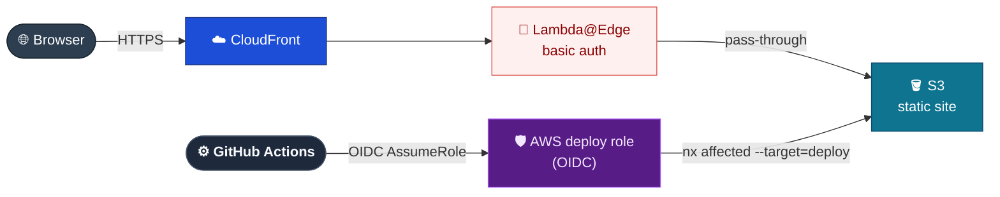

# DESIGN-20261103-LBBI — Migrate Static Site Hosting to GitHub Pages

## Problem

The docs site runs on AWS: CloudFront + S3 (static origin) + Lambda@Edge basic auth, provisioned by CDK (`DocsStack`, `EdgeStack`, `CiStack` with GitHub OIDC), deployed through `yarn nx affected --target=deploy` behind an AWS deploy role. The site has run with restricted access during its build-out — around 10 internal users, password-gated per NFR-1 — and the Artisyn Implementation Harness platform is now reaching the point of being open-sourced. Once the repo and site go public, there is no audience left to gate with basic auth, and no reason to keep operating AWS infrastructure (CDK stacks, Lambda@Edge handler, Secrets Manager, OIDC deploy roles, CloudFront/S3 logging) for what is a static VitePress build with no server-side compute need beyond that now-unnecessary auth gate. GitHub Pages removes that infrastructure and deploys directly from the GitHub Actions workflow already building the site.

**Current state:**

The Lambda@Edge auth node (red) is the pain point: it exists only to gate a private audience that will no longer exist once the repo is public, yet it still has to be built, deployed, and kept patched.

## Success

### Known ECs

- EC1: Site hosting moves from AWS (CloudFront + S3) to GitHub Pages.
- EC2: Basic-auth password gate (Lambda@Edge) is removed entirely — the site becomes publicly accessible with no credentials, consistent with being open-sourced.
- EC3: AWS infrastructure (the CDK stacks and everything they provision) is no longer provisioned or maintained for hosting this site.

### Proposed ECs

- [proposed] EC: Repo visibility change to public is tracked as an explicit prerequisite/dependency of this migration (the repo is currently private — confirmed via `gh repo view`), not assumed to have already happened.
- [proposed] EC: CI/CD deploy workflow is replaced with GitHub's native Pages deploy mechanism (`actions/configure-pages` + `actions/upload-pages-artifact` + `actions/deploy-pages`), removing the AWS OIDC deploy role and the `nx affected --target=deploy` AWS-specific path entirely for this site.
- [proposed] EC: VitePress's `base` path (currently unset, defaulting to `/`) is explicitly decided — either set to `/{repo}/` for a GitHub Pages project site, or a custom domain is kept so the site continues serving from root. This is a current-code gap, not just a future one: an unresolved choice here breaks every absolute asset/internal link under plain GitHub Pages project-site serving.
- [proposed] EC: A one-time content/secrets review happens before the repo goes public — removing the basic-auth gate is also a content-exposure change, not just an infrastructure change, since anything written assuming an authenticated-only audience becomes world-readable.
- [proposed] EC: An explicit decommission step for the now-unused AWS resources (CloudFront distribution, S3 bucket, Lambda@Edge function and versions, Secrets Manager secret, OIDC provider, IAM roles) is planned, rather than leaving them running unused after the CDK code is deleted.

## Boundaries

**In scope:** retiring the Infrastructure container's AWS/CDK implementation for this site; removing the Auth container entirely; replacing the CD deploy mechanism with GitHub Pages' native Actions deploy; updating the affected HLD docs (`System Overview.md`, `Containers/Infrastructure.md`, `Containers/Auth.md`, `Non-Functional Concerns/Requirements.md`) to match; the repo-visibility-to-public change and pre-publish content/secrets review as a tracked dependency; the VitePress `base`/custom-domain decision.

**Out of scope:** any change to the Web container's own content or VitePress build logic beyond the base-path/link adjustment the hosting switch requires; the Discuss (giscus) container's behavior — already hosting-agnostic and unaffected; the Harness Bootstrap E2E container; introducing any replacement access-gating mechanism (deliberately none — the whole point is no gate).

## Constraints

- No tracker ticket — this is a free-form/local design (`DESIGN-20261103-LBBI`); there is no Jira ticket to link.
- The repo is currently **private**. Going public is this design's dependency, not a side effect of it.
- `apps/docs-web/.vitepress/config.ts` has no `base` configured today — a current-state gap, not a future one.
- An unrelated, already in-flight, uncommitted-at-session-start change exists on `apps/infra/lib/docs-stack.ts` (a CSP `ResponseHeadersPolicy` addressing NFR-10) — out of scope for this design and must not be entangled with it.
- Several current NFRs are AWS/auth-specific and will be retired or need replacement once this migrates: NFR-1 (basic auth), NFR-2 (secret handling), NFR-3 (region — becomes moot, GitHub Pages has no region concept), NFR-4 (CDK-only infra), NFR-8 (OIDC deploy roles), NFR-9 (CloudFront/S3 access logging).
- Other NFRs are hosting-agnostic and must be preserved under the new model: NFR-5 (dead-link CI gate), NFR-6 (giscus posting permission gating), NFR-7 (markdown HTML/XSS), NFR-10 (CSP). NFR-10's CSP is currently delivered via a CloudFront `ResponseHeadersPolicy` response header, which has no direct equivalent on GitHub Pages (no custom response-header control), so Research must find an alternative delivery path (e.g. a `<meta http-equiv="Content-Security-Policy">` tag) to preserve that NFR's intent.

## Links

- Ticket: DESIGN-20261103-LBBI (local design ID, no tracker)
- Related tickets: none
- Reference docs: `docs/Target Architecture (HLD)/v1/System Overview.md`, `docs/Target Architecture (HLD)/v1/Containers/Infrastructure.md`, `docs/Target Architecture (HLD)/v1/Containers/Auth.md`, `docs/Target Architecture (HLD)/v1/Containers/Discuss.md`, `docs/Target Architecture (HLD)/v1/Non-Functional Concerns/Requirements.md`
