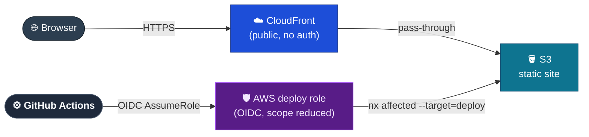
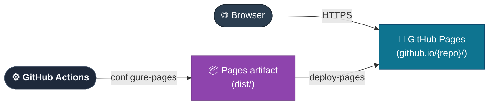
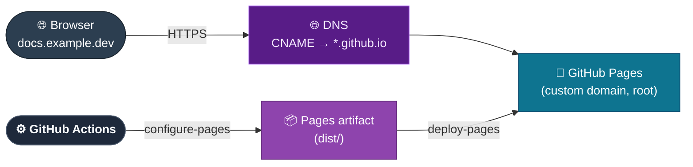
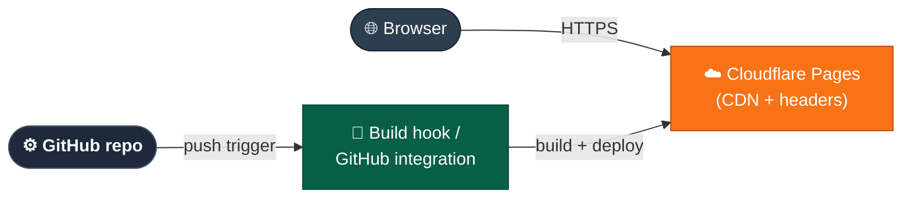
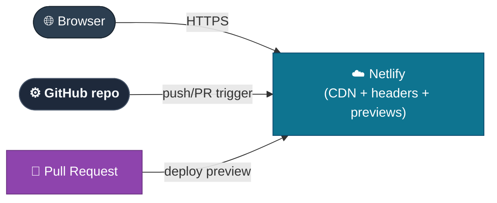

# DESIGN-20261103-LBBI: Migrate Static Site Hosting to GitHub Pages — Research

_Produced by the 🔍 Research phase. Owned by `@architect`. Do not edit after Evaluate phase begins._

## Context

The site currently runs on AWS: CloudFront + S3 + Lambda@Edge basic auth, provisioned by CDK. That auth gate was built while access was intentionally restricted to ~10 users, password-gated per NFR-1. The Artisyn Implementation Harness platform is now reaching the point of being open-sourced; once public, there is no audience left to gate and no reason to keep operating AWS infrastructure for what is a pure static VitePress build. This phase lists options for how to host the site post-migration, with no recommendation — that is Evaluate's job. Key bounding constraints from Frame: the repo is currently private (going public is a tracked dependency, not a side effect); VitePress has no `base` path configured today; and NFR-10's CSP currently rides a CloudFront `ResponseHeadersPolicy` response header, which has no direct equivalent on most alternatives.

## Options

### Option A — Minimal AWS change: keep CloudFront + S3, drop auth/OIDC complexity

**Description:** Keep `DocsStack` (CloudFront + S3, OAC) as-is; delete `EdgeStack` (Lambda@Edge placeholder) and the Auth container (`apps/lambda-auth/`) entirely; optionally narrow or keep `CiStack`'s OIDC/deploy-role machinery. CloudFront still fronts S3 but with no viewer-request Lambda — a public CDN with no auth gate.

**Industry precedent:** AWS's own "Serverless static website hosting" reference architecture typically pairs CloudFront+S3 with Lambda@Edge auth as an optional add-on module, not a required one — this just removes the optional module.

**Diagram:**

**Pros:**

- Smallest blast radius: one stack removed, one container deleted, `DocsStack`/`CiStack` otherwise untouched.
- CSP stays deliverable via CloudFront `ResponseHeadersPolicy` exactly as the in-flight NFR-10 work already does — no header-to-meta-tag migration.
- NFR-9 (CloudFront/S3 access logging) is preserved natively.
- No `base`-path change needed since nothing about path-serving changes.
- Lowest migration risk — no DNS cutover.

**Cons:**

- Does not fulfil the Known ECs (move off AWS, stop operating AWS infra) — included only as the "do nothing to hosting infra, just drop the now-pointless auth" baseline comparator.
- Still requires an AWS account, CDK stack maintenance, possibly an OIDC deploy role, and billing — the exact operational burden the ticket is trying to shed.
- CD pipeline (`yarn nx affected --target=deploy` behind `DEPLOY_ROLE_ARN`) stays as-is.
- None of the AWS-specific NFRs (region, CDK-only infra, OIDC) retire.

**Unknowns / risks:**

- If `CiStack`'s OIDC role is kept only for S3/CloudFront invalidation (no Lambda), its IAM policy scope should shrink, but a narrower variant is unverified.
- No accountable org boundary for an indefinitely-running AWS bill once the project is public/community-owned.

---

### Option B — GitHub Pages, project site (no custom domain)

**Description:** Build with VitePress, deploy via `actions/configure-pages` + `actions/upload-pages-artifact` + `actions/deploy-pages`. Site serves at `https://<org>.github.io/<repo>/`. Requires `base: '/<repo>/'` set in `apps/docs-web/.vitepress/config.ts` (currently unset, defaults to `/`) so every absolute asset/internal link resolves under the sub-path.

**Industry precedent:** GitHub's own documented `actions/deploy-pages` project-site pattern; VitePress's official "Deploy to GitHub Pages" guide explicitly documents this exact `base` requirement.

**Diagram:**

**Pros:**

- Zero infrastructure to own — fulfils the Known ECs directly, AWS stacks fully decommissioned.
- Deploy workflow lives entirely in the GitHub Actions already building the site, no new secrets beyond `permissions: pages: write` + `id-token: write`.
- Free for public repos, no billing surface.
- No DNS/domain dependency — works immediately once the repo is public and Pages is enabled.

**Cons:**

- Requires the VitePress `base` fix — every hardcoded absolute link (including the `sql.js`/WASM fetch for `docs-operational-graph.sqlite`, `buildEnd`-copied to `outDir` root in `apps/docs-web/.vitepress/config.ts`) must be verified to resolve under a sub-path.
- No custom response-header control, so NFR-10's CSP must move to a `<meta http-equiv="Content-Security-Policy">` tag (weaker — no `frame-ancestors`, no reliable reporting) or be descoped.
- No native access-log equivalent to NFR-9 — GitHub's repo traffic insights are coarse, no per-request granularity.
- URL structure changes for any existing hardcoded/bookmarked links.
- giscus's pathname-based discussion mapping may be affected by the added path prefix (unverified against its exact configured mapping strategy).

**Unknowns / risks:**

- GitHub Pages' build-size/queue limits (soft 1 GB artifact) are unmeasured against current doc volume.
- Whether the operational-graph SQLite WASM fetch path is absolute or base-relative is unverified — if absolute it needs the same base-prefix fix.

---

### Option C — GitHub Pages, custom domain (root-served)

**Description:** Same GitHub Pages Actions deploy mechanism as Option B, but a custom domain is configured via a `CNAME` file/Pages setting and DNS. `base` stays `/` since the site serves from domain root — no VitePress config change needed.

**Industry precedent:** GitHub's documented "Managing a custom domain for your GitHub Pages site"; widely used by OSS projects with a dedicated docs domain.

**Diagram:**

**Pros:**

- No `base`-path change needed, avoiding Option B's link-rewrite risk entirely.
- Cleaner public URL for an open-sourced platform — no `/{repo}/` prefix leaking into shared links.
- Same zero-infra, zero-billing profile as Option B.
- Automatic HTTPS via Let's Encrypt for custom domains.

**Cons:**

- Introduces a new dependency — a domain must be owned/available and DNS delegated/pointed, not a decision this design can make unilaterally.
- Same CSP-header and access-logging gaps as Option B regardless of domain.
- Slightly more setup/ops surface: DNS record management, domain renewal, GitHub's one-time domain-verification step against takeover.

**Unknowns / risks:**

- Whether a suitable domain is already owned by the org or needs new registration, and who owns/pays for it.
- DNS propagation and the domain-verification TXT record add a one-time cutover step not present in Option B.

---

### Option D — Cloudflare Pages

**Description:** Connect the GitHub repo to Cloudflare Pages; it builds and deploys on push, with its own global CDN. Can serve at root via a Cloudflare-managed `*.pages.dev` subdomain or a custom domain on Cloudflare DNS.

**Industry precedent:** VitePress's own docs list Cloudflare Pages as a first-class supported deploy target; Cloudflare publishes a VitePress deployment guide for this exact stack.

**Diagram:**

**Pros:**

- Supports custom response headers natively via a `_headers` file in the build output — NFR-10's CSP can ship as a real HTTP header, closer to current CloudFront behavior than a meta-tag fallback.
- Built-in access analytics/logging, closer to an NFR-9 equivalent than GitHub Pages offers.
- Free tier covers typical OSS doc-site traffic/build volume.
- No `base`-path concern if served from a custom domain or its own subdomain at root.

**Cons:**

- Introduces a third-party platform dependency beyond GitHub — new account, new project connection, new deploy credentials outside GitHub's own trust boundary.
- Not "infra you already have" the way GitHub Pages is for a GitHub-hosted OSS repo.
- Build must be reconfigured for Cloudflare's build system rather than reusing the existing GitHub Actions build.
- Furthest from the ticket's framing, which named GitHub Pages as the leading candidate specifically to deploy from the workflow already building the site.

**Unknowns / risks:**

- Cloudflare Pages' GitHub integration could duplicate the existing CI build unless configured to consume the GitHub Actions build artifact directly (Direct Upload/Wrangler) instead of triggering its own build.
- The AWS decommission step is still required regardless of which option is picked.

---

### Option E — Netlify (representative of the Netlify/Vercel class)

**Description:** Connect the repo to Netlify; it builds the VitePress site on push/PR and serves it from its own global CDN, with deploy previews per PR. Used here as representative of the "Git-connected static host with build pipeline and preview deploys" class (Vercel is comparable).

**Industry precedent:** Netlify lists VitePress/VuePress as a one-click framework preset; commonly used by Vue-ecosystem OSS documentation sites.

**Diagram:**

**Pros:**

- Deploy previews per PR — a capability none of the other options give natively.
- Custom headers via `netlify.toml`/`_headers`, same CSP-as-real-header advantage as Cloudflare Pages.
- Mature VitePress support, generous OSS free tier.
- Built-in redirects/rewrites engine if URL structure ever needs to change again.

**Cons:**

- Same third-party-platform overhead as Cloudflare Pages: new account, new integration, separate trust boundary from GitHub.
- Deploy-preview/analytics value is unconfirmed for this repo's workflow (no established PR-review-with-visual-preview culture).
- Duplicate-build risk same as Option D unless integration is configured carefully.
- Furthest from the ticket's GitHub-Pages-native framing.

**Unknowns / risks:**

- Vercel's free tier has stricter commercial-use terms than Netlify's — relevant only if that alternative is considered and the project's eventual license doesn't clearly qualify.
- AWS decommission step still required regardless.

---

## Open Questions

Proposed triage below — to be confirmed at sign-off, not yet developer-confirmed.

| #     | Question                                                                                                                                                                                                                                                                            | Owner           |
| ----- | ----------------------------------------------------------------------------------------------------------------------------------------------------------------------------------------------------------------------------------------------------------------------------------- | --------------- |
| OQ-1  | (E) Is a custom domain available/desired for this site? Affects the choice between Option B (path-based) and Option C (custom domain), and whether D/E serve at root.                                                                                                               | Developer / org |
| OQ-2  | (V) Does the design accept `<meta http-equiv="Content-Security-Policy">` as sufficient for NFR-10 under GitHub Pages (Options B/C), given it can't express `frame-ancestors` or reporting directives — or is a header-capable host (D/E) required to preserve NFR-10's full intent? | Developer       |
| OQ-3  | (V) Is some access-log/analytics equivalent to NFR-9 required post-migration, or is NFR-9 explicitly retired as AWS-specific and dropped?                                                                                                                                           | Developer       |
| OQ-4  | (E) Is `cdk destroy` across `DocsStack`/`EdgeStack`/`CiStack` sufficient, given `RemovalPolicy.RETAIN` on the S3 bucket and Secrets Manager secret — meaning those two resources need an explicit manual deletion step (and a decision on archiving bucket contents first)?         | @infra          |
| OQ-5  | (E) Beyond VitePress's own nav/sidebar link rewriting, does the `docs-operational-graph.sqlite` WASM fetch path and any other hardcoded absolute URL need a `base`-aware fix if a project-site path (Option B) is chosen?                                                           | @web            |
| OQ-6  | (E) Does changing the site's path structure (Option B's `/{repo}/` prefix) affect giscus's pathname-based discussion mapping, or is this a non-issue because no discussions have accumulated against current paths yet?                                                             | @web            |
| OQ-7  | (E) What's the tracked action item and target date for flipping the repo from private to public, since every hosting option here assumes that precondition is met?                                                                                                                  | Developer / org |
| OQ-8  | (E) Who owns the one-time content/secrets review before going public, and does it block or run parallel to the hosting migration itself?                                                                                                                                            | Developer       |
| OQ-9  | (E) Does replacing `cd.yml`'s AWS deploy also mean deleting `.github/actions/aws-auth` and the AWS-specific nx targets (`synth`/`diff`/`output`/`provision`/`destroy`/`bootstrap`/`sm-push`/`sm-pull`) in `apps/infra/project.json`, or are some retained for a transition period?  | @infra          |
| OQ-10 | (V) Is introducing a non-GitHub-native hosting vendor (Options D/E) acceptable at all, given the ticket's framing leans toward deploying natively from the workflow already building the site?                                                                                      | Developer       |
| OQ-11 | (E) Has current build output size/time been measured against GitHub Pages' soft 1 GB artifact limit and build queue?                                                                                                                                                                | @web            |
