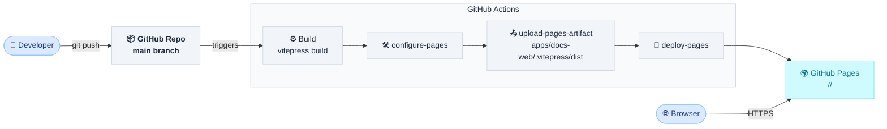
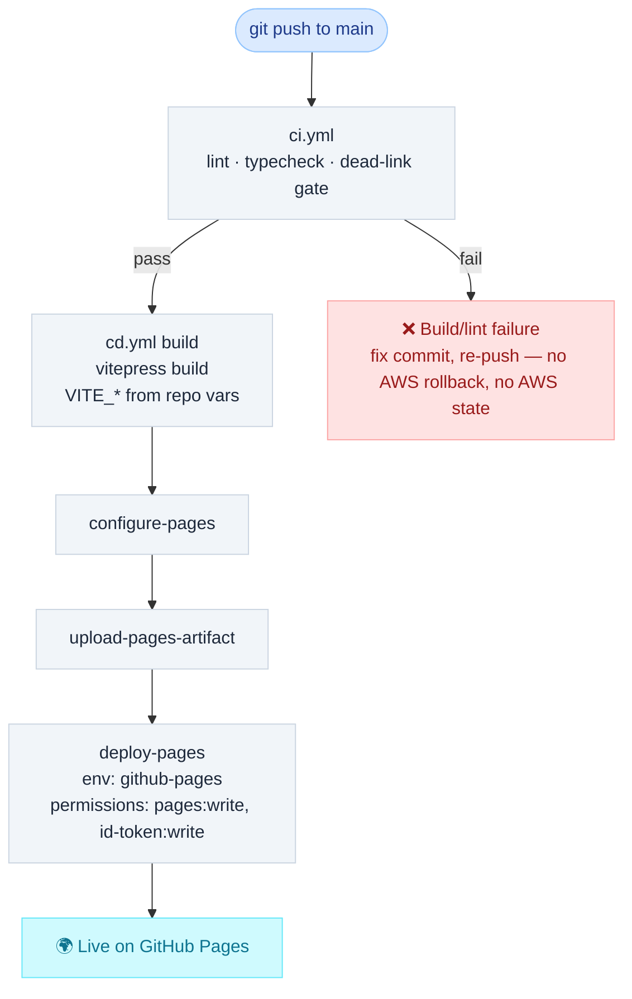
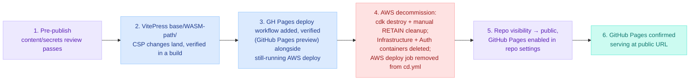

# DESIGN-20261103-LBBI: Migrate Static Site Hosting to GitHub Pages — Solution

The site moves from CloudFront + S3 + Lambda@Edge (AWS, password-gated) to GitHub Pages, a project site served at `https://<org>.github.io/<repo>/`. The Infrastructure and Auth containers are retired in their entirety; no replacement access gate is introduced — the site becomes fully public. Option selection rationale is in `design/02 Evaluate.md`; this document records only settled outcomes.

## System Context — Target State

Post-migration container list: **Web, Discuss, Harness Bootstrap E2E**. Infrastructure and Auth no longer exist as containers.

## Container Changes

| Container                      | Disposition                       | Detail                                                                                                                                                                                       |
| ------------------------------ | --------------------------------- | -------------------------------------------------------------------------------------------------------------------------------------------------------------------------------------------- |
| Infrastructure (`apps/infra/`) | **Retired entirely**              | `DocsStack`, `EdgeStack`, `CiStack`, `conventions.ts` all deleted. GitHub Pages requires no CDK-provisioned infrastructure — no CDN, no origin bucket, no edge compute, no OIDC deploy role. |
| Auth (`apps/lambda-auth/`)     | **Retired entirely**              | Dedicated solely to the basic-auth handler. No replacement access-gating mechanism — deliberate; the site is fully public.                                                                   |
| Web (`apps/docs-web/`)         | **Retained, deploy path changed** | No longer depends on Infrastructure's CDK outputs or AWS credentials. The existing build workflow now also deploys directly to GitHub Pages.                                                 |
| Discuss                        | **Structurally unaffected**       | giscus path-mapping consequence recorded under Security & Operational Consequences.                                                                                                          |
| Harness Bootstrap E2E          | **Unaffected**                    | No dependency on hosting or Infrastructure/Auth.                                                                                                                                             |

## Deploy Mechanism

- `.github/workflows/cd.yml` deploys via `actions/configure-pages`, `actions/upload-pages-artifact` (pointed at `apps/docs-web/.vitepress/dist`), `actions/deploy-pages`, with `permissions: pages: write, id-token: write` and a `github-pages` environment. No AWS role assumption, no SSM calls.
- `VITE_GITHUB_ORG`, `VITE_GITHUB_REPO`, `VITE_GISCUS_REPO_ID`, `VITE_GISCUS_CATEGORY_ID` (all non-secret, public giscus config, per `apps/docs-web/.env.example`) move from SSM Parameter Store (`SITE_SSM_ENV_PARAM`) to GitHub Actions repository variables, injected directly as env vars. No secret store is needed for these.
- `apps/docs-web/project.json`'s `deploy`, `env-push`, `env-pull`, `sm-push`, `sm-pull` nx targets are retired, along with `scripts/ci/site-deploy.sh` and the SSM-loading half of `scripts/ci/site-build.sh`. Build becomes a plain `vitepress build` with env vars already present in the Actions environment — no AWS calls at all.
- `.github/workflows/ci.yml`'s AWS OIDC auth step (`./.github/actions/aws-auth`, `CI_ROLE_ARN`) and its SSM-dependent env vars are retired. CI needs no AWS credentials once nothing in the pipeline touches AWS.
- Build failure handling: a lint/typecheck/dead-link gate failure in `ci.yml` blocks the deploy from ever running. Recovery is fixing the commit and re-pushing. There is no AWS-side rollback step, since there is no AWS-side state to roll back once decommissioned.
- The `deploy-pages` job carries a `concurrency` group (`group: "pages"`, `cancel-in-progress: false`) — GitHub's own recommended pattern for Pages deploy jobs. This is part of the target workflow design: it serializes deploys so a second push's deploy run queues behind a slower in-flight one rather than clobbering it, instead of two concurrent `deploy-pages` runs racing against each other.

The GitHub Pages deploy job is added to `cd.yml` and verified via GitHub's own Pages preview/build-check mechanism (the `deploy-pages` job's deployment summary and preview URL), not by comparing against a still-live AWS site — AWS is decommissioned in Sequencing step 4, before the repo's visibility flips to public in step 5, not after. The AWS deploy job is removed from `cd.yml` as part of that same decommission step.

## VitePress / Base-Path Changes

- `apps/docs-web/.vitepress/config.ts` gets `base: '/<repo>/'` set (currently unset, defaulting to `/`).
- The `docs-operational-graph.sqlite` WASM fetch path — currently copied via a `buildEnd` hook to `outDir` root and fetched client-side by `sql.js` using an absolute `/docs-operational-graph.sqlite` path — is made base-aware, resolved via VitePress's base-relative asset handling (e.g. an `import.meta.env.BASE_URL`-prefixed fetch), so it continues to resolve correctly under the `/<repo>/` prefix.

## Security & Operational Consequences

- **CSP delivery** moves from a CloudFront `ResponseHeadersPolicy` HTTP response header (the in-flight, uncommitted NFR-10 work on `apps/infra/lib/docs-stack.ts` — out of scope for this design, not touched by it) to a `<meta http-equiv="Content-Security-Policy">` tag added via VitePress's `head` config, using the same directive values minus `frame-ancestors` (not expressible via a meta tag; GitHub Pages has no custom response-header control). Confirmed acceptable by the developer (Research OQ-2, `design/Report.md` Assumptions table).
- **NFR-9** (CloudFront/S3 access logging) is retired with no replacement. Confirmed by the developer (Research OQ-3).
- **NFR-6 / Discuss comment-read gating** changes consequence, not mechanism. `Containers/Auth.md` records that comment-reading on the Discuss container "is not gated by anything beyond this Lambda" — today, comment-read access rides entirely on the basic-auth gate. Once Auth is retired and the repo is public, comment reading becomes open to anyone who can view the public repo's Discussions, where it was previously limited implicitly to the restricted-access population behind basic auth. This is an accepted consequence of the migration, not a gap to resolve — the design's purpose is removing the gate.
- **A one-time pre-publish content/secrets review is a hard precondition**, owned by the developer (repo maintainer): a manual sweep for hardcoded secrets, credentials, or any content never meant for a public audience. It must complete and pass **before** the repo's visibility changes from private to public. Visibility-flip is irreversible once taken, which is why the review gates it rather than the reverse. (Addresses WAF P1 item 1, `design/Report.md`.)
- **giscus mapping** is unaffected in practice: no discussions have accumulated yet under the current (pre-migration) paths, so the `/<repo>/` path-prefix change has nothing to migrate — it simply becomes part of every discussion's mapped identity going forward. As part of Sequencing step 4 (repo visibility flip to public), confirm the giscus GitHub App's installation/permissions and the configured Discussions category remain valid and correctly scoped after the repo becomes public — a one-time verification check, not a configuration change; giscus's setup is already recorded in `Containers/Discuss.md`, out of scope for this design to alter.

## Decommission

Addresses WAF P1 item 2 (`design/Report.md`).

Decommission happens **before** the repo goes public — it is a prerequisite step for the visibility flip, not a cleanup step performed after cutover. There is no AWS-side fallback once this runs: once these resources are destroyed, recovering from a problem on the GitHub Pages path means re-provisioning AWS from scratch or fixing the GitHub Pages path directly (e.g. fixing the build and re-running `deploy-pages`), not falling back to a still-running AWS deployment.

- `cdk destroy` runs across `DocsStack`, `EdgeStack`, and `CiStack` — this alone is **not sufficient**. The S3 bucket and the Secrets Manager secret both carry `RemovalPolicy.RETAIN` (confirmed in `Containers/Infrastructure.md`'s current content) and survive `cdk destroy` untouched.
- An explicit manual deletion step is required for those two retained resources, performed as part of this same pre-cutover decommission step.
- The Secrets Manager secret's manual deletion is a **forced** delete (`ForceDeleteWithoutRecovery` / the force-delete option), not a standard delete. A standard delete leaves the secret recoverable for up to 30 days, which contradicts this section's own intent of fully closing out AWS exposure before the repo goes public.
- No data-archival step is needed beyond this: the bucket only ever held reproducible VitePress build output, not unique data; the secret's only value (the basic-auth password hash) has no further use once the Auth container is retired.

## Sequencing

This order is a settled architectural decision, not just a plan: AWS is fully decommissioned **before** the repo goes public, not after. This is a deliberate change from an earlier version of this design, which kept AWS running until GitHub Pages was confirmed live, giving a rollback fallback if the new path had a problem. That fallback no longer exists: once AWS is decommissioned (step 4, below), there is no AWS-side fallback if GitHub Pages has a problem after cutover. Recovery in that case means re-provisioning AWS from scratch or fixing the GitHub Pages path directly (e.g. fixing the build and re-running `deploy-pages`), not falling back to a still-running AWS deployment. The developer confirmed this tradeoff explicitly.

Step 3 runs both deploy paths live briefly, verified via GitHub's own Pages preview mechanism, not by comparing against AWS — GitHub Pages is not yet the public entry point at that point. Step 4 tears AWS down completely before the repo goes public in step 5; step 6 is the final confirmation that the now-sole GitHub Pages path serves correctly.

## Decision Register

| #   | Decision                                                                                                                                                                                                       | Scope / Owner               | Affected interfaces / contracts                                                                                                                                                                      | Verification                                                                    |
| --- | -------------------------------------------------------------------------------------------------------------------------------------------------------------------------------------------------------------- | --------------------------- | ---------------------------------------------------------------------------------------------------------------------------------------------------------------------------------------------------- | ------------------------------------------------------------------------------- |
| 1   | Hosting platform = GitHub Pages, project site (`/<repo>/`)                                                                                                                                                     | Web container · `@web`      | Public URL shape; every absolute asset/link                                                                                                                                                          | GitHub Pages serves the built site at `https://<org>.github.io/<repo>/`         |
| 2   | Infrastructure container retired entirely                                                                                                                                                                      | Infra · `@infra`            | `apps/infra/` deleted (`DocsStack`, `EdgeStack`, `CiStack`, `conventions.ts`); CDK outputs no longer exist                                                                                           | `apps/infra/` removed from repo; no CDK stacks remain deployed                  |
| 3   | Auth container retired entirely, no replacement gate                                                                                                                                                           | Auth · `@auth`              | `apps/lambda-auth/` deleted; Secrets Manager secret has no further consumer                                                                                                                          | `apps/lambda-auth/` removed from repo; site reachable with no auth challenge    |
| 4   | CD/CI workflow replaced; AWS OIDC/SSM removed from both `cd.yml` and `ci.yml`                                                                                                                                  | Web/CI · `@web`             | `cd.yml` deploy steps, `ci.yml` auth step, `apps/docs-web/project.json` nx targets (`deploy`, `env-push`, `env-pull`, `sm-push`, `sm-pull`), `scripts/ci/site-deploy.sh`, `scripts/ci/site-build.sh` | Both workflows run green with zero AWS credential/role references               |
| 5   | VitePress `base: '/<repo>/'` set; WASM fetch path made base-aware                                                                                                                                              | Web · `@web`                | `apps/docs-web/.vitepress/config.ts`; `docs-operational-graph.sqlite` fetch call                                                                                                                     | Build produces working links and a loading Graph Explorer under `/<repo>/`      |
| 6   | CSP moves from CloudFront response header to VitePress `head` meta tag, minus `frame-ancestors`                                                                                                                | Web · `@web`                | `apps/docs-web/.vitepress/config.ts` `head` config                                                                                                                                                   | Rendered HTML `<head>` contains the CSP meta tag with matching directive values |
| 7   | NFR-9 (access logging) retired, no replacement                                                                                                                                                                 | Platform · Developer        | `docs/Target Architecture (HLD)/v1/Non-Functional Concerns/Requirements.md`                                                                                                                          | NFR-9 removed/marked retired in the NFR doc                                     |
| 8   | Pre-publish content/secrets review gates the visibility flip                                                                                                                                                   | Developer (repo maintainer) | Repo visibility setting                                                                                                                                                                              | Review sign-off recorded before visibility changes to public                    |
| 9   | AWS decommission (`cdk destroy` + manual deletion of `RemovalPolicy.RETAIN` resources) sequenced before the repo's visibility changes to public, not after — there is no AWS-side fallback once decommissioned | Infra · `@infra`            | S3 bucket, Secrets Manager secret, `DocsStack`/`EdgeStack`/`CiStack`                                                                                                                                 | Resources confirmed deleted before Sequencing step 5 (visibility flip) begins   |
| 10  | giscus discussion mapping needs no migration                                                                                                                                                                   | Discuss                     | giscus pathname mapping                                                                                                                                                                              | Confirmed empty discussion history pre-migration; no migration script required  |

## Considered Options

A full options analysis is in `design/02 Evaluate.md`. In summary: five hosting approaches were evaluated — keeping AWS with just the auth layer removed, GitHub Pages as a project site, GitHub Pages behind a custom domain, Cloudflare Pages, and Netlify. GitHub Pages (project site) was selected because it fulfils every known requirement (no AWS infra, no auth gate) without depending on a yet-unconfirmed custom domain, at the cost of one bounded, well-documented engineering task (the VitePress `base` path fix) rather than an organizational dependency.
