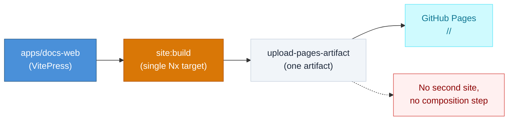

# DESIGN-20261108-1L8P — Web Explorer Landing Page & Web Portal Site Routing

## Problem

The harness has no public-facing promotional experience. `apps/docs-web` (VitePress) is a dense, documentation-oriented reference site, not built to sell the harness's value to engineering leads, architects, and prospective adopters in the first few seconds. The developer has already scaffolded a Trigger.dev-style promo SPA, `web-explorer`, for exactly this purpose, but there is no mechanism today to serve it alongside the existing docs site from this repo's single GitHub Pages deployment. The current CD pipeline (`.github/workflows/cd.yml`) builds and uploads exactly one static artifact (`apps/docs-web/.vitepress/dist`) to the Pages root — adding a second site means deciding where each lives in the URL space and how the pipeline assembles both into one deploy.

**Current state:**

## Success

### Known ECs

- EC1: A new app, `web-explorer`, provides a modern, high-level promotional UI for the harness, in the visual style of Trigger.dev, primarily for promoting the project (not a functional product surface).
- EC2: `apps/docs-web` is renamed to `web-docs` (package/app name change, e.g. `apps/web-docs`).
- EC3: Navigating to the GitHub Pages root serves `web-explorer`.
- EC4: Navigating to the docs path serves `web-docs`.
- EC5: A `web-portal` is the mechanism that makes root → web-explorer / docs-path → web-docs routing happen.

### Proposed ECs

- [proposed] EC: web-explorer's outbound links and asset base path must resolve correctly under GitHub Pages' `/<repo>/` project-site base, consistent with the existing constraint already documented for the Web container (`Containers/Web.md`) — not hardcoded to root (`/`) or a different base.
- [proposed] EC: The composed deploy must not regress NFR-5 (VitePress build fails on any dead internal link) or NFR-7 (`markdown.html: false`, no raw HTML/script execution) — web-explorer's own build introduces no new instance of either gap.
- [proposed] EC: The `docs-web` → `web-docs` rename stays mechanical — directory/package/Nx-project rename only; internal doc links and the VitePress `srcDir` resolution are unaffected by the rename itself (no content rewrite required).
- [proposed] EC: The web-portal composition step is verifiable in CI before it reaches production — this repo's CD workflow deploys straight to the live GitHub Pages site with no staging environment, so a bad path assembly would ship directly; the build step's output layout needs an assertion or check in CI, not just a local "works for me."

## Decisions

Confirmed with the developer at Frame Step 2 (2026-11-08): this design bundles two independent decisions, each with its own option set and tradeoffs, each running its own Research → Evaluate → Solution loop.

| #   | Decision                    | Why it's independent                                                                                                                                                                                                                                                                                                                                                                                                                                                                                                           |
| --- | --------------------------- | ------------------------------------------------------------------------------------------------------------------------------------------------------------------------------------------------------------------------------------------------------------------------------------------------------------------------------------------------------------------------------------------------------------------------------------------------------------------------------------------------------------------------------ |
| 1   | Web Explorer                | What the new promotional SPA is and how it's built — whether/how the developer's existing untracked `web-explorer/` scaffold (React 19 + Vite 8 + Tailwind 4 + Motion, already positioned as reference per its own `docs/TECH_STACK.md` and `docs/IMPLEMENTATION_BRIEF.md`) is adopted into the monorepo, its content and design system. Has its own option set (adopt scaffold as-is vs. rebuild; where it lands in the workspace) independent of how routing is solved.                                                      |
| 2   | Web Portal site composition | The build/deploy mechanism serving `web-explorer` at the Pages root and the renamed `web-docs` under a subpath from one static GitHub Pages deploy, including the `docs-web` → `web-docs` rename (bundled here since the rename's target path only makes sense together with the new routing layout it's renamed for). Has its own option set (e.g. multi-artifact merge at CI time vs. a client-side shell router vs. separate Nx build graph composition) and constrains the pipeline regardless of web-explorer's final UI. |

## Boundaries

**In scope:**

- New `web-explorer` app (using the existing root-level scaffold as reference/starting material, not necessarily its final location or exact code)
- Renaming `apps/docs-web` to `apps/web-docs` (directory, Nx project, package name)
- A `web-portal` mechanism achieving root → web-explorer / subpath → web-docs routing within GitHub Pages' static-only constraint
- Updates to `.github/workflows/cd.yml` and the relevant Nx `project.json` configs needed to build and compose both sites into one Pages artifact
- Updating `Containers/Web.md` (and adding new container docs as needed) to reflect the new topology — this is Publish's job later in the lifecycle, not Frame's, but it's in scope for the design overall

**Out of scope:**

- Any backend or server runtime (GitHub Pages stays static-only; no infrastructure is reintroduced)
- Authentication, analytics, CMS, or a visual graph editor in web-explorer
- Real Claude Code / live-agent integration in web-explorer — it stays a client-side, simulated demo (per the existing scaffold's own `IMPLEMENTATION_BRIEF.md`)
- Any change to the Discuss (giscus) container

## Constraints

- NFR-5 (VitePress build fails on any dead internal link) and NFR-7 (`markdown.html: false`) continue to apply unchanged and must not regress
- GitHub Pages is static-only — no server-side runtime at request time (the Infrastructure container is retired; there is nothing to run a reverse-proxy process on). Confirmed with the developer at Context Gathering sign-off: "web-portal" is realized as a build-time static composition (merge two builds into one Pages artifact tree), not a running proxy process
- The CD workflow (`cd.yml`) today uploads exactly one artifact path (`upload-pages-artifact` → `actions/deploy-pages`); it has no staging environment, so changes to the build/compose step ship straight to production on the next push to `main`
- The existing `web-explorer/` directory at the repo root is untracked, developer-authored reference material — explicitly meant to be incorporated as reference input to this design, not assumed to be the final app code or location as-is
- Region must never be hardcoded in source or documentation (standing repo convention); guarded commands (e.g. `git push`) are presented as instructions for the developer, never run directly

## Links

- Ticket: DESIGN-20261108-1L8P (local design ID — free-form input, no tracker ticket)
- Related tickets: none
- Reference docs: `docs/Target Architecture (HLD)/v1/Containers/Web.md`, `docs/Target Architecture (HLD)/v1/Non-Functional Concerns/Requirements.md`, `.github/workflows/cd.yml`, `apps/docs-web/project.json`
