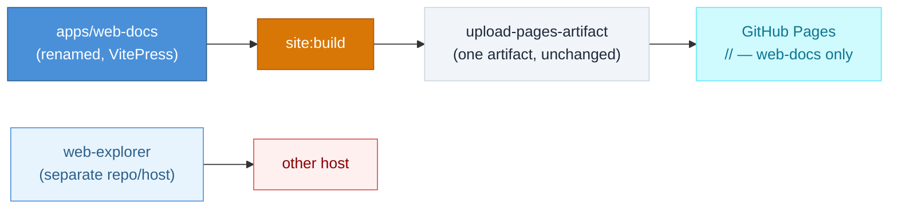
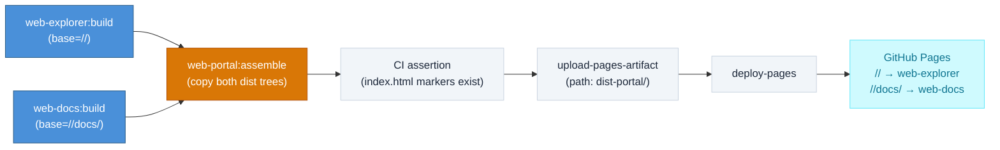
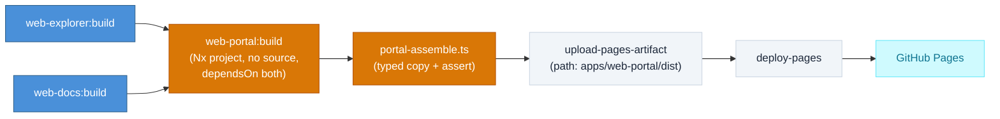
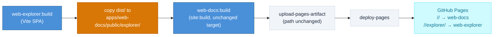
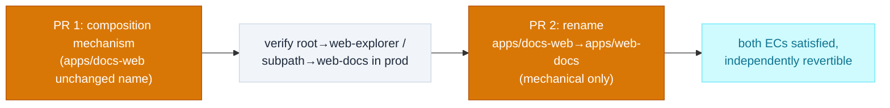

# DESIGN-20261108-1L8P: Web Explorer Landing Page & Web Portal Site Routing — Research (Decision 2: Web Portal Site Composition)

_Produced by the Research phase. Do not edit after Evaluate phase begins._

## Context

This design needs `web-explorer` served at the GitHub Pages root and the renamed `web-docs` (currently `apps/docs-web`) served under a subpath, from this repo's single static GitHub Pages deploy (`.github/workflows/cd.yml` today builds and uploads exactly one artifact). The developer confirmed at Context Gathering sign-off that "web-portal" means build-time static composition only — GitHub Pages has no server runtime, so no option here may require a running proxy process. `web-explorer` itself (Decision 1) is treated as a black-box Vite SPA with its own `dist/` output for this decision.

## Options

### Option A — Do nothing / minimal change: keep web-docs off-root indefinitely, no true composition

**Description:** Don't merge builds at all. Optionally rename `apps/docs-web`→`apps/web-docs` for consistency, but leave `cd.yml` deploying only web-docs (still effectively at root) and defer `web-explorer` to a separate GitHub Pages environment or separate host entirely (different repo, Netlify/Vercel, etc.) — no single-artifact merge logic introduced.

**Industry precedent:** Common pattern of a docs site on one static host and a marketing site on another (e.g. ReadTheDocs/Netlify docs + separate Vercel marketing site) — legitimate in general, but exactly what this Frame's EC5 (a web-portal mechanism **within this repo's pipeline**) is trying to avoid.

**Diagram:**

**Pros:**

- Zero CI risk — current `cd.yml` untouched for web-docs
- No base-path renegotiation needed for web-docs
- Fastest to ship, no new failure mode in the only deploy pipeline this repo has

**Cons:**

- Does not satisfy EC3/EC4/EC5 at all — root does not serve web-explorer from this GitHub Pages deploy, the design's explicit success criterion; this is really "defer the decision," not a candidate that meets Frame's ECs
- Splits ownership/deploy surface across two hosting mechanisms, which Frame's boundaries don't contemplate

**Unknowns / risks:**

- Whether a second free static host is acceptable at all — likely fine cost-wise (no cost ceiling defined for this engagement), but reopens a "two deploy pipelines" surface area Frame explicitly scoped CI changes around

---

### Option B — Industry-standard: dedicated Nx "assemble" target merging both dist trees before one upload-pages-artifact

**Description:** Add a new lightweight Nx target/project (e.g. a `web-portal` project with no source of its own, or a `portal:assemble` target) that depends on both `web-docs`'s and `web-explorer`'s `build` targets, copies `apps/web-explorer/dist/**` into a fresh `dist-portal/` root and `apps/web-docs/.vitepress/dist/**` into `dist-portal/docs/`. `cd.yml`'s single build step runs the assemble target; `upload-pages-artifact`'s `path` changes to the merged tree. The `docs-web`→`web-docs` rename is a prerequisite/same-PR step; VitePress's `base` moves from `/<repo>/` to `/<repo>/docs/` (or whichever subpath), web-explorer's Vite `base` is set explicitly to `/<repo>/`.

**Industry precedent:** Nx's own multi-app-to-one-static-host patterns and the general Turborepo-plus-GitHub-Pages community pattern (build N apps, copy each into a shared output tree keyed by subpath, deploy once); see Vite's `base` config docs and VitePress's deploy guide for subpath hosting.

**Diagram:**

**Pros:**

- Matches this repo's existing pipeline shape almost exactly — one artifact, one upload, one deploy, smallest diff to `cd.yml`
- Keeps Nx caching/inputs/outputs and `nx affected` semantics working per-app, assemble step itself cacheable
- A merged-dist-tree copy step is trivially assertable in CI, directly answering the Frame's "verifiable in CI" proposed EC
- Each app's build stays fully independent (satisfies "treat web-explorer as a black box" scoping for this decision)

**Cons:**

- Requires a new Nx project/target that doesn't exist today — net-new pipeline surface, however small
- Two `base` configs (VitePress + Vite) must be kept in sync with the chosen subpath string, in two different places/syntaxes
- If the merge script is plain shell (as the existing `scripts/ci/site-build.sh` is), it's manual bash with no framework guardrails — a copy bug fails silently unless the CI assertion step explicitly checks both markers

**Unknowns / risks:**

- Does VitePress cleanly support a nested subpath base (not just the one-level `/<repo>/` case already exercised)?
- Whether `actions/configure-pages@v5`'s auto-detection still matches once the artifact root is a hand-merged, multi-framework tree (may need explicit Pages settings rather than auto-detection)
- Existing indexed/bookmarked `/<repo>/...` doc URLs break with no redirect mechanism on static Pages unless an explicit stub is added

---

### Option C — First-class Nx project (`apps/web-portal`) with typed TypeScript merge logic

**Description:** Variant of B, but instead of a loose shell script, create an actual `apps/web-portal/project.json` Nx project (no source code, composition-only) whose `build` target has `dependsOn: ["web-explorer:build", "web-docs:build"]` and `outputs: apps/web-portal/dist`. Merge logic lives in a small typed Node/TS script (e.g. `scripts/ci/portal-assemble.ts`) run via `nx:run-commands`, with explicit overwrite-collision detection/asserts. `cd.yml` keeps running `nx affected --target=build` as today; `web-portal` becomes "affected" whenever either dependency changes via Nx's own project graph. `upload-pages-artifact` path becomes `apps/web-portal/dist`.

**Industry precedent:** Nx's documented pattern for "composite"/"meta" apps that depend on other projects' build outputs purely for packaging/composition — commonly used for Electron shells or multi-bundle deploy artifacts.

**Diagram:**

**Pros:**

- Fully idiomatic for this repo's existing Nx conventions — reuses inputs/outputs/caching rather than a special-cased CI step
- `nx affected` continues to correctly mark `web-portal` affected via the project graph, no hand-maintained "did either input change" check
- TypeScript merge logic makes the CI-assertion proposed EC trivial to express with real asserts/stack traces rather than brittle bash
- Nx caching avoids full rebuilds when only one app changed

**Cons:**

- More ceremony than B for what is fundamentally a `cp -r` operation
- Introduces a Node/TS build step purely for file copying
- Still carries the same base-config, URL-breakage, and VitePress-subpath unknowns as Option B — this is an implementation refinement, not a different topology

**Unknowns / risks:**

- Same technical unknowns as B (VitePress nested-subpath support, Pages auto-detect behavior, bookmark breakage)
- Additional unknown — whether an Nx "application" project with zero source confuses Nx's own project-type inference (unusual but not unsupported)

---

### Option D — Invert the subpath: web-explorer's build absorbed into web-docs's own `public/` passthrough, no separate merge step

**Description:** Build web-explorer first, copy its `dist/` output into `apps/web-docs`'s `public/explorer/` directory (VitePress's static-passthrough mechanism — anything under `public/` is copied verbatim into the final dist root). A single, unchanged `nx run site:build` then naturally produces `dist/explorer/index.html` alongside the rest of the VitePress site. This inverts Frame's stated direction (root→web-explorer) unless mirrored the other way (web-docs's prebuilt dist copied into web-explorer's own public-equivalent instead) — either direction, the key idea is no new CI step/Nx project, one app's build absorbing the other's prebuilt output as a static copy before the existing single build command runs.

**Industry precedent:** VitePress's own documented `public/` directory passthrough feature, designed for "ship a prebuilt static subtree verbatim" cases (e.g. embedding a prebuilt Storybook or API reference under a docs site).

**Diagram:**

**Pros:**

- Genuinely minimal pipeline change — `cd.yml` keeps one build step, one artifact path, nothing new in upload/deploy
- Reuses VitePress's own documented static-asset passthrough rather than inventing new merge tooling

**Cons:**

- Directly fights Frame's explicit EC3 (root→web-explorer) if web-docs remains the "outer" build — doing it the other direction is more aligned but then NFR-5's dead-link checking must run on web-docs _before_ being copied as opaque static files into web-explorer's output, meaning the two builds still need a fixed order with an explicit copy step — not meaningfully simpler than B/C, just hides the copy step inside one app directory instead of a dedicated composition stage
- Couples one app's build timing to the other's in a way that's less visible from `cd.yml` alone, harder to audit

**Unknowns / risks:**

- Whether VitePress's `public/` copy preserves correct routing for a client-side-routed SPA nested under a passthrough directory (likely fine for a single-page SPA with no internal routes, unverified if web-explorer ever adds routing)
- Same two-base-config and bookmark-breakage unknowns as B/C

---

### Option E — Sequencing variant: ship the composition mechanism first, rename `docs-web`→`web-docs` in a separate follow-up

**Description:** A sequencing option, not a topology — layer this on top of whichever of B/C is chosen. Implement the composition mechanism first, pointing at the existing `apps/docs-web` path unchanged, get root→web-explorer / subpath→web-docs working and deployed, then do the `docs-web`→`web-docs` rename as a second, purely mechanical commit/PR once routing is proven stable in production.

**Industry precedent:** Standard "land the mechanism before the rename" refactor sequencing used broadly in incremental-migration practice (Martin Fowler's parallel-change/expand-contract pattern) — keeps each commit independently revertible.

**Diagram:**

**Pros:**

- Reduces blast radius per change — a composition-mechanism bug and a rename-path bug are never shipped in the same deploy, easier to bisect given there's no staging environment (every push to main is production)
- The rename is genuinely mechanical and has zero coupling to why the new path exists, so it can land anytime after routing works

**Cons:**

- Doesn't reduce total work, only reorders it — two PRs instead of one
- The subpath string used during the interim window points at `apps/docs-web`, so the merge-path constant gets touched twice unless the subpath string is deliberately decoupled from the directory name from the start
- Marginal value if the chosen composition mechanism is simple (B's shell copy), more valuable if C's typed Nx wiring is chosen since Nx project renames have more moving parts

**Unknowns / risks:**

- None beyond what's already resolved in this file's Open Questions (see OQ-5)

---

## Open Questions

| #    | Question                                                                                                                                          | V/E | Resolution / reason                                                                                                                                                                                                                                                                                                                        |
| ---- | ------------------------------------------------------------------------------------------------------------------------------------------------- | --- | ------------------------------------------------------------------------------------------------------------------------------------------------------------------------------------------------------------------------------------------------------------------------------------------------------------------------------------------ |
| OQ-1 | Does VitePress support a nested (two-segment) subpath `base` (e.g. `/<repo>/docs/`) as cleanly as the already-proven one-segment `/<repo>/` case? | (V) | **Resolved now:** yes — VitePress's `base` option passes through to Vite's own `base` config, which accepts any path string/depth; this is standard behavior, not limited to one path segment. No spike needed. Does not disqualify Options B, C, or D.                                                                                    |
| OQ-2 | Does `actions/configure-pages`'s auto-detection still behave correctly against a hand-merged, multi-framework artifact root?                      | (E) | Worst case needs an explicit Pages settings override in `cd.yml` — a config detail, not a blocker; does not eliminate any option.                                                                                                                                                                                                          |
| OQ-3 | Is breaking existing indexed/bookmarked `/<repo>/...` doc URLs (from the VitePress base path moving) acceptable?                                  | (V) | **Not resolved here — flagged for the developer.** Reasoning available: this GitHub Pages deploy is only days old (migrated under a separate recent design), so external indexing/bookmarks are likely minimal today — but accepting any URL breakage is a policy call, not a technical fact. Confirm or correct at this stage's sign-off. |
| OQ-4 | How deep should CI verification of the composed artifact go — a file-existence assertion, or a smoke test (serve + curl both paths)?              | (E) | Scope/cost detail for Evaluate/Solution, not a blocker.                                                                                                                                                                                                                                                                                    |
| OQ-5 | Does Frame's bundling of EC2 (rename) with EC5 (routing) into one decision forbid splitting them into separate PRs (Option E's sequencing)?       | (V) | **Resolved now:** no — Frame bundles the rename with routing at the decision-_tracking_ level (one Research→Evaluate→Solution loop, not two separate decisions), not as an implementation-sequencing mandate. Option E remains viable as a sequencing variant layered on top of whichever topology (B or C) is eventually chosen.          |
| OQ-6 | What exact subpath string should web-docs use (`/docs/`, `/web-docs/`, etc.)?                                                                     | (E) | Naming/config detail, deferred to Solution.                                                                                                                                                                                                                                                                                                |
