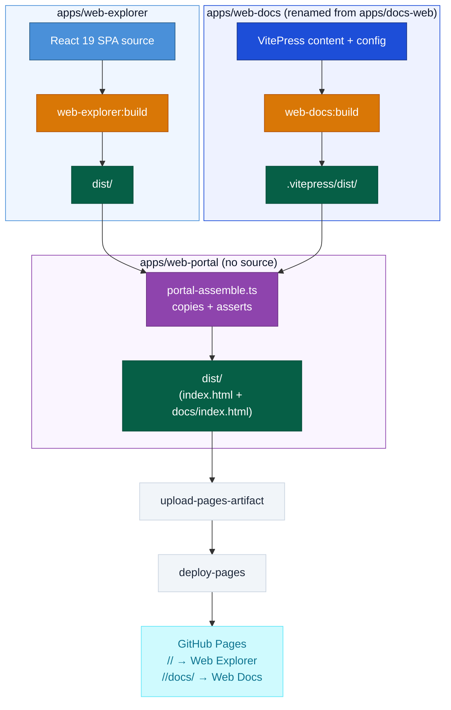
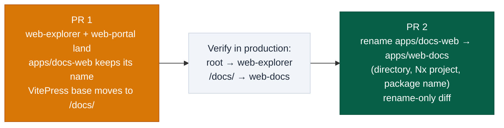

# DESIGN-20261108-1L8P — Solution Architecture

This design adds two containers (Web Explorer, Web Portal) and renames one (Web Docs) inside this repo's Web layer. No server runtime is introduced — GitHub Pages stays static-only.

## Affected boundaries

Today's Web layer has one container: VitePress, built from `apps/docs-web` (see `Target Architecture (HLD)/v1/Containers/Web.md`). This solution changes that to three:

1. **Web Explorer** (new) — a promotional single-page app at `apps/web-explorer`.
2. **Web Docs** (renamed) — the existing VitePress container, unchanged responsibility, new path (`apps/web-docs`) and new `base` config.
3. **Web Portal** (new) — a composition-only Nx project at `apps/web-portal` with no application source. Its sole responsibility: assemble Web Explorer's and Web Docs's independent static builds into one deployable artifact tree.

Discuss and Harness Bootstrap E2E are untouched.

**Rollout sequencing** (PR 1 ships composition, PR 2 ships the rename — see decision 7):

## Settled decision register

1. **Web Explorer adoption.** The developer's reference scaffold at `design/reference/web-explorer/` in this story folder (React 19 + Vite + TypeScript + Tailwind CSS 4 + Motion; a one-page SPA with a hero, a simulated `/design`/`/dev` lifecycle walkthrough labeled "SIMULATED RUN", capability cards, and a `/harness-bootstrap launch` CTA) is adopted as-is into `apps/web-explorer`. Owned by the Web layer, same as Web Docs. Verified by `yarn workspace @artisyn/web-explorer build` succeeding and producing `apps/web-explorer/dist/`. NFR-7 (no raw HTML/`<script>` execution) carries over unchanged: the app's content is rendered as JSX, not raw HTML, so it introduces no new instance of that risk — verified by the absence of `dangerouslySetInnerHTML` or raw `<script>` tags in the adopted source. A bundle-size budget check is added to this app's build target (flagged Performance Amber in `design/Report.md`'s WAF) — verified by that check passing in CI once implemented; the exact threshold is set during implementation (`solution/Efforts.md` ticket 2).

2. **Dependency reconciliation.** `apps/web-explorer/package.json`'s declared `typescript` and `vite` ranges are pinned down to versions compatible with this repo's root toolchain — `typescript` to match root's `^5.7.0` (not a root-wide bump), and `vite` to a major verified compatible with TS `^5.7` and this repo's Node 24 baseline (exact major is an implementation-time spike; already tracked as OQ-1 in `design/02 Evaluate.md`). The app's own `package-lock.json` is deleted; it joins the root Yarn workspace (already covered by the existing `workspaces: ["apps/*"]` glob) and the single root lockfile. Owned by the implementer, verified by `yarn install --immutable` succeeding at the root with no lockfile conflicts. **Contingency:** if the pin breaks the scaffold, the fallback is rebuilding `apps/web-explorer` fresh on root-aligned versions instead of adopting the scaffold verbatim — this is the defined fallback path, not an open question.

3. **Web Explorer base path.** `apps/web-explorer/vite.config.ts` sets `base` explicitly to the GitHub Pages project-site root (`/<repo>/`), consistent with the base-path convention `Containers/Web.md` already documents for this repo's GitHub Pages deployment. Verified by the built `index.html`'s asset references resolving correctly when served from that base.

4. **Web Docs rename and base path.** `apps/docs-web` is renamed to `apps/web-docs` (directory, Nx project name — currently `site` in `apps/docs-web/project.json`, becomes `web-docs` — and `package.json` name). VitePress's `base` moves from `/<repo>/` to `/<repo>/docs/`. `/docs/` is the chosen subpath, settled, not deferred. Existing bookmarked/indexed `/<repo>/...` doc URLs 404 after this change — accepted by the developer (recorded in `design/Report.md`'s Assumptions, OQ-3 under Web Portal), no redirect or compat stub added. NFR-5 (dead-link checking) and NFR-7 (`markdown.html: false`) continue to apply unchanged to this container.

5. **Web Portal composition.** A new Nx project `apps/web-portal` (`projectType: "application"`, empty `sourceRoot`, no source code of its own) declares `implicitDependencies: ["web-explorer", "web-docs"]` — this repo's own established pattern for a project-graph edge (`apps/docs-web/project.json` already uses `implicitDependencies: ["docs"]`) — so `nx affected` correctly marks `web-portal` affected whenever either dependency changes; a target-level `dependsOn: ["web-explorer:build", "web-docs:build"]` only orders tasks once a target actually runs, it does not by itself create the affected-graph edge. The `build` target also sets `outputs: ["{projectRoot}/dist"]` and runs `scripts/ci/portal-assemble.ts` via `nx:run-commands`. The script copies `apps/web-explorer/dist/**` into `apps/web-portal/dist/`, copies Web Docs's `.vitepress/dist/**` into `apps/web-portal/dist/docs/`, and asserts that both `apps/web-portal/dist/index.html` and `apps/web-portal/dist/docs/index.html` exist before the target succeeds, throwing a descriptive error rather than failing silently. This Nx project is the single source of truth for how the two independent builds combine; neither Web Explorer nor Web Docs is aware of the other. A missing `index.html` in either copied tree fails the Nx build target outright, which fails CI before `deploy-pages` runs — there is no partial-deploy failure mode.

6. **CD pipeline.** `.github/workflows/cd.yml`'s build step keeps running `nx affected --target=build` (unchanged command), which now also builds `web-portal` whenever either of its two dependencies is affected, via Nx's own project graph — no hardcoded "always rebuild both" logic is added. `actions/upload-pages-artifact`'s `path` input changes from `apps/docs-web/.vitepress/dist` to `apps/web-portal/dist`. `actions/configure-pages`'s auto-detection against this hand-merged, multi-framework artifact root is verified during implementation; if auto-detection misbehaves, explicit Pages settings are added as a direct consequence of this same decision, not a new decision. No change to the workflow's trigger (`push to main`), permissions, or the absence of a staging environment — this Reliability consequence (already flagged Amber in `design/Report.md`'s WAF) is accepted, mitigated only by the CI-level file-existence assertion in decision 5 and the rollout sequencing in decision 7.

7. **Rollout sequencing.** Two independently revertible pull requests. **PR 1** lands decisions 1, 3, 5, and 6 while `apps/docs-web` keeps its current name — `portal-assemble.ts` points at `apps/docs-web/.vitepress/dist` as its Web Docs source path, and VitePress's `base` is updated to `/<repo>/docs/` in this same PR (the base-path move is part of the composition mechanism, not the rename). Production is verified serving Web Explorer at `/<repo>/` and Web Docs at `/<repo>/docs/`. **PR 2**, once PR 1 is verified live, does the purely mechanical rename: `apps/docs-web` → `apps/web-docs` (directory, Nx project name, package name), updating `portal-assemble.ts`'s source path reference and `cd.yml`'s project reference accordingly. No behavior change in PR 2 — it is a rename-only diff.

## How it plugs into the existing system

This solution extends the Web layer described in `Target Architecture (HLD)/v1/Containers/Web.md`: renames its VitePress container, adds two siblings, and does not touch Discuss or Harness Bootstrap E2E. GitHub Pages stays static-only — no server-side runtime is reintroduced, consistent with the retired Infrastructure container.

## Considered Options

A full options analysis is in `design/02 Evaluate.md`. In summary: for Web Explorer, four options were evaluated (no dedicated SPA, adopting the existing scaffold as-is, rebuilding on a root-aligned stack from scratch, and an isolated sub-workspace with its own lockfile) — adopting the scaffold as-is was chosen because it is already functionally complete and the version-compatibility risk is a contained, local fix rather than an architectural blocker. For Web Portal composition, five options were evaluated (deferring web-explorer to a separate host, a shell-script Nx assemble target, a first-class typed Nx project, inverting the subpath via VitePress's `public/` passthrough, and a rename-sequencing variant) — the typed Nx project was chosen for its built-in verification and idiomatic fit with this repo's existing Nx conventions, combined with the sequencing variant to minimize the blast radius of shipping to a pipeline with no staging environment.
