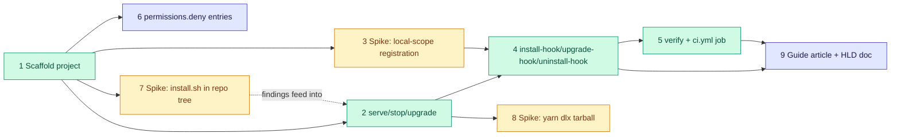

# DESIGN-20261115-V98J: Log Hub Session Telemetry Integration — Efforts

_Delivery breakdown for the `log-hub` container defined in `Architecture.md`. Rationale and rejected alternatives are in `design/02 Evaluate - Server topology.md` and `design/02 Evaluate - Repo integration footprint and canonical isolation.md`._

## WBS

| #   | Summary                                                                                                                                                                                                                                                                                                                                      | Type  | Layer | Depends on |
| --- | -------------------------------------------------------------------------------------------------------------------------------------------------------------------------------------------------------------------------------------------------------------------------------------------------------------------------------------------- | ----- | ----- | ---------- |
| 1   | Scaffold `apps/log-hub/` Nx project (`project.json`, `VERSION`, `.gitignore` entries)                                                                                                                                                                                                                                                        | feat  | Infra | —          |
| 2   | Implement `log-hub:serve`/`stop`/`upgrade` (download, checksum verify, compose up/down)                                                                                                                                                                                                                                                      | feat  | Infra | 1          |
| 3   | Spike: confirm `claude plugin … --scope local` registers a path marketplace and hooks fire                                                                                                                                                                                                                                                   | spike | Infra | 1          |
| 4   | Implement `log-hub:install-hook`/`upgrade-hook`/`uninstall-hook`, using the layout confirmed by #3. If #3 fails and the fallback layout (`solution/Architecture.md` Decision 6) is needed, do not implement the fallback branch until the open question in `design/Report.md` Assumptions row D2-6 is explicitly answered or confirmed moot. | feat  | Infra | 2, 3       |
| 5   | Implement `log-hub:verify` CI check and add the `ci.yml` job                                                                                                                                                                                                                                                                                 | feat  | Infra | 4          |
| 6   | Add the two `permissions.deny` entries (`apps/log-hub/.local/**`, `.artisyn/**`) to `.claude/settings.json`                                                                                                                                                                                                                                  | chore | Infra | 1          |
| 7   | Spike: verify `install.sh` behaves with `INSTALL_DIR` inside the repo tree; confirm no Compose project-name collision on port 5003. Findings feed into #2's implementation before it ships.                                                                                                                                                  | spike | Infra | 1          |
| 8   | Spike: confirm `yarn dlx <tarball-url>` resolves the hook installer; else document the scoped `npx` fallback                                                                                                                                                                                                                                 | spike | Infra | 2          |
| 9   | Write Engineering Guide disclosure article and HLD `Containers/Log Hub.md`                                                                                                                                                                                                                                                                   | chore | Docs  | 4, 5       |

## Sequencing

## Effort Estimate

| #   | Description                                                 | Estimate |
| --- | ----------------------------------------------------------- | -------- |
| 1   | Scaffold `apps/log-hub/` Nx project                         |          |
| 2   | `serve`/`stop`/`upgrade` targets with checksum verification |          |
| 3   | Spike: local-scope plugin registration                      |          |
| 4   | `install-hook`/`upgrade-hook`/`uninstall-hook` targets      |          |
| 5   | `verify` target + CI job                                    |          |
| 6   | `permissions.deny` entries                                  |          |
| 7   | Spike: `install.sh` in-repo-tree + port collision           |          |
| 8   | Spike: `yarn dlx` tarball resolution                        |          |
| 9   | Engineering Guide article + HLD container doc               |          |
|     | **Total**                                                   |          |
