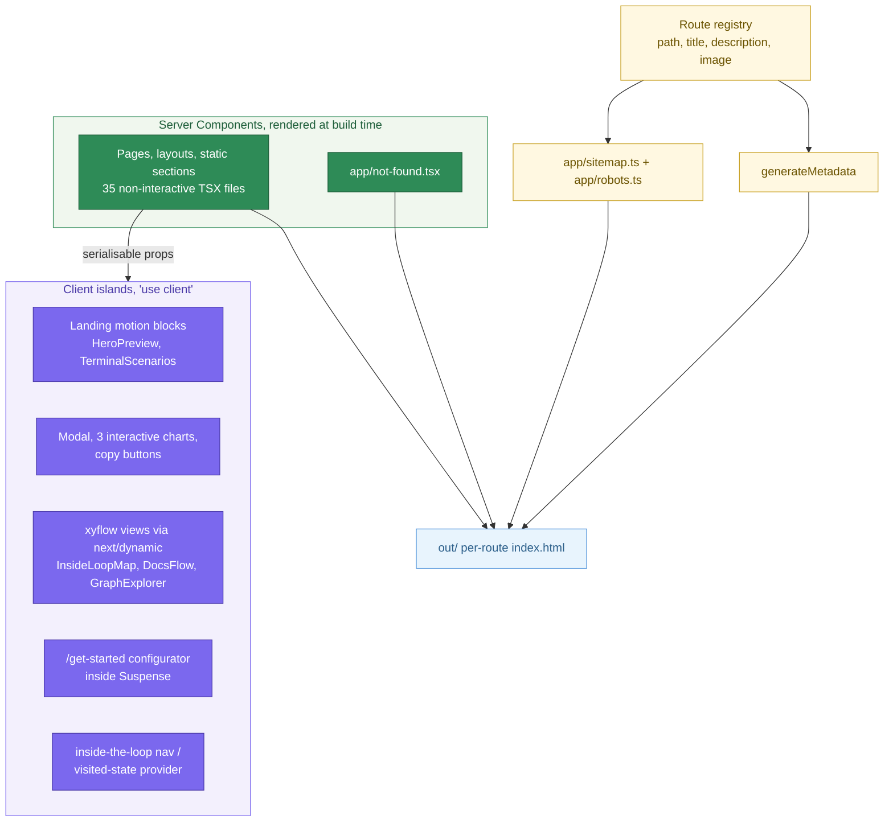
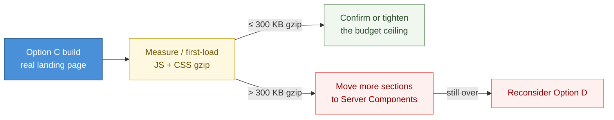

# DESIGN-20261121-UU4L: Rendering, Routing and Page Metadata — Evaluate

**Evidence used:** the Evaluate spike rows in `Report.md` Evidence (Next.js 16.4.6, 2026-11-22). Measured numbers are verified. Anything marked "est." is an extrapolation.

_Produced by the 🏗 Evaluate phase. This is the judgment artifact for Decision 1. Options come from `01 Research - Rendering, Routing and Page Metadata.md`; criteria come from `00 Frame.md`. The sibling decision is `02 Evaluate - Security Header Delivery.md`. The WAF assessment is repeated in `design/Report.md`._

## Requirements × Options Matrix

Options B and C meet every hard requirement; C ships the least client JS of the App Router options. Recount (verified 2026-11-22): 56 `.tsx` files in `apps/web-explorer/src`; 35 have no hooks, event handlers or `motion.` usage and stay Server Components; 21 need `'use client'` or a split.

Rows = evaluation criteria from `design/00 Frame.md`. Columns = options from `design/01 Research - Rendering, Routing and Page Metadata.md`.
✅ satisfies · ⚠️ partially (see note) · ❌ does not satisfy

| Requirement                                                                                      | A Catch-all + React Router                                                                                                   | B App Router, thin shell per route                                                                                                             | C App Router, Server Components + file metadata                                                                                                                                                                    | D Pages Router                                                                 |
| ------------------------------------------------------------------------------------------------ | ---------------------------------------------------------------------------------------------------------------------------- | ---------------------------------------------------------------------------------------------------------------------------------------------- | ------------------------------------------------------------------------------------------------------------------------------------------------------------------------------------------------------------------ | ------------------------------------------------------------------------------ |
| R1 EC1 per-route static HTML at real paths                                                       | ⚠️ depends on `StaticRouter`/`BrowserRouter` hydration under a catch-all, unproven (D1 OQ-9, moot after developer direction) | ✅ verified in spike (`trailingSlash` → `dir/index.html`)                                                                                      | ✅                                                                                                                                                                                                                 | ✅ verified in spike                                                           |
| R2 EC2 per-page title, description, canonical, OG/Twitter                                        | ⚠️ lookup table kept apart from pages                                                                                        | ✅ Metadata API; spike verified canonical, `og:image` and `twitter:image` absolute with base path via `metadataBase`                           | ✅ plus generated per-page images                                                                                                                                                                                  | ⚠️ hand-built per page via `next/head`; absolute URLs from one constant        |
| R3 EC4 landing first-load JS (today 436 KB raw / 139 KB gzip JS + 9 KB gzip CSS)                 | ❌ App Router runtime plus React Router plus full client tree: heaviest                                                      | ⚠️ runtime baseline measured 579 KB raw / 178 KB gzip before app code; est. 240–250 KB gzip with the landing page; needs the gzip budget below | ⚠️ same runtime baseline as B (579 KB raw / 178 KB gzip measured); static landing sections ship no component JS, so the lowest app JS of the App Router options and the most headroom under the 300 KB gzip budget | ✅ baseline measured 374 KB raw / 118 KB gzip (Turbopack), 478 / 153 (webpack) |
| R4 EC6 refactoring cost                                                                          | ✅ ~15 files                                                                                                                 | ⚠️ ~35–40 files                                                                                                                                | ⚠️ all 56 TSX files reviewed for the server/client boundary, but only ~21 marked `'use client'` or split; the 35 non-interactive files need no code change beyond imports. Larger than B's diff                    | ⚠️ ~35–40 files                                                                |
| R5 EC7 old hash URLs redirect (external early redirect script, same in every option)             | ✅                                                                                                                           | ✅                                                                                                                                             | ✅                                                                                                                                                                                                                 | ✅                                                                             |
| R6 EC8 sitemap, robots, 404, `/comic` noindex                                                    | ✅                                                                                                                           | ✅ `app/sitemap.ts`, `app/robots.ts`; root `404.html` verified                                                                                 | ✅                                                                                                                                                                                                                 | ⚠️ post-build script                                                           |
| R7 EC9 CI verification of meta and CSP on `out/`                                                 | ✅                                                                                                                           | ✅                                                                                                                                             | ✅                                                                                                                                                                                                                 | ✅                                                                             |
| R8 Inline-script footprint handed to Decision 2                                                  | ⚠️ 3 per page                                                                                                                | ⚠️ verified 3 per page (Turbopack), 2 (webpack), ~5 KB; hashes change every build                                                              | ⚠️ same as B, larger payload                                                                                                                                                                                       | ✅ verified 0 executable inline scripts with webpack, 1 with Turbopack         |
| R9 EC11 GitHub Pages limits (static output only; spike export 1.3 MB; no headers or server code) | ✅                                                                                                                           | ✅                                                                                                                                             | ✅                                                                                                                                                                                                                 | ✅                                                                             |
| R10 EC10 revertable switch-over, Nx names kept                                                   | ✅                                                                                                                           | ✅                                                                                                                                             | ⚠️ larger diff to revert                                                                                                                                                                                           | ✅                                                                             |
| R11 NFR-7 no raw script in source (JSON-LD via post-build injection or microdata)                | ✅                                                                                                                           | ✅                                                                                                                                             | ✅                                                                                                                                                                                                                 | ✅                                                                             |
| R12 Long-term framework direction                                                                | ❌ two routers                                                                                                               | ✅ App Router; can move page by page toward C                                                                                                  | ✅                                                                                                                                                                                                                 | ⚠️ Pages Router in maintenance                                                 |

## Tradeoffs

WAF pillars plus Integration Complexity and Vendor Lock-in.

| Dimension              | A Catch-all + React Router        | B App Router, thin shell per route                                                               | C App Router, Server Components + file metadata  | D Pages Router                                  |
| ---------------------- | --------------------------------- | ------------------------------------------------------------------------------------------------ | ------------------------------------------------ | ----------------------------------------------- |
| Operational Excellence | ⚠️ two routing models to maintain | ✅ idiomatic App Router; Nx targets kept                                                         | ⚠️ two mental models (server/client)             | ⚠️ hand-built metadata, sitemap, robots         |
| Security               | ⚠️ 3 inline scripts per page      | ⚠️ inline RSC scripts need Decision 2's post-export hashes                                       | ⚠️ same as B, larger payload                     | ✅ no executable inline scripts (webpack)       |
| Reliability            | ⚠️ unproven hydration pattern     | ✅ static files only                                                                             | ✅                                               | ✅                                              |
| Performance Efficiency | ❌ heaviest JS                    | ⚠️ +~100 KB gzip JS vs today (est.), offset by pre-rendered HTML for LCP and per-route splitting | ✅ least app JS long-term                        | ✅ lightest baseline                            |
| Cost Optimization      | ✅ free hosting                   | ✅ free hosting                                                                                  | ✅                                               | ✅                                              |
| Sustainability         | ⚠️ most JS shipped                | ⚠️ more JS per visit than D                                                                      | ✅                                               | ✅                                              |
| Integration Complexity | ✅ smallest diff                  | ⚠️ moderate                                                                                      | ⚠️ largest diff, but most files only need review | ⚠️ moderate                                     |
| Vendor Lock-in         | ⚠️ Next + React Router            | ⚠️ Next.js-specific APIs (metadata, navigation)                                                  | ⚠️ deepest Next.js coupling (RSC, `next/og`)     | ⚠️ Next.js Pages Router, a maintenance-mode API |

## Recommendation

**Recommended option: Option C — App Router built around Server Components, with client components only where needed.**

This is the developer's direction (2026-11-22, revised from B at the Evaluate sign-off): a best-practice Next.js app. Server Components render at build time by default. `'use client'` is pushed down to interactive leaves.

**Why:**

- It meets EC1, EC2 and EC8 with the framework's own conventions: route registry → `generateMetadata`, `app/sitemap.ts`, `app/robots.ts`, `app/not-found.tsx`.
- It ships the least client JS of the App Router options. That best serves EC4 and the new gzip budget.
- It is the model Next.js recommends, so it is the most maintainable long-term (EC10, R12).

**Boundary rule:** a page or section stays a Server Component unless it uses state, effects, event handlers, browser APIs or motion. Each interactive part is extracted into the smallest client component and receives serialisable props.

**Client islands** (from the verified scan):

| Island                                                     | Note                                              |
| ---------------------------------------------------------- | ------------------------------------------------- |
| Landing page `motion` blocks                               | Only `Landing.tsx` uses `motion`                  |
| `HeroPreview`, `TerminalScenarios` animations              | Contain the 2 reduced-motion reads to fix         |
| `Modal`                                                    | —                                                 |
| 3 interactive charts                                       | The other charts stay Server Components           |
| xyflow views: `InsideLoopMap`, `DocsFlow`, `GraphExplorer` | Loaded via `next/dynamic` from a client component |
| `/get-started` configurator                                | Inside `<Suspense>` for `useSearchParams`         |
| Inside-the-loop nav / visited-state provider               | —                                                 |
| Copy buttons                                               | —                                                 |

**Social images:** start with one shared static image plus optional hand-made per-page images in `public/` (variants 1–2). All are wired through the route registry. Generated `next/og` images (variant 3) are a later step, only after the D1 OQ-2 spike proves they export correctly on Pages.

**Accepted trade-offs:**

| #   | Trade-off                                       | Why accepted                                                                                       |
| --- | ----------------------------------------------- | -------------------------------------------------------------------------------------------------- |
| 1   | The largest refactor of the four                | Most files only need review; it avoids a second migration later from B to C                        |
| 2   | Two mental models (server/client)               | Mitigated by the boundary rule above and an ESLint check against browser APIs in server files (P2) |
| 3   | A larger serialised RSC payload per page than B | Still 2–3 inline scripts per page, covered by Decision 2's post-export hashes                      |

**Why not the others:**

- **A:** two routers, unproven hydration, heaviest JS. Everything renders client-side, the opposite of the direction.
- **B:** the same runtime, but every page stays a full client tree. It ships more JS and would need a second migration to reach C.
- **D:** lightest baseline. But it is a maintenance-mode router with hand-built metadata, sitemap and robots, and no Server Components.

**Falsifiable assumptions:**

1. The measured landing page stays within ≤ 300 KB gzip JS + CSS. If not, move more landing sections server-side first, then reconsider D.
2. The client islands listed above cover all interactivity. Anything found later is extracted the same way.

**Budget redefinition (EC4):** replace the 600 KB raw entry-chunk budget with a gzip budget on `/`.

| Item         | Value                                                                 |
| ------------ | --------------------------------------------------------------------- |
| Measure      | First-load JS + CSS referenced by `out/index.html`, gzip              |
| Ceiling      | ≤ 300 KB gzip (provisional, from est. 240–250 KB)                     |
| Check        | `check-bundle-budget.mjs` parses `_next/static/` refs                 |
| Confirmation | The ceiling is confirmed or tightened from the first real measurement |

**Open questions to resolve before implementation:**

| #            | Question                                                                                                                                                                  | Owner                | Impact if unresolved                                                                                         |
| ------------ | ------------------------------------------------------------------------------------------------------------------------------------------------------------------------- | -------------------- | ------------------------------------------------------------------------------------------------------------ |
| D1 OQ-3      | Root `404.html` also serves `/docs/*` misses: acceptable, or give it a docs-aware link?                                                                                   | Developer            | Wrong 404 UX on docs                                                                                         |
| D1 OQ-4      | `/get-started` paints defaults, then corrects from the query: acceptable, with a live-region announcement?                                                                | Developer            | Possible CLS / a11y finding                                                                                  |
| D1 OQ-1      | `.nojekyll`: add it regardless                                                                                                                                            | Implementation       | `_next/` may 404 on Pages                                                                                    |
| D1 OQ-2      | `next/og` under export                                                                                                                                                    | Implementation spike | Only if generated per-page images are adopted later; until then one shared image + hand-made per-page images |
| D1 OQ-7/8/10 | Next version pin (16.4.x); Tailwind 4 via `@tailwindcss/postcss`; `__HARNESS_VERSION__` via `next.config`; base-path prefix for plain ``/icons; Nx `outputs` → `out` | Implementation       | Build breaks                                                                                                 |
| Budget       | Budget ceiling confirmation from the first real measurement                                                                                                               | Implementation       | EC4 unverifiable                                                                                             |
| Lint         | Boundary lint rule: no `window`/`document`/hooks in files without `'use client'`                                                                                          | Implementation       | Hydration or build errors slip through                                                                       |

## WAF Assessment (recommended option)

Closing assessment of Option C.

| Pillar                 | Rating | Strengths                                                                                                            | Gaps                                                                                                                              | Recommendations                                                                                                          |
| ---------------------- | ------ | -------------------------------------------------------------------------------------------------------------------- | --------------------------------------------------------------------------------------------------------------------------------- | ------------------------------------------------------------------------------------------------------------------------ |
| Operational Excellence | 🟢     | Idiomatic App Router; Nx project and targets kept; one revertable change                                             | Two mental models (server/client)                                                                                                 | P2: boundary lint rule (no browser APIs or hooks in files without `'use client'`)                                        |
| Security               | 🟡     | NFR-7 holds (no raw script in source)                                                                                | Larger serialised RSC inline payload per page                                                                                     | P1: adopt Decision 2's post-export hash CSP with a CI coverage gate before go-live                                       |
| Reliability            | 🟢     | Static files only; hydration risk limited to client islands                                                          | Root 404 now spans `/docs/`; 2 reduced-motion reads cause hydration mismatches (`HeroPreview.tsx:89`, `TerminalScenarios.tsx:40`) | P2: decide 404 content (D1 OQ-3); P2: add `.nojekyll`; P2: fix the 2 reduced-motion reads inside their client components |
| Performance Efficiency | 🟢     | Pre-rendered HTML per route; static sections ship no component JS; most headroom under the gzip budget               | Runtime baseline (178 KB gzip measured) is above today's total                                                                    | P1: define and enforce the gzip budget on `/`                                                                            |
| Cost Optimization      | 🟢     | Free hosting; no new services                                                                                        | None                                                                                                                              | —                                                                                                                        |
| Sustainability         | 🟢     | Static CDN delivery; least client JS per visit of the App Router options; within GitHub Pages limits (86 MB of 1 GB) | None                                                                                                                              | —                                                                                                                        |

**P1 items (resolve before implementation):**

1. Gzip budget on `/` defined and enforced in CI.
2. Decision 2's hash-based CSP with a CI coverage gate.
