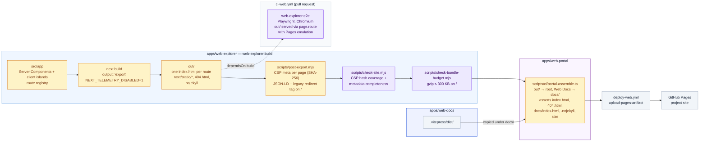
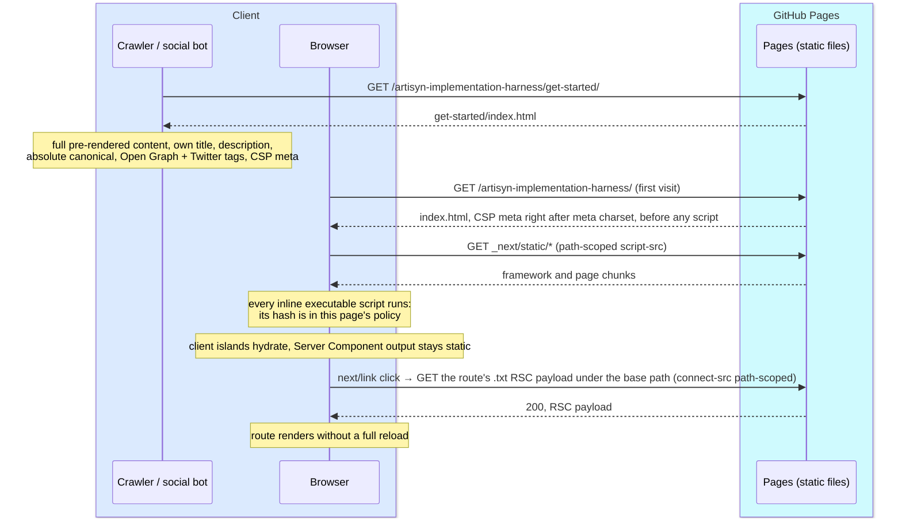
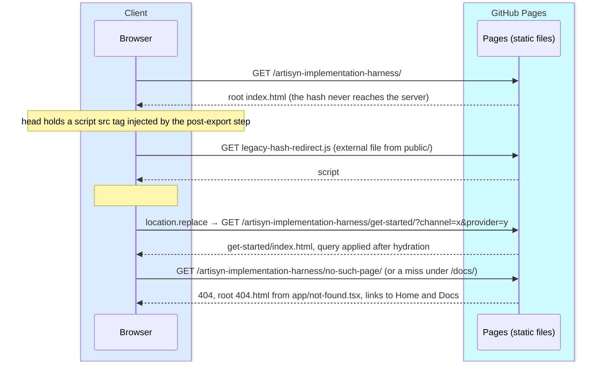
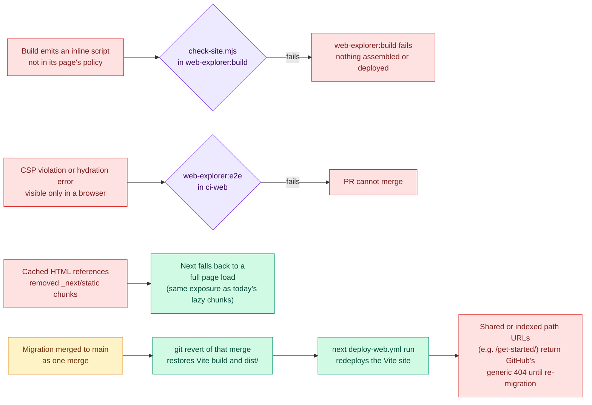

# DESIGN-20261121-UU4L: Web Explorer Next.js Static Export — Architecture

Web Explorer is rebuilt as a Next.js 16.4.x App Router app exported to static files at build time: every route gets its own pre-rendered `index.html` with its own metadata and its own hashed Content Security Policy. Hosting stays on GitHub Pages. No new container and no request-time code are added.

The current design is in [Web Explorer](<../../../../Target%20Architecture%20(HLD)/v1/Containers/Web%20Explorer.md>), [Web Portal](<../../../../Target%20Architecture%20(HLD)/v1/Containers/Web%20Portal.md>) and [System Overview](<../../../../Target%20Architecture%20(HLD)/v1/System%20Overview.md>). This file records only the delta.

| Detail                                                | Document                                                                                                      |
| ----------------------------------------------------- | ------------------------------------------------------------------------------------------------------------- |
| Component boundary, routing, route registry, metadata | [Design - Rendering, Routing and Page Metadata](Design%20-%20Rendering,%20Routing%20and%20Page%20Metadata.md) |
| Post-export step, exact CSP directive list, gates     | [Design - Security Header Delivery](Design%20-%20Security%20Header%20Delivery.md)                             |
| Framework, added and removed dependencies             | [Stack](Stack.md)                                                                                             |
| Implementation slices and sequencing                  | [Efforts](Efforts.md)                                                                                         |

## Boundary delta

Web Explorer changes its build and output; Web Portal changes only its input path and assertions; everything else is unchanged.

Legend: amber = changed by this design; violet = new gate or check; grey = unchanged.

| Element                            | Responsibility after the change                                                                                                                                                                                                                                                                                                                                                                                                                                        | Status    |
| ---------------------------------- | ---------------------------------------------------------------------------------------------------------------------------------------------------------------------------------------------------------------------------------------------------------------------------------------------------------------------------------------------------------------------------------------------------------------------------------------------------------------------- | --------- |
| Web Explorer (`apps/web-explorer`) | Next.js App Router app built with `output: 'export'` into `out/` (was `dist/`). Server Components render at build time; client components only for interactive parts. `build` runs `next build`, then `apps/web-explorer/scripts/post-export.mjs`, `check-site.mjs` and `check-bundle-budget.mjs`. Nx project name and targets `build`, `typecheck`, `lint`, `serve`, `dev`, `preview` keep their names; a new `e2e` target runs the Playwright site check             | Changed   |
| Web Portal (`apps/web-portal`)     | Still composition-only. `scripts/ci/portal-assemble.ts` copies `apps/web-explorer/out/` to the artifact root and Web Docs under `docs/`; fails if `out/docs` exists before the copy; asserts `index.html`, `404.html`, `docs/index.html` and `.nojekyll`; fails above 900 MB published size. `project.json` keeps `dependsOn: web-explorer:build, web-docs:build`; `build` declares `inputs: ["default", "^default", "{workspaceRoot}/scripts/ci/portal-assemble.ts"]` | Changed   |
| Web Docs                           | Builds and serves `/docs/` with its own policy                                                                                                                                                                                                                                                                                                                                                                                                                         | Unchanged |
| `ci-web.yml`                       | New "E2E (affected)" step after "Build (affected)" runs `web-explorer:e2e`; Chromium is installed only when `web-explorer` is affected                                                                                                                                                                                                                                                                                                                                 | Changed   |
| `deploy-web.yml`                   | Builds affected projects and uploads `apps/web-portal/dist`                                                                                                                                                                                                                                                                                                                                                                                                            | Unchanged |
| GitHub Pages                       | Serves the project site `https://dataart.github.io/artisyn-implementation-harness/`; no custom domain, no response headers, no request-time code                                                                                                                                                                                                                                                                                                                       | Unchanged |
| Discuss                            | Client-side giscus widget                                                                                                                                                                                                                                                                                                                                                                                                                                              | Unchanged |

## Representative flows

### Crawler, first visit and client navigation

A crawler gets complete HTML without running JavaScript; a browser hydrates only the client islands and then navigates with RSC payloads.

### Legacy hash link and unknown path

Old `#/...` links are rewritten to path URLs before hydration; any unknown path gets the root `404.html`.

### Failure and recovery

A CSP gap stops the pipeline before anything is deployed; a bad release is undone with one revert.

## Decision register

| #   | Decision                                                                                                                                                                                                                                                                                                                                                                                                                                                                                                                                                                                                                                                                                                                                                                                                                                      | Consequence                                                                                                                                                                                                                                                                                                                                                                                                                                                                                                                                | Verification                                                                                                                                                                                                                                                                                                                                                                                                        |
| --- | --------------------------------------------------------------------------------------------------------------------------------------------------------------------------------------------------------------------------------------------------------------------------------------------------------------------------------------------------------------------------------------------------------------------------------------------------------------------------------------------------------------------------------------------------------------------------------------------------------------------------------------------------------------------------------------------------------------------------------------------------------------------------------------------------------------------------------------------- | ------------------------------------------------------------------------------------------------------------------------------------------------------------------------------------------------------------------------------------------------------------------------------------------------------------------------------------------------------------------------------------------------------------------------------------------------------------------------------------------------------------------------------------------ | ------------------------------------------------------------------------------------------------------------------------------------------------------------------------------------------------------------------------------------------------------------------------------------------------------------------------------------------------------------------------------------------------------------------- |
| 1   | Next.js 16.4.x App Router, `output: 'export'`, `basePath: '/artisyn-implementation-harness'`, `trailingSlash: true`, `images.unoptimized: true`; built with Turbopack (the Next 16 default)                                                                                                                                                                                                                                                                                                                                                                                                                                                                                                                                                                                                                                                   | Each route is exported as `<route>/index.html` under `out/`; assets under `_next/`; every inline executable script is hashed into its page's policy, and the inline-script set the post-export step hashes is whatever this builder emits; no rewrites, headers, middleware or server actions                                                                                                                                                                                                                                              | Build emits one `index.html` per route in the route registry; e2e check asserts a `next/link` click fetches the route's RSC payload with HTTP 200 and does not fall back to a full reload                                                                                                                                                                                                                           |
| 2   | Server Components by default. A component gets `'use client'` only if it uses state, effects, event handlers, browser APIs or `motion`; interactive parts move into the smallest client component and receive serialisable props                                                                                                                                                                                                                                                                                                                                                                                                                                                                                                                                                                                                              | 35 of 56 TSX files stay server-only; about 21 become client components or are split. Static sections ship no component JavaScript. The xyflow views (`InsideLoopMap`, `DocsFlow`) load with `next/dynamic` and `ssr: false`; their diagrams are not in the pre-rendered HTML, a static placeholder is                                                                                                                                                                                                                                      | `next build` fails when a Server Component uses a hook or client-only API; the `e2e` check reports no hydration errors                                                                                                                                                                                                                                                                                              |
| 3   | One route registry is the single source for each route's path, title, description, social image and index flag. It drives `generateMetadata`, `app/sitemap.ts` and the hub and nav lists. `metadataBase` is the absolute project-site URL. No `robots.txt` and no `app/robots.ts`: crawlers read it only at `https://dataart.github.io/robots.txt`, which this repo does not control                                                                                                                                                                                                                                                                                                                                                                                                                                                          | Canonical, `og:image` and `twitter:image` are absolute and include the base path. `sitemap.xml` is published at `/artisyn-implementation-harness/sitemap.xml`                                                                                                                                                                                                                                                                                                                                                                              | Metadata-completeness check in `check-site.mjs` runs over every route-registry page plus `404.html`: every indexable page has a title, description, canonical and `og:image`                                                                                                                                                                                                                                        |
| 4   | Social images: one shared `social-preview.png`, plus optional per-page PNGs in `public/`, referenced through the route registry                                                                                                                                                                                                                                                                                                                                                                                                                                                                                                                                                                                                                                                                                                               | No image generation at build time                                                                                                                                                                                                                                                                                                                                                                                                                                                                                                          | `check-site.mjs` checks each `og:image` file exists in `out/`                                                                                                                                                                                                                                                                                                                                                       |
| 5   | Page-level `robots` meta is the only indexing control. `/comic` is `noindex` and excluded from the sitemap                                                                                                                                                                                                                                                                                                                                                                                                                                                                                                                                                                                                                                                                                                                                    | Reachable by direct link only                                                                                                                                                                                                                                                                                                                                                                                                                                                                                                              | `check-site.mjs` asserts its robots meta and its absence from `sitemap.xml`                                                                                                                                                                                                                                                                                                                                         |
| 6   | Root 404 from `app/not-found.tsx`, with a `next/link` to Home and a plain `<a href>` to the Docs URL (`/docs/` sits inside the base path, so it is not a Next route)                                                                                                                                                                                                                                                                                                                                                                                                                                                                                                                                                                                                                                                                          | It is the only 404 GitHub Pages serves, so it also answers misses under `/docs/`                                                                                                                                                                                                                                                                                                                                                                                                                                                           | Portal assembly asserts `404.html`; e2e Pages emulation maps unknown paths, including `/docs/*` misses, to the root `404.html` with status 404                                                                                                                                                                                                                                                                      |
| 7   | Legacy hash redirect via external `public/legacy-hash-redirect.js`, referenced by a `<script src>` that the post-export step injects into the landing page's `<head>`. No `next/script` and no raw `<script>` in source                                                                                                                                                                                                                                                                                                                                                                                                                                                                                                                                                                                                                       | Old shared links keep working; no inline script needed                                                                                                                                                                                                                                                                                                                                                                                                                                                                                     | e2e check: old `#/get-started?…` and `#/inside-the-loop/<id>` links land on the new paths with the query kept                                                                                                                                                                                                                                                                                                       |
| 8   | In-page anchors are plain `/#<id>` links; React Router is removed                                                                                                                                                                                                                                                                                                                                                                                                                                                                                                                                                                                                                                                                                                                                                                             | The router-state scroll workaround in `SectionLink` and Landing is deleted                                                                                                                                                                                                                                                                                                                                                                                                                                                                 | e2e check: header anchor links scroll on `/`                                                                                                                                                                                                                                                                                                                                                                        |
| 9   | `/get-started` pre-renders the default channel and provider; the query is applied after hydration inside a `<Suspense>` boundary; panels have fixed heights                                                                                                                                                                                                                                                                                                                                                                                                                                                                                                                                                                                                                                                                                   | Shared configuration links keep round-tripping; no layout shift on the switch                                                                                                                                                                                                                                                                                                                                                                                                                                                              | e2e check opens a configured link and asserts the selection                                                                                                                                                                                                                                                                                                                                                         |
| 10  | Structured data: schema.org JSON-LD (`WebSite` + `SoftwareSourceCode`) on the landing page only, injected by the post-export step as `<script type="application/ld+json">`                                                                                                                                                                                                                                                                                                                                                                                                                                                                                                                                                                                                                                                                    | Source contains no raw `<script>`, so NFR-7 holds; CSP does not govern JSON data blocks                                                                                                                                                                                                                                                                                                                                                                                                                                                    | `check-site.mjs` asserts the block on `/` parses as JSON                                                                                                                                                                                                                                                                                                                                                            |
| 11  | Per-page `<meta http-equiv="Content-Security-Policy">`, injected by the post-export step immediately after `<meta charset>` and before any `<script>`. The policy starts from `default-src 'none'` and lists each exception: `script-src 'sha256-…' <site>/`, `style-src <site>/ 'unsafe-inline'`, `img-src <site>/`, `font-src <site>/`, `connect-src <site>/`, `manifest-src <site>/`, `object-src 'none'`, `base-uri 'none'`, `form-action 'none'`, `upgrade-insecure-requests`. `<site>` is the post-export origin parameter plus the base path; the origin defaults to the production URL from one site-config constant. No `data:` in `img-src`. Referrer policy `strict-origin-when-cross-origin` via metadata. The exact directive list is in [Design - Security Header Delivery](Design%20-%20Security%20Header%20Delivery.md)       | Scripts, styles, images, fonts and connections load only from this project's path. `<site>/` also covers Web Docs assets under `/docs/`, built from the same repo. Same-origin storage and fetch are still shared across `dataart.github.io`, and Web Docs keeps its own policy (`'self'`, `'unsafe-inline'`). Header-only protections (`frame-ancestors`/`X-Frame-Options`, HSTS header, `X-Content-Type-Options`, `Permissions-Policy`, violation reporting) are not delivered; clickjacking is an accepted risk for this read-only site | Hash-coverage check in `check-site.mjs` during `web-explorer:build`. `web-explorer:e2e` serves the production HTML unchanged: `page.route` intercepts `https://dataart.github.io/artisyn-implementation-harness/**` and fulfils it from `out/` with GitHub Pages emulation (`dir/` → `dir/index.html`, 301 from `/dir` to `/dir/`, unknown paths → root `404.html` with status 404), and fails on any CSP violation |
| 12  | Inter and DM Sans `woff2` files are committed with their SIL OFL licences and loaded with `next/font/local`. The Google Fonts `@import` in `pages/docs-flow/docsFlow.css` is removed. Barlow Condensed and JetBrains Mono stay system-font fallbacks                                                                                                                                                                                                                                                                                                                                                                                                                                                                                                                                                                                          | No runtime or build-time requests to Google; no Google hosts in the CSP; deterministic builds                                                                                                                                                                                                                                                                                                                                                                                                                                              | CSP has no external font host; e2e check sees no blocked font requests                                                                                                                                                                                                                                                                                                                                              |
| 13  | Performance budget: first-load JS + CSS referenced by `out/index.html` ≤ 300 KB gzip, replacing the 600 KB raw entry-chunk budget. `check-bundle-budget.mjs` reads `_next/static/` references                                                                                                                                                                                                                                                                                                                                                                                                                                                                                                                                                                                                                                                 | The ceiling is provisional; the first real measurement confirms or tightens it ([Efforts](Efforts.md) unit 1)                                                                                                                                                                                                                                                                                                                                                                                                                              | Budget check in `web-explorer:build`. Lighthouse runs (mobile, simulated) before and after the migration on `/`, `/get-started/` and one inside-the-loop page record LCP, CLS and TBT (the lab proxy for INP) as Efforts unit 7 evidence                                                                                                                                                                            |
| 14  | The harness version from `skills/implementation-harness/package.json` is inlined via `next.config` and stays an Nx build input; `VITE_REPO_URL`/`VITE_DOCS_URL` become `NEXT_PUBLIC_REPO_URL`/`NEXT_PUBLIC_DOCS_URL` with the same defaults, and `build` inputs add `{ "env": "NEXT_PUBLIC_REPO_URL" }` and `{ "env": "NEXT_PUBLIC_DOCS_URL" }`. `next build` runs with `NEXT_TELEMETRY_DISABLED=1`, set in the Nx target command                                                                                                                                                                                                                                                                                                                                                                                                             | The `/get-started` version chip and outbound links keep working; a changed URL variable invalidates the Nx cache; builds send no telemetry                                                                                                                                                                                                                                                                                                                                                                                                 | Typecheck and build                                                                                                                                                                                                                                                                                                                                                                                                 |
| 15  | `.nojekyll` is emitted at the artifact root from `public/` as defence in depth; the Actions artifact deploy does not run Jekyll                                                                                                                                                                                                                                                                                                                                                                                                                                                                                                                                                                                                                                                                                                               | Pages always serves `_next/`                                                                                                                                                                                                                                                                                                                                                                                                                                                                                                               | Portal assembly asserts it exists                                                                                                                                                                                                                                                                                                                                                                                   |
| 16  | GitHub Pages limits are a constraint: published site ≤ 1 GB, deployment ≤ 10 minutes, bandwidth within 100 GB/month, no custom headers or request-time code, HTTP 429 tolerated, permitted use only                                                                                                                                                                                                                                                                                                                                                                                                                                                                                                                                                                                                                                           | Measured 2026-11-22: 86 MB published, about 75 s per deploy                                                                                                                                                                                                                                                                                                                                                                                                                                                                                | Portal assembly fails above 900 MB published size                                                                                                                                                                                                                                                                                                                                                                   |
| 17  | `scripts/ci/lambda-edge-deploy.sh` is deleted                                                                                                                                                                                                                                                                                                                                                                                                                                                                                                                                                                                                                                                                                                                                                                                                 | No AWS edge tooling remains in the repo                                                                                                                                                                                                                                                                                                                                                                                                                                                                                                    | `git grep` finds no reference                                                                                                                                                                                                                                                                                                                                                                                       |
| 18  | The migration lands on one integration branch and merges to `main` once. A draft PR from `feat/web-explorer-nextjs` to `main` is opened with unit 1, so every unit merge runs `ci-web`                                                                                                                                                                                                                                                                                                                                                                                                                                                                                                                                                                                                                                                        | The live site never runs a half-migrated app                                                                                                                                                                                                                                                                                                                                                                                                                                                                                               | Single merge commit; its revert restores the Vite build                                                                                                                                                                                                                                                                                                                                                             |
| 19  | Build scripts live inside the project: `apps/web-explorer/scripts/post-export.mjs`, `check-site.mjs` (hash coverage + metadata completeness) and `check-bundle-budget.mjs` (moved from `scripts/ci/`). `scripts/ci/web-explorer-build.sh` is replaced by the Nx target command. `build` declares `outputs: ["{projectRoot}/out"]`. `parse5` is a dev dependency of the post-export step and gates. Playwright config is `apps/web-explorer/playwright.config.ts`; specs live in `apps/web-explorer/e2e/`. `web-portal:build` declares `inputs: ["default", "^default", "{workspaceRoot}/scripts/ci/portal-assemble.ts"]`. `.gitignore` adds `apps/web-explorer/out/`, `.next/`, `.preview/`, `test-results/`, `playwright-report/` and `next-env.d.ts`                                                                                        | The scripts are `web-explorer:build` inputs by default, so editing them invalidates the Nx cache                                                                                                                                                                                                                                                                                                                                                                                                                                           | Changing a script re-runs `web-explorer:build`; `git status` is clean after a build                                                                                                                                                                                                                                                                                                                                 |
| 20  | One Playwright target, `web-explorer:e2e`, with `dependsOn: ["build"]`, hosts the site check: CSP violations, hydration errors, legacy redirects, 404 and client navigation. `ci-web.yml` runs it in a new "E2E (affected)" step after "Build (affected)"; it runs `yarn workspace @artisyn-harness/web-explorer playwright install --with-deps chromium` only when `yarn nx show projects --affected --base=… --head=HEAD` lists `web-explorer`; the Playwright browser cache is keyed on the Playwright version. The suite registers its `securitypolicyviolation` listener via `page.addInitScript` and also fails on console messages starting "Refused to". The Pages emulation serves GitHub Pages content types: `.html` → `text/html`, `.txt` → `text/plain`, `.js` → `text/javascript`, `.css` → `text/css`, `.woff2` → `font/woff2` | Accessibility (axe-core) checks for NFR-A18 join this target through NFR-A18's own work; this change adds none                                                                                                                                                                                                                                                                                                                                                                                                                             | The "E2E (affected)" step fails the PR on any failing check                                                                                                                                                                                                                                                                                                                                                         |
| 21  | `preview` copies `out/` to `.preview/artisyn-implementation-harness/`, re-runs `post-export.mjs --resign --origin http://localhost:<port>` on it, then serves it with `apps/web-explorer/scripts/serve-preview.mjs`, a zero-dependency `node:http` server with the same GitHub Pages emulation rules as the e2e suite. `--resign` first removes the previously injected CSP meta, JSON-LD and redirect `<script src>`, and omits `upgrade-insecure-requests` when the origin is `http:`. `dev` (`next dev`) runs without a CSP                                                                                                                                                                                                                                                                                                                | Local preview enforces the same policy as production; `out/` is never modified for local use                                                                                                                                                                                                                                                                                                                                                                                                                                               | `preview` loads `/` with no CSP violation in the browser console                                                                                                                                                                                                                                                                                                                                                    |
| 22  | `typecheck` runs `next typegen && tsc --noEmit`; the `tsconfig.json` settings Next requires are committed                                                                                                                                                                                                                                                                                                                                                                                                                                                                                                                                                                                                                                                                                                                                     | The build never rewrites `tsconfig.json`                                                                                                                                                                                                                                                                                                                                                                                                                                                                                                   | `git status` is clean after `build` and `typecheck`                                                                                                                                                                                                                                                                                                                                                                 |
| 23  | `sitemap.xml` is submitted through a Google Search Console URL-prefix property for the project site. Ownership is verified with a `<meta name="google-site-verification">` tag emitted from `metadata.verification.google` in `app/layout.tsx`; its value comes from `NEXT_PUBLIC_GOOGLE_SITE_VERIFICATION`, a build input, and the tag is omitted when the variable is unset. The value reaches the build as `NEXT_PUBLIC_GOOGLE_SITE_VERIFICATION: ${{ vars.NEXT_PUBLIC_GOOGLE_SITE_VERIFICATION }}` in the build step env of `deploy-web.yml` and `ci-web.yml`, a repository variable in the `web` environment, the same pattern as the existing `VITE_*` entries. The repo owner sets the variable, verifies the property and submits the sitemap once as an operational step                                                             | Search Console indexes the project's pages without a host-root `robots.txt`; every `out/**/*.html` file stays in post-export and gate scope                                                                                                                                                                                                                                                                                                                                                                                                | The tag is present in `out/index.html` when the variable is set; Search Console reports the sitemap as read                                                                                                                                                                                                                                                                                                         |

## WAF P1 items

| P1 item                           | Addressed by                                                                            |
| --------------------------------- | --------------------------------------------------------------------------------------- |
| Gzip budget on `/` enforced in CI | Decision 13 — budget check in `web-explorer:build`                                      |
| CSP hash-coverage gate            | Decision 11 — hash-coverage check in `web-explorer:build`, `web-explorer:e2e` as backup |
| Policy floor confirmed            | Decision 11 — strict hashed policy from `default-src 'none'`                            |

## Downstream documents

| Document                                                                                     | Change                                                                                                                                                                                              | When            |
| -------------------------------------------------------------------------------------------- | --------------------------------------------------------------------------------------------------------------------------------------------------------------------------------------------------- | --------------- |
| `docs/Target Architecture (HLD)/v1/Containers/Web Explorer.md`                               | Next.js App Router static export, Server Components, path routing (`HashRouter` removed), output `out/`, in-project build scripts and checks, new `e2e` target                                      | Publish         |
| `docs/Target Architecture (HLD)/v1/Containers/Web Portal.md`                                 | Input `out/`; new assertions (`404.html`, `.nojekyll`, no `out/docs`, size threshold); `portal-assemble.ts` as a build input                                                                        | Publish         |
| `docs/Target Architecture (HLD)/v1/System Overview.md`                                       | Design principle reworded: content is pre-rendered at build time; no request-time compute                                                                                                           | Publish         |
| `docs/Target Architecture (HLD)/v1/Non-Functional Concerns/Requirements.md`                  | New NFR-16 (front-end security policy: hashed meta CSP level, accepted header-only gaps), NFR-17 (GitHub Pages limits), NFR-18 (per-page crawlable HTML and metadata), NFR-19 (landing gzip budget) | Publish         |
| `docs/System Architecture (LLD)/Web Explorer/00. Overview.md`, `apps/web-explorer/README.md` | Implementation detail                                                                                                                                                                               | `/dev document` |

## Considered Options

A full options analysis is in [`design/02 Evaluate - Rendering, Routing and Page Metadata.md`](../design/02%20Evaluate%20-%20Rendering,%20Routing%20and%20Page%20Metadata.md) and [`design/02 Evaluate - Security Header Delivery.md`](../design/02%20Evaluate%20-%20Security%20Header%20Delivery.md). For rendering, four Next.js approaches were compared: a catch-all page keeping React Router, App Router shells around client pages, App Router with Server Components, and the Pages Router; Server Components were chosen because they meet the crawlability and metadata requirements with the framework's own conventions and ship the least client JavaScript. For security headers, four delivery approaches were compared: a relaxed meta policy, a hardened relaxed policy, a hashed per-page meta policy, and an edge proxy; the hashed meta policy was chosen as the strongest protection GitHub Pages allows without a custom domain.
