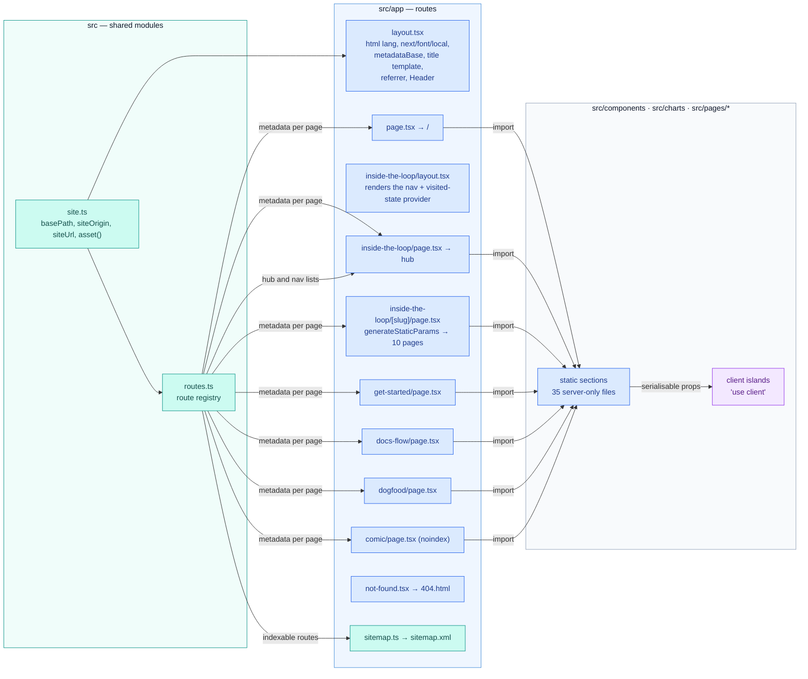
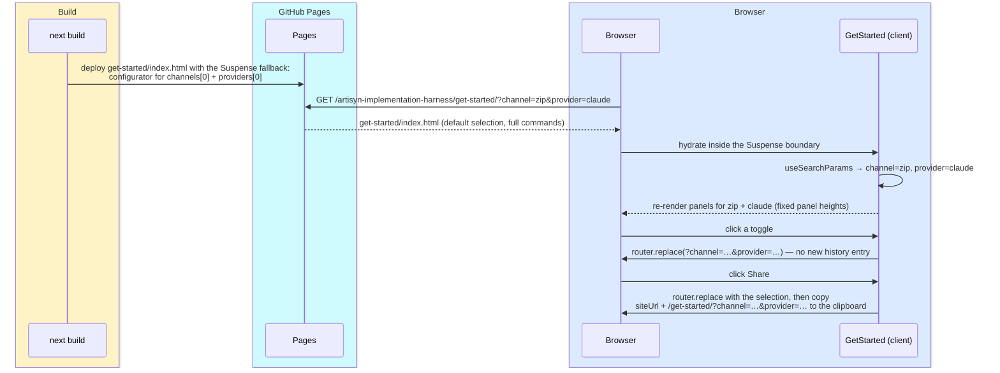
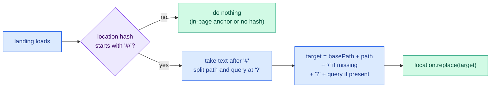

# DESIGN-20261121-UU4L: Rendering, Routing and Page Metadata — Design

Every Web Explorer route is a folder under `apps/web-explorer/src/app/`, rendered to HTML at build time by Server Components; only interactive parts are client components, and one route registry supplies every page's metadata.

The container-level change is in [Architecture](Architecture.md). CSP injection and the hash-coverage gate are in [Design - Security Header Delivery](Design%20-%20Security%20Header%20Delivery.md). Dependencies are in [Stack](Stack.md). Delivery slices are in [Efforts](Efforts.md).

## App structure

`src/app/` holds routes, layouts and crawl assets. The existing content components stay in `src/components`, `src/charts` and `src/pages/*`, and the `app/` pages import them.



Legend: blue = Server Component; violet = client component; teal = build-time data and metadata.

| File                                                                                   | Responsibility                                                                                                                                                                                                                                                                                                                                         |
| -------------------------------------------------------------------------------------- | ------------------------------------------------------------------------------------------------------------------------------------------------------------------------------------------------------------------------------------------------------------------------------------------------------------------------------------------------------ |
| `app/layout.tsx`                                                                       | `<html lang="en">`; Inter via `next/font/local`; `metadataBase` = `siteUrl`; title `{ default, template: '%s — Artisyn' }`; `referrer: 'strict-origin-when-cross-origin'`; `themeColor: '#0b1018'` via `viewport`; icons; `verification.google` from `NEXT_PUBLIC_GOOGLE_SITE_VERIFICATION`; imports `styles.css`; renders `Header` above `{children}` |
| `app/page.tsx`                                                                         | Landing. Renders the static landing sections and their client islands                                                                                                                                                                                                                                                                                  |
| `app/inside-the-loop/layout.tsx`                                                       | Imports `inside-the-loop.css`; wraps the hub and the 10 pages in the client `InsideTheLoopNavProvider`                                                                                                                                                                                                                                                 |
| `app/inside-the-loop/page.tsx`                                                         | Hub                                                                                                                                                                                                                                                                                                                                                    |
| `app/inside-the-loop/[slug]/page.tsx`                                                  | `generateStaticParams` returns the 10 slugs; `dynamicParams = false`; maps each slug to its content component inside `InsideTheLoopDetailPage`                                                                                                                                                                                                         |
| `app/get-started/page.tsx`, `docs-flow/page.tsx`, `dogfood/page.tsx`, `comic/page.tsx` | One route each; import the page's stylesheet and content component                                                                                                                                                                                                                                                                                     |
| `app/not-found.tsx`                                                                    | Root 404 page, exported as `out/404.html`                                                                                                                                                                                                                                                                                                              |
| `app/sitemap.ts`                                                                       | `export const dynamic = 'force-static'`; emits `out/sitemap.xml`                                                                                                                                                                                                                                                                                       |
| `src/site.ts`                                                                          | `basePath = '/artisyn-implementation-harness'`, `siteOrigin = 'https://dataart.github.io'`, `siteUrl`, `asset(path)` that prefixes `basePath` to a `public/` path                                                                                                                                                                                      |
| `src/routes.ts`                                                                        | Route registry (below) and the helper that turns an entry into `Metadata`                                                                                                                                                                                                                                                                              |

The 10 slugs keep today's paths: `requirements`, `context`, `harness`, `code-review`, `quality`, `retro`, `improvement`, `onboarding`, `tools`, `infrastructure` (from `InsideTheLoopRoutes.tsx`). Example: `/artisyn-implementation-harness/inside-the-loop/context/`.

Page components drop their own `Header`; the root layout renders it once. `Footer` stays in the page components that render it today, so `/docs-flow` keeps its Header-only chrome.

| Removed or replaced                                                                                           | Replacement                                                                |
| ------------------------------------------------------------------------------------------------------------- | -------------------------------------------------------------------------- |
| `src/main.tsx`, `index.html`, `vite.config.ts`                                                                | `app/layout.tsx`, `app/*/page.tsx`, `next.config.ts`                       |
| `pages/inside-the-loop/InsideTheLoopRoutes.tsx`, `InsideTheLoopLayout.tsx`                                    | `app/inside-the-loop/layout.tsx`, `page.tsx`, `[slug]/page.tsx`            |
| `components/SectionLink.tsx`                                                                                  | Plain `<a href>` anchors                                                   |
| 7 `import.meta.env.BASE_URL` uses (`Header`, `Comic` ×3, `InsideTheLoopHub`, `01-requirements`, `03-harness`) | `asset('/…')` from `src/site.ts`                                           |
| `import.meta.env.VITE_REPO_URL` / `VITE_DOCS_URL` in `env.ts`                                                 | `process.env.NEXT_PUBLIC_REPO_URL` / `NEXT_PUBLIC_DOCS_URL`, same defaults |
| `__HARNESS_VERSION__` define (`globals.d.ts`, `commands.ts`)                                                  | `process.env.HARNESS_VERSION`, inlined by `next.config.ts` `env`           |

## Route registry contract

The route registry in `src/routes.ts` is the only place a route's path, title, description, social image and index flag are written.

```ts
export type RouteEntry = {
  path: string; // trailing slash, no base path: '/get-started/'
  title: string; // the template adds ' — Artisyn'; the landing title is absolute
  description: string;
  image?: string; // file in public/; defaults to '/social-preview.png'
  index: boolean; // false → robots noindex and left out of sitemap.xml
};

export const routes: RouteEntry[] = [
  {
    path: '/',
    title: 'Artisyn — Implementation Harness',
    description:
      'Explore Artisyn Implementation Harness: structured AI engineering lifecycles, architecture-aware execution, reusable skills, and continuous learning.',
    index: true,
  },
  {
    path: '/get-started/',
    title: 'Get started',
    description:
      'Install the Artisyn Implementation Harness: pick a channel and an AI provider, then copy the install, launch and update commands.',
    index: true,
  },
  // … one entry per route: hub, 10 inside-the-loop pages, /docs-flow/, /dogfood/, /comic/ (index: false)
];
```

The landing entry carries today's `index.html` description. Per-page copy for the other entries is written in [Efforts](Efforts.md) #5.

| Consumer                                                                             | Reads                          | Produces                                                   |
| ------------------------------------------------------------------------------------ | ------------------------------ | ---------------------------------------------------------- |
| Each `page.tsx` (`export const metadata`) and `[slug]/page.tsx` (`generateMetadata`) | The entry for its path         | Title, description, canonical, Open Graph, Twitter, robots |
| `app/sitemap.ts`                                                                     | Entries with `index: true`     | `sitemap.xml` with absolute trailing-slash URLs            |
| Hub and inside-the-loop nav                                                          | The 10 inside-the-loop entries | Link lists and titles                                      |

## Server/client boundary

A file stays a Server Component unless it uses state, effects, event handlers, browser APIs or `motion`. Each interactive part moves into the smallest client component, and its props are serialisable.

Verified scan of `src/**/*.tsx` (2026-11-22): 56 files, 35 server-only. The interactive files and their handling:

| File                                                                          | Why it is interactive                      | Handling                                                                                                                                                                    |
| ----------------------------------------------------------------------------- | ------------------------------------------ | --------------------------------------------------------------------------------------------------------------------------------------------------------------------------- |
| `charts/BaDesktopFlow`, `charts/HarnessExplorer`, `charts/XrayAnatomy`        | State and handlers                         | `'use client'`                                                                                                                                                              |
| `charts/InsideLoopMap`                                                        | `@xyflow/react`                            | `'use client'`; loaded with `next/dynamic` (`ssr: false`)                                                                                                                   |
| `components/ContextFolders`, `components/EngineeringLoop`, `components/Modal` | State, handlers, document events           | `'use client'`                                                                                                                                                              |
| `components/HeroPreview`, `components/TerminalScenarios`                      | Animation; `matchMedia` read during render | `'use client'`; reduced motion through `usePrefersReducedMotion`                                                                                                            |
| `components/SectionLink`                                                      | `useLocation`, `useNavigate`               | Deleted; plain anchors (see In-page anchors)                                                                                                                                |
| `components/primitives`                                                       | Context and state                          | Split: static primitives stay in a server module; the stateful ones move to a client module                                                                                 |
| `pages/comic/Comic`                                                           | State, browser APIs                        | `'use client'`; image paths through `asset()`                                                                                                                               |
| `pages/docs-flow/DocsFlow`, `pages/docs-flow/ArtifactNode`                    | `@xyflow/react`                            | `'use client'`; `DocsFlow` loaded with `next/dynamic` (`ssr: false`)                                                                                                        |
| `pages/dogfood/GraphExplorer`                                                 | State, `useMemo`                           | `'use client'`                                                                                                                                                              |
| `pages/get-started/GetStarted`                                                | `useSearchParams`, clipboard               | `'use client'`; inside `<Suspense>` (see `/get-started` behaviour)                                                                                                          |
| `pages/inside-the-loop/01-requirements`                                       | State                                      | `'use client'`                                                                                                                                                              |
| `pages/inside-the-loop/InsideTheLoopHub`, `InsideTheLoopDetailPage`           | Navigation context, effects                | `'use client'`                                                                                                                                                              |
| `pages/inside-the-loop/InsideTheLoopNav`                                      | Context provider                           | `'use client'`; `useRouter().push` replaces `useNavigate`; visited state is recorded from `usePathname`                                                                     |
| `pages/landing/Landing` (310 lines)                                           | `motion`, clipboard, router-state scroll   | Split: static sections become Server Components; `motion` hero blocks and the copy-command button become small client components; the router-state scroll effect is deleted |

xyflow views render through `next/dynamic` with `ssr: false`, called from a client component. The `loading` placeholder is pre-rendered into the HTML with the view's final size.

React Router is removed. `Link` becomes `next/link`; `useNavigate` and `useLocation` become `useRouter` and `usePathname` from `next/navigation`.

## Hydration safety

Server HTML and the first client render must match, so client components read browser state only after hydration.

| Rule                                                                                                                                                       | Where it applies                                 |
| ---------------------------------------------------------------------------------------------------------------------------------------------------------- | ------------------------------------------------ |
| `window`, `document`, `navigator`, `localStorage` and `matchMedia` are read only in effects or event handlers                                              | Every client component                           |
| Reduced motion comes from `usePrefersReducedMotion`: `useSyncExternalStore` over `matchMedia('(prefers-reduced-motion: reduce)')`, server snapshot `false` | `HeroPreview.tsx:89`, `TerminalScenarios.tsx:40` |
| `useSearchParams` is read only inside a `<Suspense>` boundary                                                                                              | `GetStarted`                                     |

## `/get-started` behaviour

The exported HTML shows the default selection; the query is applied after hydration with no layout shift.



The Suspense fallback is the same configurator rendered with the default selection. An unknown `channel` or `provider` value falls back to the default, as today. The version chip shows `process.env.HARNESS_VERSION`.

## Legacy hash redirect

`public/legacy-hash-redirect.js` turns an old `#/<path>?<query>` link into the matching path URL before hydration; any other hash is left alone.

The post-export step adds `<script src="/artisyn-implementation-harness/legacy-hash-redirect.js">` to the landing `<head>` only, because every old hash link pointed at the site root ([Design - Security Header Delivery](Design%20-%20Security%20Header%20Delivery.md)).



| Old URL                                                                     | Result                                                                     |
| --------------------------------------------------------------------------- | -------------------------------------------------------------------------- |
| `/artisyn-implementation-harness/#/get-started?channel=zip&provider=claude` | `/artisyn-implementation-harness/get-started/?channel=zip&provider=claude` |
| `/artisyn-implementation-harness/#/inside-the-loop/context`                 | `/artisyn-implementation-harness/inside-the-loop/context/`                 |
| `/artisyn-implementation-harness/#how-it-works`                             | Unchanged; the browser scrolls to `#how-it-works`                          |

A hash path with no matching route lands on the root 404 page.

## In-page anchors

In-page section links are plain `<a href>` anchors; no router code handles them.

| Link                                             | `href`                                                                                           | Behaviour                                                                                      |
| ------------------------------------------------ | ------------------------------------------------------------------------------------------------ | ---------------------------------------------------------------------------------------------- |
| Header "How it works", "Capabilities"            | `/artisyn-implementation-harness/#how-it-works`, `/artisyn-implementation-harness/#capabilities` | From another page: loads `/` and scrolls. On `/`: same-document fragment navigation, no reload |
| Landing body links, e.g. "Explore the lifecycle" | `#how-it-works`                                                                                  | Scrolls on `/`                                                                                 |

The router-state `scrollTo` workaround in `SectionLink` and `Landing` is removed.

## Metadata output per page

Each exported page carries its own title, description, canonical URL and social tags, all absolute and under the base path.

| Tag                                                                     | Value                                                                                                                               | Example for `/get-started/`                                                   |
| ----------------------------------------------------------------------- | ----------------------------------------------------------------------------------------------------------------------------------- | ----------------------------------------------------------------------------- |
| `<title>`                                                               | `title` + ` — Artisyn`; landing uses its full title                                                                                 | `Get started — Artisyn`                                                       |
| `<meta name="description">`                                             | `description`                                                                                                                       | Registry text                                                                 |
| `<link rel="canonical">`                                                | `siteUrl` + `path`                                                                                                                  | `https://dataart.github.io/artisyn-implementation-harness/get-started/`       |
| `og:title`, `og:description`, `og:url`, `og:type`                       | Registry values; `og:type` = `website`                                                                                              | `og:url` = canonical                                                          |
| `og:image`                                                              | Absolute URL of `image`, default `social-preview.png`                                                                               | `https://dataart.github.io/artisyn-implementation-harness/social-preview.png` |
| `twitter:card`, `twitter:title`, `twitter:description`, `twitter:image` | `summary_large_image` and the same values                                                                                           | —                                                                             |
| `<meta name="robots">`                                                  | `noindex` when `index: false`                                                                                                       | Only on `/comic/`                                                             |
| Icons                                                                   | `favicon.svg`, `favicon.ico`, `apple-touch-icon.png` from `public/`, through `asset()`                                              | `/artisyn-implementation-harness/favicon.svg`                                 |
| `<meta name="referrer">`                                                | `strict-origin-when-cross-origin`                                                                                                   | Every page                                                                    |
| `<meta name="google-site-verification">`                                | `metadata.verification.google` in `app/layout.tsx`, from `NEXT_PUBLIC_GOOGLE_SITE_VERIFICATION`; omitted when the variable is unset | Every page                                                                    |

Structured data is on the landing page only. The post-export step injects it; its content is:

```json
{
  "@context": "https://schema.org",
  "@graph": [
    {
      "@type": "WebSite",
      "name": "Artisyn — Implementation Harness",
      "description": "<landing description from the route registry>",
      "url": "https://dataart.github.io/artisyn-implementation-harness/"
    },
    {
      "@type": "SoftwareSourceCode",
      "name": "Artisyn Implementation Harness",
      "description": "<landing description from the route registry>",
      "url": "https://dataart.github.io/artisyn-implementation-harness/",
      "codeRepository": "https://github.com/DataArt/artisyn-implementation-harness",
      "programmingLanguage": ["Markdown", "JavaScript"],
      "license": "https://spdx.org/licenses/MIT.html"
    }
  ]
}
```

`codeRepository` is `NEXT_PUBLIC_REPO_URL` or its default. `license` reflects the repository's MIT `LICENSE.md`.

No `robots.txt` is generated. `sitemap.xml` lists every indexable route. The repo owner submits it through a Google Search Console URL-prefix property for the project site. The property is verified by the `google-site-verification` meta tag; there is no verification file in `public/`.

## 404 page

`app/not-found.tsx` is exported as the root `404.html`, which GitHub Pages serves for every miss on the site, including misses under `/docs/`.

It renders the Header, a short "page not found" message, a `next/link` to Home and a plain `<a href="/artisyn-implementation-harness/docs/">` to Docs. The Docs link is a plain anchor because `/docs/` is Web Docs, outside the Next app.

## Build-time constants

`next.config.ts` and three public env keys fix every build-time value; the full example is in [Stack](Stack.md).

| Key                                    | Value                                                                    | Consumer                                        |
| -------------------------------------- | ------------------------------------------------------------------------ | ----------------------------------------------- |
| `output`                               | `'export'`                                                               | `next build` writes `out/`                      |
| `basePath`                             | `basePath` from `src/site.ts`                                            | Every URL and `_next/` asset                    |
| `trailingSlash`                        | `true`                                                                   | Routes export as `<route>/index.html`           |
| `images.unoptimized`                   | `true`                                                                   | `next/image` works without an image server      |
| `env.HARNESS_VERSION`                  | `version` from `skills/implementation-harness/package.json`              | `/get-started` version chip and commands        |
| `NEXT_PUBLIC_REPO_URL`                 | Default `https://github.com/DataArt/artisyn-implementation-harness`      | `env.ts` `repoUrl`                              |
| `NEXT_PUBLIC_DOCS_URL`                 | Default `https://dataart.github.io/artisyn-implementation-harness/docs/` | `env.ts` `docsUrl`                              |
| `NEXT_PUBLIC_GOOGLE_SITE_VERIFICATION` | No default; the meta tag is omitted when unset                           | `app/layout.tsx` `metadata.verification.google` |

Tailwind 4 runs through `@tailwindcss/postcss` in `postcss.config.mjs`. `styles.css` is imported by `app/layout.tsx`. Each page stylesheet (`getStarted.css`, `docsFlow.css`, `dogfood.css`, `comic.css`, `inside-the-loop.css`) is imported by its route's page or layout.

## Failure modes

| Failure                                                                                         | Detected by                                          | Outcome         |
| ----------------------------------------------------------------------------------------------- | ---------------------------------------------------- | --------------- |
| A Server Component imports a hook or `'use client'`-only API                                    | `next build`                                         | Build fails     |
| Server HTML and first client render differ                                                      | `web-explorer:e2e` console and hydration-error check | PR cannot merge |
| A page is missing its title, description, canonical or `og:image`, or the image file is missing | Metadata-completeness gate in `check-site.mjs`       | Build fails     |
| `/comic/` loses `noindex` or appears in `sitemap.xml`                                           | Metadata-completeness gate                           | Build fails     |
| A legacy hash link no longer lands on its path                                                  | `web-explorer:e2e`                                   | PR cannot merge |
| Landing first-load JS + CSS grows above 300 KB gzip                                             | `check-bundle-budget.mjs`                            | Build fails     |

## Verification

| Check                      | Where                                                     | Asserts                                                                                                                                                                                                                                                                                                                                                                                      |
| -------------------------- | --------------------------------------------------------- | -------------------------------------------------------------------------------------------------------------------------------------------------------------------------------------------------------------------------------------------------------------------------------------------------------------------------------------------------------------------------------------------- |
| Typecheck                  | `web-explorer:typecheck` (`next typegen && tsc --noEmit`) | Route params, metadata types and `asset()` calls compile                                                                                                                                                                                                                                                                                                                                     |
| Metadata-completeness gate | `scripts/check-site.mjs` in `web-explorer:build`          | For every route-registry page and `404.html`: non-empty title and description; absolute trailing-slash canonical under `siteUrl`; `og:title`, `og:description`, `og:url`, absolute `og:image` whose file exists in `out/`; `twitter:card` = `summary_large_image`; `sitemap.xml` lists exactly the pages without `noindex`; `/comic/` has `noindex`; the JSON-LD block on `/` parses as JSON |
| Gzip budget                | `scripts/check-bundle-budget.mjs` in `web-explorer:build` | JS + CSS referenced by `out/index.html` ≤ 300 KB gzip                                                                                                                                                                                                                                                                                                                                        |
| Browser checks             | `web-explorer:e2e`                                        | On every registry route: no hydration or console errors. Legacy hash links redirect with the query kept. A `next/link` click fetches the RSC payload with 200 and no full reload. Header anchor links scroll. A configured `/get-started/` link shows its selection. A missing path renders the 404 with Home and Docs links                                                                 |
