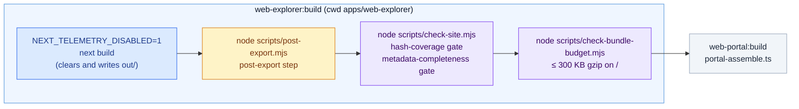
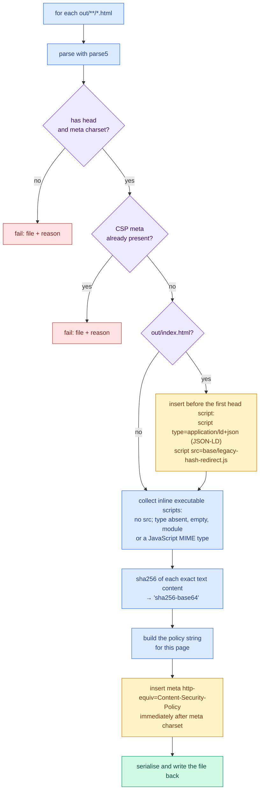
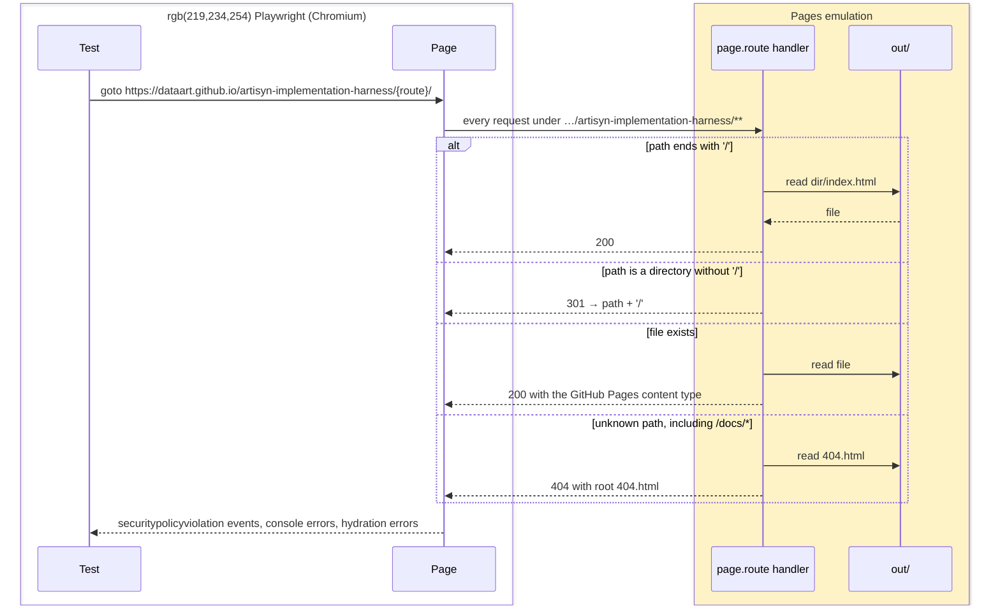

# DESIGN-20261121-UU4L: Security Header Delivery — Design

After `next build`, the post-export step gives every exported HTML page its own `<meta http-equiv="Content-Security-Policy">` with SHA-256 hashes of that page's inline scripts; a gate in the same build fails if any inline script is not covered.

GitHub Pages sends no custom response headers, so the meta tag is the only policy channel. The container view is in [Architecture](Architecture.md). Routes, metadata and the redirect algorithm are in [Design - Rendering, Routing and Page Metadata](Design%20-%20Rendering,%20Routing%20and%20Page%20Metadata.md). Dependencies are in [Stack](Stack.md).

## Build sequence

`web-explorer:build` runs four commands in order; any failure stops the build before Web Portal assembles anything.



## Post-export step

`apps/web-explorer/scripts/post-export.mjs` rewrites each `out/**/*.html` file in place, once per build.

| Input       | Default                           | Source                                                             |
| ----------- | --------------------------------- | ------------------------------------------------------------------ |
| HTML root   | `out/`                            | `next build` output; overridden by a positional directory argument |
| Site origin | `https://dataart.github.io`       | `siteOrigin` in `src/site.ts`; overridden by `--origin`            |
| Base path   | `/artisyn-implementation-harness` | `basePath` in `src/site.ts`                                        |

`<site>` below is the origin plus the base path: `https://dataart.github.io/artisyn-implementation-harness` in production.



| Rule            | Detail                                                                                                                                                                                                                                                                                               |
| --------------- | ---------------------------------------------------------------------------------------------------------------------------------------------------------------------------------------------------------------------------------------------------------------------------------------------------- |
| Data blocks     | `application/json` and `application/ld+json` scripts are not hashed; CSP does not execute them                                                                                                                                                                                                       |
| Hash input      | The script's exact text content as UTF-8, before any whitespace change                                                                                                                                                                                                                               |
| JSON-LD         | Built from the route registry landing entry and `NEXT_PUBLIC_REPO_URL`; `<` is written as `\u003c` so the text cannot close the script element. Content is in [Design - Rendering, Routing and Page Metadata](Design%20-%20Rendering,%20Routing%20and%20Page%20Metadata.md#metadata-output-per-page) |
| Legacy redirect | An external file from `public/`, so it needs no hash; `script-src <site>/` covers it                                                                                                                                                                                                                 |
| Scope           | Every exported HTML file, including `404.html`. RSC `.txt` payloads are not HTML and get no policy                                                                                                                                                                                                   |
| Idempotency     | `next build` clears `out/` first, so each run starts from fresh HTML. A second run over the same files fails on the existing CSP meta                                                                                                                                                                |
| `--resign`      | Used only by `preview`: first removes the CSP meta, JSON-LD block and redirect `<script src>` that an earlier run injected, then runs the steps above. When `--origin` is an `http:` origin, the rebuilt policy omits `upgrade-insecure-requests`                                                    |

## Policy

One directive string per page; only the hash list differs between pages.

```text
default-src 'none'; script-src 'sha256-…' 'sha256-…' <site>/; style-src <site>/ 'unsafe-inline'; img-src <site>/; font-src <site>/; connect-src <site>/; manifest-src <site>/; object-src 'none'; base-uri 'none'; form-action 'none'; upgrade-insecure-requests
```

| Directive                   | Value                                                                         | Allows                                                                                                      |
| --------------------------- | ----------------------------------------------------------------------------- | ----------------------------------------------------------------------------------------------------------- |
| `default-src`               | `'none'`                                                                      | Nothing not listed below                                                                                    |
| `script-src`                | This page's inline-script hashes + `<site>/`                                  | Next's inline bootstrap and RSC scripts on this page; `_next/static/*` chunks and `legacy-hash-redirect.js` |
| `style-src`                 | `<site>/` `'unsafe-inline'`                                                   | Site CSS files; React inline `style` attributes                                                             |
| `img-src`                   | `<site>/`                                                                     | Images from `public/` and `_next/static/media`                                                              |
| `font-src`                  | `<site>/`                                                                     | Vendored Inter and DM Sans `woff2` under `_next/static/media`                                               |
| `connect-src`               | `<site>/`                                                                     | RSC `.txt` payload fetches on client navigation                                                             |
| `manifest-src`              | `<site>/`                                                                     | A web manifest under the site path                                                                          |
| `object-src`                | `'none'`                                                                      | No plugins                                                                                                  |
| `base-uri`                  | `'none'`                                                                      | No `<base>` element                                                                                         |
| `form-action`               | `'none'`                                                                      | No form submission                                                                                          |
| `upgrade-insecure-requests` | Set in production; omitted by `--resign` when the origin is `http:` (preview) | `http:` subresource URLs are fetched over `https:`                                                          |

Path-scoped sources exclude other DataArt Pages sites on `dataart.github.io`. `<site>/` also covers Web Docs assets under `/docs/`, which are built from the same repository. Web Docs pages keep their own policy.

`<meta name="referrer" content="strict-origin-when-cross-origin">` comes from Next metadata in `app/layout.tsx`, not from this step.

Protections that need a response header are not delivered on GitHub Pages; this is accepted for the read-only public site:

| Not delivered                  | Header it needs                                                 |
| ------------------------------ | --------------------------------------------------------------- |
| Framing control (clickjacking) | `Content-Security-Policy: frame-ancestors` or `X-Frame-Options` |
| HSTS                           | `Strict-Transport-Security`                                     |
| MIME sniffing control          | `X-Content-Type-Options`                                        |
| Feature restrictions           | `Permissions-Policy`                                            |
| Violation reporting            | `report-to` / `report-uri` (ignored in meta)                    |

## Hash-coverage gate

`apps/web-explorer/scripts/check-site.mjs` re-reads the written output and fails the build on any page whose policy does not cover what it contains.

| Check, per `out/**/*.html` | Fails when                                                                                                                  |
| -------------------------- | --------------------------------------------------------------------------------------------------------------------------- |
| CSP meta count             | Not exactly one                                                                                                             |
| CSP meta position          | Not after `<meta charset>`, or not before the first `<script>`                                                              |
| Hash coverage              | The SHA-256 of an inline executable script is not in that page's `script-src`                                               |
| External URLs              | A `<script src>`, stylesheet `<link href>`, font, ``, `srcset` or CSS `url()` in the HTML points outside `<site>/` |

Each failure prints the file path and the first 80 characters of the offending script or URL. The same script runs the metadata-completeness gate ([Design - Rendering, Routing and Page Metadata](Design%20-%20Rendering,%20Routing%20and%20Page%20Metadata.md#verification)).

## Browser checks

`web-explorer:e2e` loads the exported site in Chromium on its production URL, so the production policy applies unchanged.



| Assertion                                                                                    | Route set                                            |
| -------------------------------------------------------------------------------------------- | ---------------------------------------------------- |
| No `securitypolicyviolation` event                                                           | Every route in the route registry, plus the 404 page |
| No hydration error and no console error                                                      | Every route in the route registry                    |
| Legacy hash links redirect to the path URL with the query kept                               | `#/get-started?…`, `#/inside-the-loop/<slug>`        |
| A `next/link` click fetches the RSC payload with status 200 and does not reload the document | Header navigation                                    |
| Header anchor links scroll to their section                                                  | `/` and one other page                               |
| A configured `/get-started/?channel=…&provider=…` link shows its selection                   | `/get-started/`                                      |
| A missing path renders the 404 page with Home and Docs links                                 | `/no-such-page/`                                     |

| Setup              | Value                                                                                                                                                                    |
| ------------------ | ------------------------------------------------------------------------------------------------------------------------------------------------------------------------ |
| Config             | `apps/web-explorer/playwright.config.ts`                                                                                                                                 |
| Specs              | `apps/web-explorer/e2e/`                                                                                                                                                 |
| Ignored output     | `apps/web-explorer/test-results/` and `apps/web-explorer/playwright-report/` are in `.gitignore`                                                                         |
| Violation listener | Registered with `page.addInitScript`, so it is active before any page script runs                                                                                        |
| Console            | Any console message starting with "Refused to" fails the test, as does any console error                                                                                 |
| Content types      | The Pages emulation answers with GitHub Pages content types: `.html` `text/html`, `.txt` `text/plain`, `.js` `text/javascript`, `.css` `text/css`, `.woff2` `font/woff2` |
| RSC fetch          | The `next/link` assertion runs under the Pages emulation, so the `.txt` payload is served as `text/plain`                                                                |

ci-web runs it in an "E2E (affected)" step after "Build (affected)". The step installs Chromium with `yarn workspace @artisyn-harness/web-explorer playwright install --with-deps chromium` only when `yarn nx show projects --affected --base=origin/<base> --head=HEAD` lists `web-explorer`. Accessibility (axe-core) checks are added to this target later by the NFR-A18 work.

## Preview

`web-explorer:preview` serves a locally signed copy, so the policy matches the local origin.

| Step | Action                                                                                                                                                                                                                                                       |
| ---- | ------------------------------------------------------------------------------------------------------------------------------------------------------------------------------------------------------------------------------------------------------------ |
| 1    | `dependsOn: ["build"]` produces a signed `out/`                                                                                                                                                                                                              |
| 2    | Replace `.preview/` with a fresh copy of `out/` at `.preview/artisyn-implementation-harness/`                                                                                                                                                                |
| 3    | `node scripts/post-export.mjs --resign --origin http://localhost:4173 .preview/artisyn-implementation-harness` re-signs the copy; the policy uses `http://localhost:4173/artisyn-implementation-harness/` as `<site>/` and omits `upgrade-insecure-requests` |
| 4    | `node scripts/serve-preview.mjs` serves `.preview/` on port 4173, so the site is at `http://localhost:4173/artisyn-implementation-harness/`                                                                                                                  |

`apps/web-explorer/scripts/serve-preview.mjs` is a zero-dependency `node:http` server. It applies the same GitHub Pages emulation rules as the e2e suite: `dir/` serves `dir/index.html`; `/dir` without a slash answers 301 to `/dir/`; an existing file is served with its content type; any other path, including `/docs/*`, gets the root `404.html` with status 404.

`dev` (`next dev`) runs without a CSP.

## Fonts and styles under the policy

Every font and stylesheet loads from the site path, so no third-party host appears in the policy.

| Asset                           | Delivery                                                                                                                                        | Covered by                  |
| ------------------------------- | ----------------------------------------------------------------------------------------------------------------------------------------------- | --------------------------- |
| Inter (site-wide)               | `woff2` vendored in `src/fonts/`, loaded with `next/font/local` in `app/layout.tsx`; emitted under `_next/static/media`                         | `font-src <site>/`          |
| DM Sans (`/docs-flow`)          | `woff2` vendored in `src/fonts/`, loaded with `next/font/local` by the docs-flow route; the Google Fonts `@import` in `docsFlow.css` is removed | `font-src <site>/`          |
| Global and page CSS             | Emitted by Next under `_next/static/`                                                                                                           | `style-src <site>/`         |
| React inline `style` attributes | Rendered into the HTML and set by client components                                                                                             | `style-src 'unsafe-inline'` |

## Failure modes

| Failure                                                                                          | Detected by                             | Outcome                                                      |
| ------------------------------------------------------------------------------------------------ | --------------------------------------- | ------------------------------------------------------------ |
| A Next upgrade changes the shape or number of inline scripts                                     | Hash-coverage gate                      | `web-explorer:build` fails; nothing is assembled or deployed |
| Code adds an inline script at runtime                                                            | `web-explorer:e2e` violation check      | PR cannot merge                                              |
| A third-party script, style, font or image URL is introduced                                     | Hash-coverage gate (external-URL check) | Build fails                                                  |
| A page lacks `<head>` or `<meta charset>`, or already has a CSP meta                             | Post-export step                        | Build fails                                                  |
| Deploy skew: an open page from the previous build requests a payload the new build no longer has | Next client router                      | Falls back to a full page load of the new build              |

## Verification

| Check                                | Command or target                         | Evidence                                                                                 |
| ------------------------------------ | ----------------------------------------- | ---------------------------------------------------------------------------------------- |
| Policy present and covering          | `web-explorer:build` (hash-coverage gate) | Gate passes on every `out/**/*.html`                                                     |
| No runtime violations                | `web-explorer:e2e` in ci-web              | Zero `securitypolicyviolation` events across the route registry                          |
| JSON-LD present on `/`               | Metadata-completeness gate                | Block parses as JSON                                                                     |
| Preview matches production behaviour | `web-explorer:preview`                    | Pages load with no violations on `http://localhost:4173/artisyn-implementation-harness/` |
