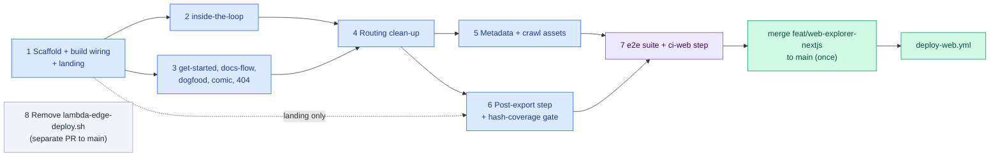
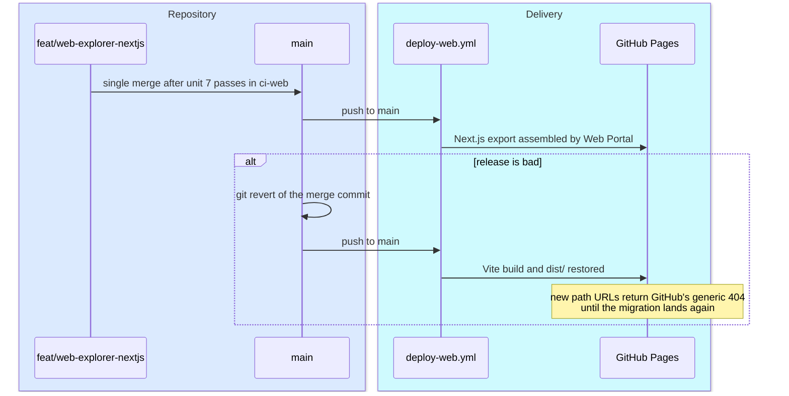

# DESIGN-20261121-UU4L: Web Explorer Next.js Static Export — Efforts

Units 1–7 land on one integration branch, `feat/web-explorer-nextjs`, which merges to `main` once after unit 7 passes; unit 8 is a separate small PR to `main`.

What each unit builds is in [Architecture](Architecture.md), [Design - Rendering, Routing and Page Metadata](Design%20-%20Rendering,%20Routing%20and%20Page%20Metadata.md), [Design - Security Header Delivery](Design%20-%20Security%20Header%20Delivery.md) and [Stack](Stack.md). Each unit is one focused dev session.

## Work breakdown

| #   | Summary                                                                                                                                                                                                                                                                                                                                                                                                                                                                                                                                                                                                                                                                                                                                                                         | Type  | Layer                    | Depends on                                      | Completion evidence                                                                                                                                                                                                                                      |
| --- | ------------------------------------------------------------------------------------------------------------------------------------------------------------------------------------------------------------------------------------------------------------------------------------------------------------------------------------------------------------------------------------------------------------------------------------------------------------------------------------------------------------------------------------------------------------------------------------------------------------------------------------------------------------------------------------------------------------------------------------------------------------------------------- | ----- | ------------------------ | ----------------------------------------------- | -------------------------------------------------------------------------------------------------------------------------------------------------------------------------------------------------------------------------------------------------------- |
| 1   | Next.js scaffold and build wiring: `next.config.ts`, `src/app/layout.tsx`, `src/site.ts`, route registry skeleton, Inter and DM Sans vendored with licence files, Tailwind via PostCSS, env and version constants; Nx targets (`build` with telemetry off and `outputs: out`, `typecheck` with `next typegen`, `dev`/`serve`, `preview`); `.gitignore`; `portal-assemble.ts` reads `out/`, asserts `index.html`, `404.html`, `.nojekyll`, `docs/index.html`, fails on a pre-existing `out/docs` and above 900 MB; `web-portal` inputs; landing ported as Server Components with client islands and `usePrefersReducedMotion`; `check-bundle-budget.mjs` moved to `apps/web-explorer/scripts/` and rewritten for gzip; draft PR opened from `feat/web-explorer-nextjs` to `main` | feat  | Web Explorer, Web Portal | —                                               | The draft PR exists and `ci-web` runs on it; `web-explorer:build` and `web-portal:build` pass; `/` renders from `out/`; the first real gzip measurement of `/` is recorded and the 300 KB ceiling is confirmed or tightened in `check-bundle-budget.mjs` |
| 2   | `/inside-the-loop` hub and the 10 detail pages under `[slug]` with `generateStaticParams`; nav and visited-state provider as a client layout; xyflow hub map through `next/dynamic`                                                                                                                                                                                                                                                                                                                                                                                                                                                                                                                                                                                             | feat  | Web Explorer             | 1                                               | `out/inside-the-loop/index.html` and 10 `out/inside-the-loop/<slug>/index.html` files; map and visited state work in `dev`                                                                                                                               |
| 3   | `/get-started` (Suspense, query round-trip, fixed panel heights), `/docs-flow` (DM Sans via `next/font/local`, xyflow), `/dogfood`, `/comic`, `app/not-found.tsx`                                                                                                                                                                                                                                                                                                                                                                                                                                                                                                                                                                                                               | feat  | Web Explorer             | 1                                               | Each route exported to its `index.html`; `out/404.html` present; a configured `/get-started/` link shows its selection in `dev`                                                                                                                          |
| 4   | Routing clean-up: `public/legacy-hash-redirect.js`, header anchors as plain links, `SectionLink` removed; React Router, Vite, `main.tsx`, `index.html`, `vite.config.ts` and `scripts/ci/web-explorer-build.sh` removed                                                                                                                                                                                                                                                                                                                                                                                                                                                                                                                                                         | feat  | Web Explorer             | 2, 3                                            | `git grep` finds no `react-router-dom`, `vite` or `web-explorer-build.sh` reference in `apps/web-explorer` or `scripts/ci`; typecheck and build pass                                                                                                     |
| 5   | Page metadata and crawl assets: full route registry, per-page metadata, social images wired, `/comic` `noindex`, `app/sitemap.ts`, metadata-completeness gate in `check-site.mjs`; `google-site-verification` meta from `metadata.verification.google`, fed by `NEXT_PUBLIC_GOOGLE_SITE_VERIFICATION` (a `build` env input; tag omitted when unset); the build step env in `deploy-web.yml` and `ci-web.yml` gains `NEXT_PUBLIC_GOOGLE_SITE_VERIFICATION: ${{ vars.NEXT_PUBLIC_GOOGLE_SITE_VERIFICATION }}`, next to the existing `VITE_*` entries                                                                                                                                                                                                                              | feat  | Web Explorer, CI         | 4                                               | Metadata-completeness gate passes in `web-explorer:build`; `out/sitemap.xml` lists every indexable route and not `/comic/`; both workflows pass the variable to their build step; with the variable set, every page carries the verification meta tag    |
| 6   | Security post-export step: `post-export.mjs` (per-page CSP meta with hashes, JSON-LD on `/`, legacy-redirect `<script src>`), hash-coverage gate in `check-site.mjs`, `preview` re-signing (`--resign`, no `upgrade-insecure-requests` on an `http:` origin), `scripts/serve-preview.mjs` (zero-dependency `node:http` server with the GitHub Pages emulation rules)                                                                                                                                                                                                                                                                                                                                                                                                            | feat  | Web Explorer             | 4 (can start after 1, on the landing page only) | Every `out/**/*.html` has exactly one CSP meta and the hash-coverage gate passes; `preview` serves `http://localhost:4173/artisyn-implementation-harness/` with no CSP violations, and a missing path returns the root `404.html` with status 404        |
| 7   | `web-explorer:e2e` Playwright suite with Pages emulation and every assertion from both design files; ci-web "E2E (affected)" step with the conditional Chromium install                                                                                                                                                                                                                                                                                                                                                                                                                                                                                                                                                                                                         | test  | Web Explorer, CI         | 5, 6                                            | `web-explorer:e2e` passes locally and in ci-web on the integration branch PR; Lighthouse runs (mobile, simulated throttling) before and after the migration on `/`, `/get-started/` and one inside-the-loop page record LCP, CLS and TBT                 |
| 8   | Remove dead `scripts/ci/lambda-edge-deploy.sh`                                                                                                                                                                                                                                                                                                                                                                                                                                                                                                                                                                                                                                                                                                                                  | chore | CI                       | —                                               | `git grep lambda-edge-deploy` returns nothing on `main`                                                                                                                                                                                                  |

Operational step, no ticket, owned by the repo owner: register a Google Search Console URL-prefix property for `https://dataart.github.io/artisyn-implementation-harness/` with the HTML-tag verification method, set the `NEXT_PUBLIC_GOOGLE_SITE_VERIFICATION` variable in the `web` environment to its token, and submit `sitemap.xml` after the first deploy that carries the tag.

## Sequencing

Units 2 and 3 run in parallel after 1. Units 5 and 6 run in parallel after 4. Unit 8 has no ordering constraint.

## Rollout and rollback

The live site switches from the Vite build to the Next.js export in one merge; one revert switches it back.

Unit 1 opens a draft PR from `feat/web-explorer-nextjs` to `main`, so every unit merged into the integration branch runs `ci-web`. The PR leaves draft once unit 7 passes.

| Step                         | Owner                                                                | Gate                                             |
| ---------------------------- | -------------------------------------------------------------------- | ------------------------------------------------ |
| Merge the integration branch | Developer, after review                                              | ci-web passes, including "E2E (affected)"        |
| Deploy                       | `deploy-web.yml` on push to `main`                                   | `web-explorer:build` gates and portal assertions |
| Roll back                    | Developer: `git revert` of the merge commit, pushed by the developer | Same pipeline; restores the Vite build           |

HLD and NFR updates happen in this design's Publish stage. LLD and `apps/web-explorer/README.md` updates happen in `/dev document`. The list is in [Architecture](Architecture.md#downstream-documents).

## Effort Estimate

| #         | Description                                                                      | Estimate |
| --------- | -------------------------------------------------------------------------------- | -------- |
| 1         | Next.js scaffold, build wiring, portal changes, landing page, gzip budget        |          |
| 2         | `/inside-the-loop` hub and 10 detail pages                                       |          |
| 3         | `/get-started`, `/docs-flow`, `/dogfood`, `/comic`, 404 page                     |          |
| 4         | Routing clean-up and removal of Vite and React Router                            |          |
| 5         | Page metadata, sitemap and metadata-completeness gate                            |          |
| 6         | Post-export step, hash-coverage gate, preview re-signing and `serve-preview.mjs` |          |
| 7         | Playwright e2e suite and ci-web step                                             |          |
| 8         | Remove `lambda-edge-deploy.sh`                                                   |          |
| **Total** |                                                                                  |          |
