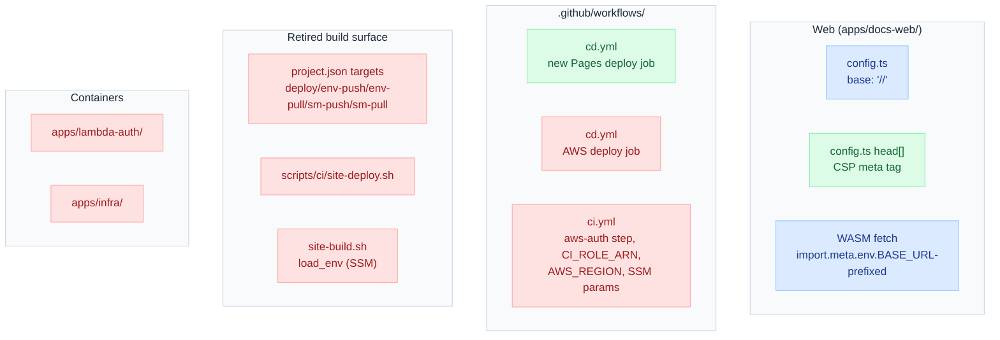

# Solution Design — GitHub Pages Migration

This document adds implementation detail to the decisions already settled in `solution/Architecture.md`. It does not introduce or contradict any decision there.

## Change Map



## VitePress Config Change

`apps/docs-web/.vitepress/config.ts` sets `base: '/<repo>/'`. It is currently unset, defaulting to `/`.

## WASM Fetch Base-Awareness

The `docs-operational-graph.sqlite` file is copied via a `buildEnd` hook to `outDir` root. The client-side `sql.js` fetch for this file is rewritten to resolve through VitePress's base-relative mechanism — the fetch URL is prefixed with `import.meta.env.BASE_URL` instead of using an absolute `/docs-operational-graph.sqlite` path. This keeps the file resolvable under the `/<repo>/` prefix.

## CSP Meta Tag

The CSP is added through VitePress's `head` config array as a `<meta http-equiv="Content-Security-Policy">` entry:

```
default-src 'self'; script-src 'self' 'unsafe-inline' 'wasm-unsafe-eval' https://giscus.app; style-src 'self' 'unsafe-inline' https://giscus.app; img-src 'self' data: https://giscus.app https://avatars.githubusercontent.com; font-src 'self' data:; connect-src 'self' https://giscus.app; frame-src https://giscus.app; object-src 'none'; base-uri 'self'
```

These are the same directive values as the in-flight CloudFront `ResponseHeadersPolicy` CSP work, minus `frame-ancestors` — a meta-tag-delivered CSP does not honor `frame-ancestors` per the CSP spec.

## GitHub Actions Deploy Workflow

`cd.yml` gets a new job using `actions/configure-pages@v5`, `actions/upload-pages-artifact@v3` (artifact path `apps/docs-web/.vitepress/dist`), and `actions/deploy-pages@v4`. The job declares `permissions: pages: write, id-token: write`, `environment: github-pages`, and a `concurrency: group: "pages", cancel-in-progress: false` block — this serializes deploys so a slower in-flight deploy is never clobbered by a later push.

During the transitional window (`solution/Architecture.md`'s Sequencing section), this job runs as a job independent of the existing AWS deploy job already in `cd.yml` — two separate jobs, not merged, so one failing does not block the other. The AWS job is deleted from `cd.yml` only once GitHub Pages is verified live.

## Retired Build/Deploy Surface

| Path                                                                                    | Change                                                                                                                                                                            |
| --------------------------------------------------------------------------------------- | --------------------------------------------------------------------------------------------------------------------------------------------------------------------------------- |
| `apps/docs-web/project.json`                                                            | `deploy`, `env-push`, `env-pull`, `sm-push`, `sm-pull` nx targets deleted                                                                                                         |
| `scripts/ci/site-deploy.sh`                                                             | Deleted (S3 sync + CloudFront invalidation)                                                                                                                                       |
| `scripts/ci/site-build.sh`                                                              | `load_env` (SSM-loading) function deleted; build becomes a plain `vitepress build` with no AWS calls                                                                              |
| `VITE_GITHUB_ORG`, `VITE_GITHUB_REPO`, `VITE_GISCUS_REPO_ID`, `VITE_GISCUS_CATEGORY_ID` | Move from SSM-sourced env vars to plain GitHub Actions repository variables (`vars.*`), injected directly in the workflow — confirmed non-secret per `apps/docs-web/.env.example` |
| `.github/workflows/ci.yml`                                                              | `./.github/actions/aws-auth` step, `CI_ROLE_ARN`, and AWS/SSM env vars (`AWS_REGION`, `SITE_SSM_ENV_PARAM`, `LAMBDA_AUTH_SSM_ENV_PARAM`) removed                                  |

## Container Removal

| Container                      | Removal detail                                                                                                                                                                                                                                                                                              |
| ------------------------------ | ----------------------------------------------------------------------------------------------------------------------------------------------------------------------------------------------------------------------------------------------------------------------------------------------------------- |
| Auth (`apps/lambda-auth/`)     | Deleted entirely                                                                                                                                                                                                                                                                                            |
| Infrastructure (`apps/infra/`) | Deleted entirely, but only after the AWS decommission step (`cdk destroy` + manual force-deletion of the `RemovalPolicy.RETAIN` S3 bucket and Secrets Manager secret, per `solution/Architecture.md`'s Decommission section) has completed — the CDK code must still exist at the moment `cdk destroy` runs |

## Failure/Recovery Paths

A build failure in `ci.yml`'s existing lint/typecheck/dead-link gate blocks the deploy from ever running. Recovery is fixing the commit and re-pushing. The `concurrency` group on the Pages deploy job prevents a race between overlapping deploys. There is no AWS-side rollback to perform once AWS is decommissioned, since there is no AWS-side state left to roll back.
