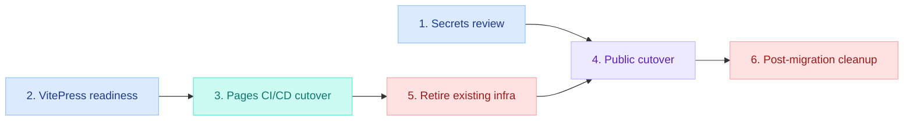

# Efforts — GitHub Pages Migration

Six items implement the decisions in `solution/Architecture.md`, grouped by natural ownership/sequencing boundaries — the same gated order as that document's Sequencing section.

## WBS

| #   | Summary                                                                                                                                                                                                                                                                                                                                                                                                                                                         | Type  | Layer         | Depends on |
| --- | --------------------------------------------------------------------------------------------------------------------------------------------------------------------------------------------------------------------------------------------------------------------------------------------------------------------------------------------------------------------------------------------------------------------------------------------------------------- | ----- | ------------- | ---------- |
| 1   | Pre-publish content/secrets review — manual sweep for hardcoded secrets or non-public content before repo visibility changes                                                                                                                                                                                                                                                                                                                                    | chore | Docs/Security | —          |
| 2   | VitePress readiness — set `base: '/<repo>/'`, fix the operational-graph SQLite WASM fetch path to be base-aware, migrate CSP from CloudFront `ResponseHeadersPolicy` to a `head` meta tag                                                                                                                                                                                                                                                                       | feat  | Web           | —          |
| 3   | GitHub Pages CI/CD cutover — add the `configure-pages`/`upload-pages-artifact`/`deploy-pages` workflow (with concurrency group) running alongside the existing AWS deploy job, verified via GitHub's Pages preview mechanism, and move `VITE_*` build vars to GitHub Actions repository variables                                                                                                                                                               | feat  | CI/CD         | 2          |
| 4   | Public cutover — flip repo visibility to public, enable GitHub Pages in repo settings (Source: GitHub Actions), verify the live site at the public `/<repo>/` URL, and verify giscus GitHub App installation/permissions and Discussions category remain valid                                                                                                                                                                                                  | chore | Web/Discuss   | 1, 5       |
| 5   | Retire existing infra — `cdk destroy` across `DocsStack`/`EdgeStack`/`CiStack`, force-delete (`ForceDeleteWithoutRecovery`) the retained S3 bucket and Secrets Manager secret, delete the Infrastructure container (`apps/infra/`), remove the AWS deploy job and AWS OIDC/SSM auth steps from `cd.yml`/`ci.yml`, and delete the Auth container (`apps/lambda-auth/`) — all completed before the repo goes public; there is no AWS-side fallback once this runs | chore | Infra/Auth    | 3          |
| 6   | Post-migration cleanup — remove obsolete `apps/docs-web` nx targets (`deploy`/`env-push`/`env-pull`/`sm-push`/`sm-pull`) and `scripts/ci/site-deploy.sh`/the SSM-loading half of `scripts/ci/site-build.sh`; can happen any time once the GitHub Pages path is confirmed working, not tied to AWS teardown                                                                                                                                                      | chore | Web           | 5          |

## Sequencing

This matches the gated order in `solution/Architecture.md`'s Sequencing section, where AWS decommission now runs before the repo's visibility flips to public, not after — that document owns the full rationale for the ordering. There is no AWS-side fallback once item 5 (retire existing infra) completes.

## Open Questions — Resolution

Research/Evaluate's OQ-4 (RETAIN-resource teardown mechanics), OQ-5 (WASM base-path fix), and OQ-8 (review ownership) are resolved into WBS items 5, 2, and 1 respectively — no separate spike tickets are needed.

OQ-4 maps specifically to item 5 (Retire existing infra), which covers the `cdk destroy` and force-delete of the retained S3 bucket and Secrets Manager secret.

OQ-1 (custom domain) is not applicable to this chosen path: Option B (GitHub Pages project site) has no domain dependency. It is moot unless a future design revisits Option C.

## Effort Estimate

| #         | Description                                             | Estimate |
| --------- | ------------------------------------------------------- | -------- |
| 1         | Pre-publish content/secrets review                      | 1h       |
| 2         | VitePress readiness (base path, WASM fix, CSP meta tag) | 2h       |
| 3         | GitHub Pages CI/CD cutover                              | 2h       |
| 4         | Public cutover                                          | 1h       |
| 5         | Retire existing infra                                   | 2h       |
| 6         | Post-migration cleanup                                  | 0.5h     |
| **Total** |                                                         | **8.5h** |
