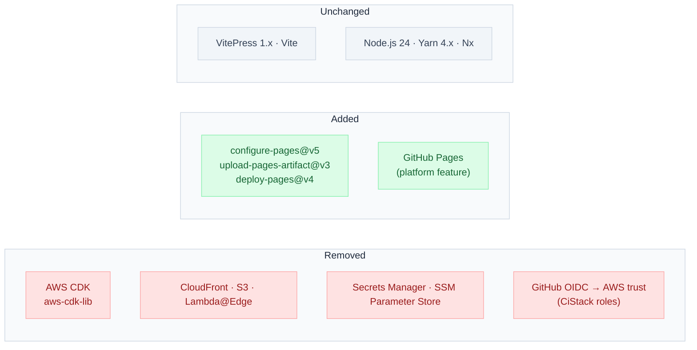

# Stack Changes — GitHub Pages Migration

This site's stack drops its AWS deploy/hosting layer entirely and adopts GitHub's own Pages platform. Build tooling for `apps/docs-web` is unchanged.

## Removed

| Item                                         | Detail                                                                                                                                                                             |
| -------------------------------------------- | ---------------------------------------------------------------------------------------------------------------------------------------------------------------------------------- |
| AWS CDK                                      | `aws-cdk-lib`, `apps/infra/` — no longer used for this site                                                                                                                        |
| CloudFront, S3 (static origin), Lambda@Edge  | Retired along with the Infrastructure and Auth containers                                                                                                                          |
| AWS Secrets Manager, AWS SSM Parameter Store | No longer used for this site's build/deploy config                                                                                                                                 |
| GitHub OIDC-to-AWS trust                     | The `CiStack`-issued deploy/CI roles are retired; the GitHub Pages deploy uses GitHub's own OIDC token internally (`id-token: write`), scoped to the Pages deployment API, not AWS |

## Added

| Item                                                                                        | Detail                                                                                                                                                             |
| ------------------------------------------------------------------------------------------- | ------------------------------------------------------------------------------------------------------------------------------------------------------------------ |
| `actions/configure-pages@v5`, `actions/upload-pages-artifact@v3`, `actions/deploy-pages@v4` | Official GitHub Actions for Pages deployment; no new runtime dependency to install — these run entirely within the existing GitHub Actions workflow                |
| GitHub Pages (platform feature)                                                             | Enabled via repo Settings → Pages → Source: GitHub Actions; no infrastructure-as-code definition, since it's a built-in GitHub feature, not a provisioned resource |

## Unchanged

VitePress 1.x, Vite, Node.js 24, Yarn 4.x, Nx — the build/lint/typecheck pipeline for `apps/docs-web` is untouched; only its deploy path changes.

## Compatibility/Operational Note

GitHub Pages requires the repo to be public (or GitHub Enterprise) for the free deploy path used here, and requires `pages: write` and `id-token: write` permissions on the workflow job that calls `actions/deploy-pages`. No other compatibility concern — the output is a plain static artifact.
