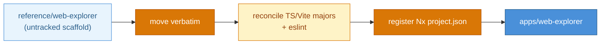
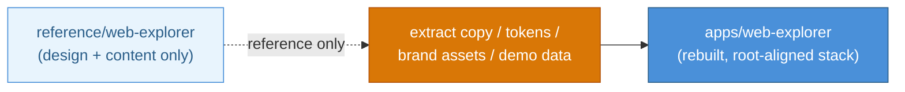
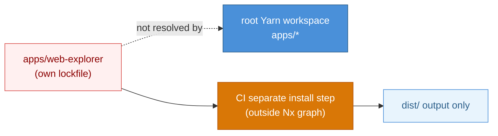

# DESIGN-20261108-1L8P: Web Explorer Landing Page & Web Portal Site Routing — Research (Decision 1: Web Explorer)

_Produced by the Research phase. Do not edit after Evaluate phase begins._

## Context

This design adds a promotional SPA (`web-explorer`) alongside the harness's existing VitePress docs site, decided independently from how routing/composition between the two sites is solved (Decision 2). The developer has already produced a working, untracked reference scaffold at `design/reference/web-explorer/` (React 19 + Vite 8 + TS + Tailwind 4 + Motion), explicitly offered as reference input, not necessarily final code or location, per `design/00 Frame.md`'s Boundaries.

## Options

### Option A — Do nothing / minimal change: fold a promo hero into the existing docs homepage

**Description:** Skip a dedicated SPA entirely; add a stronger hero/CTA to the renamed `web-docs` VitePress homepage using VitePress's own `layout: home` hero/features frontmatter.

**Industry precedent:** Many OSS docs sites (e.g. early Vue/Nuxt) used VitePress/VuePress's own homepage hero instead of a separate marketing app, for projects that haven't yet justified a second app.

**Diagram:**

**Pros:**

- Zero new app/build target/dependency surface — no React19/Vite8/Tailwind4 to reconcile against root TS/ESLint
- No base-path/portal problem at all
- NFR-5/NFR-7 already enforced here
- Fastest to ship

**Cons:**

- Does not satisfy Frame's EC1 (dedicated promotional UI) or EC3 (root serves web-explorer) — a direct contradiction of Frame, not a weaker version
- VitePress's home hero is far less flexible than a bespoke SPA (no simulated lifecycle demo, limited motion)
- Discards an already largely-complete developer-authored scaffold

**Unknowns / risks:**

- Whether this would be accepted as satisfying "sell the harness's value in the first few seconds" given Frame explicitly names web-explorer as the vehicle — likely not

---

### Option B — Adopt the existing scaffold as-is, registered as `apps/web-explorer`

**Description:** Move `design/reference/web-explorer/` verbatim into `apps/web-explorer`, add to Yarn workspaces (already covered by the `apps/*` glob), register an Nx `project.json` mirroring `apps/docs-web/project.json`'s shape (`build`/`typecheck`/`lint` via `nx:run-commands`), reconcile its TS/Vite majors against root, wire root's eslint flat config.

**Industry precedent:** Astro's own marketing site and docs site (`withastro/astro`) are separate apps in the same monorepo, each with its own framework/build config, composed at deploy time — same promo-app + docs-app shape.

**Diagram:**

**Pros:**

- Scaffold is already functionally complete (hero, interactive /design//dev demo, capabilities, operating model, CTA) per its own docs — fastest path to working
- Already brand-asset-complete (logo, favicons, social preview)
- Scaffold's own TECH_STACK.md already anticipates monorepo integration (workspaces, single lockfile, Nx target, base-path awareness)
- Content already self-reviewed for non-authoritative/simulated boundaries

**Cons:**

- Scaffold's `package.json` pins TS `^6.0.0` / Vite `^8.0.0` vs. root's TS `^5.7.0` — needs reconciliation before sharing the root lockfile (may force a root TS bump across `docs-web`/tooling, or a downgrade of the scaffold's declared ranges)
- Scaffold ships no eslint config, root's flat config may require source rework
- Scaffold has its own `package-lock.json` that must be deleted to honor the single-root-lockfile convention
- Vite defaults to base `/`, needs explicit reconfiguration
- Content accuracy against canonical `docs/Harness/` not yet verified

**Unknowns / risks:**

- Bundle size/build time impact on this repo's CI budget unmeasured (only other app today is a static VitePress site)
- Whether Tailwind 4's `@tailwindcss/vite` plugin coexists cleanly with VitePress's own Vite config in one shared `node_modules`/lockfile
- Whether the simulated /design//dev walkthrough content should be kept verbatim, trimmed, or rewritten against canonical docs before publish (flagged unresolved by the scaffold's own authors)

---

### Option C — Adopt content/design intent only, rebuild on a stack version-matched to the monorepo

**Description:** Treat the scaffold as design/content reference only (Frame's Boundaries explicitly permit this: "using the existing root-level scaffold as reference/starting material, not necessarily its final location or exact code"). Rebuild `apps/web-explorer` fresh, reusing scaffold copy, brand assets, `DESIGN_SYSTEM.md` tokens and demo data, pinned to TS/React/Vite majors chosen to coexist with root constraints.

**Industry precedent:** Turborepo's monorepo guide for "docs + marketing site" recommends each app pin its own framework version while sharing lint/format tooling from the root — the standard Turborepo/Nx multi-app pattern.

**Diagram:**

**Pros:**

- Removes the version-mismatch risk from day one — no forced root TS bump
- Clean opportunity to add Nx/eslint/prettier integration correctly from the start
- Keeps everything Frame already validated (positioning, copy, visual system, brand assets, simulated-demo boundaries) — low content risk
- Can intentionally slim unused pieces (e.g. whether Motion is justified) before load-bearing

**Cons:**

- Discards already-working, reviewed code — non-trivial rebuild effort (component tree, interactive demo state machine, accessibility/reduced-motion behavior already implemented once)
- Risk of content drift between rebuild and the scaffold's reference docs if not tracked carefully
- Slower to ship than Option B if version reconciliation turns out trivial in practice

**Unknowns / risks:**

- Whether React 19 + Vite 8 themselves are viable at all in this repo irrespective of version pinning (untested combination here, would need a spike either way)
- How much of the existing component code can be reused verbatim vs. rewritten once the stack is pinned differently

---

### Option D — Isolated sub-workspace with its own lockfile/toolchain

**Description:** Place the scaffold at `apps/web-explorer` but do not fold it into the root Yarn workspace for dependency resolution — keep its own `package-lock.json`/toolchain, invoked by CI as an isolated step, with only its `dist/` output consumed downstream.

**Industry precedent:** Explicitly the anti-pattern Nx's and Turborepo's own docs warn against ("single lockfile per monorepo") — included as a contrast/quarantine option, not a recommended approach.

**Diagram:**

**Pros:**

- Fully sidesteps the TS6/Vite8 vs. root TS5.7 version conflict — no root dependency graph change at all
- Scaffold's own README offers this as an optional fallback
- Minimal risk of destabilizing docs-web's build or root tooling

**Cons:**

- Directly violates the scaffold's own integration guidance and this repo's established convention (single root lockfile, `workspaces: ["apps/*"]`)
- Two dependency trees to keep patched/audited
- CI complexity (a second install step outside the normal Nx/Yarn workspace graph)
- Inconsistent with every other app in this repo

**Unknowns / risks:**

- Whether Nx can still orchestrate build ordering/caching for an app it doesn't manage dependencies for (likely degrades Nx's affected-graph benefits)
- This repo's `yarn npm audit` gate (NFR-11) is scoped to the root lockfile — a second lockfile is not covered by it

---

## Open Questions

| #    | Question                                                                                                                                                   | V/E | Resolution / reason                                                                                                                                                                                                                                                                                                                       |
| ---- | ---------------------------------------------------------------------------------------------------------------------------------------------------------- | --- | ----------------------------------------------------------------------------------------------------------------------------------------------------------------------------------------------------------------------------------------------------------------------------------------------------------------------------------------- |
| OQ-1 | Does root bump TS to `^6.0`/Vite to `^8` to match the scaffold, or does the scaffold get pinned down to root's TS `^5.7`?                                  | (V) | Would disqualify Option B outright if neither direction works. Not resolved here — marked **conditional**: Option B stays viable pending this reconciliation being confirmed workable in Evaluate/Solution; both directions are plausible, not a hard wall.                                                                               |
| OQ-2 | CI budget fit (install/build time, bundle size) is unmeasured against this repo's current lightweight VitePress-only pipeline.                             | (E) | Cost/sizing detail feeding Evaluate's cost dimension — does not eliminate any option.                                                                                                                                                                                                                                                     |
| OQ-3 | Eslint/Prettier conformance effort for the scaffold's existing source against root's flat config.                                                          | (E) | Rework-cost detail, does not eliminate options.                                                                                                                                                                                                                                                                                           |
| OQ-4 | Keep, trim, or rewrite the simulated `/design`/`/dev` walkthrough content before publish?                                                                  | (E) | Content decision, deferred to Solution's content drafting.                                                                                                                                                                                                                                                                                |
| OQ-5 | Scaffold's `vite.config.ts` does not yet set an explicit `base` (Vite defaults to `/`).                                                                    | (E) | Confirmed fixable with a one-line config change regardless of which option is chosen — not a blocker.                                                                                                                                                                                                                                     |
| OQ-6 | Does Option D's isolated lockfile leave a gap in this repo's dependency-audit coverage (NFR-11, `yarn npm audit` scoped to the root lockfile in `ci.yml`)? | (V) | **Resolved now:** yes — Option D's isolated lockfile falls outside the existing root-lockfile-scoped audit gate and conflicts with this repo's established single-lockfile convention. Option D is treated as disqualified as described, unless audit scope is explicitly extended (added cost outside what Option D as proposed offers). |
| OQ-7 | Is the scaffold's derived brand mark/wordmark approved as final visual identity?                                                                           | (E) | Doesn't block technical adoption — a publish-readiness item for later, not a Research-stage blocker.                                                                                                                                                                                                                                      |
