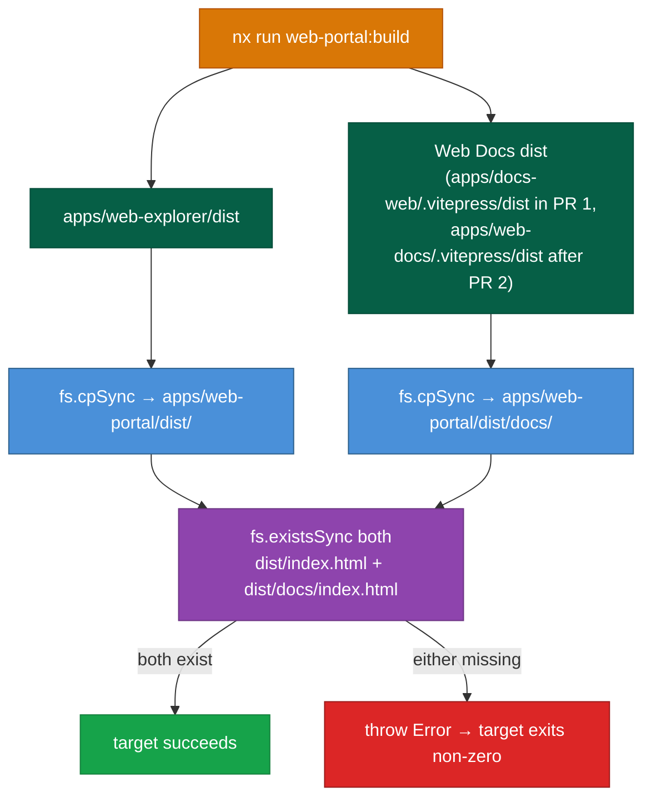
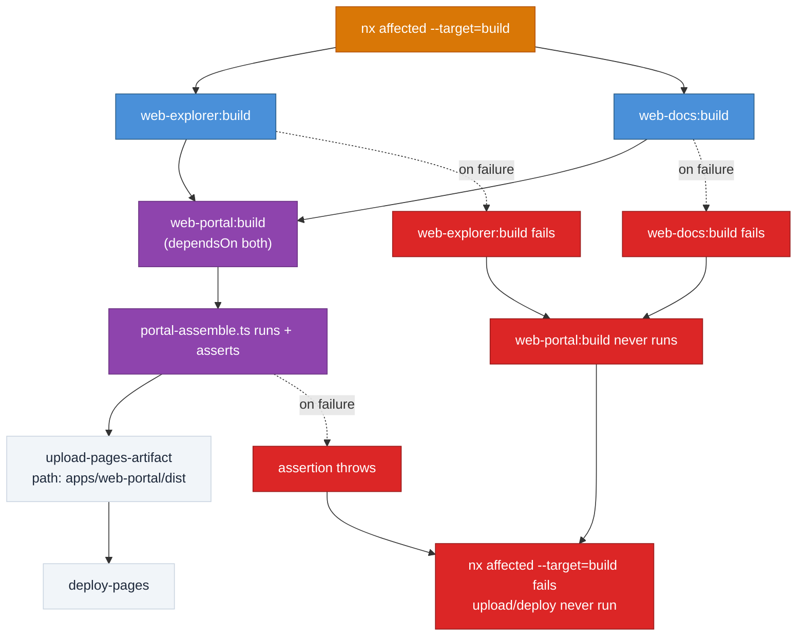

# DESIGN-20261108-1L8P — Solution Design

Every decision below already appears in `solution/Architecture.md`'s decision register; this document only adds the implementation shape.

## `apps/web-portal/project.json` shape

```json
{
  "name": "web-portal",
  "projectType": "application",
  "root": "apps/web-portal",
  "sourceRoot": "",
  "implicitDependencies": ["web-explorer", "web-docs"],
  "targets": {
    "build": {
      "executor": "nx:run-commands",
      "dependsOn": ["web-explorer:build", "web-docs:build"],
      "cache": true,
      "outputs": ["{projectRoot}/dist"],
      "options": {
        "command": "tsx scripts/ci/portal-assemble.ts"
      }
    }
  }
}
```

`implicitDependencies` creates the project-graph edge `nx affected` walks — this repo's own existing pattern (`apps/docs-web/project.json` already declares `"implicitDependencies": ["docs"]`). The target-level `dependsOn` is a separate, task-graph-only ordering: it makes `web-explorer:build`/`web-docs:build` run before `web-portal:build` once that target is invoked, but does not by itself mark `web-portal` affected — both are required together. `tsx` matches this repo's existing pattern for root-level TypeScript automation (`scripts/bootstrap/bootstrap-client.mts`), rather than `node` against a compiled script.

## `scripts/ci/portal-assemble.ts` behavior



The script reads two fixed source paths — `apps/web-explorer/dist`, and Web Docs's dist path (`apps/docs-web/.vitepress/dist` in PR 1, `apps/web-docs/.vitepress/dist` after PR 2's rename). It copies the first into `apps/web-portal/dist/` and the second into `apps/web-portal/dist/docs/`, using `fs.cpSync(src, dest, { recursive: true })`. It then asserts both `dist/index.html` and `dist/docs/index.html` exist via `fs.existsSync`, throwing a descriptive `Error` — not just logging — if either is missing. This is what makes the Nx build target fail loudly rather than silently uploading an incomplete artifact.

## CI run: full sequence including the failure branch



## Failure/recovery

If either source build (`web-explorer` or `web-docs`) fails, Nx's `dependsOn` means `web-portal:build` never runs — the assemble script never executes against a partial or missing source tree. If the assemble script's own assertion fails, the Nx target exits non-zero, `nx affected --target=build` fails in `cd.yml`, and `upload-pages-artifact`/`deploy-pages` never run — production is never updated with a broken artifact.

## Configuration changes

| File                                                                                           | Change                                                                                                                                                                                                                                                                                                                           |
| ---------------------------------------------------------------------------------------------- | -------------------------------------------------------------------------------------------------------------------------------------------------------------------------------------------------------------------------------------------------------------------------------------------------------------------------------- |
| `apps/web-explorer/vite.config.ts`                                                             | Add `base: '/<repo>/'` — the literal value is tokenized the same way Web Docs's `config.ts` already tokenizes its base path; no hardcoded repo name.                                                                                                                                                                             |
| `apps/docs-web/.vitepress/config.ts` (renamed to `apps/web-docs/.vitepress/config.ts` in PR 2) | Change `base` from `/<repo>/` to `/<repo>/docs/`.                                                                                                                                                                                                                                                                                |
| `.github/workflows/cd.yml`                                                                     | `Build site` step keeps `yarn nx affected --target=build --configuration=ci --base=HEAD~1 --head=HEAD` unchanged — Nx's project graph correctly includes `web-portal` once its `implicitDependencies` is declared. `Upload artifact` step's `path` input changes from `apps/docs-web/.vitepress/dist` to `apps/web-portal/dist`. |

## Data and schema

No schema, event, or data changes. This solution introduces no persistent data or API surface.

## Accessibility and content

Web Explorer's existing scaffold already implements reduced-motion support, keyboard focus, and semantic headings per its own `IMPLEMENTATION_BRIEF.md`. Carried over unchanged, not re-specified here.
