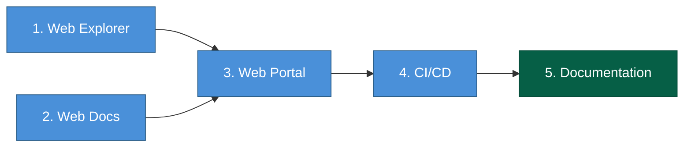

# DESIGN-20261108-1L8P — Efforts

## WBS

| #   | Summary                                                                                                                                                                                                                                                                                                                                                                                                                                                                                                                               | Type  | Layer         | Depends on |
| --- | ------------------------------------------------------------------------------------------------------------------------------------------------------------------------------------------------------------------------------------------------------------------------------------------------------------------------------------------------------------------------------------------------------------------------------------------------------------------------------------------------------------------------------------- | ----- | ------------- | ---------- |
| 1   | **Web Explorer:** spike Vite/TS compatibility with root (`^5.7.0`, Node 24) and pin `apps/web-explorer`'s ranges down from scaffold defaults; register the app (move scaffold from `design/reference/web-explorer/`, join root Yarn workspace, delete its standalone `package-lock.json`, add `project.json` mirroring `apps/docs-web/project.json`'s `build`/`typecheck`/`lint` targets, fix eslint conformance, add a bundle-size budget check); set `vite.config.ts`'s `base` to the tokenized GitHub Pages project-site root path | feat  | Web Explorer  | —          |
| 2   | **Web Docs:** change `.vitepress/config.ts`'s `base` from `/<repo>/` to `/<repo>/docs/` (PR 1); once PR 1 is verified live, rename `apps/docs-web` → `apps/web-docs` (directory, Nx project name, package name) as the mechanical PR 2 follow-up, updating `portal-assemble.ts`'s source path and `cd.yml`'s project reference accordingly                                                                                                                                                                                            | feat  | Web Docs      | —          |
| 3   | **Web Portal:** create the `apps/web-portal` Nx project (`project.json`, no source) with `implicitDependencies` on both apps (for `nx affected`) and a `build` target `dependsOn` both apps' `build` targets (for task ordering); write `scripts/ci/portal-assemble.ts` to copy both dist trees into `apps/web-portal/dist/` and assert both `index.html` files exist                                                                                                                                                                 | feat  | Web Portal    | 1, 2       |
| 4   | **CI/CD:** update `.github/workflows/cd.yml` — confirm `nx affected --target=build` covers `web-portal`, change `upload-pages-artifact` path to `apps/web-portal/dist`, verify `configure-pages` auto-detection against the merged artifact (add explicit Pages settings if it misbehaves); verify PR 1 in production (root serves Web Explorer, `/docs/` serves Web Docs, from one GitHub Pages deploy) before PR 2's rename lands                                                                                                   | feat  | CI/CD         | 3          |
| 5   | **Documentation:** update `Containers/Web.md` and add new container docs for Web Explorer and Web Portal (Publish-phase work, listed here for visibility, not executed in this stage)                                                                                                                                                                                                                                                                                                                                                 | chore | Documentation | 4          |

## Sequencing

Units 1 (Web Explorer) and 2 (Web Docs) run in parallel-capable branches and converge at unit 3 (Web Portal). Each unit still carries its internal PR1/PR2 sequencing and spike/verification steps as described in its own row — collapsing to layer-level units does not remove that detail, only the per-step ticket granularity.

## Migration and rollback

PR 1 (units 1–4's non-rename work) is revertible as a unit by reverting the single merge commit — production falls back to today's single-artifact VitePress-only deploy with no data to migrate back, since this solution introduces no persistent data. PR 2 (unit 2's rename half) is independently revertible — reverting it only undoes the directory/project rename, not the routing behavior PR 1 already shipped.

## Effort estimate

| #         | Description                                                     | Estimate |
| --------- | --------------------------------------------------------------- | -------- |
| 1         | Web Explorer: version spike, app registration, base-path config |          |
| 2         | Web Docs: base-path config (PR 1) + mechanical rename (PR 2)    |          |
| 3         | Web Portal: Nx project + `portal-assemble.ts`                   |          |
| 4         | CI/CD: `cd.yml` update + production verification                |          |
| 5         | Documentation: update architecture docs                         |          |
| **Total** |                                                                 |          |
