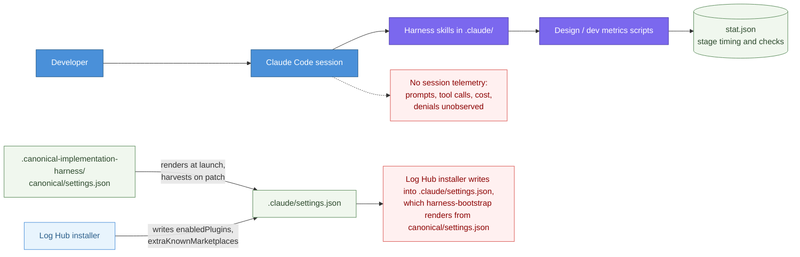

# DESIGN-20261115-V98J — Log Hub Session Telemetry Integration

## Problem

This repo develops with Claude Code through the Artisyn harness, but nothing captures what happens inside those sessions: prompts, tool calls, cost, context use, permission denials, subagent activity. The only telemetry today is the lifecycle-level `stat.json` written by the design and dev metrics scripts. It records stage timing and checks, not session content or cost. Artisyn Log Hub (https://github.com/DataArt/artisyn-log-hub) is a self-hosted observability platform for exactly this: a Claude Code hook plugin uploads session transcripts, OpenTelemetry metrics and a harness snapshot to a server the team runs. The developer wants to integrate it into this repo, most likely running the server locally at first. Two things make this non-trivial. First, other contributors need a defined path: a hook that uploads full transcripts cannot be silently switched on for them. Second, the setup must not touch the canonical harness in `.canonical-implementation-harness/`, which this repo releases as a versioned ZIP and bootstraps into other projects. The Log Hub installer merges `enabledPlugins` and `extraKnownMarketplaces` keys into the committed `.claude/settings.json`. The bootstrap renders and harvests that same file from `canonical/settings.json`. The two collide by default.

**Current state:**

## Success

### Known ECs

Evaluation criteria from the developer's own words.

- EC1: Claude Code sessions in this repo are captured in Log Hub: transcripts, tool calls, OTEL cost/context metrics and harness snapshot.
- EC2: The developer can run the Log Hub server locally (Docker Compose on their own machine) and point this repo's hook at it.
- EC3: Other contributors have a defined path. They can join the same telemetry setup, or stay out, without the repo breaking for them either way.
- EC4: The setup has no impact on the canonical harness. `.canonical-implementation-harness/` content, `/harness-bootstrap launch` output and `patch harvest` results are byte-for-byte unaffected by the Log Hub integration.

### Proposed ECs

Each item below is a proposal for the developer to accept or reject.

- [proposed] EC5 Security (NFR-11, P1): no Log Hub credential is ever committed. The API key lives only in the gitignored `.artisyn/config/log-hub.local.json`. The Gitleaks CI gate stays green.
- [proposed] EC6 Consent and zero-upload default: a fresh clone uploads nothing. A contributor without a local API key and server URL has the hook record locally at most, or not run at all. Contributors are told what is collected (full unredacted transcripts, file contents, command output, CLAUDE.md/skills/MCP config, git user name, absolute paths) before they are invited to install, in a committed Engineering Guide article.
- [proposed] EC7 Reversibility and verification: the hook's uninstall returns the repo to its pre-hook state. A repeatable check (an existing harness-bootstrap E2E layer or a diff of launch output) proves EC4 rather than asserting it.
- [proposed] EC8 Tamper surface: the tracked `.artisyn/config/log-hub.json` cannot redirect contributors' uploads to a different server without review. `serverUrl` stays in the local file, and changes to the tracked config are called out in review. The hook's own trust model warns "anyone who can commit controls the hook".
- [proposed] EC9 Conventions: the integration is documented in the Engineering Guide alongside MCP Setup. The repo's `yarn`-only convention is reconciled with the installer being an `npx` one-liner: either an explicit documented exception for a one-off tool run, or a `yarn dlx` equivalent.

## Decisions

This Frame bundles two decisions, confirmed at Frame Step 2. Each gets its own Research → Evaluate → Solution loop.

| #   | Decision                                                                                                                                                                                                                                                                                                                                   | Why it's independent                                                                                                                                                                                                                                                                                                                                     |
| --- | ------------------------------------------------------------------------------------------------------------------------------------------------------------------------------------------------------------------------------------------------------------------------------------------------------------------------------------------ | -------------------------------------------------------------------------------------------------------------------------------------------------------------------------------------------------------------------------------------------------------------------------------------------------------------------------------------------------------- |
| 1   | **Server topology** — where the Log Hub server runs for this repo's contributors: local Docker Compose per developer, one shared team instance (VM behind VPN, password auth, HTTPS), or hybrid (local by default, shared instance optional).                                                                                              | Its options are about hosting, auth mode, data custody and retention. It can be chosen and later changed without changing what files the repo commits.                                                                                                                                                                                                   |
| 2   | **Repo integration footprint and canonical isolation** — which Log Hub files are committed versus gitignored (`.artisyn/marketplace/`, `.artisyn/config/log-hub.json`, the `enabledPlugins`/`extraKnownMarketplaces` keys in `.claude/settings.json`), and how those keys are kept out of `/harness-bootstrap launch` and `patch harvest`. | Its options are about git layout, Claude Code plugin registration scope (project vs user level) and bootstrap exclusion rules. They hold regardless of which server a contributor points at. Contributor onboarding and consent (EC6, EC8) ride on this decision rather than forming a third one, because they are fixed by what a fresh clone contains. |

## Boundaries

**In scope:**

- Where the Log Hub server runs for this repo's contributors (local per developer, shared team instance, or both) and how a contributor connects to it.
- Which Log Hub files land in the repo (committed vs gitignored), and how the hook's `.claude/settings.json` keys are isolated from the canonical harness and the bootstrap launch/harvest flow.
- Contributor onboarding and disclosure documentation in `docs/Engineering Guide/`.
- A new HLD container document under `docs/Target Architecture (HLD)/v1/Containers/` describing Log Hub session telemetry as dev tooling, in the same shape as `Harness Bootstrap E2E.md`.
- The Node/Docker prerequisites added for contributors who opt in.

**Out of scope:**

- Running or hosting a Log Hub server as part of this platform's deployed site. GitHub Pages, Web Portal, Web Docs and Web Explorer are untouched.
- Changing Log Hub itself (upstream repo).
- Shipping Log Hub as a feature of the canonical harness for consumer projects. That would be a separate Product-track design under `docs/Harness/`.
- Codex and Copilot providers. The hook is a Claude Code plugin only.
- Replacing the design/dev `stat.json` lifecycle metrics. Log Hub is complementary session-level telemetry.
- Server-side analytics configuration, team budgets and retention policy tuning beyond what contributor onboarding needs.

## Constraints

| Constraint              | Detail                                                                                                                                                                                                                                                                                                                                   | Source                                                              |
| ----------------------- | ---------------------------------------------------------------------------------------------------------------------------------------------------------------------------------------------------------------------------------------------------------------------------------------------------------------------------------------- | ------------------------------------------------------------------- |
| Canonical settings      | `.canonical-implementation-harness/canonical/settings.json` is a provider-neutral document rendered into `.claude/settings.json` at `/harness-bootstrap launch`. `patch harvest` treats that file as a derivation. Keys the Log Hub installer writes there are at risk of being harvested into the canonical ZIP or clobbered on launch. | `canonical/manifest.json` maps `settings` → `.claude/settings.json` |
| Installer write targets | OTEL env keys go to the user-level `~/.claude/settings.json` and are mirrored into the gitignored `.claude/settings.local.json`. Only the plugin/marketplace keys go to the committed `.claude/settings.json`. The hook's own `.artisyn/config/.gitignore` ignores `log-hub.local.json`.                                                 | Log Hub `hook/INSTALL_HOOK.md`                                      |
| Public repository       | Anything committed, including `.artisyn/marketplace/` plugin scripts and `.artisyn/config/log-hub.json`, is world-readable.                                                                                                                                                                                                              | Repo visibility                                                     |
| NFR-11 (P1)             | No secrets in git. Gitleaks scans history on every PR and push to `main`.                                                                                                                                                                                                                                                                | `Non-Functional Concerns/Requirements.md`                           |
| NFR-10                  | This platform's own logging must not capture tokens. A session that reads `.claude/settings.local.json` sends its contents to the Log Hub server, because the hook does not redact.                                                                                                                                                      | `Non-Functional Concerns/Requirements.md`; Log Hub `hook/README.md` |
| Repo conventions        | `yarn` only, never `npm`/`npx`. Region must not be hardcoded (relevant if a shared server is ever cloud-hosted).                                                                                                                                                                                                                         | `CLAUDE.md`                                                         |
| Toolchain               | Repo pins Node 24 (`.nvmrc`). The hook requires Node 22/24/26 at current security patch levels. The server requires Docker Engine with Compose v2.                                                                                                                                                                                       | `.nvmrc`; Log Hub `hook/README.md`, `user-docs/install-server.md`   |
| Hook behaviour          | Without `apiKey` or `serverUrl` the hook records locally and uploads nothing. Server install starts in `AUTH_MODE=none`, acceptable only for a single developer on their own machine. A shared server must use password auth and HTTPS.                                                                                                  | Log Hub `hook/README.md`, `user-docs/small-team-setup.md`           |
| Privacy and employment  | Log Hub's docs require that contributors be informed before the hook is installed in their projects.                                                                                                                                                                                                                                     | Log Hub `user-docs/trust-model.md`                                  |
| Tracker                 | No tracker ticket. This is local ID DESIGN-20261115-V98J.                                                                                                                                                                                                                                                                                | `design/Report.md`                                                  |

## Links

- Ticket: DESIGN-20261115-V98J (local ID, no Jira record)
- Related tickets: none
- Reference docs: `docs/Target Architecture (HLD)/v1/System Overview.md`; `docs/Target Architecture (HLD)/v1/Non-Functional Concerns/Requirements.md` (NFR-10, NFR-11); `docs/Engineering Guide/05 Getting Started.md`; `docs/Engineering Guide/06 MCP Setup.md`; `.canonical-implementation-harness/canonical/settings.json`; Log Hub `hook/INSTALL_HOOK.md`, `hook/README.md`, `user-docs/small-team-setup.md`, `user-docs/install-server.md`, `user-docs/trust-model.md`.
