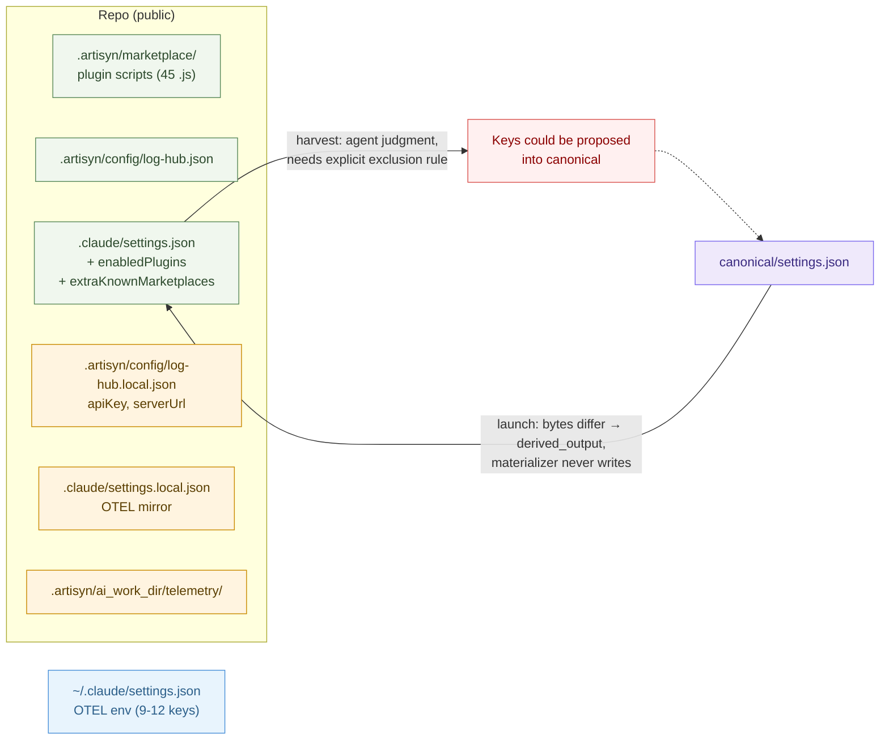
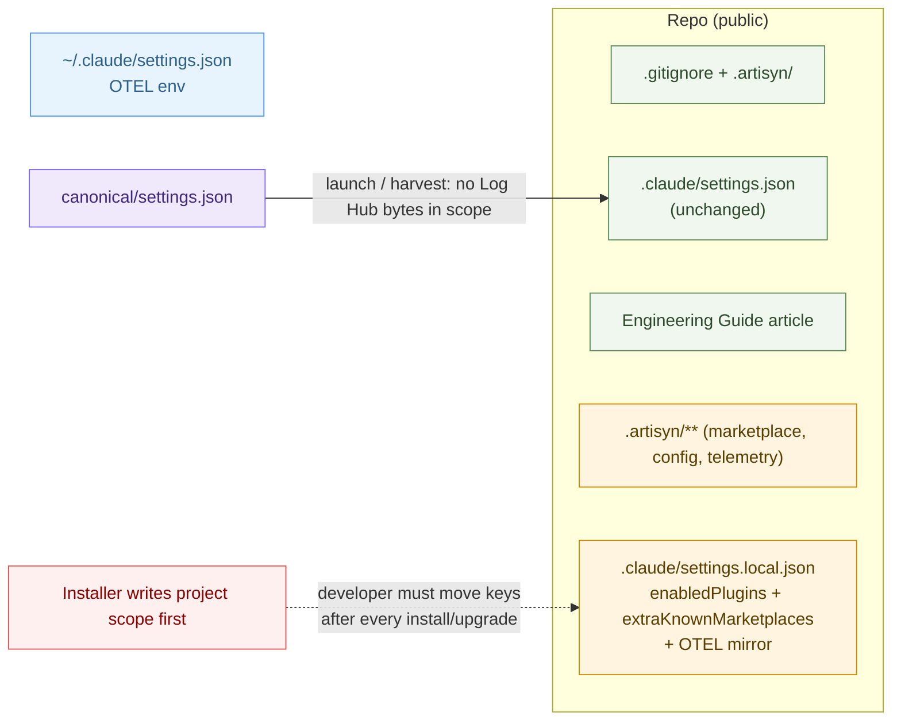
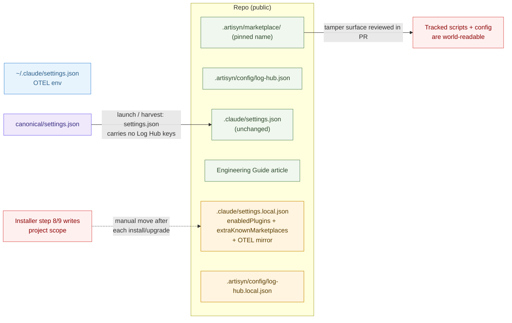
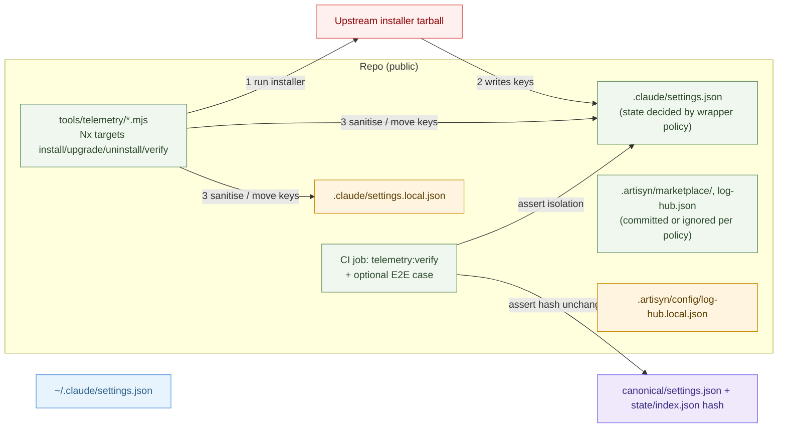
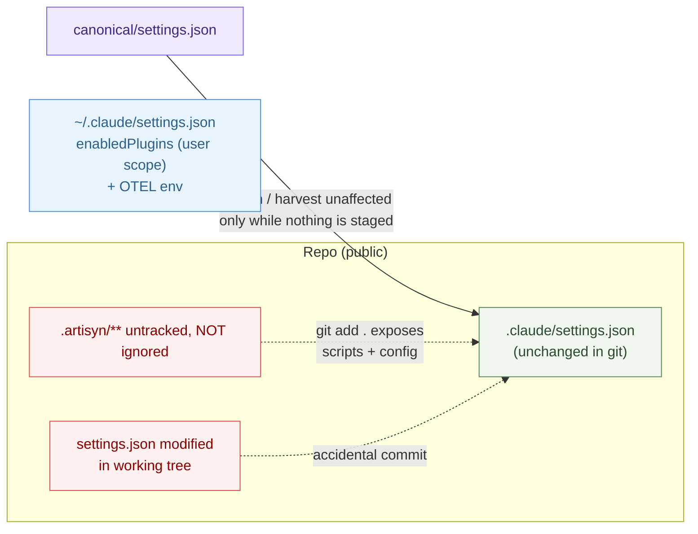

# DESIGN-20261115-V98J: Log Hub Session Telemetry Integration — Research: Repo integration footprint and canonical isolation

_Produced by the 🔍 Research phase. Owned by `@architect`. Do not edit after Evaluate phase begins._

## Context

This decision fixes three things: what a fresh clone contains after Log Hub is integrated, where the plugin registration lives, and how `/harness-bootstrap launch` and `patch harvest` stay byte-for-byte unaffected (EC4). Where the Log Hub server runs is the sibling decision in `01 Research - Server topology.md`. The evaluation criteria (EC1–EC9) are defined in `00 Frame.md`.

Files read: `00 Frame.md`; `.claude/settings.json`; `.gitignore`; `.canonical-implementation-harness/canonical/settings.json`; `.canonical-implementation-harness/scripts/plan-provider-launch.mjs`; `.claude/skills/harness-bootstrap/references/patch/04-patch-harvest.md`; `apps/harness-bootstrap-e2e/src/tests/integration/boot-005-preserve-existing-settings.test.ts`; `docs/Engineering Guide/06 MCP Setup.md`; upstream `hook/INSTALL_HOOK.md`; Claude Code plugin and settings reference.

Verified facts:

| Fact                                                                                                                                                                                                                                                                                                                                                                                                                                                                                                                       | Evidence                                                                                                                                              |
| -------------------------------------------------------------------------------------------------------------------------------------------------------------------------------------------------------------------------------------------------------------------------------------------------------------------------------------------------------------------------------------------------------------------------------------------------------------------------------------------------------------------------- | ----------------------------------------------------------------------------------------------------------------------------------------------------- |
| The installer (1.0.75+, hook 2.31.x) extracts `.artisyn/marketplace/`, writes tracked `.artisyn/config/log-hub.json` and gitignored `log-hub.local.json` (via its own `.artisyn/config/.gitignore`), merges `enabledPlugins["log-hub-hooks@artisyn-<hash>"]` and `extraKnownMarketplaces["artisyn-<hash>"].source.path` into committed `.claude/settings.json` (writing a `.bak`), then runs `claude plugin marketplace add ./.artisyn/marketplace` and `claude plugin install … --scope project`. The scope is hardcoded. | upstream `hook/INSTALL_HOOK.md` steps 5–9                                                                                                             |
| Marketplace name is `artisyn-<first 8 hex of sha256(normalised origin URL)>`. A name already present in a committed `marketplace.json` is reused. A fork with a different origin gets a different hash unless `marketplace.json` is committed.                                                                                                                                                                                                                                                                             | `INSTALL_HOOK.md` step 5                                                                                                                              |
| OTEL env keys go to `~/.claude/settings.json` (user scope) and are mirrored to gitignored `.claude/settings.local.json`. Claude Code 2.1.282+ reads OTEL only from user or managed scope. The sandbox has 2.1.274.                                                                                                                                                                                                                                                                                                         | `INSTALL_HOOK.md` "The OTEL env block"; `claude --version`                                                                                            |
| Claude Code supports `claude plugin install --scope user\|project\|local` and `marketplace add --scope …`. Local scope writes `enabledPlugins` to `.claude/settings.local.json`. `extraKnownMarketplaces` is accepted in any settings file. Precedence: local > project > user.                                                                                                                                                                                                                                            | `claude plugin … --help`; code.claude.com `plugins/install.md`, `settings-reference.md`                                                               |
| Uninstall removes `.artisyn/marketplace/` and `.artisyn/config/`, surgically removes the two keys from `.claude/settings.json`, and removes the OTEL keys it owns from `settings.local.json`. It does not remove plugin keys from `settings.local.json`.                                                                                                                                                                                                                                                                   | `INSTALL_HOOK.md` "3. Uninstall"                                                                                                                      |
| Bootstrap launch: `planConfigOutputs()` compares the canonical rendering of `settings` with the existing `.claude/settings.json` bytes. Any difference → `derived_output`, never written by `materialize-launch.mjs`. This repo's file already differs (permissions, hooks), so it is already a reserved derivation.                                                                                                                                                                                                       | `.canonical-implementation-harness/scripts/plan-provider-launch.mjs:155-181`; `01b-launch-install.md` Block C; `state/operations/59753801-….json:898` |
| Harvest is agent-driven. It compares a registered permanent file with its baseline and asks the orchestrator to "separate reusable behavior from project-only customizations". There is no mechanical exclusion list for settings keys. `canonical/settings.json` is registered.                                                                                                                                                                                                                                           | `references/patch/04-patch-harvest.md` §1–2; `06-patch-state.md`; `registry.md:91`                                                                    |
| E2E `BOOT-005` asserts only that an existing settings file is planned as `derived_output` and its bytes are untouched at materialize. No exact-content assertion. No harvest case.                                                                                                                                                                                                                                                                                                                                         | `apps/harness-bootstrap-e2e/src/tests/integration/boot-005-preserve-existing-settings.test.ts:30-43`                                                  |
| The repo gitignores `.claude/settings.local.json` and `*.bak`, with precedent for ignoring specific `.claude/skills/*`. No `.artisyn/` entry. No `.claude/.gitignore`.                                                                                                                                                                                                                                                                                                                                                     | `.gitignore:19,38,52-53`                                                                                                                              |
| Engineering Guide precedent: credentials only in `.claude/settings.local.json` env; "preserve any other keys already there".                                                                                                                                                                                                                                                                                                                                                                                               | `06 MCP Setup.md:25,65`                                                                                                                               |
| `yarn@4.9.2`, `nodeLinker: node-modules`; `npx` is forbidden. `yarn dlx <tarball-url>` is unverified.                                                                                                                                                                                                                                                                                                                                                                                                                      | `package.json:9`; `.yarnrc.yml:1`                                                                                                                     |
| Nx projects exist only under `apps/`. There is no `tools/`.                                                                                                                                                                                                                                                                                                                                                                                                                                                                | `ls apps/`                                                                                                                                            |

Diagram legend for every option below: green = committed; amber = gitignored; blue = user home; purple = canonical bootstrap package; red = collision or risk.

## Options

### Option A — Upstream default: commit everything the installer writes

**Description:** Run the installer as documented. Commit `.artisyn/marketplace/`, `.artisyn/config/log-hub.json`, `.artisyn/config/.gitignore`, and the two keys in `.claude/settings.json`. Rely on the existing reserved-derivation behaviour at launch. Add an explicit written harvest exclusion rule (bootstrap state or registry note): `enabledPlugins` and `extraKnownMarketplaces` are project-only and never promoted to canonical. Contributors run `claude plugin install log-hub-hooks@artisyn-<hash> --scope project` once per clone and add their own `log-hub.local.json`.

**Industry precedent:** Husky and lint-staged committed hook config with `prepare`; committed `.vscode/extensions.json`; Nx/Turbo workspace tooling config. Claude Code project scope is designed for this.

**Diagram:**

**Pros:**

- Zero deviation from upstream. Install, upgrade and uninstall work as documented and are idempotent.
- One `claude plugin install` per contributor.
- The marketplace name is pinned by the committed `marketplace.json`, so forks reuse it.
- Launch isolation already holds.
- Smallest doc burden.

**Cons:**

- Harvest isolation rests on orchestrator judgment plus a written rule.
- Commits about 45 unsigned third-party JS files into a public repo. "Anyone who can commit controls the hook" applies to every contributor's machine.
- Every contributor with the plugin enabled but no key still has 15 hooks executing on every event (local records only).
- Two OTEL write targets on Claude Code below 2.1.282.

**Unknowns / risks:**

- Whether a future harvest proposes the two keys into canonical unnoticed. There is no harvest E2E.
- Whether `--scope project` on a fresh clone prompts for trust of a path marketplace.

**Bearing on ECs:**

- EC4: launch yes; harvest only with the new written rule.
- EC5 yes: step 7 hard-aborts if the local file is tracked.
- EC6: a fresh clone enables the plugin for everyone and uploads nothing, but hooks run. Consent must precede `claude plugin install`.
- EC7: surgical uninstall. Verify = settings diff + clean `.artisyn/` status.
- EC8: tracked config and scripts are PR-reviewed; `serverUrl` stays local.
- EC9: `npx` exception or a verified `yarn dlx`.

---

### Option B — Per-developer only: gitignore `.artisyn/` entirely, register the plugin in local scope

**Description:** Add `.artisyn/` to `.gitignore`. Each opting-in contributor runs the installer, then moves the registration out of the committed file: restore `.claude/settings.json` from `.bak`, run `claude plugin marketplace add ./.artisyn/marketplace --scope local` and `claude plugin install … --scope local`. Nothing Log-Hub-related is committed. The Engineering Guide documents the steps and the disclosure.

**Industry precedent:** direnv `.envrc.local`; `git config --local` and `core.hooksPath`; `.vscode/settings.json` kept out of git; pre-commit writing to `.git/hooks`.

**Diagram:**

**Pros:**

- EC4 is mechanically true: no Log Hub bytes in any file the bootstrap reads.
- No third-party scripts or server hints in the public repo.
- The EC8 surface collapses to each developer's disk.
- A fresh clone has no plugin, hooks or marketplace.

**Cons:**

- Fights the installer. Every install and upgrade rewrites `.claude/settings.json` and runs `--scope project`; the undo is manual each time.
- Uninstall expects the keys in `.claude/settings.json` and leaves `settings.local.json` plugin keys behind.
- A local-scope `extraKnownMarketplaces` relative path is unverified.
- Dirty-tree risk: an accidental commit reintroduces A without its rule.

**Unknowns / risks:**

- Whether `--scope local` registers a path marketplace and survives `claude plugin update` (OQ-3).
- Whether `upgrade` re-adds the project key (OQ-8).

**Bearing on ECs:**

- EC4 strongest. EC5 unchanged, plus `.artisyn/` ignored. EC6 by construction.
- EC7 reversible, but no repo-side proof.
- EC8: no tracked config. EC9: same `npx` tension.

---

### Option C — Commit the marketplace and tracked config; keep `.claude/settings.json` clean via local scope

**Description:** Commit `.artisyn/marketplace/`, `.artisyn/config/log-hub.json` and `.artisyn/config/.gitignore`, so every clone has identical plugin code and shared settings, but not the two keys. After the installer runs, restore `.claude/settings.json` from `.bak` and register with `--scope local` (keys land in gitignored `.claude/settings.local.json`). An Engineering Guide article sits alongside `06 MCP Setup.md`.

**Industry precedent:** pre-commit commits `.pre-commit-config.yaml` with a per-clone `pre-commit install`; `.vscode/settings.json` plus `*.local.json`; Nx commits `nx.json` while `.nx/` is ignored; `.npmrc` committed, `~/.npmrc` for tokens.

**Diagram:**

**Pros:**

- `.claude/settings.json` stays identical to today.
- Shared plugin code and `otelTraces` / context settings are consistent. The marketplace name is pinned.
- A fresh clone has the code on disk but no registration. No hooks run.

**Cons:**

- Same installer-fighting cost as B on every install and upgrade.
- Uninstall leaves `settings.local.json` plugin keys behind.
- Still commits about 45 unsigned third-party scripts publicly.
- Two sources of truth for "installed here".

**Unknowns / risks:**

- Same local-scope path-marketplace question as B.
- Upgrade behaviour without the project key.

**Bearing on ECs:**

- EC4: settings untouched; `.artisyn/` is not a registered bootstrap path, so harvest never sees it.
- EC5 unchanged. EC6: a fresh clone runs nothing.
- EC7 reversible; verifiable with `git diff --exit-code .claude/settings.json` in CI.
- EC8: tracked config and scripts are reviewable; `serverUrl` stays local. EC9: same tension.

---

### Option D — Repo-owned wrapper: Nx target that runs the installer, re-sanitises settings, plus a CI/E2E guard

**Description:** A new Node script (new Nx project such as `tools/telemetry` or `apps/log-hub`, or a root `package.json` script) exposed as `yarn nx run telemetry:install|upgrade|uninstall|verify`. `install` runs the upstream installer (via `yarn dlx` if verifiable, else one documented `npx` exception inside the script), then post-processes per the policy chosen in Evaluate: keep the keys A-style, or move them to local scope C-style. `verify` asserts canonical isolation: `.claude/settings.json` contains no (or exactly the allowed) plugin keys, tracked `log-hub.json` has no `serverUrl` or `apiKey`, and the `canonical/settings.json` hash matches `state/index.json`. It runs in CI and optionally as a new deterministic harness-bootstrap-e2e integration case. The developer's brain-dump adds that the same Nx project could also download the Log Hub server release and run it locally via `yarn nx run log-hub:serve`; that is Option F in `01 Research - Server topology.md`.

**Industry precedent:** Husky `prepare` wrapping hook install; Nx executors wrapping third-party CLIs; `turbo gen`; config-drift CI jobs; `pre-commit run --all-files` as a CI gate.

**Diagram:**

**Pros:**

- Turns EC4 and EC7 into machine-checked properties.
- Closes A's "harvest is judgment" gap and B/C's "manual key move" gap.
- Resolves EC9 in one sanctioned invocation.
- Composable with A, B or C for the file layout.

**Cons:**

- New code to own.
- Tracks upstream installer internals (step semantics, key names, `.bak`) and breaks silently on upstream change.
- Adds an Nx project and a CI job for tooling only some contributors use.
- A "no `enabledPlugins`" assertion is fragile if other project-scope plugins are adopted later.
- Running a remote tarball from a repo script is still remote code execution. Upstream publishes no sha256.

**Unknowns / risks:**

- `yarn dlx <tarball-url>` viability (OQ-4).
- Feasibility of a deterministic harvest E2E. Today only launch is stubbed (`runStubbedLaunch`); the harvest guard may need to be a plain CI script.

**Bearing on ECs:**

- EC4 strongest verifiability. EC5: `verify` greps the tracked config.
- EC6: the wrapper can print the disclosure and require confirmation.
- EC7: `uninstall` then `verify`. EC8: CI diff check on `log-hub.json`. EC9 by construction.

---

### Option E — Nothing in the repo: personal user-level install only

**Description:** The repo commits nothing beyond a one-line pointer. The developer installs in their own clone and either keeps the `.claude/settings.json` edit unstaged forever, or registers at user scope so the plugin is on for every repo on their machine. `.artisyn/` stays untracked (not gitignored).

**Industry precedent:** Personal global git hooks (`core.hooksPath` in `~/.gitconfig`), `.gitignore_global`, user-level editor settings, dotfiles.

**Diagram:**

**Pros:**

- Zero repo change, maintenance or exposure by default.
- User scope covers every repo for that developer.

**Cons:**

- No defined contributor path: fails EC3 by construction. No disclosure article.
- User-scope registration of a project-relative marketplace path is ambiguous across repos. The installer's step 5 rationale shows upstream knew this.
- Permanent dirty tree and accidental-commit risk.
- No reversibility proof or verification.

**Unknowns / risks:**

- Whether user-scope `extraKnownMarketplaces` with a relative path resolves relative to cwd or to `~/.claude`.

**Bearing on ECs:**

- EC4 incidental. EC5 unchanged.
- EC6: a fresh clone runs nothing, but there is no committed disclosure.
- EC7 none. EC8: no tracked config, no review. EC9 undocumented.

---

## Comparison (unranked)

| Aspect                                            | A                            | B                    | C                    | D                         | E               |
| ------------------------------------------------- | ---------------------------- | -------------------- | -------------------- | ------------------------- | --------------- |
| Committed: `.artisyn/marketplace/`                | yes                          | no                   | yes                  | per policy                | no (untracked)  |
| Committed: `log-hub.json`                         | yes                          | no                   | yes                  | per policy                | no              |
| Committed: plugin keys in `.claude/settings.json` | yes                          | no                   | no                   | per policy                | no (dirty tree) |
| Plugin scope                                      | project                      | local                | local                | per policy                | user            |
| Launch isolation mechanism                        | existing derived-output      | no bytes in scope    | no bytes in scope    | asserted by `verify`      | incidental      |
| Harvest isolation mechanism                       | written rule, agent judgment | none needed          | none needed          | asserted by `verify` / CI | incidental      |
| Installer friction per install/upgrade            | none                         | revert + rescope     | revert + rescope     | automated                 | revert          |
| Fresh clone runs hooks?                           | yes (local only, no upload)  | no                   | no                   | per policy                | no              |
| Public exposure of third-party scripts            | yes                          | no                   | yes                  | per policy                | no              |
| New repo code                                     | none                         | `.gitignore` + Guide | `.gitignore` + Guide | Nx project + CI           | none            |

## Open Questions

Proposed tier per `.claude/skills/design/patterns/design-oq-triage.md`: (V) Viability — the answer can disqualify an option; (E) Evaluation-input — affects cost or detail, not which options survive. The developer confirms or corrects each tag at sign-off.

| #     | Question                                                                                                                                                                                                                                                                                                                                                   | Owner                                                                                                                    |
| ----- | ---------------------------------------------------------------------------------------------------------------------------------------------------------------------------------------------------------------------------------------------------------------------------------------------------------------------------------------------------------- | ------------------------------------------------------------------------------------------------------------------------ |
| OQ-1  | (E) Does `patch harvest` ever propose `.claude/settings.json` keys beyond what canonical declares? Isolation today is agent judgment; the existing `hooks.PostToolUse` has not been harvested, which is precedent, not a guarantee. Decides whether A needs only a written rule or a mechanical gate (D).                                                  | Developer + `@architect`: dry-run harvest on a branch with the two keys; inspect the proposed canonical diff             |
| OQ-2  | (E) Does the E2E assert exact settings content anywhere? Verified: only `BOOT-005`, launch only, bytes untouched. No harvest case. Decides whether EC7's check reuses an E2E layer or needs a new case or CI script.                                                                                                                                       | `@architect` confirmed the current state; remaining: feasibility of a deterministic harvest case with `runStubbedLaunch` |
| OQ-3  | (V) Does `claude plugin install --scope local` plus `marketplace add ./.artisyn/marketplace --scope local` register a path marketplace correctly and load it from `extraKnownMarketplaces` in `settings.local.json`? The flags exist (2.1.274); a relative-path marketplace in local or user scope is untested. Decides feasibility of B, C and C-style D. | Developer: scratch clone; `claude plugin list`; confirm hooks fire                                                       |
| OQ-4  | (E) Does `yarn dlx <server-origin>/static/artisyn-hooks-installer.tgz install` work with Yarn 4.9.2? `dlx` needs the package `bin` name, which is not visible without a running server. Decides EC9.                                                                                                                                                       | Developer: once a server is up (Decision 1), run `yarn dlx -p <url> <bin>`                                               |
| OQ-5  | (E) The marketplace hash depends on the origin, and a committed `marketplace.json` name is reused. Does Claude Code tolerate a committed `enabledPlugins["log-hub-hooks@artisyn-<hash>"]` from the upstream origin when a fork contributor installs? Decides correctness of A and C for forks.                                                             | Developer: install in a fork clone with the marketplace committed                                                        |
| OQ-6  | (V) Is committing about 45 unsigned third-party JS files into a public repo acceptable ("anyone who can commit controls the hook")? Upstream publishes no tarball sha256 to pin. Gates A, C and committed-policy D.                                                                                                                                        | Developer; optionally `@product-architect`                                                                               |
| OQ-7  | (E) Should the public repo expose the team's server URL at all? The installer keeps `serverUrl` local (1.0.75+), but `log-hub.json` accepts it as a fallback and the Guide must name something. Decides EC8 and the disclosure wording; interacts with Decision 1.                                                                                         | Developer                                                                                                                |
| OQ-8  | (E) What does hook `upgrade` do when the project-scope key is absent (B, C)? Steps 8/9 "no-op if already up to date" implies it re-adds the key. Decides the recurring friction of B and C.                                                                                                                                                                | Developer: scratch-clone `upgrade` after moving the keys                                                                 |
| OQ-9  | (E) Does `uninstall` leave `enabledPlugins` in `.claude/settings.local.json` behind when registered at local scope? Upstream uninstall removes only OTEL keys from that file. Decides EC7 for B and C.                                                                                                                                                     | Developer: scratch-clone test                                                                                            |
| OQ-10 | (E) Does this repo's agent-e2e (which spawns Claude Code sessions in fixtures) pick up a project-scope plugin and start uploading fixture sessions under A? Does the installer honour `CLAUDE_CONFIG_DIR`? Risk: unintended telemetry from `yarn nx run harness-bootstrap-e2e:agent-e2e` fixture runs.                                                     | `@architect`: check fixture cwd and whether fixtures have `.claude/`; developer confirms at a live run                   |
