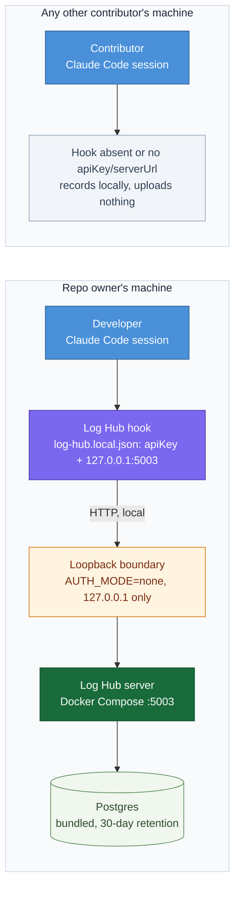
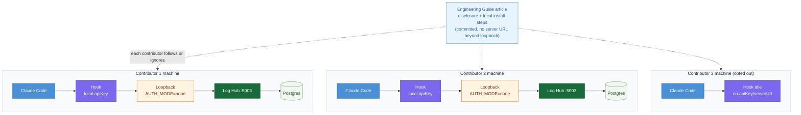
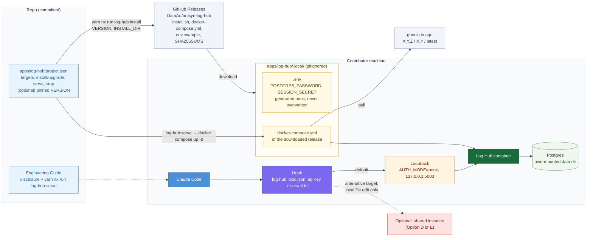
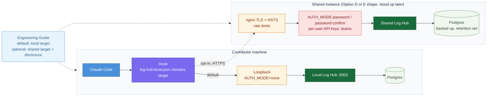
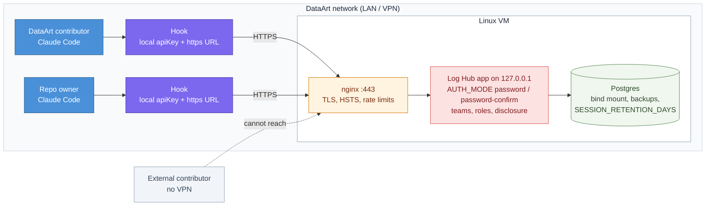
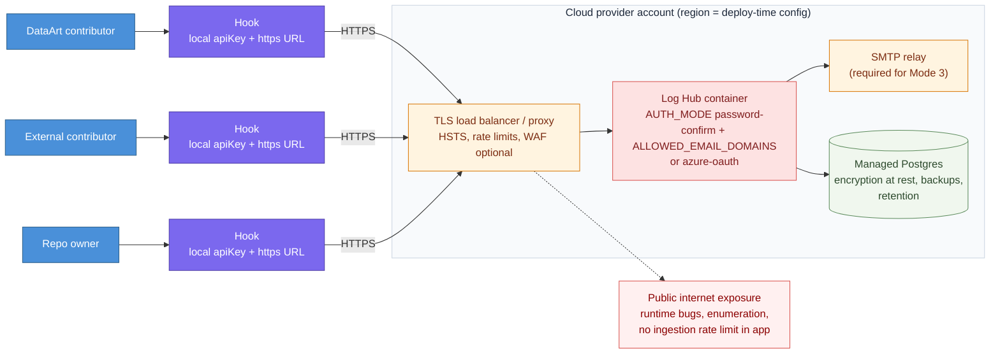

# DESIGN-20261115-V98J: Log Hub Session Telemetry Integration — Research: Server topology

_Produced by the 🔍 Research phase. Owned by `@architect`. Do not edit after Evaluate phase begins._

## Context

This decision covers one thing: where the Artisyn Log Hub server runs for this repo's contributors, and how each contributor's hook connects to it. Nothing in this file selects what the repo commits for the hook; that is the sibling decision in `01 Research - Repo integration footprint and canonical isolation.md`. The evaluation criteria (EC1–EC9) are defined in `00 Frame.md`.

Sources read: `00 Frame.md`; `Report.md` (Context, Evidence); `System Overview.md`; `Requirements.md` (NFR-10, NFR-11); upstream user docs `authentication-modes.md`, `server-configuration.md`, `security-hardening.md` (§1, 2, 4, 5, 6, 7, 9, 11), `small-team-setup.md`, `install-server.md`, release `install.sh` (all fetched 2026-11-15); `apps/harness-bootstrap-e2e/project.json`; `.gitignore`.

Facts that bound the options:

| Fact                                                                                                                                                                                                                                                                                                                                                                                                                                                                                            | Evidence                                               |
| ----------------------------------------------------------------------------------------------------------------------------------------------------------------------------------------------------------------------------------------------------------------------------------------------------------------------------------------------------------------------------------------------------------------------------------------------------------------------------------------------- | ------------------------------------------------------ |
| "No runtime compute we operate" applies to the deployed public site. Harness Bootstrap E2E is the precedent for dev tooling. A Log Hub server is dev tooling. None of the options touch GitHub Pages.                                                                                                                                                                                                                                                                                           | `System Overview.md`; `Report.md` Context              |
| NFR-11: the API key lives only in gitignored `.artisyn/config/log-hub.local.json`. Options differ in whether a server URL is ever committed.                                                                                                                                                                                                                                                                                                                                                    | `Requirements.md` NFR-11                               |
| NFR-10: the hook does not redact. A session that reads `.claude/settings.local.json` or `.env` uploads them. Upstream names Claude Code `permissions.deny` as the only source-side mitigation.                                                                                                                                                                                                                                                                                                  | `Requirements.md` NFR-10; `security-hardening.md` §6.3 |
| No `apiKey`/`serverUrl` → the hook records locally and uploads nothing. This zero-upload baseline is the same for every option (EC6).                                                                                                                                                                                                                                                                                                                                                           | upstream hook docs                                     |
| Auth modes: `none` (loopback only, install default), `password` (trusted network, SMTP optional), `password-confirm` (internet-reachable, SMTP required, `ALLOWED_EMAIL_DOMAINS`), `azure-oauth` (Entra ID, single tenant). First sign-in becomes admin.                                                                                                                                                                                                                                        | `authentication-modes.md`                              |
| Upstream supports an internet-reachable server (HTTPS + Mode 3 + allow-list, audited Oct 2026) but recommends company network only.                                                                                                                                                                                                                                                                                                                                                             | `security-hardening.md` §1, 2                          |
| Known limitations: no rate limit on ingestion or API-key routes; plain `http` to a non-local host sends transcripts and key unencrypted; `npx` installer has no checksum; `turnEndCostAdvisorModel` / `sessionAttributionLlmModel` in tracked `log-hub.json` are passed unvalidated to local `claude --model`; Windows shell invocation.                                                                                                                                                        | `security-hardening.md` §11                            |
| No at-rest encryption by the app; the operator can read the DB directly. Repos are private until shared via a team. Modes: restricted (default) vs transparent. Disclosure acknowledgement precedes team visibility. `SESSION_RETENTION_DAYS` default 30. Account deletion hard-deletes.                                                                                                                                                                                                        | `security-hardening.md` §5, 7, 9                       |
| Release `install.sh` honours `VERSION` (`latest` default or `X.Y.Z`) and `INSTALL_DIR` (default `$HOME/artisyn-log-hub`). It downloads `docker-compose.yml` and `env.example` of that release, generates `.env` with random secrets on first install only and never overwrites it, refuses to install a lower version (forward-only DB migrations; `FORCE=1` overrides), then runs `docker compose pull && up -d`. Release assets include `SHA256SUMS`. Image tags: `X.Y.Z` / `X.Y` / `latest`. | release `install.sh`; `install-server.md`              |
| Repo precedent for wrapper targets: `apps/harness-bootstrap-e2e/project.json` uses `executor: nx:run-commands` with `cwd: {projectRoot}`.                                                                                                                                                                                                                                                                                                                                                       | `apps/harness-bootstrap-e2e/project.json`              |

## Options

### Option A — Developer-only local server, nothing shared

**Description:** Only the repo owner runs Log Hub. `install.sh` installs into `$HOME/artisyn-log-hub`: Docker Compose with bundled Postgres, `AUTH_MODE=none`, bound to `127.0.0.1:5003`. The hook points at loopback through the owner's own gitignored `log-hub.local.json`. Contributors are not invited. A contributor's hook, if present, records locally at most. No team, no HTTPS, no SMTP.

**Industry precedent:** Jaeger all-in-one, `grafana/otel-lgtm`, Arize Phoenix local, Langfuse `docker compose` on a laptop, `mlflow ui` local. The pattern: developer-local sink, loopback is the boundary.

**Diagram:**

**Pros:**

- Zero shared infrastructure, cost or operator.
- Smallest disclosure footprint: the owner's own data only.
- Mode 1 loopback is the shipped default.
- No server URL in any committed file; contributors cannot be redirected.

**Cons:**

- EC3 is met only in its "stay out" half.
- EC1 holds for one person. No team analytics.
- The dataset sits on one laptop with no backup.
- Docker becomes a developer prerequisite.

**Unknowns / risks:**

- A developer who needs the server from more than one own machine breaks loopback.
- §11.1 container-gateway trust on a laptop that runs other containers.

**Bearing on ECs:**

- EC2 fully. EC3 partial. EC6 natural. EC8 minimal.

---

### Option B — Per-contributor local instances, no central server

**Description:** Same as A, but documented as the standard path for any contributor who opts in. Each contributor runs their own Log Hub locally in Mode 1 and points their hook at their own loopback. The Engineering Guide covers install, disclosure and the one-line hook install against `http://127.0.0.1:5003`. Data never leaves a machine. There is no shared dataset. The repo owns no files for the server; the install location, version and lifecycle are each contributor's own.

**Industry precedent:** MLflow's default per-developer local store; Phoenix and Langfuse local installs documented as optional dev tooling; per-machine OTEL collectors feeding a local Grafana.

**Diagram:**

**Pros:**

- Every contributor gets the developer's capability. No operator, cost or VPN. Works for externals.
- Each contributor is sole custodian of their data.
- The documented `serverUrl` is loopback.
- Repeatable steps.

**Cons:**

- No shared view.
- Multiplies the Docker prerequisite and the image-update chore.
- Each local server makes outbound npm, pricing and GitHub calls by default (§4.4). Three flags disable them.
- Install location and commands live outside the repo's `yarn nx run` convention. Contributors end up on different Log Hub versions with no repo-side knowledge of which.

**Unknowns / risks:**

- Whether any contributor will do it (doc debt).
- Windows shell-invoked `claude` post-turn risk (§11.2).

**Bearing on ECs:**

- EC2 yes. EC3 both halves. EC6 natural. EC8 small.

---

### Option F — Per-contributor local instance, repo-managed via an Nx wrapper project

**Description:** A new Nx project in this monorepo (working name `artisyn-log-hub`, at `apps/log-hub/` or `tools/log-hub/`) with `nx:run-commands` targets that wrap the upstream release. `log-hub:install` / `log-hub:upgrade` runs the release `install.sh` with `INSTALL_DIR` set to a gitignored directory inside the project (for example `apps/log-hub/.local/`) and, optionally, `VERSION` from a value committed in the repo. `log-hub:serve` runs `docker compose up -d` there. `log-hub:stop` runs `docker compose down`. The server is still the upstream Docker Compose stack with bundled Postgres in Mode 1 on `127.0.0.1:5003`, on the contributor's own machine. The repo owns only the wrapper (`project.json`, a small script, a README), never the downloaded compose file, `.env` or database. Every opting-in contributor gets an identical local instance through `yarn nx run log-hub:serve`. No central data. Contributors can still point their hook at a shared instance (D or E) by editing only `log-hub.local.json`, so F composes with C, D and E the way B does.

Version pinning has two sub-variants (unranked):

- **Pinned.** The repo commits `VERSION=X.Y.Z` (in `project.json` or a `log-hub.version` file). All contributors run the same release. Upgrades are a reviewed commit. `SHA256SUMS` is verifiable against a committed digest. Cost: a maintenance commit per upstream release, and the hook version must stay compatible with the pinned server (hook 2.31.1 today).
- **Always-latest.** `VERSION=latest`. Zero maintenance, but contributors drift and the repo cannot reproduce a contributor's server state. Forward-only migrations mean a contributor on a newer `latest` cannot be pinned back without `FORCE=1` and a DB that may not open.

**Industry precedent:** Repo-owned wrappers around a vendored dev stack: Supabase CLI `supabase start`; Nx/Turbo `dev:infra` targets that bring up Postgres/Redis; Make/Taskfile targets that download a pinned tool release into a gitignored `.tools/` (Terraform/kubectl pins, asdf/mise tool-versions); the Nx run-commands wrapper already used here for `harness-bootstrap-e2e`. Pin-vs-latest is the renovate-tracked image tag vs `:latest` trade-off.

**Diagram:**

**Pros:**

- Reproducible local instance through the repo's own `yarn nx run` convention. One command each to start, stop and upgrade.
- Removes `curl | sh` and the ad-hoc `$HOME` install from the contributor path.
- Still no central data, operator, cost or VPN. Works for externals.
- The pinned variant gives a reviewable, checksum-verifiable server version that B cannot.
- Install dir sits next to the project, so cleanup, `.gitignore` and docs are in one place. `.env` is already covered by `.gitignore`.
- Composes with C, D and E.

**Cons:**

- Adds a committed Nx project for dev tooling that runs Docker. It needs an HLD container doc, lint/typecheck exclusions, and a decision that its targets never run in CI (Docker is not in the CI toolchain).
- Docker Engine + Compose v2 becomes a documented contributor prerequisite. Windows needs WSL or Docker Desktop, and the wrapper would branch to `install.ps1`.
- The wrapper downloads and executes a remote shell script. Without `SHA256SUMS` verification it inherits the no-signature risk. Verification is extra code.
- Secrets in the repo tree: `.local/.env` holds `POSTGRES_PASSWORD` and `SESSION_SECRET`. Gitignored, but a session that reads it uploads it (NFR-10). The upstream `permissions.deny` mitigation would add `Read(./apps/log-hub/.local/**)` to `.claude/settings.json`, the file Decision 2 isolates.
- DB bind mount inside the repo tree: `git clean -fdx` deletes a contributor's telemetry history. Moving it out via `LOG_HUB_DATA_DIR` partly undoes the single-location benefit.
- Naming: `artisyn-log-hub` collides with the upstream product and the `$HOME/artisyn-log-hub` default. `log-hub` avoids that.
- Easy to start, also easy to forget running. Uploads queue against a stopped server, with only the hook's local queue behaviour as signal.

**Unknowns / risks:**

- `install.sh` behaviour with `INSTALL_DIR` inside a git working tree.
- Whether the Nx project graph (`nx affected`, cache, `namedInputs`) ignores `.local/`. `harness-bootstrap-e2e` already excludes `runs/**`.
- Whether the Compose project name derived from `.local` collides across repos, or with a hand-run `$HOME/artisyn-log-hub` on port 5003.
- Stability of `install.sh`'s `VERSION` / `INSTALL_DIR` interface.
- The `permissions.deny` edit touches `.claude/settings.json`. EC4 must be checked for it (Decision 2 territory).

**Bearing on ECs:**

- EC2 yes: the developer uses the same wrapper.
- EC3 both halves: join = `yarn nx run log-hub:serve` + hook install; stay out = never run it.
- EC6 natural, same disclosure article as B.
- EC8 small: the documented `serverUrl` is loopback. The new tamper surface is the wrapper itself, a committed script that downloads and runs upstream code, covered by code review like `log-hub.json`.

---

### Option C — Hybrid: local by default, optional shared instance

**Description:** Two documented targets. The default is a local Mode 1 instance (A or B shape), provisioned either by hand (Option B) or via the Nx wrapper (Option F). The optional target is a shared instance (D or E shape) that a contributor points their hook at by editing only the gitignored `log-hub.local.json`. Nothing in the repo selects the target. The Engineering Guide names both, with the disclosure attached to the shared one. The shared instance can be stood up later without changing committed files.

**Industry precedent:** Nx Cloud (`nx connect`, local cache otherwise), Turborepo remote cache, MLflow local until `MLFLOW_TRACKING_URI` is set, Sentry no-op without a DSN, OTEL SDK with no exporter endpoint.

**Diagram:**

**Pros:**

- The developer starts today (EC2) and defers the shared decision without reopening repo integration.
- Three contributor states: out, local, shared.
- Switching is a one-file local edit.
- Disclosure is attached only where it is needed.

**Cons:**

- Two paths mean two prerequisite and troubleshooting sets.
- A local dataset does not merge later; only manual export/import (§6.4).
- Inherits the chosen shared option's cons.
- A shared URL eventually appears in the Engineering Guide (committed), though never in tracked hook config.

**Unknowns / risks:**

- Whether deferring the shared choice is a decision or a reschedule of D vs E.
- The hook supports one target per repo.

**Bearing on ECs:**

- EC2 yes. EC3 all paths. EC6 natural.
- EC8: the committed docs URL is a review-visible vector; Evaluate call.

---

### Option D — Shared self-hosted instance inside the company network (upstream reference)

**Description:** One Linux VM inside the DataArt network (LAN/VPN only) runs the release Docker Compose stack with Postgres. nginx terminates TLS on the same VM and proxies to `127.0.0.1`, with `TRUST_PROXY` and `PUBLIC_BASE_URL` set. `AUTH_MODE=password` (Mode 2) or `password-confirm` (Mode 3, SMTP + `ALLOWED_EMAIL_DOMAINS`). The first sign-up becomes admin and invites the team. Each contributor has their own API key. A team is created for sharing. Disclosure acknowledgement precedes visibility. This is `small-team-setup.md` as written.

**Industry precedent:** Self-hosted Sentry, Langfuse self-hosted, internal Grafana/Prometheus, SonarQube, Nexus/Artifactory, GitLab self-managed.

**Diagram:**

**Pros:**

- Documented, audited upstream setup with checklist, `.env` and nginx config.
- A shared dataset enables team analytics, budgets and comparison.
- The network boundary limits exposure.
- Centralised retention, backup and upgrade.

**Cons:**

- Excludes contributors outside the DataArt network: a hard split of EC3 for a public repo.
- Needs an operator (VM, internal CA cert, patching, backups, admin, user review) and a payer.
- The URL becomes a committed Engineering Guide value and a redirection target.
- Multi-person transcripts in one DB are readable by the operator. Disclosure and a retention policy are mandatory.

**Unknowns / risks:**

- Whether DataArt already operates a Log Hub instance to join.
- Internal CA availability.
- SMTP relay availability decides Mode 2 vs Mode 3.

**Bearing on ECs:**

- EC2 not met alone (needs C). EC3 partial (network-gated).
- EC6 via in-app disclosure + article.
- EC8: documented `serverUrl` in docs; tracked `log-hub.json` controls post-turn model names.

---

### Option E — Cloud-hosted, internet-reachable instance

**Description:** The same image on a cloud provider (VM or container service) with managed Postgres via `DATABASE_URL`, a TLS-terminating proxy or load balancer with HSTS and rate limits, reachable from the internet. `AUTH_MODE=password-confirm` + `ALLOWED_EMAIL_DOMAINS`, or `azure-oauth`. Region is deploy-time configuration and is never written into this repo. Operated by the provider-account owner.

**Industry precedent:** Langfuse Cloud and Langfuse self-hosted on a cloud VM, Sentry SaaS, Grafana Cloud, Phoenix cloud, PostHog self-hosted on cloud; OSS shared backends (Codecov, Nx Cloud).

**Diagram:**

**Pros:**

- The only shared option with a join path for externals without VPN.
- Managed Postgres gives at-rest encryption and backups.
- Mode 3 allow-list or Entra ID is an audited gate.
- Decoupled from DataArt infrastructure and from any laptop.

**Cons:**

- Upstream discourages it for daily use: sensitive data plus runtime-bug exposure.
- No app-level ingestion rate limit; the proxy must supply one.
- Recurring cost and an operator.
- `ALLOWED_EMAIL_DOMAINS` re-excludes externals unless domains are added or guests arranged.
- Cross-border storage obligations.
- The region rule means the deployment cannot be described concretely in this repo.

**Unknowns / risks:**

- Which provider account and payer; whether the AWS MCP entry in `.mcp.json` implies an account.
- Whether a public-repo project with an unknown contributor population should store full transcripts at all.
- Entra ID single tenant blocks externals.

**Bearing on ECs:**

- EC2 not alone (needs C). EC3 universal in principle, allow-list gated.
- EC6 in-app disclosure + article.
- EC8: a public URL in committed docs is the largest redirection surface.

---

## Comparison (unranked)

| EC / attribute                     | A Developer-only local | B Per-contributor local, hand-run | F Per-contributor local, Nx wrapper                 | C Hybrid                  | D Shared internal VM       | E Cloud-hosted public                |
| ---------------------------------- | ---------------------- | --------------------------------- | --------------------------------------------------- | ------------------------- | -------------------------- | ------------------------------------ |
| EC2 local server for developer     | Yes, verbatim          | Yes                               | Yes, via `yarn nx run log-hub:serve`                | Yes (default path)        | No, unless combined with C | No, unless combined with C           |
| EC3 join path                      | None                   | Run your own (`install.sh`)       | Run your own (one Nx command)                       | Local or shared           | DataArt network only       | Any contributor, allow-list gated    |
| EC3 stay-out path                  | Default                | Default                           | Default (never run the target)                      | Default                   | Default                    | Default                              |
| EC6 zero-upload fresh clone        | Yes                    | Yes                               | Yes                                                 | Yes                       | Yes                        | Yes                                  |
| EC6 disclosure needed              | Developer only         | Self-disclosure article           | Self-disclosure article                             | Shared path only          | Required, multi-person     | Required, multi-person, cross-border |
| EC8 committed `serverUrl` anywhere | No                     | Loopback only in docs             | Loopback only in docs; wrapper script reviewable    | Shared URL in docs later  | Internal URL in docs       | Public URL in docs                   |
| Committed repo files for server    | None                   | None                              | Nx project, script, README, optional version pin    | Depends on local variant  | None (docs only)           | None (docs only)                     |
| Server version control             | Contributor's own      | Contributor's own                 | Pinned (reviewed) or always-latest                  | As local variant          | Operator                   | Operator                             |
| Contributor prerequisites          | n/a                    | Docker + Compose v2               | Docker + Compose v2 (documented in toolchain table) | Docker for local path     | VPN + hook only            | Hook only                            |
| Operator / payer                   | Developer              | Each contributor                  | Each contributor; repo maintains wrapper            | Developer, then shared op | DataArt IT or named person | Account owner                        |
| Upstream stance                    | Shipped default        | Shipped default                   | Shipped default, scripted via documented env vars   | Both documented           | Reference setup            | Supported, discouraged               |

## Open Questions

Proposed tier per `.claude/skills/design/patterns/design-oq-triage.md`: (V) Viability — the answer can disqualify an option; (E) Evaluation-input — affects cost or detail, not which options survive. The developer confirms or corrects each tag at sign-off.

| #     | Question                                                                                                                                                                                                                                                     | Owner                                       |
| ----- | ------------------------------------------------------------------------------------------------------------------------------------------------------------------------------------------------------------------------------------------------------------ | ------------------------------------------- |
| OQ-1  | (V) Who are the current and expected contributors, and are any outside DataArt's network or employment? Decides whether D's VPN gate is acceptable and whether E's allow-list excludes anyone.                                                               | Developer                                   |
| OQ-2  | (V) Is cross-developer visibility (team sharing, analytics, budgets) wanted, or is per-person self-review the goal? If the latter, A/B/F and C-local cover EC1 and the shared options carry only cost.                                                       | Developer                                   |
| OQ-3  | (V) Does DataArt already run a Log Hub instance that this repo's DataArt contributors could join?                                                                                                                                                            | Developer → DataArt / Log Hub maintainers   |
| OQ-4  | (V) For any shared option: who operates it (patching, backups, admin, user review) and who pays?                                                                                                                                                             | Developer, DataArt IT                       |
| OQ-5  | (E) For any shared option: what disclosure, legal basis and data-residency position applies to storing contributors' transcripts, file contents and git identities, including externals?                                                                     | Developer, DataArt legal/security           |
| OQ-6  | (E) Should post-turn `claude -p` analysis be enabled at all? It runs on each developer's own account and budget. The model name in tracked `log-hub.json` is unvalidated (§11.2). Interacts with the Decision 2 tracked-file review rule.                    | Developer; Evaluate                         |
| OQ-7  | (E) Retention: is the 30-day default acceptable, and who sets it per option?                                                                                                                                                                                 | Developer; operator for D/E                 |
| OQ-8  | (E) May a shared server URL appear in a committed file (Engineering Guide) given EC8? If not, how do contributors learn it?                                                                                                                                  | Evaluate                                    |
| OQ-9  | (V) Does the developer need the server from more than one own machine? If yes, loopback-only A/B/F is insufficient.                                                                                                                                          | Developer                                   |
| OQ-10 | (V) Is Docker Engine + Compose v2 an acceptable prerequisite for opting-in contributors (B/F and C-local), given the documented toolchain is Node 24 + Yarn?                                                                                                 | Developer; Evaluate                         |
| OQ-11 | (V) For E: which provider account? Does the AWS MCP entry in `.mcp.json` imply an existing intended account?                                                                                                                                                 | Developer                                   |
| OQ-12 | (E) For D/E: is an SMTP relay available (Mode 3 refuses to start without one)? Is an internal CA or public certificate obtainable?                                                                                                                           | DataArt IT / operator                       |
| OQ-13 | (E) For F: pin the release version in the repo or track `latest`? If pinned, who bumps it and how is hook-version compatibility checked (hook 2.31.1 vs server X.Y.Z)? Forward-only migrations mean a contributor on a newer `latest` cannot be pinned back. | Developer; Evaluate                         |
| OQ-14 | (E) For F: where do the install directory and Postgres bind mount live? Inside the project (`apps/log-hub/.local/`, deleted by `git clean -fdx`) or outside via `INSTALL_DIR` / `LOG_HUB_DATA_DIR` (loses the single-location benefit)?                      | Developer; Evaluate                         |
| OQ-15 | (E) For F: should the wrapper verify `SHA256SUMS` before running `install.sh`? Without it the wrapper is a committed `curl \| sh`.                                                                                                                           | Evaluate; implementation                    |
| OQ-16 | (E) For F: Windows support. Branch to `install.ps1`, require WSL, or document as unsupported?                                                                                                                                                                | Developer                                   |
| OQ-17 | (E) For F: does adding `Read(./apps/log-hub/.local/**)` to `permissions.deny` in `.claude/settings.json` (to keep the server `.env` out of transcripts, NFR-10) conflict with Decision 2's canonical isolation of that file and EC4?                         | Decision 2; Evaluate                        |
| OQ-18 | (E) For F: project name and location (`apps/log-hub/` vs `tools/log-hub/`; `log-hub` vs `artisyn-log-hub`), and exclusion from `nx affected` / CI so Docker is never required in `ci.yml`.                                                                   | Developer; Evaluate                         |
| OQ-19 | (E) For F: does `install.sh` behave with `INSTALL_DIR` inside a git working tree, and does the Compose project name collide with a hand-run `$HOME/artisyn-log-hub` on port 5003?                                                                            | Implementation spike before Evaluate closes |
