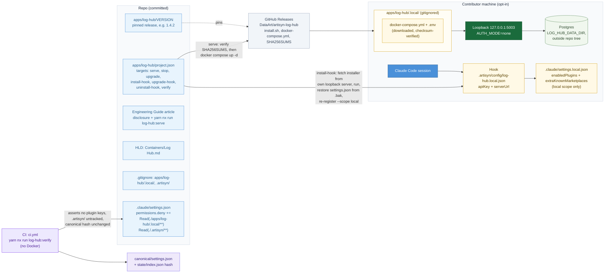

# Log Hub Session Telemetry Integration — Architecture

## Naming and location

The new Nx project is `log-hub`, at `apps/log-hub/`. It follows the same shape as `harness-bootstrap-e2e`. `apps/` is the convention in this repo; `tools/` does not exist here.

This name avoids collision with the upstream product name `artisyn-log-hub` and its default install directory `$HOME/artisyn-log-hub`.

`log-hub` is not registered in `apps/web-portal`'s composed deploy tree. It has no runtime of its own, the same precedent as the Harness Bootstrap E2E container.

## Scope / boundary

Log Hub is a new container: dev tooling, not part of the deployed public site. It lives at `apps/log-hub/`. It runs only on a contributor's own machine, never in CI runtime, never in the GitHub Pages build. The precedent is the Harness Bootstrap E2E container — dev/CI tooling with no site presence.

## Responsibilities

1. Download and run a pinned release of the upstream Artisyn Log Hub server (Docker Compose, Mode 1 `AUTH_MODE=none`, loopback `127.0.0.1:5003`) on the contributor's own machine.
2. Install, upgrade and uninstall the upstream Claude Code hook plugin against that local server, registered at **local** Claude Code scope (`.claude/settings.local.json`). This never touches the committed `.claude/settings.json`.
3. Verify, in CI and on demand, that none of the above ever touches tracked settings or the canonical harness.

## Diagram — deployment and data/control flow

## Decision register

| #   | Decision                                                                                                                                                                                                                                                                                                                                                                                                                                                                                                                                                                                                                                                                                                                                                                                                                                                                  | Consequence                                                                                                                                                                                    | Verification                                                                                                                                                                                               |
| --- | ------------------------------------------------------------------------------------------------------------------------------------------------------------------------------------------------------------------------------------------------------------------------------------------------------------------------------------------------------------------------------------------------------------------------------------------------------------------------------------------------------------------------------------------------------------------------------------------------------------------------------------------------------------------------------------------------------------------------------------------------------------------------------------------------------------------------------------------------------------------------- | ---------------------------------------------------------------------------------------------------------------------------------------------------------------------------------------------- | ---------------------------------------------------------------------------------------------------------------------------------------------------------------------------------------------------------- |
| 1   | New Nx project `log-hub` at `apps/log-hub/`, `nx:run-commands` executor, same shape as `harness-bootstrap-e2e`.                                                                                                                                                                                                                                                                                                                                                                                                                                                                                                                                                                                                                                                                                                                                                           | One place owns server lifecycle and hook lifecycle; no change to `apps/web-portal`'s composed deploy tree.                                                                                     | `yarn nx show projects` lists `log-hub`; `web-portal:build` output unchanged.                                                                                                                              |
| 2   | Server: Mode 1 (`AUTH_MODE=none`), loopback `127.0.0.1:5003`, Docker Compose, release version pinned in `apps/log-hub/VERSION`.                                                                                                                                                                                                                                                                                                                                                                                                                                                                                                                                                                                                                                                                                                                                           | Every contributor who opts in runs the same checked release; no shared server, no operator, no cost now.                                                                                       | `yarn nx run log-hub:serve` brings up the pinned version; `docker compose ps` shows the container bound to `127.0.0.1`.                                                                                    |
| 3   | `log-hub:serve`/`log-hub:upgrade` verify the release's `SHA256SUMS` before running `install.sh`. Resolves WAF P1 (Security).                                                                                                                                                                                                                                                                                                                                                                                                                                                                                                                                                                                                                                                                                                                                              | A tampered or mismatched download aborts the target instead of running.                                                                                                                        | Target fails closed on checksum mismatch; covered by a unit test with a fixture bad checksum.                                                                                                              |
| 4   | Install directory `apps/log-hub/.local/` (compose file, `.env`) is gitignored. Postgres data directory is set via `LOG_HUB_DATA_DIR` to a path outside the repo tree (default `$HOME/.cache/artisyn-log-hub/<repo-slug>/pgdata`, overridable).                                                                                                                                                                                                                                                                                                                                                                                                                                                                                                                                                                                                                            | `git clean -fdx` cannot delete a contributor's telemetry history; `.env` secrets never enter git history.                                                                                      | `.gitignore` covers `apps/log-hub/.local/`; `git status` stays clean after `log-hub:serve`.                                                                                                                |
| 5   | Hook install (`log-hub:install-hook`) runs the upstream installer fetched from the contributor's own running local server, then restores `.claude/settings.json` from the `.bak` the installer writes, then registers the plugin and marketplace at **local** Claude Code scope (`--scope local`). Nothing Log-Hub-related is committed.                                                                                                                                                                                                                                                                                                                                                                                                                                                                                                                                  | The committed `.claude/settings.json` is byte-identical before and after; a fresh clone has no plugin, no hooks, no marketplace.                                                               | `yarn nx run log-hub:verify` (see #8); `git diff --exit-code .claude/settings.json` after install.                                                                                                         |
| 6   | A spike confirms `claude plugin marketplace add ./.artisyn/marketplace --scope local` plus `claude plugin install … --scope local` registers correctly and the hooks fire, before `log-hub:install-hook` ships. If the spike fails, `log-hub:install-hook` falls back to committing `.artisyn/marketplace/` and `.artisyn/config/log-hub.json` with exactly the two upstream keys in `.claude/settings.json`, and `log-hub:verify` is updated to allow exactly those two keys instead of none. Resolves WAF P1 (Reliability). **This fallback is not implemented until the open question of whether committing ~45 unsigned third-party plugin scripts into this public repo is acceptable (`design/Report.md` Assumptions row D2-6) is explicitly answered or confirmed moot** — if the spike succeeds, D2-6 never needs an answer because the fallback never activates. | Decision 2's footprint has one working path at implementation time either way, with no code path shipped against an unanswered open question.                                                  | Spike ticket's recorded evidence in `design/Report.md`; `log-hub:verify` test suite covers whichever layout is implemented; the fallback branch (WBS #4/#9) is blocked in Efforts.md until D2-6 is closed. |
| 7   | `.claude/settings.json`'s existing `permissions.deny` list gains two entries: `Read(./apps/log-hub/.local/**)` for the server's compose file and `.env`, and `Read(./.artisyn/**)` for the hook's own `apiKey`/`serverUrl` in `.artisyn/config/log-hub.local.json`. A Claude Code session never uploads either in a transcript.                                                                                                                                                                                                                                                                                                                                                                                                                                                                                                                                           | Addresses NFR-10 for both secret-bearing paths this design introduces (compose `.env` and the hook's local config), not just the first.                                                        | `.claude/settings.json` diff shows two added deny entries; `log-hub:verify` asserts both are present.                                                                                                      |
| 8   | `log-hub:verify` (plain Node script, no Docker, runs in CI via `ci.yml`) asserts: `.claude/settings.json` has no `enabledPlugins`/`extraKnownMarketplaces` keys from Log Hub (or exactly the two allowed keys, if the Decision 6 fallback is active); `.artisyn/` and `apps/log-hub/.local/` are gitignored and untracked; `canonical/settings.json`'s rendered hash still matches the bootstrap's recorded hash in `.canonical-implementation-harness/state/index.json`.                                                                                                                                                                                                                                                                                                                                                                                                 | Canonical isolation becomes a CI-checked property, not an assertion.                                                                                                                           | New `ci.yml` job; fails the build on any drift.                                                                                                                                                            |
| 9   | `log-hub:install-hook` sets the defaults in `.artisyn/config/log-hub.json` (the installer's own tracked-by-default config file; gitignored under this design's primary layout per Decision 5, committed only if the Decision 6 fallback is active) with post-turn `claude -p` analysis off (`otelTraces`/cost-advisor keys not set).                                                                                                                                                                                                                                                                                                                                                                                                                                                                                                                                      | No developer's Anthropic usage is spent by the server without an explicit opt-in. Under the fallback layout this file is committed and reviewable, so the same default is visible in the diff. | Default config in the wrapper script; documented in the Engineering Guide article.                                                                                                                         |
| 10  | `log-hub` targets (`serve`, `stop`, `upgrade`, `install-hook`, `upgrade-hook`, `uninstall-hook`) are excluded from `nx affected`/CI; only `log-hub:verify` runs in CI, and it never requires Docker.                                                                                                                                                                                                                                                                                                                                                                                                                                                                                                                                                                                                                                                                      | Docker stays an opt-in contributor prerequisite, never a CI dependency; `ci.yml` is unaffected.                                                                                                | `apps/log-hub/project.json` `verify` target has no Docker dependency; other targets carry no `ci` tag.                                                                                                     |
| 11  | A new HLD container document, `docs/Target Architecture (HLD)/v1/Containers/Log Hub.md`, describes this as a dev-tooling container with no production runtime and no presence in the deployed site, same precedent as Harness Bootstrap E2E.                                                                                                                                                                                                                                                                                                                                                                                                                                                                                                                                                                                                                              | `System Overview.md`'s container table gains one row; the "no runtime compute we operate" principle is explicitly scoped to the public site, unaffected.                                       | Publish stage updates `System Overview.md` and creates the container doc.                                                                                                                                  |
| 12  | A new Engineering Guide article (alongside `06 MCP Setup.md`) documents: what Log Hub is, the exact data it uploads (full unredacted transcripts, file contents, command output), that contributors must read it before running `log-hub:install-hook`, and that doing nothing uploads nothing.                                                                                                                                                                                                                                                                                                                                                                                                                                                                                                                                                                           | Satisfies the consent requirement; no hook runs without a documented, read disclosure.                                                                                                         | Publish stage creates the article; linked from `05 Getting Started.md`.                                                                                                                                    |

## How it plugs into the existing system

No change to Web Explorer, Web Docs, Web Portal, Discuss, or CI's deployed-site pipeline. The only committed changes are: the `log-hub` Nx project, one new `.gitignore` entries pair, two new `permissions.deny` entries, one new CI job, and documentation. The canonical harness (`.canonical-implementation-harness/`) is not read, written, or referenced by any `log-hub` target.

## WAF P1 handling

Both Evaluate P1 items are addressed above: SHA256SUMS verification (Decision 3) and the local-scope registration spike with a documented fallback (Decision 6).

## Considered Options

A full options analysis is in `design/02 Evaluate - Server topology.md` and `design/02 Evaluate - Repo integration footprint and canonical isolation.md`. In summary: for where the Log Hub server runs, the alternatives ranged from a bare personal install to a shared internal or cloud-hosted instance; a repo-managed local instance via this Nx project was chosen because it is the only option that gives every contributor, including those outside DataArt's network, a reproducible join path today with no operator or cost, while a shared instance stays available later as an opt-in target. For how the repo integrates with the Claude Code hook, the alternatives ranged from committing everything the installer writes to committing nothing; a repo-owned wrapper registering the plugin at local Claude Code scope was chosen because it makes canonical-harness isolation a CI-checked property instead of a judgment call, and keeps third-party plugin code out of this public repository.
