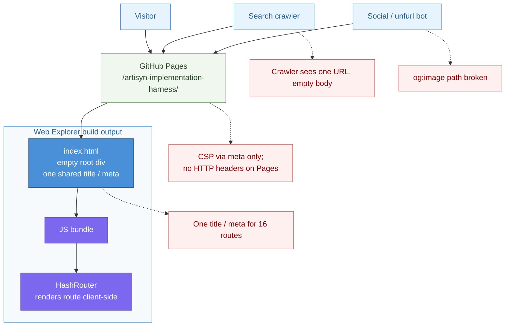

# DESIGN-20261121-UU4L — Web Explorer Next.js Static Export

## Problem

Web Explorer renders all 16 routes in the browser from one empty HTML page, so search crawlers and link-unfurl bots see one URL with no content.

Web Explorer is the public promo app at the GitHub Pages project-site root. It is a React 19 + Vite single-page app. All 16 routes (`/`, the `/inside-the-loop` hub plus 10 detail pages, `/docs-flow`, `/get-started`, `/dogfood`, `/comic`) render client-side under a `HashRouter`. They all come from one `index.html` whose body is an empty `
`.

- Search crawlers treat everything after `#` as the same URL. Only one page is indexable.
- Crawlers and link-unfurl bots that do not run JavaScript see no content.
- Every route shares one `<title>`, description and Open Graph block.
- `og:image` is the root-relative `/social-preview.png`. It has neither the `/artisyn-implementation-harness/` base path nor an absolute URL. Social previews are very likely broken today (to verify in Research).
- There is no canonical URL, Twitter/X card, sitemap or `robots.txt`.
- Security policy is a single `<meta http-equiv="Content-Security-Policy">` with `script-src 'self'`.

**Why now:** the harness ships publicly through five release channels, and this page is its front door. Discoverability and shareable previews of each page now matter.

**Current state:**

## Success

The design succeeds when every route is a pre-rendered static page with its own metadata, still served by GitHub Pages.

### Known ECs

From the developer's request, 2026-11-21.

- EC1: Web Explorer is built with Next.js. Every route is pre-rendered at build time to static HTML (SSG) and served at real path URLs instead of hash routes.
- EC2: Each static page has its own title, description and social meta (Open Graph and Twitter/X card), plus SEO basics such as a canonical URL.
- EC3: Front-end security headers (CSP and the other protections normally sent as headers) are defined and enforced for every page, within what GitHub Pages can deliver.
- EC4: Performance is preserved or improved against the current Vite build: first-load JS for the landing page, and Core Web Vitals (LCP, CLS, INP) of the exported pages.
- EC5: Hosting stays on GitHub Pages. Web Portal still composes the site with Web Docs under `/docs/`, and the existing `deploy-web.yml` workflow still deploys it.
- EC6: The refactoring the migration needs is identified and scoped: client/server component boundaries, code that touches browser APIs during pre-render, the router replacement, and build tooling (Nx targets, Tailwind, the build-time harness version).

### Proposed ECs

- [proposed] EC7: Existing links keep working. Old hash URLs (for example `/#/get-started?channel=…&provider=…` and `/#/inside-the-loop/…`) redirect client-side to the new path URLs. The `/get-started` shareable configuration keeps round-tripping through the URL.
- [proposed] EC8: The build generates crawl infrastructure: `sitemap.xml`, `robots.txt`, absolute canonical URLs on the project-site URL, an exported 404 page, and an explicit index/noindex decision for the unlinked `/comic` page.
- [proposed] EC9: The build verifies itself. CI fails if any exported page lacks a title, description or social image, if the CSP does not cover an inline script, or if the landing page exceeds its redefined bundle budget.
- [proposed] EC10: No regressions and a clean rollback. Accessibility requirements (`Non-Functional Concerns/Accessibility.md`) and NFR-7 still hold. The Nx project name and target names (`build`, `typecheck`, `lint`) stay the same. The switch-over lands as one revertable change.
- EC11 (added by the developer, 2026-11-22): The site stays within GitHub Pages' published limits, recorded as a new NFR: published site ≤ 1 GB (hard); each deployment finishes within 10 minutes (hard); bandwidth within the 100 GB/month soft limit; no reliance on custom response headers or request-time server code; GitHub's rate limiting (HTTP 429) is tolerated; use stays within GitHub Pages' permitted uses (no commercial/SaaS hosting, no sensitive transactions). Source: docs.github.com/en/pages/getting-started-with-github-pages/github-pages-limits.

## Decisions

Each of the two decisions below gets its own Research → Evaluate → Solution loop. Performance (EC4), the refactoring scope (EC6) and GitHub Pages limits (EC11) are evaluation criteria applied across both, not decisions of their own. The developer fixed the framework (Next.js) and the host (GitHub Pages); neither is a decision here. SEO and social metadata were merged into Decision 1 at the developer's request on 2026-11-21, because the router choice largely sets the metadata API.

| #   | Decision                                                                                                                                                                                                                                                                                                                                                                                                                                                                                                                                                                                                                                 | Why it's independent                                                                                                                                                                                                                                                                         |
| --- | ---------------------------------------------------------------------------------------------------------------------------------------------------------------------------------------------------------------------------------------------------------------------------------------------------------------------------------------------------------------------------------------------------------------------------------------------------------------------------------------------------------------------------------------------------------------------------------------------------------------------------------------- | -------------------------------------------------------------------------------------------------------------------------------------------------------------------------------------------------------------------------------------------------------------------------------------------- |
| 1   | **Rendering, routing and page metadata.** How Next.js produces the static export: App Router vs Pages Router under `output: 'export'`, where the client/server component boundary sits, base path and trailing-slash URL scheme, how today's lazy route chunks map, and how old hash URLs reach the new paths. Also: where each page's title, description, canonical URL and social tags are defined; how social images are produced (one shared image, hand-designed per page, or generated at build time); and how sitemap, robots and structured data are produced within NFR-7. Covers EC1, EC2, EC4, EC6, EC7, EC8 and part of EC9. | Its options are router, rendering and metadata models. The router choice largely decides which metadata API is used, so they are evaluated together. They can be approved on build output, URL shape, crawlability and refactoring cost, whatever security approach is chosen.               |
| 2   | **Security header delivery on GitHub Pages.** How CSP and the other header protections reach the browser when Pages cannot set response headers: a `<meta>` CSP with build-time script hashes, a looser `<meta>` policy, or an edge layer in front of Pages that adds real headers. Covers EC3 and part of EC9.                                                                                                                                                                                                                                                                                                                          | Its options are delivery mechanisms and policy strictness. The trade-off (protection strength vs hosting simplicity) holds for any rendering choice. Only the list of inline scripts to hash depends on Decision 1 (including any structured-data script); that is an input, not a coupling. |

## Boundaries

This design covers Web Explorer's framework, build, URLs, metadata, security policy and performance; Web Docs and hosting stay as they are.

| In scope                                                                                                                               | Out of scope                                                                   |
| -------------------------------------------------------------------------------------------------------------------------------------- | ------------------------------------------------------------------------------ |
| Web Explorer's framework, build, routing and URL scheme (`apps/web-explorer/`)                                                         | Web Docs (VitePress) itself, beyond staying compatible with the composed site  |
| Per-page metadata, social images, sitemap, robots, canonical URLs                                                                      | Content and copy changes to existing pages; visual redesign                    |
| The front-end security policy for Web Explorer pages, including any change to how GitHub Pages delivers it                             | Moving hosting off GitHub Pages, or adding a server runtime at request time    |
| Performance budget and how it is measured                                                                                              | Analytics, tracking and cookie consent                                         |
| The refactoring the migration forces in existing components                                                                            | Internationalisation                                                           |
| Web Portal's composition step and `deploy-web.yml`, only as far as the new build output requires                                       | Brand approval of the logo assets (tracked separately in the Web Explorer LLD) |
| HLD/LLD/NFR doc updates this change implies: Web Explorer, Web Portal, System Overview wording on "no server-side rendering", new NFRs | —                                                                              |

## Constraints

GitHub Pages serves static files only, and every choice must fit that host.

| #   | Constraint                                                                                                                                                                                                                                                                               | Status                   |
| --- | ---------------------------------------------------------------------------------------------------------------------------------------------------------------------------------------------------------------------------------------------------------------------------------------- | ------------------------ |
| 1   | GitHub Pages serves static files only. It cannot set custom response headers or rewrites. It serves `dir/index.html` for `/dir/`, and one root `404.html` for the whole project site, which includes Web Docs under `/docs/`.                                                            | Resolved                 |
| 2   | The site is a project site under the base path `/artisyn-implementation-harness/`. Next.js must be configured with that base path.                                                                                                                                                       | Resolved                 |
| 3   | Web Portal copies Web Explorer's output to the artifact root and Web Docs's output under `docs/`. Web Explorer must not emit anything under `docs/`. Its assert on `dist/index.html` changes with the new output folder.                                                                 | Resolved                 |
| 4   | Next.js puts assets under `_next/`. Whether GitHub Pages' Jekyll processing drops underscore folders when deploying through `actions/deploy-pages`, and so whether `.nojekyll` is needed, is unverified.                                                                                 | To verify in Research    |
| 5   | System Overview design principle: "Content is static — no server-side rendering … no runtime compute we operate". Build-time pre-rendering fits the intent, but the wording must be clarified. Request-time compute stays forbidden.                                                     | Resolved                 |
| 6   | NFR-7: no `dangerouslySetInnerHTML` or raw `<script>` in source. This conflicts with the usual way of emitting JSON-LD structured data.                                                                                                                                                  | Open — Research resolves |
| 7   | Root Yarn workspace and single lockfile; `yarn`, never `npm`/`npx`. Node 24 (nvm). React 19 and Tailwind CSS 4 stay. Tailwind moves from `@tailwindcss/vite` to a PostCSS-based integration.                                                                                             | Resolved                 |
| 8   | `__HARNESS_VERSION__` is read at build time from `skills/implementation-harness/package.json`, an input of the Nx `build` target. It must keep working.                                                                                                                                  | Resolved                 |
| 9   | The prior approved design `[DESIGN-20261108-1L8P] Web Explorer Landing Page & Web Portal Site Routing` chose `HashRouter`. This design supersedes that routing decision.                                                                                                                 | Resolved                 |
| 10  | Deploys run only through `deploy-web.yml` on push to `main`. `git push` is a guarded command the developer runs.                                                                                                                                                                         | Resolved                 |
| 11  | GitHub Pages limits (EC11). Verified 2026-11-22: published site 86 MB of 1 GB (Web Explorer 19 MB, Web Docs 66 MB); last 3 `deploy-web.yml` runs took ~70–75 s end to end vs the 10-minute deployment timeout; the 10 builds/hour soft limit does not apply to custom Actions workflows. | Resolved                 |

## Sizing

The migration covers 16 pre-rendered pages from about 80 source files.

| Dimension                 | Estimate                                                                                     | Source                         |
| ------------------------- | -------------------------------------------------------------------------------------------- | ------------------------------ |
| Pages to export           | 16 routes (1 landing, 1 hub + 10 detail, `/docs-flow`, `/get-started`, `/dogfood`, `/comic`) | `src/main.tsx`, LLD            |
| Source size               | ~80 files, ~9.9k lines; 7 files use browser APIs, 4 use router hooks                         | code scan, Report Evidence     |
| Landing first-load budget | 600 KB raw JS+CSS; currently 472,500 bytes                                                   | `check-bundle-budget.mjs`, LLD |
| Traffic                   | Unknown; public promo site, low request volume, served by GitHub Pages CDN                   | —                              |
| Relevant NFR target       | Site is public, no access gate; NFR-7, NFR-11                                                | Requirements.md                |

## Links

- Ticket: DESIGN-20261121-UU4L (local design ID, no tracker ticket)
- Related tickets: none
- Reference docs:
  - `docs/Target Architecture (HLD)/v1/Containers/Web Explorer.md`
  - `docs/Target Architecture (HLD)/v1/Containers/Web Portal.md`
  - `docs/Target Architecture (HLD)/v1/System Overview.md`
  - `docs/Target Architecture (HLD)/v1/Non-Functional Concerns/Requirements.md`
  - `docs/System Architecture (LLD)/Web Explorer/00. Overview.md`
  - Prior design: `docs/Stories/design/approved/[DESIGN-20261108-1L8P] Web Explorer Landing Page & Web Portal Site Routing/`
