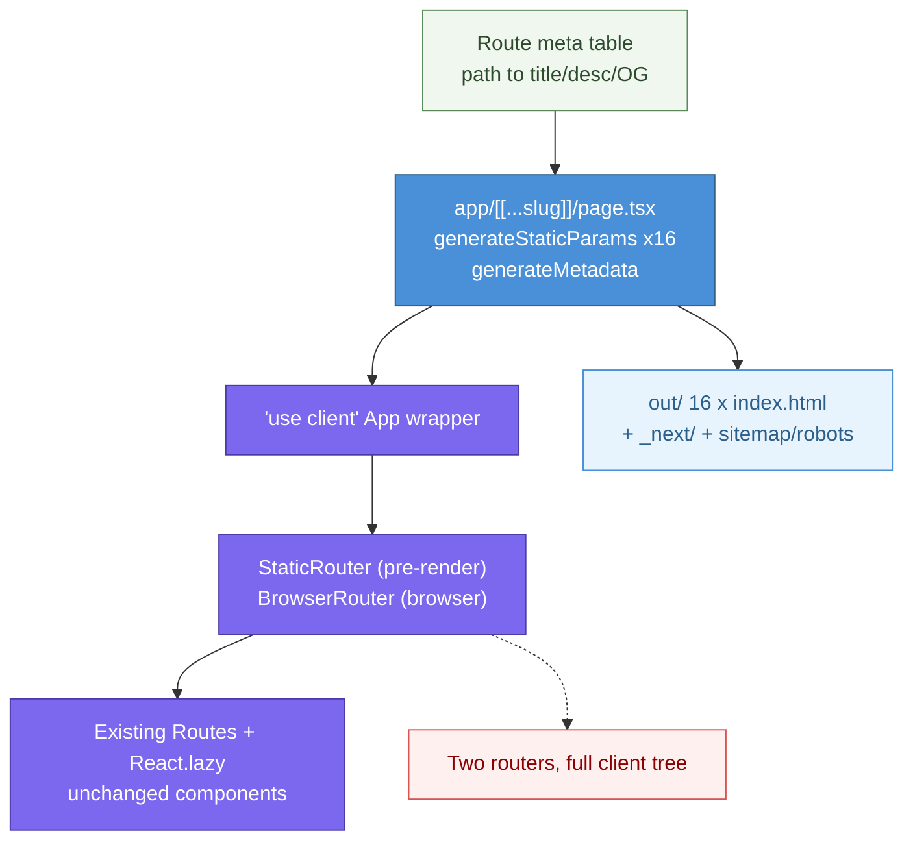
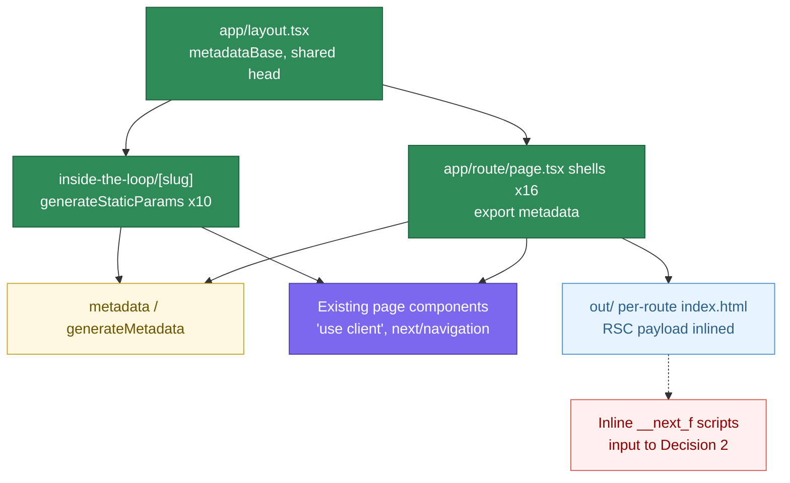
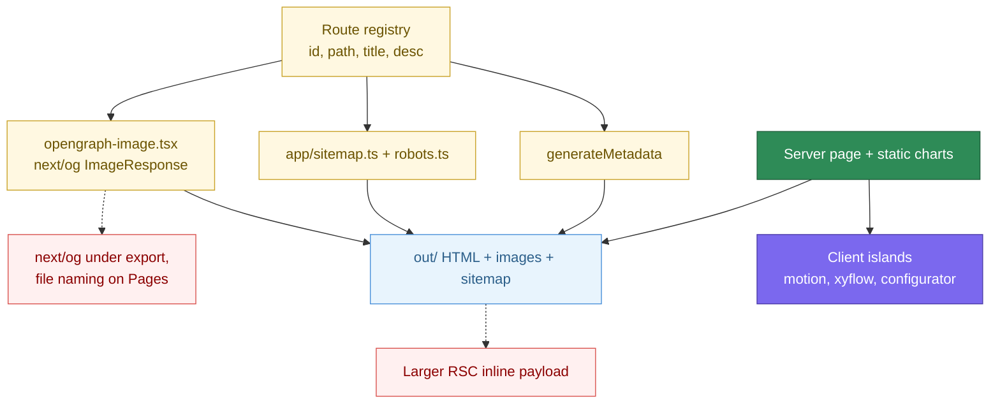
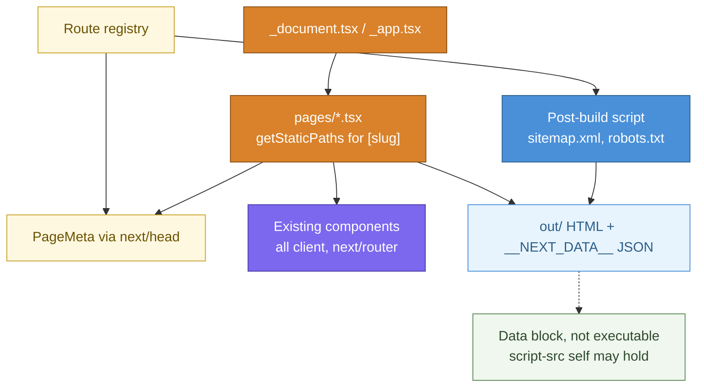

# DESIGN-20261121-UU4L: Rendering, Routing and Page Metadata — Research

_Produced by the 🔍 Research phase. Owned by `@architect`. Do not edit after Evaluate phase begins._

## Context

This research covers Decision 1 from `00 Frame.md`: how Next.js produces the static export, how routing changes, and where each page's metadata comes from. It covers EC1, EC2, EC4, EC6, EC7, EC8 and part of EC9.

### Legend

| Tag | Meaning                                                                         |
| --- | ------------------------------------------------------------------------------- |
| [V] | Verified in this repo                                                           |
| [K] | From the architect's own Next.js 15.x–16.0 knowledge; not verified in this repo |

### Verified repo facts

- [V] `react-router-dom` is imported in 9 files: `main.tsx`, `Header.tsx` (Link), `SectionLink.tsx` (useLocation/useNavigate), `Landing.tsx` (Link/useLocation, router state `scrollTo`), `GetStarted.tsx` (`useSearchParams`, line 140), `InsideTheLoopRoutes.tsx` (nested Routes), `InsideTheLoopLayout.tsx` (Outlet), `InsideTheLoopNav.tsx` (useNavigate), `InsideTheLoopDetailPage.tsx` (Link).
- [V] Most browser-API use is in effects or handlers and is safe to pre-render: `Modal`, `SectionLink`, `Landing` (clipboard, scroll), `Comic` (scroll), `GetStarted` (clipboard).
- [V] Two hydration-mismatch risks read `window.matchMedia('(prefers-reduced-motion)')` during render: `HeroPreview.tsx:89` and `TerminalScenarios.tsx:40`. The pre-render returns false; a reduced-motion browser returns true. Both must move into an effect or `useSyncExternalStore`.
- [V] `import.meta.env.BASE_URL` appears 7 times in 5 files (`Header`, `01-requirements`, `03-harness`, `InsideTheLoopHub`, `Comic`). Plain `` is not auto-prefixed with `basePath` [K], so these need a shared constant.
- [V] `env.ts` reads `VITE_REPO_URL` and `VITE_DOCS_URL` (both have defaults); they become `NEXT_PUBLIC_*` or constants. `deploy-web.yml` passes neither. `tsconfig.json` has `types: ["vite/client"]`.
- [V] About 20 of ~70 TSX files use hooks, `onClick` or `motion.`; only 3 of 22 `src/charts/*` do. `@xyflow/react` is used by `InsideLoopMap.tsx` and `docs-flow/flow.ts`/`DocsFlow`. `motion` is used only in `Landing.tsx`.
- [V] No root `404.html` today: `apps/web-portal/dist/` has none; VitePress's lands at `docs/404.html`. A Next-exported `404.html` would become the first root 404 for the whole project site, `/docs/` included.
- [V] No `.nojekyll` anywhere. `deploy-web.yml` calls `actions/configure-pages@v5` without `static_site_generator`; upload is `upload-pages-artifact@v4` of `apps/web-portal/dist`.
- [V] `portal-assemble.ts` copies `apps/web-explorer/dist` and asserts `index.html`. `check-bundle-budget.mjs` parses `dist/index.html` `src=`/`href=` refs and resolves via `/assets/`; under Next it fails because assets live under `_next/static/` and both `` tags per page plus a bootstrap, different on each page. Decision 2 must cover per-page inline-script hashes or a looser `script-src` [K].
- The one inside-the-loop chunk may re-split differently under `[slug]`; this must be measured.

**Unknowns / risks:**

- App Router baseline landing first-load JS (Next client runtime + React 19 ≈ 100 KB+ gzip, several hundred KB raw [K]) vs the current 472,500 bytes raw and the 600 KB budget.
- `/get-started` default selection pre-renders, then corrects (possible CLS).

**Refactoring footprint:** ~16 page shells + 2 layouts, 9 router files, 7 `BASE_URL` uses, 2 reduced-motion reads, `env.ts`, `globals.d.ts`, `main.tsx` deleted, `index.html` deleted (head moves to `layout.tsx` and metadata), same tooling files as A. About 35–40 files.

---

### Option C — App Router built around Server Components and file-based metadata (industry standard)

**Description:** Option B's route layout, plus Server Components by default. `'use client'` is pushed down to interactive leaves only: motion blocks, Hero/Terminal animations, Modal, xyflow charts via `next/dynamic` from a client component, the GetStarted configurator, copy buttons. Static charts and content stay server-rendered with no component JS ([V] 19 of 22 `src/charts/*` and ~50 of ~70 TSX files have no hooks, handlers or motion). A single route registry (id, path, title, description, image) drives `generateMetadata`, `app/sitemap.ts`, `app/robots.ts`, and each route's `opengraph-image.tsx`/`twitter-image.tsx`. Those use `ImageResponse` from `next/og` to generate one image per route at build time. `app/not-found.tsx` becomes `404.html`. Structured data comes without `dangerouslySetInnerHTML`: schema.org microdata attributes on existing markup, or JSON-LD injected by a post-build step (see sub-choices).

**Industry precedent:** Next.js "Server and Client Components"; metadata file conventions `opengraph-image`, `sitemap.xml`, `robots.txt`; `ImageResponse`; the "JSON-LD" guide (nextjs.org/docs/app/guides/json-ld), which itself uses `dangerouslySetInnerHTML`, conflicting with NFR-7, so a workaround from the sub-choices is needed. vercel.com and nextjs.org use this model.

**Diagram:**

**Pros:**

- Smallest client JS potential of the four.
- Metadata, sitemap and robots share one source of truth.
- Per-page generated social cards with no per-page design work.
- Matches current Next.js guidance.

**Cons:**

- Largest refactor. The client/server split is audited in every component, and props crossing the boundary must be serialisable.
- `next/og` uses Satori: limited CSS, fonts bundled locally.
- Same RSC inline-payload concern for Decision 2 as B. The payload is larger because Server Component output is serialised.
- Two mental models for contributors.

**Unknowns / risks:**

- Whether `opengraph-image.tsx` prerenders under `output: 'export'` (older versions needed `export const dynamic = 'force-static'`).
- Exported file name and extension. It is served at `/opengraph-image`, with a hash query in some versions. Pages serves extension-less files with a generic content type, which some unfurl bots reject.
- Whether `og:image` includes `basePath` and the absolute `metadataBase`.
- Whether `metadata.icons` strings get `basePath`.
- Whether `sitemap.ts`/`robots.ts` need `force-static` and honour `trailingSlash`.

**Refactoring footprint:** Everything in B, plus a boundary pass over all ~70 TSX files (~20 marked or split as client), a route registry, ~13 image routes (or one shared generator under `[slug]`), `sitemap.ts`, `robots.ts`, `not-found.tsx`. About 60–70 files.

---

### Option D — Pages Router with `next/head` and build-script crawl assets

**Description:** `pages/index.tsx`, `pages/get-started.tsx`, `pages/inside-the-loop/index.tsx`, `pages/inside-the-loop/[slug].tsx` (`getStaticPaths`), plus `docs-flow`, `dogfood` and `comic`. `pages/_app.tsx` holds the shared layout and global CSS. `pages/_document.tsx` holds `<html lang>`, fonts and the CSP meta. `pages/404.tsx` becomes `404.html`. Each page sets title, description, canonical, OG and Twitter via `next/head`, fed by a shared route registry and a small `<PageMeta>` component. There is no `metadataBase`, so absolute URLs are built from one constant. `sitemap.xml`/`robots.txt` come from a Node script after `next build` (or are committed to `public/`). Components stay client as today; no `'use client'` is needed. Router: `next/link`; `useRouter()` from `next/router` (`router.query` is empty on first render under export until `router.isReady`).

**Industry precedent:** Next.js Pages Router "Static HTML Export" (nextjs.org/docs/pages/guides/static-exports), `next/head`, `getStaticPaths`, "Custom Document"; many pre-App-Router GitHub Pages Next sites; GitHub's `pages/nextjs.yml` starter (works for both routers).

**Diagram:**

**Pros:**

- Component code closest to today.
- On CSP, page props go in `<script id="__NEXT_DATA__" type="application/json">`, a non-executable data block that `script-src` does not govern. No other executable inline scripts are known by default. Today's `script-src 'self'` may hold unchanged, shrinking Decision 2's scope [K, to verify on a real build].
- Mature, well-documented static export.

**Cons:**

- Pages Router is in maintenance; new features target the App Router. This is a long-term direction risk.
- No file-based metadata, sitemap, robots or `next/og` conventions; all hand-built.
- Every page hydrates its full tree; no Server Component saving.
- `router.query` is empty at hydration: the same correction-on-load issue.

**Unknowns / risks:**

- Pages Router baseline first-load JS ≈ 85–90 KB gzip, smaller than App Router [K]. It must be measured against the 600 KB raw budget.
- Whether Next 16 still fully supports `output: 'export'` with the Pages Router (believed yes; check against the pinned version).
- Whether `_document.tsx` head injection adds any inline script.

**Refactoring footprint:** ~14 page files, `_app`, `_document`, `404`, 9 router files, 7 `BASE_URL` uses, 2 reduced-motion reads, `env.ts`, `globals.d.ts`, a `<PageMeta>` component, route registry, post-build crawl-assets script, tooling files as in A. About 35–40 files.

---

## Sub-choices that apply to any option

Each concern below has variants that combine with any option above.

| Concern                 | Variants                                                                                                                                                                                                                                                                                                                     | Notes                                                                                                                                                                                        |
| ----------------------- | ---------------------------------------------------------------------------------------------------------------------------------------------------------------------------------------------------------------------------------------------------------------------------------------------------------------------------- | -------------------------------------------------------------------------------------------------------------------------------------------------------------------------------------------- |
| Social image            | (1) one shared static image at an absolute URL; (2) hand-designed PNG per page in `public/`; (3) `next/og` `ImageResponse` metadata routes (App Router only); (4) a build script (Satori + resvg, or a Playwright screenshot of each exported page) writing PNGs into `out/`                                                 | [V] Today's `og:image` is root-relative `/social-preview.png`, with no base path or host, so previews are broken. Brand assets are not yet brand-approved for public use (Web Explorer LLD). |
| Sitemap / robots        | `app/sitemap.ts`/`app/robots.ts` (App Router); a post-build Node script; static committed files                                                                                                                                                                                                                              | `/comic` needs an explicit noindex choice: leave it out of the sitemap and/or `robots: { index: false }`.                                                                                    |
| Structured data (NFR-7) | (1) none; (2) schema.org microdata attributes on existing markup — no script, Google supports it [K]; (3) a post-build step injects `<script type="application/ld+json">` into exported HTML — source stays script-free, and the JSON is a data block `script-src` does not govern; (4) an NFR-7 exception for typed JSON-LD | External `src` JSON-LD is not read by Google [K], so it is not an option.                                                                                                                    |
| Hash back-compat        | external `public/*.js` loaded early, or a client `useEffect` on `/`                                                                                                                                                                                                                                                          | The external file keeps `'self'`; the effect version briefly flashes the landing first.                                                                                                      |
| URL form                | `trailingSlash: true` (`dir/index.html`) or `false` (`name.html`)                                                                                                                                                                                                                                                            | Both served by Pages; canonicals and sitemap must match.                                                                                                                                     |

## Open Questions

_V/E tiers are proposed at Research and confirmed at the Research sign-off._

| #     | Question                                                                                                                                                                                                                                                    | V/E | Why this tier                                                                                                        | Owner          |
| ----- | ----------------------------------------------------------------------------------------------------------------------------------------------------------------------------------------------------------------------------------------------------------- | --- | -------------------------------------------------------------------------------------------------------------------- | -------------- |
| OQ-1  | Does `actions/deploy-pages` (Actions-sourced artifact) skip Jekyll so `_next/` is served without `.nojekyll`? [K: yes, Jekyll runs only for branch-sourced Pages; unverified.] [V] No `.nojekyll` exists.                                                   | (E) | Adding `.nojekyll` costs nothing either way; no option is removed.                                                   | Implementation |
| OQ-2  | For the pinned Next version, does `opengraph-image.tsx`/`ImageResponse` prerender under `output: 'export'`, with what file name/extension, and does `og:image` carry `basePath` and `metadataBase`? Needs a one-route spike.                                | (E) | Affects only social-image variant (3); variant (4) produces the same result if it fails. No option is removed.       | Evaluate spike |
| OQ-3  | The exported `404.html` becomes the 404 for `/docs/*` misses too. Acceptable, or should Web Portal drop/replace it, or add a docs-aware link?                                                                                                               | (E) | Composition detail; same for every option.                                                                           | Developer      |
| OQ-4  | `/get-started` reads the query after hydration (Suspense in App Router, `router.isReady` in Pages Router). Is a first paint with the default channel/provider, then a correction, acceptable for CLS and accessibility (focus or live-region announcement)? | (E) | Same behaviour in every option; affects detail.                                                                      | Developer      |
| OQ-5  | Real landing first-load JS per option, and how the budget is redefined (framework + main + layout + page chunks referenced by `out/index.html`, raw or gzip). `check-bundle-budget.mjs` must parse `_next/static/` refs. Needs a measured spike.            | (E) | Scores EC4 in the matrix; the budget is redefined with this design, so no option is removed outright.                | Evaluate spike |
| OQ-6  | Exact inline-script list per option from a real `out/` build (App Router `self.__next_f.push` + bootstrap per page; Pages Router: is `__NEXT_DATA__` the only one?).                                                                                        | (E) | Input to Decision 2's sizing (its OQ-4); does not remove a Decision 1 option.                                        | Evaluate spike |
| OQ-7  | Pinned Next version and builder: Next 16 defaults to Turbopack [K]. Confirm Tailwind 4 via `@tailwindcss/postcss`, the `__HARNESS_VERSION__` define (`next.config` `env` or a generated module), Node 24.                                                   | (E) | Implementation detail common to all options.                                                                         | Implementation |
| OQ-8  | Are `metadata.icons` and plain `` auto-prefixed with `basePath`? [K: plain `` is not; unsure for icons.] Affects 7 `BASE_URL` sites and favicons.                                                                                             | (E) | Same fix in every option.                                                                                            | Implementation |
| OQ-9  | Option A only: is `StaticRouter`/`BrowserRouter` hydration under a Next catch-all a supported, stable pattern? It departs from the official guide, which uses `ssr: false` (empty HTML, fails EC1).                                                         | (V) | If not stable, Option A cannot meet EC1 and drops out. Option A is marked **conditional** until a spike resolves it. | Evaluate spike |
| OQ-10 | Does the Nx output move from `dist` to `out` (changing `project.json` `outputs` and `portal-assemble.ts`), or is `dist` kept? `distDir` changes `.next`, not the export folder [K].                                                                         | (E) | Tooling detail common to all options.                                                                                | Implementation |
